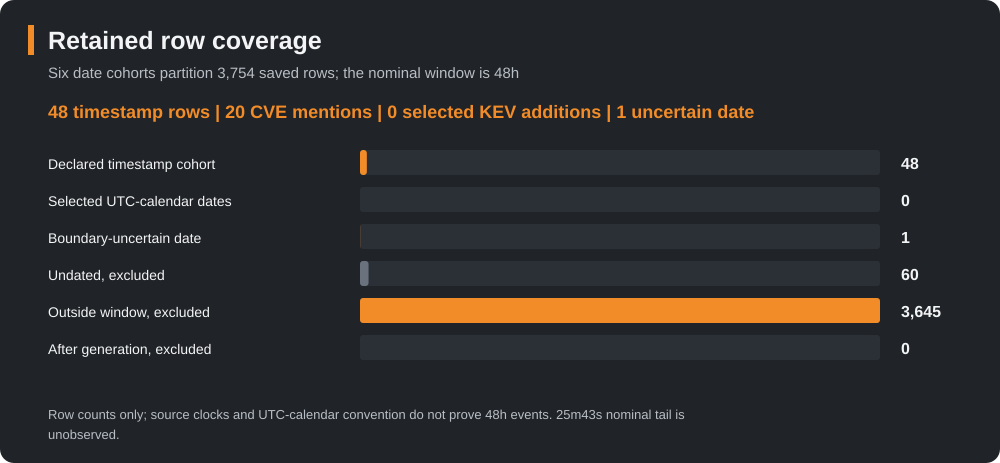
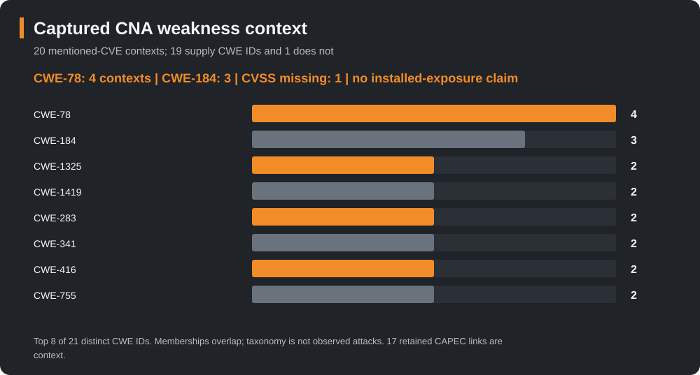
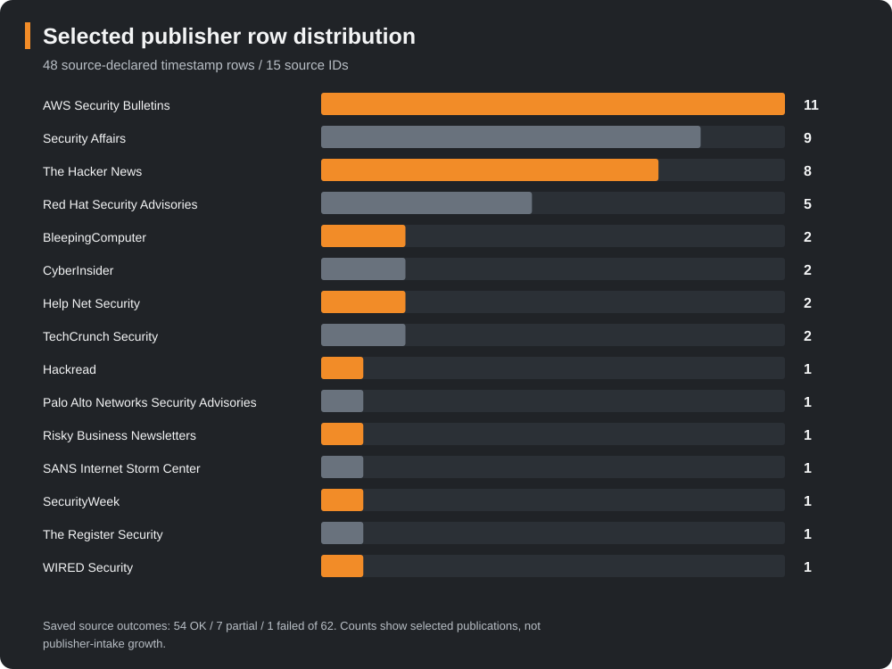

# Daily intelligence briefing: 25 October 2026, 22:00 CDT

Edition **SW-DAILY-2026-10-25-2200-CDT** · **Partial / selected source subset** · Actual compilation **2026-10-26T07:21:59.704713+00:00** (late).

The nominal weekend window is **[2026-10-24 03:00Z, 2026-10-26 03:00Z)**, 48 elapsed hours (23 October 22:00 through 25 October 22:00 America/Chicago). The next nominal opportunity is **26 October 06:00 CDT / 11:00Z**; scheduling does not guarantee publication. This first nominal edition was compiled after its cutoff.

## 1. Executive summary

The retained snapshot yields **48 source-declared timestamp rows from 15 source IDs**, mentioning **20 unique CVEs**. Those figures count selected publications and CVE mentions, including discussion of older issues. They do not count new disclosures or incidents. There are **zero selected-period KEV-addition rows**, while **three mentioned CVEs were already KEV-listed** in captured context.

PHP applicability and publisher guidance merit close review: upstream fixed releases, vendor backports, SAPI conditions and a separate later follow-up must stay distinct. AWS bulletin rows add MCP/read-only-validation and runtime dependency leads. Collabora and Arista reporting connects to older CISA catalog dates. Supply-chain and AI stories remain attributed reporting leads rather than newly verified compromise findings.

The snapshot was generated **2026-10-26 02:34:17+00:00** and captured **02:49:33.444752–02:49:34.625644+00:00**. The **25m43s** between generation and nominal 03:00Z is unobserved. Later compilation cannot fill that tail.

| Date cohort | Rows | Unique CVE mentions |
|---|---:|---:|
| Source-declared timestamp cohort | 48 | 20 |
| Selected UTC-calendar dates | 0 | 0 |
| Boundary-uncertain date | 1 | 0 |
| Undated, excluded | 60 | 141 |
| Outside window, excluded | 3,645 | 2,031 |
| After generation, excluded | 0 | 0 |

The date-only row is a Debian libheif advisory dated 24 October with no retained CVE links. UTC-calendar classification is a reporting convention, without a guaranteed publisher timezone or hour. The boundary row stays separate. CVE unions overlap across cohorts and cannot be added. Outside and undated row lists are excluded from this public projection.

## 2. Selected notable developments

### PHP: patch evidence and deployment conditions

Selected publication rows include a [Palo Alto Networks applicability advisory](https://security.paloaltonetworks.com/CVE-2026-109618) and reporting about the initial PHP pair. Retained PHP context, dated 21 October, lists upstream **8.5.12, 8.4.27, 8.3.36 and 8.2.35**. Distribution/LTS fixes and 7.4/8.0/8.1 backports need package evidence; a numerically lower version alone does not settle patch status. [PHP notices](https://www.php.net/archive/2026.php).

The [OOM advisory](https://github.com/php/php-src/security/advisories/GHSA-w8hw-w9fx-j79w) describes a pre-application mod_php demonstration and qualifies other SAPI cases. The [request-state advisory](https://github.com/php/php-src/security/advisories/GHSA-6wmf-4rv5-p3rp) distinguishes demonstrated, candidate and configuration-dependent same-worker paths. The report has not checked any deployment's SAPI, worker reuse or patch provenance.

Retained [CISA guidance, revised 23 October](https://www.cisa.gov/news-events/alerts/2026/10/21/critical-vulnerabilities-php-require-immediate-patching), conditionally advises taking affected systems temporarily offline when immediate updating is unavailable or unsupported 8.1 and earlier PHP remains, until patched/updated. This is attributed conditional guidance, not an assessment of readers' systems.

The initial-pair release list does **not** establish a shipped fix for the separate **CVE-2026-115560** follow-up. Retained 23 October PHP context describes a planned regular release and a conditional `session.upload_progress.enabled=0` measure for an unusual serializer-switch path involving `ini_set()` before `session_start()`. That limited measure is not complete mitigation of the initial pair; later release/registry history was not established. [PHP follow-up context](https://www.php.net/archive/2026.php). This follow-up mention does not add a 21st CNA brief or alter the 20-CVE row denominator.

### Collabora and Arista: distinguish publication from catalog addition

Selected reporting discusses Collabora Built-in CODE Server and Arista VeloCloud Orchestrator. Captured CISA dates for both are **23 October**, before this window. The Collabora CNA affected range ends at `<26.4.303`; the loaded solution array is empty, so the range is not treated as a newly verified shipped fix. Review the [CVE record](https://www.cve.org/CVERecord?id=CVE-2026-110447) and its retained publisher references.

For Arista, retained publisher/CNA guidance names fixed VCO releases **5.2.3.18, 6.1.3.10 and 6.4.2.12**, within their respective trains. It also describes restricted administrative access and monitoring of suspicious administrator/outbound activity and webshells as interim controls. Apply the product/train and environment conditions in [Arista advisory 0199](https://www.arista.com/en/support/advisories-notices/security-advisory/24838-security-advisory-0199); no asset or remediation was verified here.

### AWS MCP and runtime advisories

Eleven AWS timestamp rows cover PostgreSQL/MySQL MCP input-validation and read-only-enforcement issues, Security Agent S3 ownership checks, OpenSearch Dashboards, Deep Java Library, Systems Manager Agent, projen, JDBC XML handling, Go SDK decoding and trust bundles. Their source clocks do not prove first disclosure during these 48 hours. The [PostgreSQL MCP bulletin](https://aws.amazon.com/security/security-bulletins/rss/2026-101-aws/) and the 20 structured CNA contexts in [data.json](data.json) retain individual affected/default/version conditions and reference links. Empty solution fields remain empty; a linked release/tag alone is not a newly verified universal fix.

Brotli context for [CVE-2026-111497](https://www.cve.org/CVERecord?id=CVE-2026-111497) names **1.0.10, 1.1.1 and 1.2.1** in the retained CNA solution; match the applicable upstream/vendor branch and bundled runtime. The [Go trust-bundle context](https://www.cve.org/CVERecord?id=CVE-2026-111943) retains **null CVSS and no supplied CWE**, rather than substituting zero severity or no weakness.

## 3. CISA KEV context

**0** catalog-addition rows qualify in the selected timestamp/calendar cohorts. The captured CNA context still has these **3 already-listed CVEs** among the 20 mentioned IDs:

| CVE | Catalog addition date | CISA due-date field | Ransomware field |
|---|---|---|---|
| CVE-2026-106931 | 2026-10-20 | 2026-10-23 | Unknown |
| CVE-2026-110447 | 2026-10-23 | 2026-10-26 | Unknown |
| CVE-2026-114625 | 2026-10-23 | 2026-10-26 | Unknown |

The due-date fields are catalog/federal-directive data, not deadlines assigned to this site's readers. “Unknown” ransomware status does not establish absence. Catalog addition dates do not identify first exploitation, incident or precise addition instants. See the retained [CISA catalog](https://www.cisa.gov/known-exploited-vulnerabilities-catalog?field_cve=CVE-2026-114625) references in data.json. The SiteGuard CVE appears as a retained mention/context, without inventing a new event.

## 4. Campaigns and actors

The supplied catalog retains **41 entities and 35 explicit relationships**, with their individual dates/confidence. Storm-0940/ConnectWise-linked campaign material cites [Microsoft's 21 October publication](https://www.microsoft.com/en-us/security/blog/2026/10/21/storm-0940-uses-artex-agentic-ai-connectwise-supply-chain-compromise/) and is **older background**. The dated catalog does not establish Storm-0940 activity in this report window. Shared weaknesses, aliases and co-mentions do not establish fresh actor activity or attribution.

## 5. Supply chain and AI

Retained reporting discusses [LiteLLM release-pipeline credentials](https://thehackernews.com/2026/10/leaked-litellm-master-key-let-attackers.html), [coding-agent instruction-file trust boundaries](https://www.bleepingcomputer.com/news/security/ai-coding-agents-hijacked-using-agentsmd-file-in-downloads-folder/) and [AI sandbox boundaries](https://thehackernews.com/2026/10/openai-ai-agents-demonstrate-vm-escapes.html). These are publisher-attributed leads drawn from admitted row metadata. No new primary-body review, device assessment or reproduction was performed for these leads. Their retained CVE arrays stay empty.

## 6. Watchlist and revision status

Prioritize exact vendor applicability, package/backport evidence and original advisory conditions before choosing changes. Keep the [Tailscale SSH reporting lead](https://thehackernews.com/2026/10/unpatched-tailscale-ssh-flaws-could-let.html) and the [Help Net Security recap](https://www.helpnetsecurity.com/2026/10/25/week-in-review-php-vulnerabilities-patched-exploited-palo-alto-globalprotect-vpn-flaw/) as unlinked CVE leads: neither row supplies a CVE identity, so none is inferred from its headline.

**Revision watch: partial; one refused initial attempt.** Citation metadata from **11 prior reports** contains **333 citation occurrences across 273 exact URLs**. That assessment did not establish prior request history or compatible security-field baselines; it was not a set of 273 article checks.

One initial request to the [previously cited AWS locator](https://aws.amazon.com/security/security-bulletins/rss/2026-107-aws/) returned **HTTP 301**. Redirects were disabled and no target was followed. No article body, qualified baseline or content comparison was established. The source route is held pending separate review, with **no automatic next-check time**.

This pass records **1 attempted locator, 0 qualified article checks and 0 semantic comparisons**. The remaining **272 URLs were not requested**. Neither changed nor unchanged content was established, and the earlier unknown-history assessment remains unchanged. The prior citation is recorded in the [October month-to-date report](https://github.com/TeamStarWolf/intelligence-hub/blob/main/reports/monthly/2026-10/README.md).

The next nominal report opportunity is **26 October 06:00 America/Chicago (11:00Z)**, followed by the configured **14:00 and 22:00 local** opportunities. These are report scheduling opportunities, not automatic checks of held sources or guarantees of delivery.

## 7. Mitigation and applicability checklist

| Area | Retained guidance | Evidence needed before action |
|---|---|---|
| PHP initial pair | Match upstream fixes or distribution/LTS/backport evidence; preserve SAPI/configuration prerequisites. | Actual package provenance, SAPI and deployment conditions. |
| PHP later follow-up | Treat the conditional serializer/upload-progress measure separately; shipped third-fix status is not established. | Current original vendor notice and exact configuration; no automatic setting change. |
| VeloCloud Orchestrator | Use the named fixed release for the applicable train; review publisher interim access/monitoring guidance. | Product/train match and authorized remediation verification. |
| Collabora Built-in CODE Server | Retain the CNA affected range and linked publisher guidance; no loaded solution text. | Correct product/packaging and publisher remediation statement. |
| Brotli / AWS / Go components | Use the individual CNA version/default-status records and cited vendor guidance; preserve missing data. | Actual dependency/build inventory and vendor-specific fix evidence. |

These are source-grounded review steps, not instructions that a device is affected or has been fixed. All 20 captured records are PUBLISHED/loaded ok, but metadata state is not an environment assessment.

## 8. CWE / CAPEC context

**19 of 20** captured CNA contexts supply weakness identifiers; **CVE-2026-111943** has none supplied. The 20 contexts contain **21 distinct CWE IDs**, with overlapping memberships. CWE-78 appears in 4 contexts and CWE-184 in 3; those are classifications, not observed attack counts.

Four supplied CWE catalog entities match CNA IDs. Three of those families have **17 explicit retained CWE-to-CAPEC catalogue links**: CWE-78, CWE-79 and CWE-89. The retained set has no matched edge for CWE-416; no global absence is inferred. Source versions and clocks remain in data.json. [MITRE CWE-78](https://cwe.mitre.org/data/definitions/78.html), [CWE-79](https://cwe.mitre.org/data/definitions/79.html) and [CWE-89](https://cwe.mitre.org/data/definitions/89.html) support taxonomy context only; CAPEC associations are not observed techniques or campaign attribution.

## 9. Source outcomes and limitations

The snapshot records **54 OK, 7 partial and 1 failed source**, across 62 source identities. The failed CISA-advisories source has no retained rows/last-success in this snapshot. Partial-source and last-good retention limits qualify coverage; a source status or 48-row selection is not an intake-growth or completeness claim.

Two publication links/headlines containing a byline name are withheld, and one tracked CNA reference is omitted whole. Their counted row/CVE membership is retained: **48 counted rows and 46 linked explicit rows** are different denominators. Public data uses short editorial labels. It contains no outside/undated raw lists, publisher intake objects or raw publisher summaries.

All inclusion clocks are source-declared metadata. The snapshot and nominal tail, retrospective discussion, overlap, missing CVE links, product conditions, current-as-captured CNA/KEV context and refused initial source attempt limit this edition. See the complete structured limitations in data.json.

## 10. Sources, primary first

Primary/context sources already present in the frozen analysis include [PHP notices](https://www.php.net/archive/2026.php), the two [PHP](https://github.com/php/php-src/security/advisories/GHSA-w8hw-w9fx-j79w) [advisories](https://github.com/php/php-src/security/advisories/GHSA-6wmf-4rv5-p3rp), the retained [CISA PHP alert](https://www.cisa.gov/news-events/alerts/2026/10/21/critical-vulnerabilities-php-require-immediate-patching), [Arista advisory 0199](https://www.arista.com/en/support/advisories-notices/security-advisory/24838-security-advisory-0199), official [CVE records](https://www.cve.org/CVERecord?id=CVE-2026-109618), AWS security bulletins, CISA catalog entries and MITRE taxonomy pages. Source-specific links, dates, versions and confidence come from the retained snapshot. The separate AWS request returned HTTP 301 and produced no qualified article body; it did not validate or replace the cited source content.

Selected publisher references throughout this report are attributed reporting. The complete deduplicated public citation list is in data.json; its link count is not a count of observed primary documents or incidents. Original input hash is recorded there for the frozen public feed, while private source proofs and provenance locators remain excluded.
