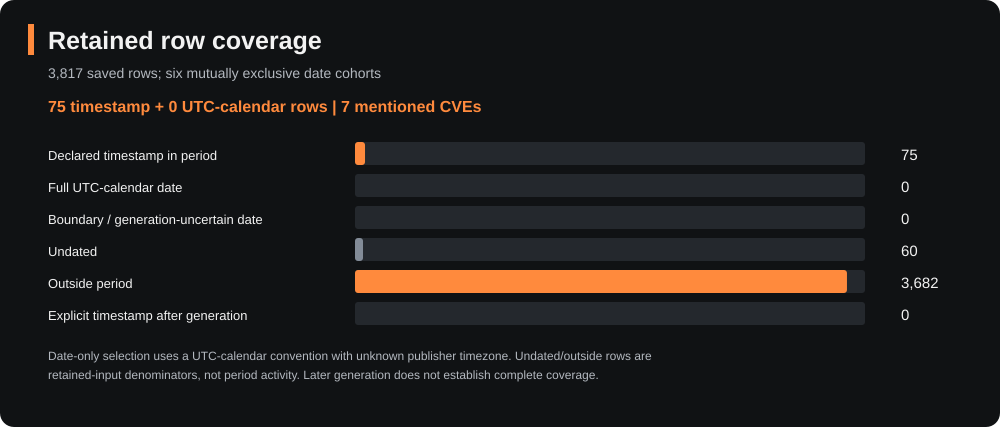
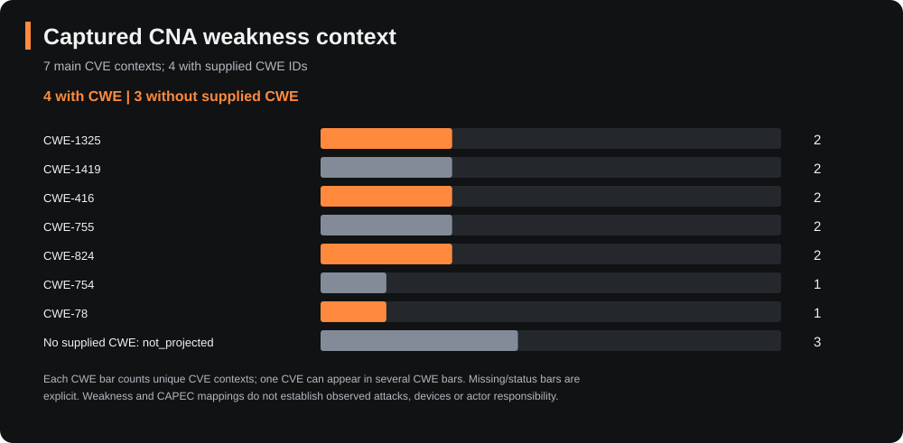
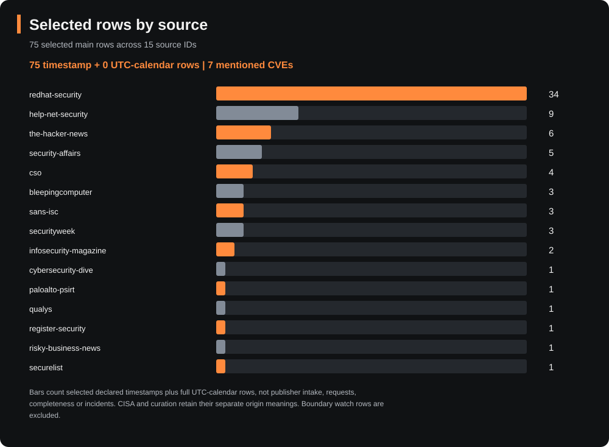

# Daily intelligence brief — 26 October 2026, 06:00 CDT

**Partial retrospective review.** Declared period: 2026-10-25T06:00:00-05:00 inclusive to 2026-10-26T06:00:00-05:00 exclusive (America/Chicago). The reporting opportunity was 26 October at 06:00 CDT / 11:00 UTC; this edition was compiled later.

## Executive summary

The main selection contains **75 source-declared timestamp rows**, with **7 unique CVE identifiers supplied by those rows**. The captured context marks **1** of the main mentioned CVEs as KEV-listed, while the selected period contains **0 source-declared CISA catalog-addition rows**. These are different measures; neither counts new exploitation events.

4 of 7 main CVE contexts have a successful loaded CNA status; 3 do not. CVSS is supplied for 4, and CWE IDs for 4. Missing enrichment stays unknown. Advisory rows without explicit CVE IDs are not assumed to contain no vulnerabilities.

The input was generated **996 seconds after this period ended**, then captured and analyzed later. It supports a retrospective selection of declared dates and bounded source/CNA context, **not an as-of-cutoff reconstruction**. This later snapshot cannot establish complete coverage at the cutoff. No new article checks or comparisons were performed in the revision pass.

## Dates and scope

| Clock | Recorded value |
| --- | --- |
| Period end, exclusive | 2026-10-26T11:00:00Z |
| Nominal reporting opportunity | 2026-10-26T11:00:00Z |
| Saved input generation | 2026-10-26T11:16:36+00:00 |
| Transport capture | 2026-10-26T12:11:03.087237+00:00 to 2026-10-26T12:11:04.706663+00:00 |
| Offline analysis complete | 2026-10-26T12:48:59.084465+00:00 |
| This compilation | 2026-10-26T13:36:45.448Z |
| Publication observation | Not assigned by this compilation |

Source publication/update/retrieval dates inside the records remain separate. Event dates do not drive selection. CISA dates mean catalog addition; due dates are catalog/federal data, not deadlines assigned to readers.

## Selected notable developments

### PHP: initial pair, deployment conditions and separate follow-up

The loaded PHP context separates the initial pair from a later conditional issue. Upstream release numbers do not settle distribution backports, and the SAPI/request prerequisites differ. The later follow-up must not inherit the initial pair’s shipped fixes.

Counted identifiers: [CVE-2026-109618](https://www.cve.org/CVERecord?id=CVE-2026-109618), [CVE-2026-109619](https://www.cve.org/CVERecord?id=CVE-2026-109619). References: [Source 1](https://www.cve.org/CVERecord?id=CVE-2026-109618); [Source 2](https://www.php.net/archive/2026.php); [Source 3](https://github.com/php/php-src/security/advisories/GHSA-w8hw-w9fx-j79w); [Source 4](https://github.com/php/php-src/security/advisories/GHSA-6wmf-4rv5-p3rp). Retained structured context; no new publisher-body check.

### SiteGuard: captured KEV context with a local, low-privilege metric

The CNA projection identifies SiteGuard product/version ranges and a CVSS 4.0 score of 8.5 with AV:L and PR:L. It must not be described as a generic remote unauthenticated issue. The captured KEV entry is dated October 20; that is catalog context, not a new incident here.

Counted identifiers: [CVE-2026-106931](https://www.cve.org/CVERecord?id=CVE-2026-106931). References: [Source 1](https://www.cve.org/CVERecord?id=CVE-2026-106931); [Source 2](https://www.cisa.gov/known-exploited-vulnerabilities-catalog?field_cve=CVE-2026-106931). Retained structured context; no new publisher-body check.

### Signal RingRTC: preserve the range and metric conditions

The retained record marks RingRTC versions below 2.72.0 as affected and supplies CVSS 4.0 9.3. Its vector and product statement are retained in data.json. The projection supplies no solution or workaround text, so the range boundary alone is not a verified shipped-fix claim.

Counted identifiers: [CVE-2026-113380](https://www.cve.org/CVERecord?id=CVE-2026-113380). References: [Source 1](https://www.cve.org/CVERecord?id=CVE-2026-113380). Retained structured context; no new publisher-body check.

## CISA catalog additions and captured KEV context

There are **zero selected-period catalog-addition rows**. That does not mean zero exploitation, zero incidents, or no KEV-listed products in the selected publications.

Captured KEV membership among the main mentioned CVEs: [CVE-2026-106931](https://www.cve.org/CVERecord?id=CVE-2026-106931). Catalog membership is later retained context, not evidence of first disclosure or current exposure.

## Product, version, CVSS and mitigation context

All **7** main CVE contexts, including complete bounded product/version statements, supplied solutions/workarounds, vectors, source clocks and limitations, are retained in [data.json](data.json). The index below is not a fixed-version or applicability determination. A range boundary is a fixed-release claim only when the source separately supplies that resolution. CVSS 3.0, 3.1 and 4.0 remain versioned metrics, not an operational risk ranking. A workaround object with null text or only a reference is not a usable workaround.

### PHP applicability and mitigation conditions

For the initial pair, the retained PHP notice lists upstream **8.2.35, 8.3.36, 8.4.27 and 8.5.12**. It also describes distribution/LTS fixes and minimal backports for 7.4, 8.0 and 8.1. A lower displayed version alone does not establish an unpatched package; vendor package/backport evidence remains necessary.

The source context distinguishes a pre-application mod_php demonstration from other SAPI susceptibility qualifications and configuration-dependent, same-worker request-state paths. Do not transfer the demonstration to every SAPI, configuration or installation. CISA’s retained conditional guidance concerns inability to update immediately or unsupported PHP 8.1 and earlier; it does not prove that every numerically older build is unpatchable.

The separate later follow-up must not inherit the pair’s shipped release list. The retained notice describes a planned regular-release fix and an interim upload-progress setting only for a particular session-serializer switch before session start. That measure is not complete mitigation of the initial pair, and these inputs do not establish a shipped third fix. CVE-2026-115560 remains failed/UNKNOWN in this CNA projection; separate publisher context does not fill its missing products, CVSS or registry state.

References: [Dated publisher context 1](https://www.php.net/archive/2026.php); [Dated publisher context 2](https://github.com/php/php-src/security/advisories/GHSA-w8hw-w9fx-j79w); [Dated publisher context 3](https://github.com/php/php-src/security/advisories/GHSA-6wmf-4rv5-p3rp); [Dated publisher context 4](https://www.cisa.gov/news-events/alerts/2026/10/21/critical-vulnerabilities-php-require-immediate-patching).

### Version statements worth distinguishing

- **[CVE-2026-106931](https://www.cve.org/CVERecord?id=CVE-2026-106931)** — EG Secure Solutions Inc. / SiteGuard Server Edition for Apache httpd; default unaffected; Ver2.20 to &lt; Ver8.00 Update 5 [affected; semver]; EG Secure Solutions Inc. / SiteGuard Server Edition for Nginx; default unaffected; Ver2.20 to &lt; Ver8.00 Update 5 [affected; semver]; EG Secure Solutions Inc. / SiteGuard Server Edition for IIS; default unaffected; Ver2.20 to &lt; Ver8.00 Update 5 [affected; semver]; EG Secure Solutions Inc. / SiteGuard Server Edition for Apache httpd on FreeBSD; default unaffected; Ver2.20 to &lt; Ver7.00 Update 6 [affected; semver]; EG Secure Solutions Inc. / SiteGuard Server Edition for Nginx on FreeBSD; default unaffected; Ver2.20 to &lt; Ver7.00 Update 6 [affected; semver]. CVSS 8.5 / v4.0. Its retained vector is AV:L/PR:L; do not call it generic remote unauthenticated exposure. No supplied solution text establishes a shipped fix here.

- **[CVE-2026-113380](https://www.cve.org/CVERecord?id=CVE-2026-113380)** — Signal / RingRTC; default unaffected; 0 to &lt; 2.72.0 [affected; semver]. CVSS 9.3 / v4.0. No supplied solution text establishes a shipped fix here.

### Main CVE context index

Product names are a compact index; full version/default-status statements remain in data.json. “KEV” means captured catalog membership. No missing record is treated as CVE-registry absence.

| CVE | Product index | CNA / state | CVSS score / version | Captured KEV | CWE IDs |
| --- | --- | --- | --- | --- | --- |
| [CVE-2026-104621](https://www.cve.org/CVERecord?id=CVE-2026-104621) | Not supplied | failed / UNKNOWN | Not supplied | Not supplied | Not supplied |
| [CVE-2026-104622](https://www.cve.org/CVERecord?id=CVE-2026-104622) | Not supplied | failed / UNKNOWN | Not supplied | Not supplied | Not supplied |
| [CVE-2026-106931](https://www.cve.org/CVERecord?id=CVE-2026-106931) | SiteGuard Server Edition for Apache httpd; SiteGuard Server Edition for Nginx (+3 more) | ok / PUBLISHED | 8.5 / v4.0 | Yes; 2026-10-20 | CWE-78 |
| [CVE-2026-109618](https://www.cve.org/CVERecord?id=CVE-2026-109618) | PHP | ok / PUBLISHED | 9.2 / v4.0 | Not supplied | CWE-416, CWE-755, CWE-824, CWE-1325, CWE-1419 |
| [CVE-2026-109619](https://www.cve.org/CVERecord?id=CVE-2026-109619) | PHP | ok / PUBLISHED | 9.2 / v4.0 | Not supplied | CWE-416, CWE-755, CWE-824, CWE-1325, CWE-1419 |
| [CVE-2026-113380](https://www.cve.org/CVERecord?id=CVE-2026-113380) | RingRTC | ok / PUBLISHED | 9.3 / v4.0 | Not supplied | CWE-754 |
| [CVE-2026-115560](https://www.cve.org/CVERecord?id=CVE-2026-115560) | Not supplied | failed / UNKNOWN | Not supplied | Not supplied | Not supplied |

## CWE and CAPEC context

4 of 7 main CVE contexts supply CWE IDs; 3 do not. One CVE may have several weakness IDs, so membership counts overlap. The retained catalog provides CWE 4.20 context where supplied. Qualified CAPEC 3.9 definitions are limited to 63, 66, 88, 115, 126 and 593; other retained names/mappings are not qualified definitions. A CNA weakness or taxonomy edge does not establish an observed exploit, attack pattern or actor.

| Supplied CWE | Unique main CVE memberships |
| --- | --- |
| CWE-1325 | 2 |
| CWE-1419 | 2 |
| CWE-416 | 2 |
| CWE-755 | 2 |
| CWE-824 | 2 |
| CWE-754 | 1 |
| CWE-78 | 1 |

Full membership and explicitly supplied taxonomy references are in data.json.

## Campaigns and actors

The retained Storm-0940/ConnectWise account is earlier background, outside this publication window. It is not a new daily/weekend event and is not evidence of actor responsibility for these CVE rows. No attribution is inferred from headlines, aliases or taxonomy links. The source was published October 21, updated October 23 and observed October 25; its event date is null. The observation clock is not an event or publication time. [Microsoft account](https://www.microsoft.com/en-us/security/blog/2026/10/21/storm-0940-uses-artex-agentic-ai-connectwise-supply-chain-compromise/).

## Supply chain, AI and watchlist

- **[Microsoft 365 token-replay reporting](https://thehackernews.com/2026/10/microsoft-365-token-replay-attacks.html)** — source-declared publication 2026-10-26T08:35:51+00:00. Publication metadata flags token-replay coverage; no tenant/account total or CVE association is verified here.

- **[AI coding-agent download risks](https://www.csoonline.com/article/4240222/malicious-downloads-can-trick-ai-coding-agents-into-compromising-themselves.html)** — source-declared publication 2026-10-26T10:35:08+00:00. An editorial lead on agent/download trust boundaries, not a confirmed vulnerability or assessed control.

- **[AI-agent deployment controls](https://securelist.com/tr/how-to-secure-ai-agents/121444/)** — source-declared publication 2026-10-26T10:00:18+00:00. Vendor reporting is a review lead, not evidence that a product prevents the reported threat.

- **[Runtime and compression update coverage](https://www.securityweek.com/node2shell-brotli-flaw-triggers-patching-across-microsoft-node-js-python-packages/)** — source-declared publication 2026-10-26T10:21:57+00:00. The row supplies no CVE association; no identifier or affected-version claim is inferred from its headline.

- **[AI-assisted coding quality tooling](https://www.helpnetsecurity.com/2026/10/26/google-elephant-goldfish-model-plugin/)** — source-declared publication 2026-10-26T04:25:59+00:00. A publication lead only; functionality, efficacy and security assurances were not independently checked.

**Next nominal opportunity: 26 October 2026 at 14:00 America/Chicago / 19:00 UTC.** This is a planned opportunity, not a completed check or an automatic request. Missing CNA guidance, source gaps and the prior held AWS route remain review items.

## Prior-source revision review

The shared 11:00 UTC metadata pass covers **462 citation occurrences**, **378 canonical URLs** and 12 prior reports. **377** histories remain unknown and **1** prior route remains held. It selected 0 sources, made **0 new requests**, and completed **0 qualified checks / 0 comparisons**. Material change is null, not a finding of no change. Unknown, held and not selected do not mean updated or unchanged. The held URI is not automatically followed or checked. 

## Coverage and limitations

The saved input contains 3817 article/catalog rows, 2180 CNA contexts and 62 sources. 60 rows have no primary date and 3682 are outside this period; neither raw list is published here. Source health in data.json uses only the eight approved public fields and may represent retained last-good input. This selection includes 34 Red Hat advisory rows; absent CVE metadata is not a claim that their advisories contain no CVEs. The main row count is independent of how many safe links remain.

- Publication clocks drive inclusion; event dates are context only.
- The source graph counts main declared-time/calendar rows, not publisher intake, requests, incident volume or completeness.
- Failed/UNKNOWN CNA enrichment, absent CVSS and null guidance stay unknown. Product conditions and supplier backports control applicability.
- Catalog addition dates and current KEV context are different from disclosure/exploitation times or environment exposure.
- Source claims, versions, confidence and dates stay attributed. No publisher body, device, patch or control efficacy was newly checked for this report.
- Overlapping periods and multi-CWE/CVE memberships must not be summed.
- Unsafe links and raw/private titles are omitted or replaced by neutral labels without changing date/CVE membership.

## Sources, primary first

Official CVE links appear in the complete context index above. The retained dated context and original-source references include:

- [Retained source 1](https://www.cve.org/CVERecord?id=CVE-2026-109618)
- [Retained source 2](https://www.php.net/archive/2026.php)
- [Retained source 3](https://github.com/php/php-src/security/advisories/GHSA-w8hw-w9fx-j79w)
- [Retained source 4](https://github.com/php/php-src/security/advisories/GHSA-6wmf-4rv5-p3rp)
- [Retained source 5](https://www.cisa.gov/news-events/alerts/2026/10/21/critical-vulnerabilities-php-require-immediate-patching)
- [Retained source 6](https://www.cisa.gov/known-exploited-vulnerabilities-catalog?field_cve=CVE-2026-106931)
- [Retained source 7](https://www.microsoft.com/en-us/security/blog/2026/10/21/storm-0940-uses-artex-agentic-ai-connectwise-supply-chain-compromise/)

The source classification identifies an original reference, not a new whole-document observation. The full deduplicated citation list and all main CVE context are in [data.json](data.json).

Prior edition: **SW-DAILY-2026-10-25-2200-CDT**. 
