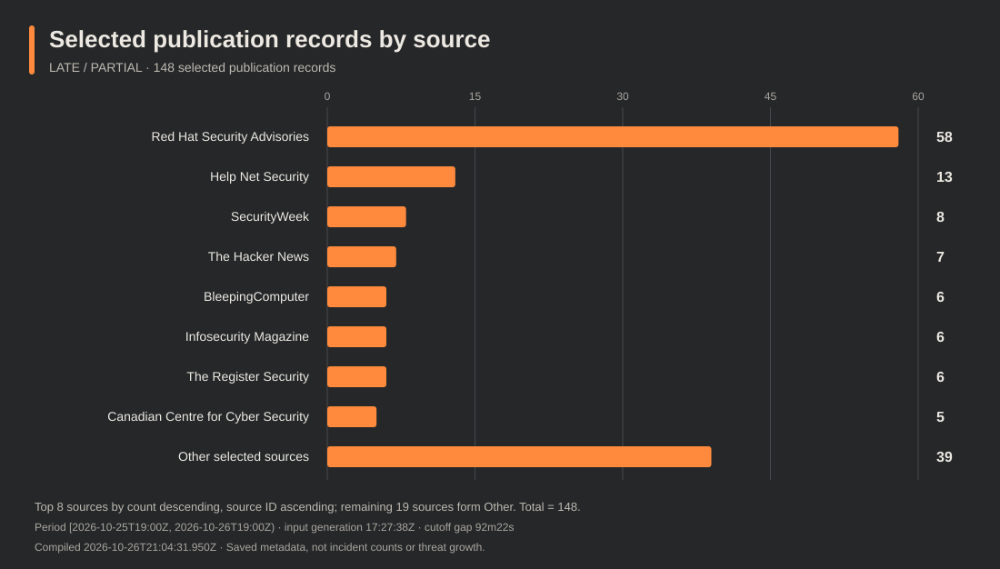
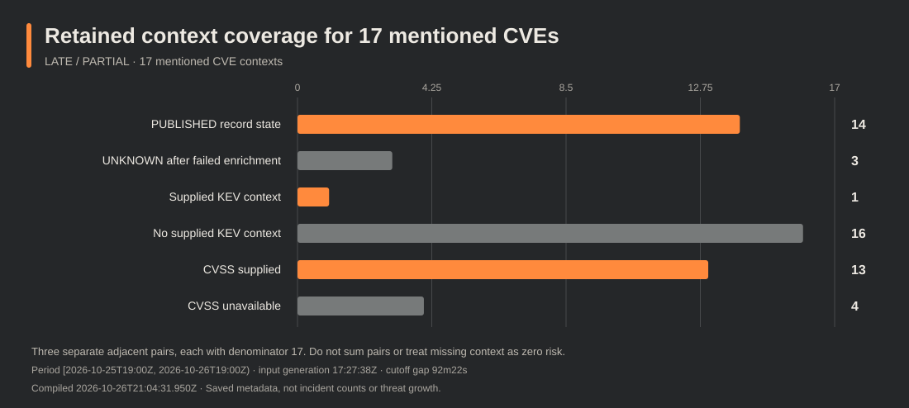
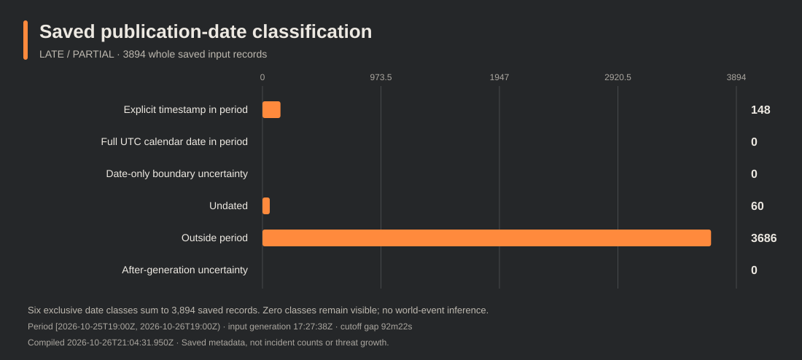

# Daily intelligence brief — 26 October 2026, 14:00 CDT

**LATE · PARTIAL · source_subset**  
Edition: SW-DAILY-2026-10-26-1400-CDT  
Compiled: 2026-10-26T21:04:31.950Z  
Period: **[25 October 14:00 CDT, 26 October 14:00 CDT)** — **[2026-10-25 19:00 UTC, 2026-10-26 19:00 UTC)**, 24 elapsed hours.  
[Matching data](data.json) · [Previous 06:00 edition](../0600-CDT/README.md)

## Executive summary

The saved subset contains **148 timestamped publication records from 27 source IDs**, with **17 distinct CVE mentions**. There are **zero selected KEV-addition rows** and **one supplied current KEV context**. These are publication/catalog measures, not counts of incidents, first disclosures, exploitation or installed exposure.

The fixed snapshot was generated at **17:27:38 UTC** and captured at **19:31:43.350776–19:31:44.827651 UTC**. The generation precedes the nominal cutoff by **5,542 seconds (92 minutes 22 seconds)**. Later capture and offline analysis do not fill that tail. The analysis operation completed at **20:05:30.428574 UTC**; compilation is separately recorded above. The nominal slot is distinct from actual publication. Publication metadata is frozen at compilation; later delivery is tracked separately.

Vendor publication intake is concentrated in Red Hat notices: **58 of 148 records**. Captured technical context includes PHP, NGINX, GitLab, VeloCloud, AWS CDK, Kata Containers and Linux. Preserve each product, version, SAPI, configuration and backport qualification. Three failed CNA enrichments remain UNKNOWN.

## Selected notable developments

### PHP: distinguish initial-pair fixes from follow-up guidance

Retained guidance supplies initial-pair releases and distribution/backport conditions. SAPI demonstrations and request-state prerequisites differ. Follow-up CVE-2026-115560 remains UNKNOWN in this CNA input; a future-release plan is not a shipped third fix. [Source publication metadata](<https://snyk.io/blog/php-patches-critical-unauthenticated-rces/>).

Scope: Structured retained context and attributed publication metadata; no installed exposure or equal SAPI exploitability.

### NGINX: retain branch and configuration conditions

Five mentioned NGINX CVEs have affected-range context. Plus and Open Source ranges differ, including literal open bounds. Two workaround texts remain unavailable after privacy withholding; this is not evidence that no workaround exists. [Source publication metadata](<https://ubuntu.com/security/notices/USN-8955-1>).

Scope: CNA/F5 context and Ubuntu notice metadata; boundaries are not blanket shipped-fix assurances.

### GitLab and VeloCloud: use the explicit release guidance

Captured vendor guidance names specific GitLab and VeloCloud release trains. VeloCloud has the sole supplied current KEV context, added before this period; it contributes no period KEV-addition row. [Source publication metadata](<https://research.checkpoint.com/2026/26th-october-threat-intelligence-report/>).

Scope: Retained vendor/CNA guidance; differing CVSS versions are not a local risk ranking.

### AWS CDK: separate applicability from missing fix text

The CDK Redshift alpha context supplies a product/version range and CVSS metric. Its CNA title remains unavailable; structured solution/workaround text is absent. The range boundary alone is not a verified shipped fix. [Source publication metadata](<https://aws.amazon.com/security/security-bulletins/rss/2026-151-aws/>).

Scope: Structured retained context, with no title reconstruction or environment conclusion.

### Vendor intake is concentrated in Red Hat notices

Red Hat contributes 58 of 148 selected publication records. Several notices can concern the same package. These counts describe saved intake, not new vulnerabilities, incidents or threat growth. [Source publication metadata](<https://access.redhat.com/errata/RHSA-2026:89730>).

Scope: Exact publisher-row counts; no CVEs inferred from titles.

### AI-agent control and containment remain reporting themes

Selected metadata covers AI coding-agent input handling, retained access, containment and identity governance. These remain attributed reporting or research leads; headlines do not establish incident counts, exploitability or actor identity. [Source publication metadata](<https://www.helpnetsecurity.com/2026/10/26/google-elephant-goldfish-model-plugin/>).

Scope: Publication metadata and structured CVE mentions only; failed enrichment remains UNKNOWN.

### Build verification and token lifecycle appear in coverage

Selected entries concern build verification and reporting about GitHub and LiteLLM token handling. Labels are paraphrased. No new article-body check or source-revision baseline was established. [Source publication metadata](<https://www.helpnetsecurity.com/2026/10/26/witness-open-source-software-supply-chain-tool/>).

Scope: Attributed metadata only; no transitive campaign or compromise inference.

## KEV additions and retained KEV context

No selected row is a KEV catalog addition in this period. **CVE-2026-114625** has supplied KEV context with an **October 23 addition date** and an **October 26 due date**; ransomware status is **unknown**. The earlier catalog addition is distinct from the 24-hour publication cohort and does not date an incident or the start of exploitation. Follow the captured [Arista advisory](https://www.arista.com/en/support/advisories-notices/security-advisory/24838-security-advisory-0199) and the record's CISA reference for source-specific action.

## CVE products, versions, scores and mitigation limits

The table is a concise reading aid. The matching data preserves the full supplied product/version entries, default-status and custom-range semantics, fixes/workarounds, CVSS vectors and source URLs, required action, source update/retrieval/attempt clocks, weaknesses and missingness. **14 contexts are PUBLISHED; three are UNKNOWN after failed enrichment.** CVSS is supplied for 13 of 17, with versions retained; the four unavailable metrics are not zeros. Scores across versions are not a local risk ranking.

| CVE | Captured applicability and guidance | CVSS |
| --- | --- | --- |
| [104621](https://www.cve.org/CVERecord?id=CVE-2026-104621) | UNKNOWN after failed enrichment. Product, versions, guidance and score unavailable; no registry-absence or shipped-fix claim. | Unavailable |
| [104622](https://www.cve.org/CVERecord?id=CVE-2026-104622) | UNKNOWN after failed enrichment; no product or remediation claim established. | Unavailable |
| [109618](https://www.cve.org/CVERecord?id=CVE-2026-109618) | PHP affected branch end bounds precede 8.2.35, 8.3.36, 8.4.27 and 8.5.12. Initial-pair publisher release guidance and SAPI/backport conditions apply below. | 9.2 · v4.0 |
| [109619](https://www.cve.org/CVERecord?id=CVE-2026-109619) | Same PHP branch end bounds; request-state prerequisites require separate review. Do not assume equal demonstrated exploitability across SAPIs. | 9.2 · v4.0 |
| [110264](https://www.cve.org/CVERecord?id=CVE-2026-110264) | GitLab affected ranges: 7.0–<18.11.13; 19.0–<19.0.10; 19.1–<19.1.9; 19.2–<19.2.9; 19.3–<19.3.6; 19.4–<19.4.3; 19.5–<19.5.1. Explicit solution recommends those releases or later. | 10.0 · v3.1 |
| [114625](https://www.cve.org/CVERecord?id=CVE-2026-114625) | VeloCloud Orchestrator affected: 5.2.0–<5.2.3.18, 6.1.0–<6.1.3.10, 6.4.0–<6.4.2.12. Explicit fixed releases are 5.2.3.18, 6.1.3.10 and 6.4.2.12 or later within their trains. Interim administrative-access and monitoring guidance remains source-specific. | 9.4 · v4.0 |
| [115418](https://www.cve.org/CVERecord?id=CVE-2026-115418) | AWS aws-cdk/aws-redshift-alpha affected range 0–<2.274.0-alpha.0. CNA title stays unavailable. No structured solution/workaround text; the boundary alone is not verified shipped-fix evidence. | 7.0 · v4.0 |
| [115560](https://www.cve.org/CVERecord?id=CVE-2026-115560) | UNKNOWN after failed enrichment. Separate PHP follow-up publisher guidance below does not change this state or establish a shipped third fix. | Unavailable |
| [15176](https://www.cve.org/CVERecord?id=CVE-2026-15176) | NGINX Plus 37.1.0–<37.1.0.1 and 37.0.0–<37.0.5.1; R33–R36 retain affected entries with open * upper bounds. Open Source 1.31.0–<1.31.7 and 0.1.29–<1.30.6. Captured workaround avoids alias in a location and avoids $request_filename. | 9.2 · v4.0 |
| [24834](https://www.cve.org/CVERecord?id=CVE-2026-24834) | Kata Containers affected entry <3.27.0; default status unknown. Structured solution/workaround text absent. Consult the advisory/release without treating the boundary alone as package remediation proof. | 9.4 · v3.1 |
| [74753](https://www.cve.org/CVERecord?id=CVE-2026-74753) | Linux ranges include 6.6.145–<6.6.156, 6.12.96–<6.12.108, 6.18.39–<6.18.46 and 7.1.4–<7.1.10, with Git ranges retained. No structured solution/workaround text; distribution backports need package evidence. | 7.8 · v3.1 |
| [80521](https://www.cve.org/CVERecord?id=CVE-2026-80521) | Linux affected ranges include 6.1.141–<6.1.189 and 6.6.93–<6.6.158 plus Git ranges. Unaffected branch entries start at 6.1.189, 6.6.158, 6.12.111, 6.18.53 and 7.1.10; 7.2 is an original-fix entry. Preserve branch/backport conditions. | 7.8 · v3.1 |
| [80841](https://www.cve.org/CVERecord?id=CVE-2026-80841) | Linux includes affected Git ranges and an affected 3.14 entry; earlier versions are listed unaffected. Unaffected entries begin at 6.6.158, 6.12.111, 6.18.51, 7.1.13 and 7.2.3; 7.3 is an original-fix entry. | Unavailable |
| [93479](https://www.cve.org/CVERecord?id=CVE-2026-93479) | NGINX Plus bounds as 15176. Open Source 1.31.2–<1.31.7 and 1.30.0–<1.30.6. Captured mitigation uses named rather than unnamed captures and confines use to the regex-match block. | 9.2 · v4.0 |
| [95101](https://www.cve.org/CVERecord?id=CVE-2026-95101) | NGINX Plus 37.1.0–<37.2.0.1, 37.0.0–<37.0.7.1 and R33–R36 open bounds. Open Source 1.31.0–<1.31.7, 1.30.0–<1.30.6 and an additional 1.25.0 affected entry with * upper bound. Workaround text withheld/unavailable. | 6.9 · v4.0 |
| [97205](https://www.cve.org/CVERecord?id=CVE-2026-97205) | NGINX Plus bounds as 15176. Open Source 1.31.0–<1.31.7 and 1.30.0–<1.30.6. Captured workaround disables aio or avoids serving SSI pages. | 9.2 · v4.0 |
| [97629](https://www.cve.org/CVERecord?id=CVE-2026-97629) | NGINX Plus bounds as 15176. Open Source 1.31.0–<1.31.7, 1.30.0–<1.30.6 and an additional 1.23.3 affected entry with * upper bound. Workaround text withheld/unavailable. | 8.3 · v4.0 |

For all five NGINX contexts, Plus default status is unknown. Open Source default status is also unknown for 95101 and 97629. The data preserves literal custom ranges and open bounds. None of these five supplies explicit structured solution text; affected-range endpoints are not universal current-fix assurances.

### PHP: releases, SAPIs, backports and the follow-up path

The retained [PHP release notice](https://www.php.net/archive/2026.php) identifies 8.5.12, 8.4.27, 8.3.36 and 8.2.35 for the initial pair, alongside distribution/LTS fixes and minimal backports for 7.4, 8.0 and 8.1. A lower displayed version alone does not show that a distribution package is unpatched.

The [susceptibility advisory](https://github.com/php/php-src/security/advisories/GHSA-w8hw-w9fx-j79w) documents an unauthenticated pre-application mod_php demonstration; other SAPIs have qualifications. The [request-state advisory](https://github.com/php/php-src/security/advisories/GHSA-6wmf-4rv5-p3rp) distinguishes demonstrated cases from candidate, configuration-dependent and same-worker paths. The two demonstrations do not establish equal exploitability across all SAPIs.

The retained [CISA conditional guidance](https://www.cisa.gov/news-events/alerts/2026/10/21/critical-vulnerabilities-php-require-immediate-patching), revised October 23, advises temporary offline status where immediate updating is impossible or unsupported PHP 8.1 or earlier remains in use, until patched or updated. Keep its conditions and distribution/backport evidence together.

PHP's October 23 follow-up describes a next-regular-release plan for 115560 and the interim setting session.upload_progress.enabled=0 for an unusual path: php_binary or php_serialize is changed to php through ini_set() before session_start(), while upload progress remains enabled. This does not establish a shipped third fix or complete mitigation of the initial pair. The CNA state for 115560 remains UNKNOWN in this input.

## Weakness and attack-pattern context

The captured CNA records supply distinct CWE memberships in the data. Supplied catalogue definitions match **CWE-416** and **CWE-89**. The latter has related CAPEC mappings **108, 109, 110, 470, 66 and 7**; only **CAPEC-66** among them has a separately captured definition. The retained versions are **CWE 4.20** and **CAPEC 3.9**. These are catalogue relationships, not evidence of an observed attack or a campaign technique. Content modification dates are not incident dates.

## Campaigns and actors

The selected publication metadata does not establish a qualified window actor/campaign attribution. Retained earlier [Microsoft background](https://www.microsoft.com/en-us/security/blog/2026/10/21/storm-0940-uses-artex-agentic-ai-connectwise-supply-chain-compromise/) attributes ConnectWise-linked application abuse to Storm-0940 and describes it as China-state aligned. That remains publisher attribution, with no selected-article evidence match establishing activity in this window. Application presence/authentication does not establish customer compromise or exfiltration; the supplied context does not establish compromise of Microsoft corporate systems/products. Names, aliases and co-mentions alone do not establish identity.

## Supply-chain and AI reporting

Selected entries discuss software-build verification, token lifecycle, AI-agent instructions, containment and access governance. Their data labels are manually reviewed paraphrases. The report treats headline-level claims as attributed reporting/watchlist leads. It derives no incident totals, exploit proof or actor identity from those titles. All 148 selected entry exploitation fields remain unknown.

## Previous-source revision watch

The dedicated pass reconciled **1,713 citation occurrences from 15 compiled reports**, preserving **1,285 distinct literal URL groups**. Of these, **1,283 have canonical identities**: **1,281 remain unknown/noneligible** and **two match held historical scopes**, covering five citation occurrences. Two additional unsupported identities remain unknown. These canonical refusals are metadata-processing outcomes, not new HTTP publisher refusals.

All 1,285 groups fall in the recent-priority bucket. **Selected: 0 · new requests: 0 · qualified article checks: 0 · comparisons: 0 · qualified baselines: 0 · cap exclusions: 0.** New public source-check records are empty; material changes remain unknown/not checked. The metadata extraction completed at 19:53 UTC, separately from earlier source-attempt clocks. Unknown history is not never-requested history.

The policy remains at most 12 URLs and 24 shared primary documents, with 8 recent/4 older slots, a 96-hour lookback and 48-hour priority. Success/failure cooldowns are opportunities, not request permission; held routes require distinct review. Per-URL earliest eligibility is unavailable or held NULL.

## Data coverage and source health

| Date class | Rows |
| --- | ---: |
| Explicit timestamp in the half-open period | 148 |
| Full UTC-calendar date in period | 0 |
| Date-only boundary uncertainty | 0 |
| Undated | 60 |
| Outside the period | 3,686 |
| After-generation uncertainty | 0 |
| **Whole saved input** | **3,894** |

Source health in the whole saved input is **54 ok, seven partial and one failed** across 62 source records. The general CISA advisory collection failed. Other retained CISA category material does not establish completeness. The selected period is a capped source subset, with 2,185 whole-input CNA context entries; only the 17 mentioned CVEs enter this report's brief set.

The frozen input is still the 17:27-generated snapshot. The requested ten-minute collection cadence after that generation was not observed in bounded evidence. The last observed returned run collected and deployed successfully, but the cause of missing later freshness remains unresolved. Report assembly does not repair the scheduler or establish a newer feed. A later collection or publication observation cannot change these frozen inputs and counts.

## Watchlist

- **Next nominal opportunity:** 26 October 22:00 CDT / 27 October 03:00 UTC; it is not a punctual-delivery guarantee.
- **CNA follow-up:** 104621, 104622 and 115560 remain UNKNOWN after failed enrichment; retain missingness.
- **NGINX guidance:** 95101 and 97629 have unavailable workaround/detail text; do not infer no workaround.
- **KEV applicability:** verify the VeloCloud record's version/configuration and source-specific required action; its catalog addition predates this period.
- **Privacy:** one selected entry title, one CNA title and four mitigation/detail fields remain NULL. Counts and membership remain intact.

## Limitations

- Late, partial saved-source subset; not an exhaustive incident, disclosure, exploitation or exposure census.
- The fixed input generation is 5542 seconds before the nominal cutoff. Later capture, analysis and compilation do not reconstruct that missing tail.
- Sixty undated and 3686 outside-period records are excluded. Date-only values use a declared UTC-calendar convention with unknown publisher timezone; none entered the main cohort.
- All 148 selected exploitation fields remain unknown. Titles and CVE mentions do not establish exploitation, incidents, first disclosures or installed exposure.
- Whole-input source health is 54 ok, 7 partial, 1 failed. The general CISA advisory collection failed; retained category-specific material does not establish full CISA coverage.
- CVE-2026-104621, CVE-2026-104622 and CVE-2026-115560 failed enrichment and remain UNKNOWN; registry absence and shipped fixes are not established.
- One entry title, one CNA title and four NGINX workaround/detail fields remain NULL. Withheld workaround text means unavailable, not no workaround.
- Preserve product/version conditions, custom open bounds, distribution backports, PHP SAPI prerequisites and CVSS source/version. A version boundary alone does not verify a vendor package fix.
- CWE/CAPEC mappings are taxonomy, not observed attacks. Publisher attribution and background do not establish actor identity or period activity.
- The dedicated revision pass reconciled citation metadata only: zero new requests, article checks, comparisons or qualified baselines. Material changes are unknown.
- Requested ten-minute collection after the saved 17:27 generation was not observed in bounded evidence. The last observed collection/deployment completed, but missing later freshness remains unresolved; this report does not claim it fixed.
- Next nominal reporting/collection times are opportunities, not guarantees. Later refreshes cannot change this edition frozen input or counts.

## Primary-first references

The full typed reference list is in data.json. Source record clocks remain in the retained briefs; no link was newly fetched for this edition.

1. [PHP release notices](https://www.php.net/archive/2026.php), [susceptibility advisory](https://github.com/php/php-src/security/advisories/GHSA-w8hw-w9fx-j79w), [request-state advisory](https://github.com/php/php-src/security/advisories/GHSA-6wmf-4rv5-p3rp), and [CISA conditional guidance](https://www.cisa.gov/news-events/alerts/2026/10/21/critical-vulnerabilities-php-require-immediate-patching).
2. [GitLab patch release](https://docs.gitlab.com/releases/patches/patch-release-gitlab-19-5-1-released/) and [Arista advisory](https://www.arista.com/en/support/advisories-notices/security-advisory/24838-security-advisory-0199).
3. AWS, Kata, Linux and F5/NGINX primary record/vendor links are retained with each CVE in data.json and linked from the table.
4. [CWE-416](https://cwe.mitre.org/data/definitions/416.html), [CWE-89](https://cwe.mitre.org/data/definitions/89.html), and [CAPEC-66](https://capec.mitre.org/data/definitions/66.html) supply the qualified taxonomy context.
5. [Microsoft's attributed background](https://www.microsoft.com/en-us/security/blog/2026/10/21/storm-0940-uses-artex-agentic-ai-connectwise-supply-chain-compromise/) remains earlier context; selected publisher links are listed in data.json with metadata-only evidence scope.
