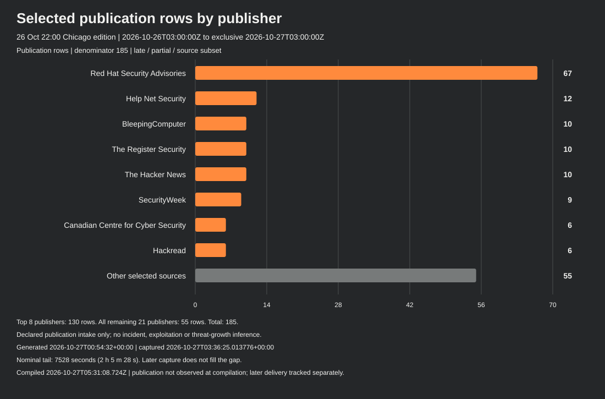
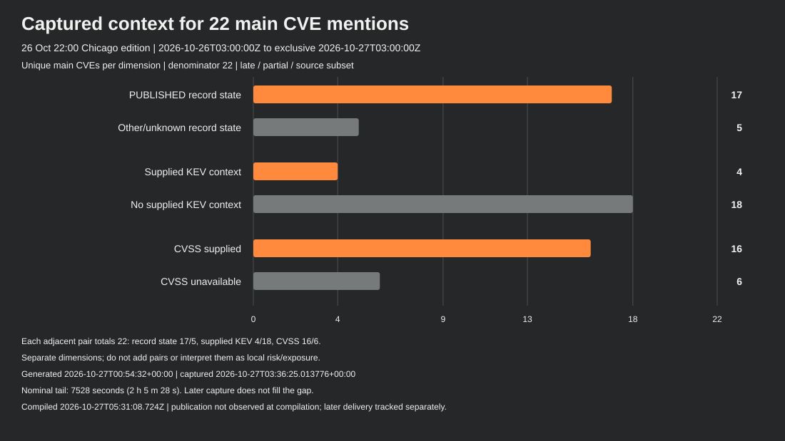
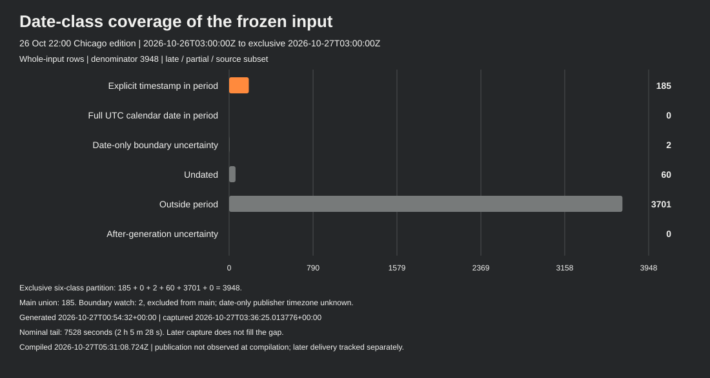

# Security intelligence — 26 October 2026, 22:00 Chicago

**SW-DAILY-2026-10-26-2200-CDT · Daily · Late / partial / retained source subset**

This edition covers the half-open 24-hour window from **25 October 22:00 to 26 October 22:00 America/Chicago** (2026-10-26T03:00:00Z through, excluding, 2026-10-27T03:00:00Z). The prior edition is SW-DAILY-2026-10-26-1400-CDT. Actual compilation: **2026-10-27T05:31:08.724Z**.

The nominal slot is distinct from actual publication. Publication metadata is frozen at compilation; later delivery is tracked separately. At this compilation, publication was not observed and its observation clock is NULL.

## Executive summary

The admitted main cohort contains **185 timestamped publication rows from 29 publishers**, with **22 unique structured CVE mentions**. There are **zero admitted main KEV-addition rows**, while four mentioned CVEs carry supplied KEV context. Two date-only PHP KEV rows remain separate boundary watch. These measures are not counts of incidents, newly disclosed vulnerabilities or exposed systems.

PHP applicability and conditional guidance, Brotli branch fixes, NGINX module/version conditions, Adobe custom release statuses and train-specific GitLab/VeloCloud remediation are the main structured-context priorities. All **113 supplied version rows** remain in the data and the version table below. Five CVE enrichments failed and remain UNKNOWN; six contexts have no CVSS object.

The input was generated **2026-10-27T00:54:32+00:00**, leaving an unobserved **7,528-second (2 h 5 m 28 s)** interval before the nominal cutoff. Capture began at 03:36:23.138639+00:00 and completed at 03:36:25.013776+00:00. Later analysis and this compilation do not reconstruct the missing interval, prove live feed freshness or establish a collection repair.

## Selected notable developments

### 1. PHP applicability and conditional guidance remain the priority

The captured initial-pair records retain branch, SAPI, request-state and distribution-backport conditions. Each now includes nine analysis steps and six limitations, including the supplied CISA action and conditional October 23 offline guidance. The separate CVE-2026-115560 record remains UNKNOWN after failed enrichment; the publisher follow-up is a release plan and conditional interim measure, not proof of a shipped third fix.

Captured CNA/KEV and separately attributed PHP publisher context. Publication pointers are not new source checks or installed exposure findings.

Sources: [captured source 1](https://www.cve.org/CVERecord?id=CVE-2026-109618); [captured source 2](https://www.cve.org/CVERecord?id=CVE-2026-109619); [captured source 3](https://www.cve.org/CVERecord?id=CVE-2026-115560); [captured source 4](https://snyk.io/blog/php-patches-critical-unauthenticated-rces/).

### 2. Brotli ranges retain separate branch fixes

The supplied CVE-2026-111497 context lists affected branches 1.0.3–<1.0.10, 1.1.0–<1.1.1 and 1.2.0–<1.2.1, with explicit solution releases 1.0.10, 1.1.1 or 1.2.1. These ranges are not one continuous interval. Package and portfolio reporting remains distinct from system applicability.

Source-qualified captured record and selected publication metadata; no universal package or environment claim.

Sources: [captured source 1](https://www.cve.org/CVERecord?id=CVE-2026-111497); [captured source 2](https://thehackernews.com/2026/10/php-issues-second-windows-security.html); [captured source 3](https://security.paloaltonetworks.com/CVE-2026-111497); [captured source 4](https://cyberscoop.com/brotli-critical-vulnerability-decompression-library-node2shell-broccoli2shell/).

### 3. NGINX module and custom-version conditions stay explicit

Five contexts retain distinct Plus/OSS version conditions, including custom R33–R36 bounds. Three available workaround texts retain their configuration conditions. The HTTP/3 and SSL workaround texts, and their mirrored step details, remain unavailable; withheld text does not mean that no workaround exists. No structured solution text establishes a blanket shipped-fix claim.

Captured CNA fields and vendor/distribution publication pointers; boundaries and status are not inferred remediation assurance.

Sources: [captured source 1](https://www.cve.org/CVERecord?id=CVE-2026-15176); [captured source 2](https://www.cve.org/CVERecord?id=CVE-2026-93479); [captured source 3](https://www.cve.org/CVERecord?id=CVE-2026-95101); [captured source 4](https://www.cve.org/CVERecord?id=CVE-2026-97205).

### 4. Commerce records need literal release-status interpretation

The Adobe contexts retain different affected/default statuses. CVE-2026-48356 includes separate unaffected July-labelled custom release strings and an unaffected Commerce Events 1.21.0 entry. CVE-2025-54236 retains default affected status and its inclusive recorded range. Empty structured guidance does not erase unaffected entries or establish a universal fix.

Captured product/version/KEV context. E-commerce reporting topics do not establish incident counts or individual-store exposure.

Sources: [captured source 1](https://www.cve.org/CVERecord?id=CVE-2025-54236); [captured source 2](https://www.cve.org/CVERecord?id=CVE-2026-48356); [captured source 3](https://securityaffairs.com/201795/malware/magento-campaign-infects-953-online-stores-across-five-domains.html).

### 5. GitLab and VeloCloud remediation remains train-specific

GitLab records explicit recommended release thresholds across seven affected trains. VeloCloud records fixes in the 5.2, 6.1 and 6.4 trains plus qualified interim administrative-access and review guidance. CVSS 10.0/v3.1 and 9.4/v4.0 retain different metric versions and sources; they are not local risk rankings.

Source-qualified captured guidance, with original version and configuration limits retained.

Sources: [captured source 1](https://www.cve.org/CVERecord?id=CVE-2026-110264); [captured source 2](https://www.cve.org/CVERecord?id=CVE-2026-114625); [captured source 3](https://research.checkpoint.com/2026/26th-october-threat-intelligence-report/).

### 6. Kernel and container conditions resist one-version shortcuts

Three Linux contexts retain Git and release-status rows, original-fix markers and branch-specific backport conditions. CVE-2026-80841 has no supplied CVSS object. Kata retains its literal affected version string and unknown default status; neither a boundary nor an empty guidance array supplies deployment remediation assurance.

Captured CNA version data and publication pointers; no universal older-version vulnerability rule.

Sources: [captured source 1](https://www.cve.org/CVERecord?id=CVE-2026-74753); [captured source 2](https://www.cve.org/CVERecord?id=CVE-2026-80521); [captured source 3](https://www.cve.org/CVERecord?id=CVE-2026-80841); [captured source 4](https://www.cve.org/CVERecord?id=CVE-2026-24834).

### 7. AI tooling and supply-chain coverage concerns trust boundaries

Selected publication metadata includes local-file/Markdown trust in coding agents, credential scope, build provenance and model-cache isolation. These are reporting themes. This edition did not check the article bodies, establish campaign identities, validate claimed impact totals or convert headlines into CVE/exploitation evidence.

Publication metadata only; no independent incident, exploitation, actor or exposure conclusion.

Sources: [captured source 1](https://thehackernews.com/2026/10/malicious-file-in-downloads-folder.html); [captured source 2](https://www.helpnetsecurity.com/2026/10/26/witness-open-source-software-supply-chain-tool/); [captured source 3](https://thehackernews.com/2026/10/gheist-uses-stolen-github-tokens-to.html); [captured source 4](https://www.helpnetsecurity.com/2026/10/26/ai-coding-agents-malware-openai-codex/).

### 8. Publisher intake is a coverage measure

Red Hat accounts for 67 of the 185 main publication rows. The remaining rows span 28 other publishers. Advisory frequency and repeated package notices do not measure threat growth, distinct incidents or affected systems; source-specific version and distribution conditions still govern applicability.

Declared publication intake counts only; no incident or severity-ranking inference.

Sources: [captured source 1](https://access.redhat.com/errata/RHSA-2026:89752); [captured source 2](https://access.redhat.com/errata/RHSA-2026:89744); [captured source 3](https://access.redhat.com/errata/RHSA-2026:89111); [captured source 4](https://access.redhat.com/errata/RHSA-2026:90495).

## KEV: period rows and retained catalogue context

**Main KEV-addition rows: 0. Supplied current KEV contexts among main CVE mentions: 4.** The two PHP KEV publication dates are date-only 2026-10-26. Under the declared UTC-calendar convention that day overlaps the window but begins before its 03:00Z start, so both rows remain boundary uncertainty and do not enter the main addition count. Publisher timezone is unknown.

| CVE | Captured catalogue addition | Captured catalogue due date | Ransomware field |
| --- | --- | --- | --- |
| CVE-2025-54236 | 2025-10-24 | 2025-11-14 | Unknown |
| CVE-2026-109618 | 2026-10-26 | 2026-10-29 | Unknown |
| CVE-2026-109619 | 2026-10-26 | 2026-10-29 | Unknown |
| CVE-2026-114625 | 2026-10-23 | 2026-10-26 | Unknown |

Addition and due dates above are captured catalogue attributes, not incident, disclosure or first-exploitation dates. All four ransomware fields remain **Unknown**. Federal catalogue actions and due dates retain their stated agency scope; this report assigns no deadline to a reader. Adobe action context cites BOD 22-01; the PHP/VeloCloud contexts cite BOD 26-04 and retain triage/applicability conditions.

## CVE products, versions, scores and mitigation limits

The following are captured CNA/KEV and explicitly attributed supplementary contexts. They are later retained metadata, not an as-of-cutoff reconstruction or an assessment of installed software. The five UNKNOWN/failed records are CVE-2026-104621, CVE-2026-104622, CVE-2026-115560, CVE-2026-90975 and CVE-2026-91141. Failed enrichment does not establish absence from a registry, product applicability, lack of exploitation or a shipped fix.

There are **17 PUBLISHED and 5 UNKNOWN contexts**. Sixteen supply CVSS: **6 v3.1 and 10 v4.0**; six have no supplied metric. Score, vector, version and record-source URL stay together in data.json. They are not NVD relabellings or local risk rankings.

| CVE and captured status | Recorded product/version scope | CVSS / record source | Guidance and limits |
| --- | --- | --- | --- |
| [CVE-2025-54236](https://www.cve.org/CVERecord?id=CVE-2025-54236) · PUBLISHED/ok | Adobe Commerce: affected 0 through 2.4.4-p15 inclusive, with default affected status. Do not infer that every newer build is unaffected. | [9.1 / v3.1](https://www.cve.org/CVERecord?id=CVE-2025-54236) | No structured solution/workaround text; retain the supplied CISA action and original applicability limits. |
| [CVE-2026-104621](https://www.cve.org/CVERecord?id=CVE-2026-104621) · UNKNOWN/failed | Product and version applicability unavailable after failed enrichment; record state UNKNOWN. | Unavailable | Empty product/guidance arrays and NULL CVSS are availability limits. No registry-absence, shipped-fix, no-exploitation or unsupported product claim follows. |
| [CVE-2026-104622](https://www.cve.org/CVERecord?id=CVE-2026-104622) · UNKNOWN/failed | Product and version applicability unavailable after failed enrichment; record state UNKNOWN. | Unavailable | Empty product/guidance arrays and NULL CVSS are availability limits. No registry-absence, shipped-fix, no-exploitation or unsupported product claim follows. |
| [CVE-2026-109618](https://www.cve.org/CVERecord?id=CVE-2026-109618) · PUBLISHED/ok | PHP affected branches 8.2.* &lt;8.2.35; 8.3.* &lt;8.3.36; 8.4.* &lt;8.4.27; 8.5.* &lt;8.5.12. | [9.2 / v4.0](https://www.cve.org/CVERecord?id=CVE-2026-109618) | Initial-pair upstream release and distribution/backport context is supplementary publisher guidance, separate from the empty CNA solutions array; see the nine-step discussion below. |
| [CVE-2026-109619](https://www.cve.org/CVERecord?id=CVE-2026-109619) · PUBLISHED/ok | PHP affected branches 8.2.* &lt;8.2.35; 8.3.* &lt;8.3.36; 8.4.* &lt;8.4.27; 8.5.* &lt;8.5.12. | [9.2 / v4.0](https://www.cve.org/CVERecord?id=CVE-2026-109619) | Request-state/SAPI/configuration distinctions remain; conditional guidance is not equal demonstrated exploitability across every SAPI. |
| [CVE-2026-110264](https://www.cve.org/CVERecord?id=CVE-2026-110264) · PUBLISHED/ok | GitLab affected trains: 7.0–&lt;18.11.13; 19.0–&lt;19.0.10; 19.1–&lt;19.1.9; 19.2–&lt;19.2.9; 19.3–&lt;19.3.6; 19.4–&lt;19.4.3; 19.5–&lt;19.5.1. | [10.0 / v3.1](https://www.cve.org/CVERecord?id=CVE-2026-110264) | Explicit solution recommends those releases or later, preserving train applicability. |
| [CVE-2026-111497](https://www.cve.org/CVERecord?id=CVE-2026-111497) · PUBLISHED/ok | Brotli: 1.0.3–&lt;1.0.10; 1.1.0–&lt;1.1.1; 1.2.0–&lt;1.2.1. | [9.2 / v4.0](https://www.cve.org/CVERecord?id=CVE-2026-111497) | Explicit solution identifies 1.0.10, 1.1.1 or 1.2.1; do not join the branches into one continuous affected interval. |
| [CVE-2026-114625](https://www.cve.org/CVERecord?id=CVE-2026-114625) · PUBLISHED/ok | VeloCloud: 5.2.0–&lt;5.2.3.18; 6.1.0–&lt;6.1.3.10; 6.4.0–&lt;6.4.2.12. | [9.4 / v4.0](https://www.cve.org/CVERecord?id=CVE-2026-114625) | Explicit fixed releases remain train-specific. Interim guidance restricts administrative access and reviews suspicious access/outbound activity/persistence/administrator changes. |
| [CVE-2026-115418](https://www.cve.org/CVERecord?id=CVE-2026-115418) · PUBLISHED/ok | CNA title unavailable. Structured product is aws-cdk/aws-redshift-alpha; affected 0–&lt;2.274.0-alpha.0; default unaffected. | [7.0 / v4.0](https://www.cve.org/CVERecord?id=CVE-2026-115418) | No structured solution/workaround establishes a shipped-fix claim. The withheld title remains NULL. |
| [CVE-2026-115560](https://www.cve.org/CVERecord?id=CVE-2026-115560) · UNKNOWN/failed | Product and version applicability unavailable after failed enrichment; record state UNKNOWN. | Unavailable | Empty product/guidance arrays and NULL CVSS are availability limits. No registry-absence, shipped-fix, no-exploitation or unsupported product claim follows. |
| [CVE-2026-15176](https://www.cve.org/CVERecord?id=CVE-2026-15176) · PUBLISHED/ok | NGINX Plus: 37.1.0–&lt;37.1.0.1; 37.0.0–&lt;37.0.5.1; custom R33–R36 affected. OSS: 1.31.0–&lt;1.31.7; 0.1.29–&lt;1.30.6. | [9.2 / v4.0](https://www.cve.org/CVERecord?id=CVE-2026-15176) | Available workaround avoids alias in the specified location and $request_filename. No explicit structured solution text. |
| [CVE-2026-24834](https://www.cve.org/CVERecord?id=CVE-2026-24834) · PUBLISHED/ok | Kata Containers retains the literal affected version string &lt; 3.27.0, an empty version type and default unknown. | [9.4 / v3.1](https://www.cve.org/CVERecord?id=CVE-2026-24834) | No structured solution/workaround; the boundary does not verify package remediation. |
| [CVE-2026-48356](https://www.cve.org/CVERecord?id=CVE-2026-48356) · PUBLISHED/ok | Four Adobe product entries retain eight version/status rows. Commerce/B2B/Magento custom affected lists and separate unaffected July-labelled strings are literal; Events has affected ≤1.20.0 and unaffected 1.21.0. | [9.3 / v3.1](https://www.cve.org/CVERecord?id=CVE-2026-48356) | Empty structured guidance does not erase the explicit unaffected entries. All literal custom strings are reproduced in the version-row table. |
| [CVE-2026-74753](https://www.cve.org/CVERecord?id=CVE-2026-74753) · PUBLISHED/ok | Linux perf: five Git ranges plus 6.6.145–&lt;6.6.156, 6.12.96–&lt;6.12.108, 6.18.39–&lt;6.18.46 and 7.1.4–&lt;7.1.10 affected release ranges. | [7.8 / v3.1](https://www.cve.org/CVERecord?id=CVE-2026-74753) | Keep Git bounds and branch/backport conditions. No universal older-version vulnerability or shipped-package-fix inference. |
| [CVE-2026-80521](https://www.cve.org/CVERecord?id=CVE-2026-80521) · PUBLISHED/ok | Linux UNIX sockets: six Git ranges; affected 6.1.141–&lt;6.1.189 and 6.6.93–&lt;6.6.158; explicit unaffected branch entries also remain. | [7.8 / v3.1](https://www.cve.org/CVERecord?id=CVE-2026-80521) | Unaffected branch starts 6.1.189/6.6.158/6.12.111/6.18.53/7.1.10; 7.2 is typed original_commit_for_fix. Preserve the second product default/status conditions. |
| [CVE-2026-80841](https://www.cve.org/CVERecord?id=CVE-2026-80841) · PUBLISHED/ok | Linux packet ring: six Git ranges plus eight release/status rows; branch-specific unaffected and original-fix markers remain literal. | Unavailable | Unaffected starts 6.6.158/6.12.111/6.18.51/7.1.13/7.2.3; 7.3 is original_commit_for_fix. CVSS is unavailable, not zero. |
| [CVE-2026-90975](https://www.cve.org/CVERecord?id=CVE-2026-90975) · UNKNOWN/failed | Product and version applicability unavailable after failed enrichment; record state UNKNOWN. | Unavailable | Empty product/guidance arrays and NULL CVSS are availability limits. No registry-absence, shipped-fix, no-exploitation or unsupported product claim follows. |
| [CVE-2026-91141](https://www.cve.org/CVERecord?id=CVE-2026-91141) · UNKNOWN/failed | Product and version applicability unavailable after failed enrichment; record state UNKNOWN. | Unavailable | Empty product/guidance arrays and NULL CVSS are availability limits. No registry-absence, shipped-fix, no-exploitation or unsupported product claim follows. |
| [CVE-2026-93479](https://www.cve.org/CVERecord?id=CVE-2026-93479) · PUBLISHED/ok | NGINX Plus: 37.1.0–&lt;37.1.0.1; 37.0.0–&lt;37.0.5.1; custom R33–R36 affected. OSS: 1.31.2–&lt;1.31.7; 1.30.0–&lt;1.30.6. | [9.2 / v4.0](https://www.cve.org/CVERecord?id=CVE-2026-93479) | Available workaround uses named captures and confines use to the regex-match block. No explicit structured solution text. |
| [CVE-2026-95101](https://www.cve.org/CVERecord?id=CVE-2026-95101) · PUBLISHED/ok | NGINX Plus: 37.1.0–&lt;37.2.0.1; 37.0.0–&lt;37.0.7.1; R33–R36 affected. OSS: 1.31.0–&lt;1.31.7; 1.30.0–&lt;1.30.6; affected 1.25.0 with custom * upper bound. | [6.9 / v4.0](https://www.cve.org/CVERecord?id=CVE-2026-95101) | Workaround text and mirrored detail remain unavailable. This does not establish no workaround. Plus/OSS default unknown conditions remain. |
| [CVE-2026-97205](https://www.cve.org/CVERecord?id=CVE-2026-97205) · PUBLISHED/ok | NGINX Plus: 37.1.0–&lt;37.1.0.1; 37.0.0–&lt;37.0.5.1; custom R33–R36 affected. OSS: 1.31.0–&lt;1.31.7; 1.30.0–&lt;1.30.6. | [9.2 / v4.0](https://www.cve.org/CVERecord?id=CVE-2026-97205) | Available workaround disables aio or avoids serving SSI pages, with original conditions. No explicit structured solution text. |
| [CVE-2026-97629](https://www.cve.org/CVERecord?id=CVE-2026-97629) · PUBLISHED/ok | NGINX Plus: 37.1.0–&lt;37.1.0.1; 37.0.0–&lt;37.0.5.1; R33–R36 affected. OSS: 1.31.0–&lt;1.31.7; 1.30.0–&lt;1.30.6; affected 1.23.3 with custom * upper bound. | [8.3 / v4.0](https://www.cve.org/CVERecord?id=CVE-2026-97629) | Workaround text and mirrored detail remain unavailable. This is not absence of a workaround; Plus/OSS default unknown conditions remain. |

### PHP: current nine-step guidance and six limitations

Each initial-pair context retains nine analysis steps and six limitations. The supplied publisher context supplements, and does not overwrite, CNA and KEV fields:

1. Establish product, version and deployment applicability; this report has not inspected an environment.
2. Review the supplied CISA action, preserving federal scope, catalogue due dates and exposure-dependent instructions.
3. Follow the captured advisory pointer for mitigation strategies rather than substituting a generic control.
4. Confirm remediation only after a separately authorized change; no remediation or validation operation occurred in this reporting run.
5. The PHP October 21 context identifies initial-pair upstream releases and distribution/LTS/minimal backports for 7.4, 8.0 and 8.1. A lower displayed version alone does not establish a missing patch.
6. The documented unauthenticated pre-application mod_php demonstration does not establish equal demonstrated exploitability across every SAPI, configuration and version.
7. Request-state demonstrations, candidate cases and configuration-dependent same-worker paths remain distinct.
8. The revised October 23 CISA offline guidance is conditional where immediate updating is impossible or unsupported PHP 8.1 or earlier remains in use, until patched/updated. Keep distribution/backport qualifications alongside that condition.
9. The separate October 23 follow-up for CVE-2026-115560 describes a release plan and conditional session.upload_progress.enabled=0 use when php_binary/php_serialize changes to php through ini_set() before session_start(), while upload progress is enabled. This is not complete mitigation of the initial pair or proof that a third fix shipped.

The six limitations preserve environment-assessment boundaries, bounded advisory applicability, federal due-date scope, CVSS comparability, supplementary context separate from CNA/KEV fields, and distinct publisher/revision/retrieval clocks. The captured nine-step/six-limitation arrays are retained intact in both PHP data records.

### All 113 supplied version/status rows

Each row below is a source-supplied condition, including unaffected entries, unknown default statuses, custom strings and original-fix markers. The dash means an empty source string, not an inferred boundary or absence of remediation. Git identifiers are source version bounds; they are not a verification of an installed package. Adobe July-labelled custom strings remain literal and must not be treated as ordinary semver thresholds.

| CVE | Product | Default status | Version type | Row status | Version / lower spelling | Less than | Less than or equal |
| --- | --- | --- | --- | --- | --- | --- | --- |
| CVE-2025-54236 | Adobe Commerce | affected | semver | affected | 0 | — | 2.4.4-p15 |
| CVE-2026-109618 | PHP | unaffected | semver | affected | 8.2.* | 8.2.35 | — |
| CVE-2026-109618 | PHP | unaffected | semver | affected | 8.3.* | 8.3.36 | — |
| CVE-2026-109618 | PHP | unaffected | semver | affected | 8.4.* | 8.4.27 | — |
| CVE-2026-109618 | PHP | unaffected | semver | affected | 8.5.* | 8.5.12 | — |
| CVE-2026-109619 | PHP | unaffected | semver | affected | 8.2.* | 8.2.35 | — |
| CVE-2026-109619 | PHP | unaffected | semver | affected | 8.3.* | 8.3.36 | — |
| CVE-2026-109619 | PHP | unaffected | semver | affected | 8.4.* | 8.4.27 | — |
| CVE-2026-109619 | PHP | unaffected | semver | affected | 8.5.* | 8.5.12 | — |
| CVE-2026-110264 | GitLab | unaffected | semver | affected | 7.0 | 18.11.13 | — |
| CVE-2026-110264 | GitLab | unaffected | semver | affected | 19.0 | 19.0.10 | — |
| CVE-2026-110264 | GitLab | unaffected | semver | affected | 19.1 | 19.1.9 | — |
| CVE-2026-110264 | GitLab | unaffected | semver | affected | 19.2 | 19.2.9 | — |
| CVE-2026-110264 | GitLab | unaffected | semver | affected | 19.3 | 19.3.6 | — |
| CVE-2026-110264 | GitLab | unaffected | semver | affected | 19.4 | 19.4.3 | — |
| CVE-2026-110264 | GitLab | unaffected | semver | affected | 19.5 | 19.5.1 | — |
| CVE-2026-111497 | Brotli | unaffected | semver | affected | 1.0.3 | 1.0.10 | — |
| CVE-2026-111497 | Brotli | unaffected | semver | affected | 1.1.0 | 1.1.1 | — |
| CVE-2026-111497 | Brotli | unaffected | semver | affected | 1.2.0 | 1.2.1 | — |
| CVE-2026-114625 | VeloCloud Orchestrator | unaffected | custom | affected | 5.2.0 | 5.2.3.18 | — |
| CVE-2026-114625 | VeloCloud Orchestrator | unaffected | custom | affected | 6.1.0 | 6.1.3.10 | — |
| CVE-2026-114625 | VeloCloud Orchestrator | unaffected | custom | affected | 6.4.0 | 6.4.2.12 | — |
| CVE-2026-115418 | aws-cdk/aws-redshift-alpha | unaffected | custom | affected | 0 | 2.274.0-alpha.0 | — |
| CVE-2026-15176 | NGINX Plus | unknown | custom | affected | 37.1.0 | 37.1.0.1 | — |
| CVE-2026-15176 | NGINX Plus | unknown | custom | affected | 37.0.0 | 37.0.5.1 | — |
| CVE-2026-15176 | NGINX Plus | unknown | custom | affected | R36 | * | — |
| CVE-2026-15176 | NGINX Plus | unknown | custom | affected | R35 | * | — |
| CVE-2026-15176 | NGINX Plus | unknown | custom | affected | R34 | * | — |
| CVE-2026-15176 | NGINX Plus | unknown | custom | affected | R33 | * | — |
| CVE-2026-15176 | NGINX Open Source | unaffected | semver | affected | 1.31.0 | 1.31.7 | — |
| CVE-2026-15176 | NGINX Open Source | unaffected | semver | affected | 0.1.29 | 1.30.6 | — |
| CVE-2026-24834 | kata-containers | unknown | — | affected | &lt; 3.27.0 | — | — |
| CVE-2026-48356 | Adobe Commerce | unaffected | custom | affected | 0 | — | 2.4.9, 2.4.8-p5, 2.4.7-p10, 2.4.6-p15, 2.4.5-p17, 2.4.4-p18 |
| CVE-2026-48356 | Adobe Commerce | unaffected | custom | unaffected | 2.4.9-2026-jul, 2.4.8-2026-jul, 2.4.7-2026-jul, 2.4.6-2026-jul, 2.4.5-2026-jul, 2.4.4-2026-jul | — | — |
| CVE-2026-48356 | Adobe Commerce B2B | unaffected | custom | affected | 0 | — | 1.5.3, 1.5.2-p5, 1.4.2-p10, 1.3.4-p17, 1.3.3-p18 |
| CVE-2026-48356 | Adobe Commerce B2B | unaffected | custom | unaffected | 1.5.3-2026-jul, 1.5.2-2026-jul, 1.4.2-2026-jul, 1.3.4-2026-jul, 1.3.3-2026-jul | — | — |
| CVE-2026-48356 | Magento Open Source | unaffected | custom | affected | 0 | — | 2.4.9, 2.4.8-p5, 2.4.7-p10, 2.4.6-p15 |
| CVE-2026-48356 | Magento Open Source | unaffected | custom | unaffected | 2.4.9-2026-jul, 2.4.8-2026-jul, 2.4.7-2026-jul, 2.4.6-2026-jul | — | — |
| CVE-2026-48356 | Adobe Commerce Events | unaffected | semver | affected | 0 | — | 1.20.0 |
| CVE-2026-48356 | Adobe Commerce Events | unaffected | semver | unaffected | 1.21.0 | — | — |
| CVE-2026-74753 | Linux | unaffected | git | affected | 4cdb1b3ab96eb1b7eb70bc5c82fede334bd60df2 | ce12e1170c0c78dffb9b28af6d287492ae7dd99d | — |
| CVE-2026-74753 | Linux | unaffected | git | affected | 39358e856fb89e62e3c8d7389a2dc4ec33dbe90e | e593031ff19a9484e8a00bc47edd447187721846 | — |
| CVE-2026-74753 | Linux | unaffected | git | affected | a2d5d3ee7b6e3953114726b1521e62123ab5b043 | 7a03413f31c196ab3894f988cdce0bb47b4fec42 | — |
| CVE-2026-74753 | Linux | unaffected | git | affected | 06ccef0434e98058ddae7bcebc901f93d22b7653 | 7ce010275c531475f9d6e7efb11b9e522c74ed2e | — |
| CVE-2026-74753 | Linux | unaffected | git | affected | 037a3c43edfb597665dd34457cd22b14692f2ba3 | fa091f46c3833fb22384f10eade2b4e1e1d0b278 | — |
| CVE-2026-74753 | Linux | unaffected | semver | affected | 6.6.145 | 6.6.156 | — |
| CVE-2026-74753 | Linux | unaffected | semver | affected | 6.12.96 | 6.12.108 | — |
| CVE-2026-74753 | Linux | unaffected | semver | affected | 6.18.39 | 6.18.46 | — |
| CVE-2026-74753 | Linux | unaffected | semver | affected | 7.1.4 | 7.1.10 | — |
| CVE-2026-80521 | Linux | unaffected | git | affected | 5dfd283f4651d04dbb70ceb9ae5c4a30eda3c52a | 2b6c2842692d08e7acaf32d1eb47f95def35f3fe | — |
| CVE-2026-80521 | Linux | unaffected | git | affected | de7921631ff323369aa63a4324695ab54ea4047e | 6fda5c51b8e43a8440f76e65c89d9f95ddb2ef33 | — |
| CVE-2026-80521 | Linux | unaffected | git | affected | 4090fa373f0e763c43610853d2774b5979915959 | 1293fd69a50d188a5788b08ba3741a3e86be1608 | — |
| CVE-2026-80521 | Linux | unaffected | git | affected | 4090fa373f0e763c43610853d2774b5979915959 | fe198b077864feafd4aa4b33b1a5ce26f50195a2 | — |
| CVE-2026-80521 | Linux | unaffected | git | affected | 4090fa373f0e763c43610853d2774b5979915959 | e3702470ced94fad74d71e2232f022d2eb752a6d | — |
| CVE-2026-80521 | Linux | unaffected | git | affected | 4090fa373f0e763c43610853d2774b5979915959 | 594d905195024b228c962627ae5ae7c17bd582a4 | — |
| CVE-2026-80521 | Linux | unaffected | semver | affected | 6.1.141 | 6.1.189 | — |
| CVE-2026-80521 | Linux | unaffected | semver | affected | 6.6.93 | 6.6.158 | — |
| CVE-2026-80521 | Linux | affected | — | affected | 6.10 | — | — |
| CVE-2026-80521 | Linux | affected | semver | unaffected | 0 | 6.10 | — |
| CVE-2026-80521 | Linux | affected | semver | unaffected | 6.1.189 | — | 6.1.* |
| CVE-2026-80521 | Linux | affected | semver | unaffected | 6.6.158 | — | 6.6.* |
| CVE-2026-80521 | Linux | affected | semver | unaffected | 6.12.111 | — | 6.12.* |
| CVE-2026-80521 | Linux | affected | semver | unaffected | 6.18.53 | — | 6.18.* |
| CVE-2026-80521 | Linux | affected | semver | unaffected | 7.1.10 | — | 7.1.* |
| CVE-2026-80521 | Linux | affected | original_commit_for_fix | unaffected | 7.2 | — | * |
| CVE-2026-80841 | Linux | unaffected | git | affected | b013840810c221f2b0cf641d01531526052dc1fb | debf9f50140b3df3949ebcb97d4450f8993fe32d | — |
| CVE-2026-80841 | Linux | unaffected | git | affected | b013840810c221f2b0cf641d01531526052dc1fb | 4ce6e2d2e38055b2012bd5fdb0c8a8183c8a1b0c | — |
| CVE-2026-80841 | Linux | unaffected | git | affected | b013840810c221f2b0cf641d01531526052dc1fb | ed25ed29034ddc3dbe451ccbaa58ab9932f99d8b | — |
| CVE-2026-80841 | Linux | unaffected | git | affected | b013840810c221f2b0cf641d01531526052dc1fb | 0189dce07db2dc059ae0570e06758ec4233c6e11 | — |
| CVE-2026-80841 | Linux | unaffected | git | affected | b013840810c221f2b0cf641d01531526052dc1fb | 550d00aa58193fb649a09a9c9e338c685adad784 | — |
| CVE-2026-80841 | Linux | unaffected | git | affected | b013840810c221f2b0cf641d01531526052dc1fb | 992cc9f94ca924089a506ba9b327caa9af797529 | — |
| CVE-2026-80841 | Linux | affected | — | affected | 3.14 | — | — |
| CVE-2026-80841 | Linux | affected | semver | unaffected | 0 | 3.14 | — |
| CVE-2026-80841 | Linux | affected | semver | unaffected | 6.6.158 | — | 6.6.* |
| CVE-2026-80841 | Linux | affected | semver | unaffected | 6.12.111 | — | 6.12.* |
| CVE-2026-80841 | Linux | affected | semver | unaffected | 6.18.51 | — | 6.18.* |
| CVE-2026-80841 | Linux | affected | semver | unaffected | 7.1.13 | — | 7.1.* |
| CVE-2026-80841 | Linux | affected | semver | unaffected | 7.2.3 | — | 7.2.* |
| CVE-2026-80841 | Linux | affected | original_commit_for_fix | unaffected | 7.3 | — | * |
| CVE-2026-93479 | NGINX Plus | unknown | custom | affected | 37.1.0 | 37.1.0.1 | — |
| CVE-2026-93479 | NGINX Plus | unknown | custom | affected | 37.0.0 | 37.0.5.1 | — |
| CVE-2026-93479 | NGINX Plus | unknown | custom | affected | R36 | * | — |
| CVE-2026-93479 | NGINX Plus | unknown | custom | affected | R35 | * | — |
| CVE-2026-93479 | NGINX Plus | unknown | custom | affected | R34 | * | — |
| CVE-2026-93479 | NGINX Plus | unknown | custom | affected | R33 | * | — |
| CVE-2026-93479 | NGINX Open Source | unaffected | custom | affected | 1.31.2 | 1.31.7 | — |
| CVE-2026-93479 | NGINX Open Source | unaffected | custom | affected | 1.30.0 | 1.30.6 | — |
| CVE-2026-95101 | NGINX Plus | unknown | custom | affected | 37.1.0 | 37.2.0.1 | — |
| CVE-2026-95101 | NGINX Plus | unknown | custom | affected | 37.0.0 | 37.0.7.1 | — |
| CVE-2026-95101 | NGINX Plus | unknown | custom | affected | R36 | * | — |
| CVE-2026-95101 | NGINX Plus | unknown | custom | affected | R35 | * | — |
| CVE-2026-95101 | NGINX Plus | unknown | custom | affected | R34 | * | — |
| CVE-2026-95101 | NGINX Plus | unknown | custom | affected | R33 | * | — |
| CVE-2026-95101 | NGINX Open Source | unknown | custom | affected | 1.31.0 | 1.31.7 | — |
| CVE-2026-95101 | NGINX Open Source | unknown | custom | affected | 1.30.0 | 1.30.6 | — |
| CVE-2026-95101 | NGINX Open Source | unknown | custom | affected | 1.25.0 | * | — |
| CVE-2026-97205 | NGINX Plus | unknown | custom | affected | 37.1.0 | 37.1.0.1 | — |
| CVE-2026-97205 | NGINX Plus | unknown | custom | affected | 37.0.0 | 37.0.5.1 | — |
| CVE-2026-97205 | NGINX Plus | unknown | custom | affected | R36 | * | — |
| CVE-2026-97205 | NGINX Plus | unknown | custom | affected | R35 | * | — |
| CVE-2026-97205 | NGINX Plus | unknown | custom | affected | R34 | * | — |
| CVE-2026-97205 | NGINX Plus | unknown | custom | affected | R33 | * | — |
| CVE-2026-97205 | NGINX Open Source | unaffected | custom | affected | 1.31.0 | 1.31.7 | — |
| CVE-2026-97205 | NGINX Open Source | unaffected | custom | affected | 1.30.0 | 1.30.6 | — |
| CVE-2026-97629 | NGINX Plus | unknown | custom | affected | 37.1.0 | 37.1.0.1 | — |
| CVE-2026-97629 | NGINX Plus | unknown | custom | affected | 37.0.0 | 37.0.5.1 | — |
| CVE-2026-97629 | NGINX Plus | unknown | custom | affected | R36 | * | — |
| CVE-2026-97629 | NGINX Plus | unknown | custom | affected | R35 | * | — |
| CVE-2026-97629 | NGINX Plus | unknown | custom | affected | R34 | * | — |
| CVE-2026-97629 | NGINX Plus | unknown | custom | affected | R33 | * | — |
| CVE-2026-97629 | NGINX Open Source | unknown | custom | affected | 1.31.0 | 1.31.7 | — |
| CVE-2026-97629 | NGINX Open Source | unknown | custom | affected | 1.30.0 | 1.30.6 | — |
| CVE-2026-97629 | NGINX Open Source | unknown | custom | affected | 1.23.3 | * | — |

## CWE and CAPEC: qualified taxonomy, not attack observations

Fourteen main CVE contexts supply weaknesses; eight do not. The 15 distinct CNA weakness IDs below have overlapping membership and are not additive incident totals.

| CNA weakness ID | Main CVE membership |
| --- | --- |
| CWE-122 | CVE-2026-15176, CVE-2026-93479 |
| CWE-1325 | CVE-2026-109618, CVE-2026-109619 |
| CWE-1419 | CVE-2026-109618, CVE-2026-109619 |
| CWE-172 | CVE-2026-95101 |
| CWE-190 | CVE-2026-110264 |
| CWE-20 | CVE-2025-54236 |
| CWE-252 | CVE-2026-111497 |
| CWE-416 | CVE-2026-109618, CVE-2026-109619, CVE-2026-97205 |
| CWE-434 | CVE-2026-48356 |
| CWE-732 | CVE-2026-24834 |
| CWE-755 | CVE-2026-109618, CVE-2026-109619 |
| CWE-787 | CVE-2026-111497 |
| CWE-824 | CVE-2026-109618, CVE-2026-109619 |
| CWE-89 | CVE-2026-114625, CVE-2026-115418 |
| CWE-908 | CVE-2026-97629 |

Only supplied CWE-416 and CWE-89 catalogue entities match selected CNA weakness IDs. CWE-416 is associated with the PHP initial pair and CVE-2026-97205; CWE-89 with VeloCloud and the AWS context. Captured definitions use **CWE 4.20**. CWE-89 maps to CAPEC-108/109/110/470/66/7 as catalogue relationships. Among those targets only **CAPEC-66** has a separately captured definition, with **CAPEC 3.9** provenance. These mappings and definitions do not establish an observed technique, exploit or campaign.

## Actors, campaigns and supply-chain / AI reporting

Microsoft background names Storm-0940 and attributes the described ConnectWise-linked cloud-application abuse to it, with a China-state-aligned characterization. This is publisher attribution, not independently established identity. Its captured publication is October 21, update October 23 and observation October 25. There are zero selected article evidence-URL matches and zero selected CVE endpoint matches; no window activity or transitive actor/CVE attribution follows.

Application/authentication observations alone do not establish exfiltration, universal customer compromise or compromise of Microsoft corporate products/systems. The source account limitations remain in the data. AI-agent, credential, build-provenance and cache-isolation publication topics are retained as attributed reporting themes. No operational AI claim, impact total, actor identity or exposure conclusion is inferred from a headline or link.

## Actual-data charts

All three charts use the same frozen input, main/whole-input recipes and compilation clock 2026-10-27T05:31:08.724Z.

The top eight publishers contribute 130 rows; all 21 remaining selected publishers contribute 55. Together they equal 185. The chart measures declared publication intake, not threats or incidents.

Each adjacent pair has denominator 22: record state 17/5, supplied KEV context 4/18 and CVSS availability 16/6. The three dimensions must not be summed or interpreted as local risk.

The exclusive classes are 185 timestamped, 0 full-calendar, 2 boundary-uncertain, 60 undated, 3,701 outside and 0 after-generation rows, totaling 3,948. Boundary rows do not enter the 185-row main union.

## Previous-source revision outcome

Citation metadata reconciliation covered 16 known generated reports and 1,917 citation occurrences. There were 1,391 literal URL groups and 1,389 canonical URL groups: 1,387 canonical groups had unknown attempt history and 2 remained under existing holds. The held groups accounted for 5 occurrences (AWS 4; Talos 1), not 2 new refusals. Two literal groups were unsupported because of unsafe query keys. All 1,391 literal groups were in the recent 48-hour priority window; 0 were in the older part of the 96-hour window. The occurrence total included 526 repeated literal occurrences and 0 exact five-field duplicates.

No sources were selected or requested. There were 0 qualified article checks, 0 comparisons, 0 qualified baselines and 0 public revision records. Material article updates, timestamp changes, raw-response changes and supported unchanged status were not assessed. Empty records do not establish that articles are unchanged or fully updated. Baseline establishment, refusal and not-checked states remain distinct.

Finite available history does not establish that an unknown URL was never requested or is eligible. Per-URL next eligibility remains unknown (null), with existing holds retained separately. Policy intervals do not supply missing attempt clocks.

The actual citation metadata reconciliation clock is 2026-10-27T04:00:15.397327+00:00. The nominal cutoff is 2026-10-27T03:00:00Z. These clocks are separate from report compilation, publication and publisher event or update clocks. The next nominal report and revision-review cycle is 2026-10-27 06:00 America/Chicago (2026-10-27T11:00:00Z); that scheduled slot does not prove execution or delivery or establish any URL's next eligibility.

## Watchlist

- Resolve the five failed/UNKNOWN CNA enrichments only through a separately authorized source workflow; do not fill missing product, version, score or fix values from publication titles.
- Keep PHP conditional SAPI/backport/offline guidance and the unshipped follow-up plan separate; retain the unavailable NGINX mitigation text as unavailable.
- Treat the two date-only PHP KEV rows as boundary watch, not two additional main period rows.
- Preserve all eight withheld outputs: three article titles, the AWS CNA title and four nested NGINX texts. Missing mitigation text is not proof of no workaround.
- The next nominal report/revision cycle is **Tuesday 27 October 06:00 America/Chicago (11:00Z)**. It is not a delivery guarantee and is separate from each URL eligibility clock, which remains unknown/null or held.

## Source clocks, coverage and limitations

| Clock or scope | Frozen value |
| --- | --- |
| Nominal slot | 2026-10-26T22:00:00-05:00 / 2026-10-27T03:00:00Z |
| Inclusive period start | 2026-10-25T22:00:00-05:00 / 2026-10-26T03:00:00Z |
| Exclusive period end | 2026-10-26T22:00:00-05:00 / 2026-10-27T03:00:00Z |
| Input generation | 2026-10-27T00:54:32+00:00 |
| Input capture | 2026-10-27T03:36:23.138639+00:00 to 2026-10-27T03:36:25.013776+00:00 |
| Analysis projection completion | 2026-10-27T04:24:37.332407+00:00 |
| Analysis operation receipt completion | 2026-10-27T04:24:37.387464+00:00 |
| Actual compilation | 2026-10-27T05:31:08.724Z |
| Publication observation at compilation | publication_not_observed_at_compilation; NULL clock |
| Next nominal cycle | 2026-10-27T06:00:00-05:00 / 2026-10-27T11:00:00Z |

The whole snapshot contains 3,948 publication rows, 2,188 CNA contexts and 62 source-health rows. The health view is 54 ok / 6 partial / 2 failed. CISA general-advisory collection and another source failed; that does not invalidate separately supplied KEV context or prove that unobserved advisories/events were absent. Every article exploitation field remains unknown; catalogue context is a separate evidence type.

Whole-input SHA-256: 8f0a4a2351d0a7245f764bb2916bf21f1ff1a10296516f1d98f183ec6140277e. The matching data file is [data.json](data.json). It contains all 185 main rows, two separate boundary rows, all 22 main CNA contexts with 113 version rows, qualified taxonomy/background attribution and 253 typed public reference objects. Source publication, update, event, retrieval/observation, generation, capture, analysis, compilation and publication clocks remain distinct.

- Publication rows, structured CVE mentions, supplied KEV membership, taxonomy and attribution are distinct evidence types. They are not counts of incidents, newly disclosed flaws, exploitation or installed-system exposure.
- The 3,948-row frozen input is a retained source subset. Its declared window beginning in 1998 does not establish complete historical coverage.
- The main union contains 185 aware-timestamp rows and zero full UTC-calendar rows. Two date-only rows are boundary watch only; publisher timezone is unknown and the UTC-calendar convention is not exact elapsed-hour event timing.
- The input was generated at 2026-10-27T00:54:32+00:00, leaving 7,528 seconds before the nominal 03:00Z cutoff. Later capture, analysis and compilation do not fill or reconstruct that interval or prove a collection repair.
- The 62-source health view records 54 ok, 6 partial and 2 failed sources. Missing or failed source collection is not evidence that nothing happened.
- CNA, KEV and catalogue context is later retained metadata, not historical as-of-cutoff knowledge or current patch/environment assurance.
- Five main CVE contexts have failed enrichment and UNKNOWN record state; six have no CVSS object. Unknown is not registry absence, no exploitation, no fix or zero severity.
- All 113 supplied version rows retain default statuses, custom strings, Git bounds and branch conditions. A range boundary is not a shipped-fix claim; distribution backports can invalidate simple displayed-version comparisons.
- CVSS score, vector, metric version and record source remain together. v3.1 and v4.0 values are not converted into local risk or exposure rankings.
- Zero main KEV-addition rows and four supplied KEV contexts are different measures. The two date-only PHP catalogue rows are excluded from the main period count. Supplied ransomware status remains Unknown, and catalogue due dates are not deadlines assigned to readers.
- CWE/CAPEC definitions and mappings do not demonstrate an attack. Earlier publisher actor attribution, with no selected evidence-URL/CVE endpoint matches, establishes no window activity or independently proven identity.
- No publisher article bodies were requested in this report/revision pass. No qualified article checks, field comparisons or baselines were established; empty revision records do not mean unchanged or fully updated content.
- Three article titles, one CNA title and four nested mitigation/detail texts remain unavailable. Withheld text does not mean no workaround; values were not reconstructed from URLs or surrounding content.
- Publication metadata is observed only at compilation. Later delivery and the next nominal opportunity are tracked separately; no punctual execution or delivery is promised.

## Primary-first references

These are captured reference pointers, not new requests or an assertion that the current web responses were rechecked. The full typed reference list is in data.json. Primary context pointers precede publication metadata.

- [CVE-2025-54236: captured record reference](https://www.cve.org/CVERecord?id=CVE-2025-54236) — captured_CNA_reference.
- [CVE-2025-54236: captured vendor-guidance reference](https://helpx.adobe.com/security/products/magento/apsb25-88.html) — captured_CNA_reference.
- [CVE-2025-54236: supplied catalogue action](https://www.cisa.gov/known-exploited-vulnerabilities-catalog?field_cve=CVE-2025-54236) — captured_KEV_context.
- [CVE-2026-104621: captured record reference](https://www.cve.org/CVERecord?id=CVE-2026-104621) — captured_CNA_reference.
- [CVE-2026-104622: captured record reference](https://www.cve.org/CVERecord?id=CVE-2026-104622) — captured_CNA_reference.
- [CVE-2026-109618: captured record reference](https://www.cve.org/CVERecord?id=CVE-2026-109618) — captured_CNA_reference.
- [CVE-2026-109618: captured vendor-guidance reference](https://github.com/php/php-src/security/advisories/GHSA-w8hw-w9fx-j79w) — captured_CNA_reference.
- [CVE-2026-109618: supplied catalogue action](https://www.cisa.gov/known-exploited-vulnerabilities-catalog?field_cve=CVE-2026-109618) — captured_KEV_context.
- [CVE-2026-109618: captured context reference](https://www.php.net/archive/2026.php) — captured_primary_context.
- [CVE-2026-109618: captured context reference](https://github.com/php/php-src/security/advisories/GHSA-6wmf-4rv5-p3rp) — captured_primary_context.
- [CVE-2026-109618: captured context reference](https://www.cisa.gov/news-events/alerts/2026/10/21/critical-vulnerabilities-php-require-immediate-patching) — captured_primary_context.
- [CVE-2026-109619: captured record reference](https://www.cve.org/CVERecord?id=CVE-2026-109619) — captured_CNA_reference.
- [CVE-2026-109619: supplied catalogue action](https://www.cisa.gov/known-exploited-vulnerabilities-catalog?field_cve=CVE-2026-109619) — captured_KEV_context.
- [CVE-2026-110264: captured record reference](https://www.cve.org/CVERecord?id=CVE-2026-110264) — captured_CNA_reference.
- [CVE-2026-110264: captured record reference](https://gitlab.com/gitlab-org/gitlab/-/work_items/633633) — captured_CNA_reference.
- [CVE-2026-110264: captured record reference](https://hackerone.com/reports/4093475) — captured_CNA_reference.
- [CVE-2026-110264: captured record reference](https://docs.gitlab.com/releases/patches/patch-release-gitlab-19-5-1-released/) — captured_CNA_reference.
- [CVE-2026-111497: captured record reference](https://www.cve.org/CVERecord?id=CVE-2026-111497) — captured_CNA_reference.
- [CVE-2026-111497: captured vendor-guidance reference](https://nodejs.org/en/blog/vulnerability/october-2026-security-releases) — captured_CNA_reference.
- [CVE-2026-114625: captured record reference](https://www.cve.org/CVERecord?id=CVE-2026-114625) — captured_CNA_reference.
- [CVE-2026-114625: captured vendor-guidance reference](https://www.arista.com/en/support/advisories-notices/security-advisory/24838-security-advisory-0199) — captured_CNA_reference.
- [CVE-2026-114625: supplied catalogue action](https://www.cisa.gov/known-exploited-vulnerabilities-catalog?field_cve=CVE-2026-114625) — captured_KEV_context.
- [CVE-2026-115418: captured record reference](https://www.cve.org/CVERecord?id=CVE-2026-115418) — captured_CNA_reference.
- [CVE-2026-115418: captured vendor-guidance reference](https://github.com/aws/aws-cdk/releases) — captured_CNA_reference.
- [CVE-2026-115418: captured vendor-guidance reference](https://aws.amazon.com/security/security-bulletins/2026-151-aws/) — captured_CNA_reference.
- [CVE-2026-115560: captured record reference](https://www.cve.org/CVERecord?id=CVE-2026-115560) — captured_CNA_reference.
- [CVE-2026-15176: captured record reference](https://www.cve.org/CVERecord?id=CVE-2026-15176) — captured_CNA_reference.
- [CVE-2026-15176: captured vendor-guidance reference](https://my.f5.com/manage/s/article/K000162416) — captured_CNA_reference.

### Selected publication pointers

- [PHP initial-pair and follow-up advisory coverage](https://snyk.io/blog/php-patches-critical-unauthenticated-rces/) — Snyk, declared 2026-10-26T04:00:00+00:00; publication metadata only.
- [Ubuntu NGINX notice (USN-8955-1)](https://ubuntu.com/security/notices/USN-8955-1) — Ubuntu Security Notices, declared 2026-10-26T15:34:05+00:00; publication metadata only.
- [Check Point threat-reporting overview for October 26](https://research.checkpoint.com/2026/26th-october-threat-intelligence-report/) — Check Point Research, declared 2026-10-26T16:12:38+00:00; publication metadata only.
- [Coverage of the PHP Windows Brotli update](https://thehackernews.com/2026/10/php-issues-second-windows-security.html) — The Hacker News, declared 2026-10-26T17:45:57+00:00; publication metadata only.
- [CERT/CC note on vsomeip memory allocation (VU#128947)](https://kb.cert.org/vuls/id/128947) — CERT/CC Vulnerability Notes, declared 2026-10-26T19:07:02+00:00; publication metadata only.
- [Reporting on Magento and e-commerce campaigns](https://securityaffairs.com/201795/malware/magento-campaign-infects-953-online-stores-across-five-domains.html) — Security Affairs, declared 2026-10-26T20:41:22+00:00; publication metadata only.
- [CERT/CC note on mpc-lib derivation boundaries (VU#701544)](https://kb.cert.org/vuls/id/701544) — CERT/CC Vulnerability Notes, declared 2026-10-26T22:45:54+00:00; publication metadata only.
- [Palo Alto Networks portfolio notice on Brotli](https://security.paloaltonetworks.com/CVE-2026-111497) — Palo Alto Networks Security Advisories, declared 2026-10-26T23:40:00+00:00; publication metadata only.
- [Brotli risk-scope commentary](https://cyberscoop.com/brotli-critical-vulnerability-decompression-library-node2shell-broccoli2shell/) — CyberScoop, declared 2026-10-27T00:22:54+00:00; publication metadata only.
