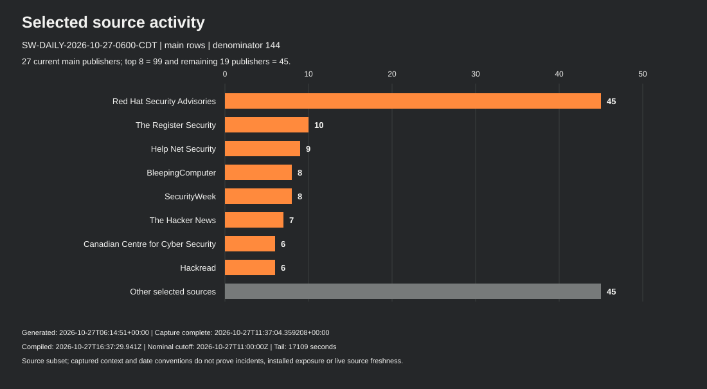
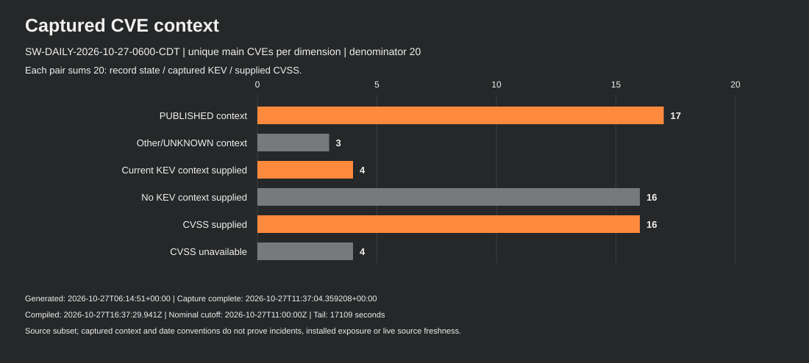
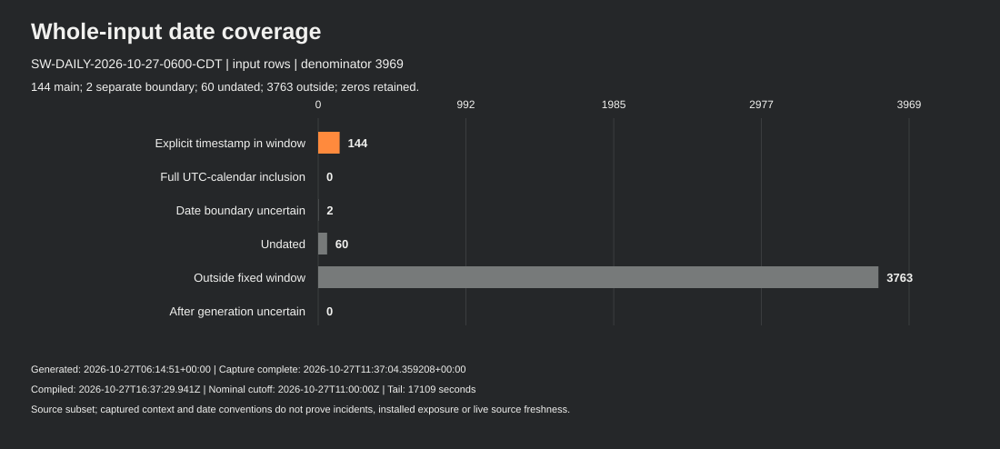

# Security intelligence · October 27, 2026 · 06:00 Chicago

Edition: **SW-DAILY-2026-10-27-0600-CDT** · **late / partial / source subset**.
Actual compilation: **2026-10-27T16:37:29.941Z**. The fixed 24-hour window is **2026-10-26T11:00:00Z through 2026-10-27T11:00:00Z**, start included/end excluded (Monday 06:00 through Tuesday 06:00 America/Chicago, UTC-05:00).

The nominal slot is distinct from actual publication. Publication metadata is frozen at compilation; later delivery is tracked separately.

This edition uses the frozen [Hub JSON source endpoint](https://teamstarwolf.github.io/intelligence-hub/data/feed.json) with **11,116,239 bytes** and whole-input SHA-256 **ae85034b4f65ac693941f5378a9061dffac003383e2c577a8d7828e013f7f9de**. The endpoint can change later; the edition binds the retained identity above. No raw feed or publisher article bodies are included.

## Executive summary

The main union contains **144 explicitly timestamped publication rows from 27 publishers**, mentioning **20 unique CVEs**. There are **zero main period KEV-addition rows**, while **four main CVE briefs carry captured KEV membership**. Two date-only boundary rows remain on a separate watchlist. These are publication/catalogue measures, not incidents, new disclosures, observed attacks or installed exposure.

Seventeen selected CNA contexts are PUBLISHED and three remain UNKNOWN after failed enrichment. Sixteen have a supplied CVSS object and four do not; unavailable scores remain unavailable. All 113 literal product/version rows and source-specific conditions are retained in data.json and the version table below. Three selected article labels and five unsafe CNA title/text fields remain unavailable.

The snapshot was generated at **2026-10-27T06:14:51+00:00** and captured from **2026-10-27T11:37:02.671507+00:00** through **2026-10-27T11:37:04.359208+00:00**. Its generation leaves **17,109 seconds (4 hours 45 minutes 9 seconds)** before the nominal11Z cutoff. Later capture, analysis and report assembly do not fill that tail. The saved metadata does not establish a repaired collector, a ten-minute cadence or fresh current Hub status.

## Selected notable developments

### 1. PHP pair guidance and a separate unresolved follow-up

The retained PHP pair includes branch-specific upstream release guidance, distribution/LTS backport qualifications and SAPI/request-state prerequisites. The separate CVE-2026-115560 follow-up remains UNKNOWN in the loaded CNA context; the cited release plan and conditional upload-progress setting do not establish a shipped third fix or complete mitigation of the pair.

Evidence scope: Captured CNA/KEV and qualified supplementary PHP/CISA context; publisher article bodies not checked; no installed-exposure or equal-SAPI-exploitability conclusion.

References: [CVE-2026-109618](https://www.cve.org/CVERecord?id=CVE-2026-109618), [CVE-2026-109619](https://www.cve.org/CVERecord?id=CVE-2026-109619), [CVE-2026-115560](https://www.cve.org/CVERecord?id=CVE-2026-115560).

### 2. Brotli decoder context retains three release branches

The captured record supplies affected ranges ending before 1.0.10, 1.1.1 and 1.2.1 and an explicit publisher solution. Consumers and packaging differ; the publication metadata does not establish that every embedding product or installed build is affected or fixed.

Evidence scope: CNA source/version/solution context with retained applicability limits, not a new source request or current software inventory.

References: [CVE-2026-111497](https://www.cve.org/CVERecord?id=CVE-2026-111497).

### 3. Five NGINX contexts preserve custom ranges and withheld guidance

The data retains distinct NGINX Plus and Open Source product blocks, custom R33-R36 rows, default statuses and all literal bounds. Workaround text for two contexts is withheld and unavailable; it is not evidence that no workaround exists. Range endpoints alone do not establish shipped fixes.

Evidence scope: Captured CNA conditions; metadata mentions and CVSS are not proof of device exposure or observed attack.

References: [CVE-2026-15176](https://www.cve.org/CVERecord?id=CVE-2026-15176), [CVE-2026-93479](https://www.cve.org/CVERecord?id=CVE-2026-93479), [CVE-2026-95101](https://www.cve.org/CVERecord?id=CVE-2026-95101), [CVE-2026-97205](https://www.cve.org/CVERecord?id=CVE-2026-97205), [CVE-2026-97629](https://www.cve.org/CVERecord?id=CVE-2026-97629).

### 4. Commerce records retain affected and unaffected product statements

The older input-validation record and the upload-handling record remain separate. The latter has four product blocks, affected endpoint lists and separately declared unaffected July identifiers; these custom strings must not be flattened into one universal ordered range. Missing structured guidance does not establish that no vendor fix exists.

Evidence scope: Source-attributed CNA/KEV context. A store-campaign headline does not independently identify exploitation of these CVEs.

References: [CVE-2025-54236](https://www.cve.org/CVERecord?id=CVE-2025-54236), [CVE-2026-48356](https://www.cve.org/CVERecord?id=CVE-2026-48356).

### 5. GitLab and VeloCloud guidance stays train-specific

GitLab supplies seven release-train endpoints and a solution. VeloCloud supplies three custom train ranges, fixed-release guidance and interim administrative-access/monitoring conditions. CISA dates remain federal catalogue context, and different CVSS metric versions do not form a local risk ranking.

Evidence scope: Retained publisher/CNA conditions; no environment assessment, automatic remediation or current release verification.

References: [CVE-2026-110264](https://www.cve.org/CVERecord?id=CVE-2026-110264), [CVE-2026-114625](https://www.cve.org/CVERecord?id=CVE-2026-114625).

### 6. Kernel and container context keeps branch and configuration limits

The three Linux records retain Git intervals, per-product default statuses and explicit release/unaffected rows. Kata retains its literal version condition and unknown default status. Package/backport evidence remains necessary; one published Linux context has no supplied CVSS object.

Evidence scope: Captured product/version metadata; no universal older-version vulnerability rule or shipped-fix assurance.

References: [CVE-2026-24834](https://www.cve.org/CVERecord?id=CVE-2026-24834), [CVE-2026-74753](https://www.cve.org/CVERecord?id=CVE-2026-74753), [CVE-2026-80521](https://www.cve.org/CVERecord?id=CVE-2026-80521), [CVE-2026-80841](https://www.cve.org/CVERecord?id=CVE-2026-80841).

### 7. AI and software-delivery themes remain publication metadata

Selected metadata covers coding-agent instructions, Markdown trust boundaries, AI cache isolation and LiteLLM access-key/supply-chain topics. These pointers support a reading watchlist; their body claims, incident totals and exploit narratives were not independently checked.

Evidence scope: Publication metadata only; no headline-derived CVE, exposure, new-disclosure, incident or actor-identity inference.

References: [source metadata](https://www.helpnetsecurity.com/2026/10/26/ai-coding-agents-malware-openai-codex/), [source metadata](https://www.darkreading.com/application-security/in-the-wild-attack-ai-agents-trust-markdown), [source metadata](https://blog.cloudflare.com/kv-cache-exposure-remediation/), [source metadata](https://therecord.media/litellm-hackers-ai-malware).

### 8. Coverage and revision evidence remain partial

The main union has 144 declared timestamp rows from 27 publishers; 45 rows are Red Hat advisories. The generated input leaves 17,109 seconds before nominal cutoff. The revision pass reconciles 2,170 citation occurrences from 17 reports without selecting, fetching or comparing publisher bodies.

Evidence scope: Frozen input/cohort and accepted offline metadata counts, not threat growth, a full source history or source freshness/repair evidence.

References: [source metadata](https://teamstarwolf.github.io/intelligence-hub/data/feed.json).

## Period KEV additions and retained KEV context

The main addition count is **0**. The two CISA rows for CVE-2026-109618 and CVE-2026-109619 have the source date 2026-10-26, without a publication instant. Under the declared UTC-calendar convention their possible day crosses the11Z start boundary; both stay outside the main addition count. Publisher timezone is unknown.

The following four membership records are captured context attached to main CVE mentions. Their addition/due dates are catalogue fields, not a period incident count, first-exploitation date or deadline assigned to this report’s readers. All four retained ransomware fields read Unknown.

| Captured KEV context | Date added | Catalogue/federal due date | Ransomware field |
| --- | --- | --- | --- |
| [CVE-2025-54236](https://www.cisa.gov/known-exploited-vulnerabilities-catalog?field_cve=CVE-2025-54236) | 2025-10-24 | 2025-11-14 | Unknown |
| [CVE-2026-109618](https://www.cisa.gov/known-exploited-vulnerabilities-catalog?field_cve=CVE-2026-109618) | 2026-10-26 | 2026-10-29 | Unknown |
| [CVE-2026-109619](https://www.cisa.gov/known-exploited-vulnerabilities-catalog?field_cve=CVE-2026-109619) | 2026-10-26 | 2026-10-29 | Unknown |
| [CVE-2026-114625](https://www.cisa.gov/known-exploited-vulnerabilities-catalog?field_cve=CVE-2026-114625) | 2026-10-23 | 2026-10-26 | Unknown |

Adobe’s action retains the applicable BOD 22-01/vendor-guidance scope. The PHP pair and VeloCloud actions retain BOD 26-04/forensics-triage and conditional cloud/discontinue-use language. The original action text and source URL remain in each JSON brief. No organizational applicability was assessed.

## CVE, product, CVSS and guidance context

The table preserves separate record and source states. Record references are navigation pointers; the three UNKNOWN/failed contexts do not establish registry absence, an unavailable vendor fix or lack of exploitation. Scores retain their CVSS source and metric version; a cross-version numeric ranking is not a local risk assessment.

| CVE reference | Approved record label | Record/source state | Product blocks / version rows | Source CVSS | Guidance status |
| --- | --- | --- | ---: | --- | --- |
| [CVE-2025-54236](https://www.cve.org/CVERecord?id=CVE-2025-54236) | Adobe Commerce input-validation context | PUBLISHED / ok | 1 / 1 | 9.1 · v3.1 · `CVSS:3.1/AV:N/AC:L/PR:N/UI:N/S:U/C:H/I:H/A:N` | CISA action; structured solution/workaround not supplied |
| [CVE-2026-109618](https://www.cve.org/CVERecord?id=CVE-2026-109618) | PHP memory-management vulnerability context | PUBLISHED / ok | 1 / 4 | 9.2 · v4.0 · `CVSS:4.0/AV:N/AC:H/AT:P/PR:N/UI:N/VC:H/VI:H/VA:H/SC:N/SI:N/SA:N` | CISA action; workaround/advisory pointer supplied |
| [CVE-2026-109619](https://www.cve.org/CVERecord?id=CVE-2026-109619) | PHP request-state vulnerability context | PUBLISHED / ok | 1 / 4 | 9.2 · v4.0 · `CVSS:4.0/AV:N/AC:H/AT:P/PR:N/UI:N/VC:H/VI:H/VA:H/SC:N/SI:N/SA:N` | CISA action; workaround/advisory pointer supplied |
| [CVE-2026-110264](https://www.cve.org/CVERecord?id=CVE-2026-110264) | GitLab integer-overflow context | PUBLISHED / ok | 1 / 7 | 10 · v3.1 · `CVSS:3.1/AV:N/AC:L/PR:N/UI:N/S:C/C:H/I:H/A:H` | solution supplied |
| [CVE-2026-111497](https://www.cve.org/CVERecord?id=CVE-2026-111497) | Brotli decoder memory-safety context | PUBLISHED / ok | 1 / 3 | 9.2 · v4.0 · `CVSS:4.0/AV:N/AC:L/AT:P/PR:N/UI:N/VC:H/VI:H/VA:H/SC:N/SI:N/SA:N` | solution supplied |
| [CVE-2026-114625](https://www.cve.org/CVERecord?id=CVE-2026-114625) | VeloCloud Orchestrator advisory context | PUBLISHED / ok | 1 / 3 | 9.4 · v4.0 · `CVSS:4.0/AV:N/AC:L/AT:N/PR:L/UI:N/VC:H/VI:H/VA:H/SC:H/SI:H/SA:H` | CISA action; solution supplied |
| [CVE-2026-115418](https://www.cve.org/CVERecord?id=CVE-2026-115418) | unavailable (withheld) | PUBLISHED / ok | 1 / 1 | 7 · v4.0 · `CVSS:4.0/AV:L/AC:L/AT:N/PR:L/UI:A/VC:H/VI:H/VA:H/SC:N/SI:N/SA:N` | structured solution/workaround not supplied |
| [CVE-2026-115560](https://www.cve.org/CVERecord?id=CVE-2026-115560) | Unverified CNA context for CVE-2026-115560 | UNKNOWN / failed | 0 / 0 | unavailable | structured solution/workaround not supplied |
| [CVE-2026-15176](https://www.cve.org/CVERecord?id=CVE-2026-15176) | NGINX core-module context | PUBLISHED / ok | 2 / 8 | 9.2 · v4.0 · `CVSS:4.0/AV:N/AC:H/AT:N/PR:N/UI:N/VC:H/VI:H/VA:H/SC:N/SI:N/SA:N` | workaround/advisory pointer supplied |
| [CVE-2026-24834](https://www.cve.org/CVERecord?id=CVE-2026-24834) | Kata Containers privilege-boundary context | PUBLISHED / ok | 1 / 1 | 9.4 · v3.1 · `CVSS:3.1/AV:L/AC:L/PR:N/UI:N/S:C/C:H/I:H/A:H` | structured solution/workaround not supplied |
| [CVE-2026-48356](https://www.cve.org/CVERecord?id=CVE-2026-48356) | Adobe Commerce upload-handling context | PUBLISHED / ok | 4 / 8 | 9.3 · v3.1 · `CVSS:3.1/AV:N/AC:L/PR:N/UI:R/S:C/C:H/I:H/A:N` | structured solution/workaround not supplied |
| [CVE-2026-74753](https://www.cve.org/CVERecord?id=CVE-2026-74753) | Linux perf event-lifetime context | PUBLISHED / ok | 2 / 9 | 7.8 · v3.1 · `CVSS:3.1/AV:L/AC:L/PR:L/UI:N/S:U/C:H/I:H/A:H` | structured solution/workaround not supplied |
| [CVE-2026-80521](https://www.cve.org/CVERecord?id=CVE-2026-80521) | Linux UNIX-socket lifecycle context | PUBLISHED / ok | 2 / 16 | 7.8 · v3.1 · `CVSS:3.1/AV:L/AC:L/PR:L/UI:N/S:U/C:H/I:H/A:H` | structured solution/workaround not supplied |
| [CVE-2026-80841](https://www.cve.org/CVERecord?id=CVE-2026-80841) | Linux packet-buffer lifetime context | PUBLISHED / ok | 2 / 14 | unavailable | structured solution/workaround not supplied |
| [CVE-2026-90975](https://www.cve.org/CVERecord?id=CVE-2026-90975) | Unverified CNA context for CVE-2026-90975 | UNKNOWN / failed | 0 / 0 | unavailable | structured solution/workaround not supplied |
| [CVE-2026-91141](https://www.cve.org/CVERecord?id=CVE-2026-91141) | Unverified CNA context for CVE-2026-91141 | UNKNOWN / failed | 0 / 0 | unavailable | structured solution/workaround not supplied |
| [CVE-2026-93479](https://www.cve.org/CVERecord?id=CVE-2026-93479) | NGINX map and regex-handling context | PUBLISHED / ok | 2 / 8 | 9.2 · v4.0 · `CVSS:4.0/AV:N/AC:H/AT:N/PR:N/UI:N/VC:H/VI:H/VA:H/SC:N/SI:N/SA:N` | workaround/advisory pointer supplied |
| [CVE-2026-95101](https://www.cve.org/CVERecord?id=CVE-2026-95101) | NGINX HTTP3 context | PUBLISHED / ok | 2 / 9 | 6.9 · v4.0 · `CVSS:4.0/AV:N/AC:L/AT:N/PR:N/UI:N/VC:N/VI:L/VA:N/SC:N/SI:N/SA:N` | workaround text unavailable |
| [CVE-2026-97205](https://www.cve.org/CVERecord?id=CVE-2026-97205) | NGINX core request-processing context | PUBLISHED / ok | 2 / 8 | 9.2 · v4.0 · `CVSS:4.0/AV:N/AC:H/AT:N/PR:N/UI:N/VC:H/VI:H/VA:H/SC:N/SI:N/SA:N` | workaround/advisory pointer supplied |
| [CVE-2026-97629](https://www.cve.org/CVERecord?id=CVE-2026-97629) | NGINX TLS-module context | PUBLISHED / ok | 2 / 9 | 8.3 · v4.0 · `CVSS:4.0/AV:N/AC:L/AT:P/PR:N/UI:N/VC:H/VI:L/VA:N/SC:N/SI:N/SA:N` | workaround text unavailable |

### PHP pair: nine retained steps and six limits

Each of the two PHP JSON briefs keeps all nine guidance steps and six limitations. This outline separates supplementary notice/advisory dates from the source-record and retrieval clocks.

1. Establish the exact installed product, package, version, SAPI and configuration against the cited record; this report has no environment inventory.
2. Retain the CISA BOD 26-04 and forensics-triage action with its federal/catalogue scope. Internet-exposure evaluation and applicability remain an asset-owner task; catalogue due dates are not deadlines assigned to every reader.
3. The structured CNA workaround points to the GitHub Security Advisory. That pointer is a request to consult the advisory, not a complete remediation claim.
4. After a separately authorized change, compare the installed version/configuration and package evidence with vendor guidance; the report does not patch or verify a device.
5. The PHP notice dated 2026-10-21 lists initial-pair upstream releases 8.5.12, 8.4.27, 8.3.36 and 8.2.35. Distribution/LTS fixes and minimal backports for 7.4, 8.0 and 8.1 are separate qualifications: a lower displayed number alone does not show that a vendor package lacks the patch.
6. The susceptibility advisory documents an unauthenticated pre-application mod_php demonstration and discusses other SAPIs with qualifications. Broad web-serving risk is not proof of equal demonstrated exploitability across every SAPI, configuration, version or patched installation.
7. The request-state advisory distinguishes concrete demonstrations from candidate cases and configuration-dependent same-worker paths. The cited request/SAPI prerequisites have not been established for an installed deployment here.
8. The CISA alert revised 2026-10-23 gives conditional temporary-offline guidance when organizations cannot update immediately or use unsupported PHP 8.1 or earlier, until patched or updated. It does not make every numerically older build unpatched/unpatchable; the retained page does not establish its initial publication time.
9. The PHP notice dated 2026-10-23 treats CVE-2026-115560 separately: a next-regular-release plan and session.upload_progress.enabled=0 for the unusual php_binary/php_serialize-to-php ini_set() change before session_start(), while upload progress remains enabled. This condition is not complete mitigation of the initial pair, a shipped third fix, or historical registry-absence proof.

The six scope limits are:

- This is retained source-grounded context, without an environment assessment or automatic patch instruction.
- Bounded excerpts do not replace the original product/version/configuration applicability guidance.
- CISA catalogue/federal due dates keep their original audience and scope.
- CVSS versions and product contexts differ; scores are not a local risk ranking.
- Supplementary publisher context does not change the loaded CNA state, CVSS, KEV membership, guidance classification or establish device exposure.
- Notice/advisory/CISA revision dates are distinct from generation, retrieval and last-check clocks. Later release/registry history and actual vendor packages were not established here.

### Branches, default statuses and missing guidance

GitLab’s explicit solution lists 18.11.13, 19.0.10, 19.1.9, 19.2.9, 19.3.6, 19.4.3 and 19.5.1 for the corresponding source trains. Brotli’s three source branches end before 1.0.10, 1.1.1 and 1.2.1, with an explicit solution. VeloCloud’s custom 5.2 / 6.1 / 6.4 ranges retain fixed releases 5.2.3.18, 6.1.3.10 and 6.4.2.12 and interim administrative-network/monitoring conditions until fixed software is deployed. These are retained publisher statements, not new package checks or automatic remediation instructions.

All five NGINX Plus blocks keep default_status=unknown and the custom R33-R36 rows. CVE-2026-95101 has its distinct 37.1.0 → 37.2.0.1 and 37.0.0 → 37.0.7.1 bounds; the other four retain their own 37.1.0 → 37.1.0.1 and 37.0.0 → 37.0.5.1 bounds. The Open Source rows and default statuses are separately preserved. Wildcards/custom strings are literal source conditions, not universal version-order or shipped-fix assurances.

The readable NGINX guidance separately covers avoiding alias/$request_filename, using named regex captures limited to their matching block, and disabling aio or avoiding SSI. The workaround text for CVE-2026-95101 and CVE-2026-97629 remains NULL, as do the corresponding guidance-step details; this report does not reconstruct it or say no workaround exists. The structured solution arrays for these five contexts are empty.

Adobe Commerce CVE-2025-54236 retains the source’s affected default and inclusive 2.4.4-p15 bound. CVE-2026-48356 retains four product blocks: affected endpoint lists, separate unaffected July identifiers and the Commerce Events 1.20.0 / 1.21.0 statements. Custom lists are not collapsed into a single ordered range. Neither absent structured solution/workaround arrays nor an unaffected row proves current installed remediation.

The AWS context for CVE-2026-115418 retains its product/version block (aws-cdk/aws-redshift-alpha, 0 before 2.274.0-alpha.0, default unaffected), but the record title is unavailable for privacy. That product information is not used to reconstruct the withheld title. Its empty solution/workaround arrays do not establish that no mitigation exists.

Kata keeps the literal version string “< 3.27.0”, an empty version_type and default_status=unknown; a boundary string is not a shipped-fix confirmation. Linux CVE-2026-74753,80521 and80841 retain separate product blocks, Git intervals and branch/status rows, including explicit unaffected statements for the latter two. Distribution/backport evidence remains necessary; a lower display number alone is not a vulnerability finding. CVE-2026-80841 has no supplied CVSS object.

CVE-2026-115560,90975 and91141 remain UNKNOWN/failed, with no supplied products, versions or CVSS. Publisher metadata mentioning an identifier does not repair those fields or establish registry history. The PHP follow-up release plan remains distinct from its unavailable CNA record.

### All 113 literal product/version rows

Empty source strings are shown as `""`. Each product block keeps its own default status. The columns retain exclusive and inclusive fields separately, including custom/wildcard/Git/original_commit_for_fix values; duplicate product names do not merge their blocks. Public Git version identifiers below are version data, not private proof hashes.

| # | CVE | Vendor / product | Default status | Literal version | Row status | less_than (exclusive) | less_than_or_equal (inclusive) | Version type |
| ---: | --- | --- | --- | --- | --- | --- | --- | --- |
| 1 | CVE-2025-54236 | Adobe / Adobe Commerce | affected | `0` | affected | `""` | `2.4.4-p15` | `semver` |
| 2 | CVE-2026-109618 | PHP Group / PHP | unaffected | `8.2.*` | affected | `8.2.35` | `""` | `semver` |
| 3 | CVE-2026-109618 | PHP Group / PHP | unaffected | `8.3.*` | affected | `8.3.36` | `""` | `semver` |
| 4 | CVE-2026-109618 | PHP Group / PHP | unaffected | `8.4.*` | affected | `8.4.27` | `""` | `semver` |
| 5 | CVE-2026-109618 | PHP Group / PHP | unaffected | `8.5.*` | affected | `8.5.12` | `""` | `semver` |
| 6 | CVE-2026-109619 | PHP Group / PHP | unaffected | `8.2.*` | affected | `8.2.35` | `""` | `semver` |
| 7 | CVE-2026-109619 | PHP Group / PHP | unaffected | `8.3.*` | affected | `8.3.36` | `""` | `semver` |
| 8 | CVE-2026-109619 | PHP Group / PHP | unaffected | `8.4.*` | affected | `8.4.27` | `""` | `semver` |
| 9 | CVE-2026-109619 | PHP Group / PHP | unaffected | `8.5.*` | affected | `8.5.12` | `""` | `semver` |
| 10 | CVE-2026-110264 | GitLab / GitLab | unaffected | `7.0` | affected | `18.11.13` | `""` | `semver` |
| 11 | CVE-2026-110264 | GitLab / GitLab | unaffected | `19.0` | affected | `19.0.10` | `""` | `semver` |
| 12 | CVE-2026-110264 | GitLab / GitLab | unaffected | `19.1` | affected | `19.1.9` | `""` | `semver` |
| 13 | CVE-2026-110264 | GitLab / GitLab | unaffected | `19.2` | affected | `19.2.9` | `""` | `semver` |
| 14 | CVE-2026-110264 | GitLab / GitLab | unaffected | `19.3` | affected | `19.3.6` | `""` | `semver` |
| 15 | CVE-2026-110264 | GitLab / GitLab | unaffected | `19.4` | affected | `19.4.3` | `""` | `semver` |
| 16 | CVE-2026-110264 | GitLab / GitLab | unaffected | `19.5` | affected | `19.5.1` | `""` | `semver` |
| 17 | CVE-2026-111497 | Google / Brotli | unaffected | `1.0.3` | affected | `1.0.10` | `""` | `semver` |
| 18 | CVE-2026-111497 | Google / Brotli | unaffected | `1.1.0` | affected | `1.1.1` | `""` | `semver` |
| 19 | CVE-2026-111497 | Google / Brotli | unaffected | `1.2.0` | affected | `1.2.1` | `""` | `semver` |
| 20 | CVE-2026-114625 | Arista Networks / VeloCloud Orchestrator | unaffected | `5.2.0` | affected | `5.2.3.18` | `""` | `custom` |
| 21 | CVE-2026-114625 | Arista Networks / VeloCloud Orchestrator | unaffected | `6.1.0` | affected | `6.1.3.10` | `""` | `custom` |
| 22 | CVE-2026-114625 | Arista Networks / VeloCloud Orchestrator | unaffected | `6.4.0` | affected | `6.4.2.12` | `""` | `custom` |
| 23 | CVE-2026-115418 | AWS / aws-cdk/aws-redshift-alpha | unaffected | `0` | affected | `2.274.0-alpha.0` | `""` | `custom` |
| 24 | CVE-2026-15176 | F5 / NGINX Plus | unknown | `37.1.0` | affected | `37.1.0.1` | `""` | `custom` |
| 25 | CVE-2026-15176 | F5 / NGINX Plus | unknown | `37.0.0` | affected | `37.0.5.1` | `""` | `custom` |
| 26 | CVE-2026-15176 | F5 / NGINX Plus | unknown | `R36` | affected | `*` | `""` | `custom` |
| 27 | CVE-2026-15176 | F5 / NGINX Plus | unknown | `R35` | affected | `*` | `""` | `custom` |
| 28 | CVE-2026-15176 | F5 / NGINX Plus | unknown | `R34` | affected | `*` | `""` | `custom` |
| 29 | CVE-2026-15176 | F5 / NGINX Plus | unknown | `R33` | affected | `*` | `""` | `custom` |
| 30 | CVE-2026-15176 | F5 / NGINX Open Source | unaffected | `1.31.0` | affected | `1.31.7` | `""` | `semver` |
| 31 | CVE-2026-15176 | F5 / NGINX Open Source | unaffected | `0.1.29` | affected | `1.30.6` | `""` | `semver` |
| 32 | CVE-2026-24834 | kata-containers / kata-containers | unknown | `< 3.27.0` | affected | `""` | `""` | `""` |
| 33 | CVE-2026-48356 | Adobe / Adobe Commerce | unaffected | `0` | affected | `""` | `2.4.9, 2.4.8-p5, 2.4.7-p10, 2.4.6-p15, 2.4.5-p17, 2.4.4-p18` | `custom` |
| 34 | CVE-2026-48356 | Adobe / Adobe Commerce | unaffected | `2.4.9-2026-jul, 2.4.8-2026-jul, 2.4.7-2026-jul, 2.4.6-2026-jul, 2.4.5-2026-jul, 2.4.4-2026-jul` | unaffected | `""` | `""` | `custom` |
| 35 | CVE-2026-48356 | Adobe / Adobe Commerce B2B | unaffected | `0` | affected | `""` | `1.5.3, 1.5.2-p5, 1.4.2-p10, 1.3.4-p17, 1.3.3-p18` | `custom` |
| 36 | CVE-2026-48356 | Adobe / Adobe Commerce B2B | unaffected | `1.5.3-2026-jul, 1.5.2-2026-jul, 1.4.2-2026-jul, 1.3.4-2026-jul, 1.3.3-2026-jul` | unaffected | `""` | `""` | `custom` |
| 37 | CVE-2026-48356 | Adobe / Magento Open Source | unaffected | `0` | affected | `""` | `2.4.9, 2.4.8-p5, 2.4.7-p10, 2.4.6-p15` | `custom` |
| 38 | CVE-2026-48356 | Adobe / Magento Open Source | unaffected | `2.4.9-2026-jul, 2.4.8-2026-jul, 2.4.7-2026-jul, 2.4.6-2026-jul` | unaffected | `""` | `""` | `custom` |
| 39 | CVE-2026-48356 | Adobe / Adobe Commerce Events | unaffected | `0` | affected | `""` | `1.20.0` | `semver` |
| 40 | CVE-2026-48356 | Adobe / Adobe Commerce Events | unaffected | `1.21.0` | unaffected | `""` | `""` | `semver` |
| 41 | CVE-2026-74753 | Linux / Linux | unaffected | `4cdb1b3ab96eb1b7eb70bc5c82fede334bd60df2` | affected | `ce12e1170c0c78dffb9b28af6d287492ae7dd99d` | `""` | `git` |
| 42 | CVE-2026-74753 | Linux / Linux | unaffected | `39358e856fb89e62e3c8d7389a2dc4ec33dbe90e` | affected | `e593031ff19a9484e8a00bc47edd447187721846` | `""` | `git` |
| 43 | CVE-2026-74753 | Linux / Linux | unaffected | `a2d5d3ee7b6e3953114726b1521e62123ab5b043` | affected | `7a03413f31c196ab3894f988cdce0bb47b4fec42` | `""` | `git` |
| 44 | CVE-2026-74753 | Linux / Linux | unaffected | `06ccef0434e98058ddae7bcebc901f93d22b7653` | affected | `7ce010275c531475f9d6e7efb11b9e522c74ed2e` | `""` | `git` |
| 45 | CVE-2026-74753 | Linux / Linux | unaffected | `037a3c43edfb597665dd34457cd22b14692f2ba3` | affected | `fa091f46c3833fb22384f10eade2b4e1e1d0b278` | `""` | `git` |
| 46 | CVE-2026-74753 | Linux / Linux | unaffected | `6.6.145` | affected | `6.6.156` | `""` | `semver` |
| 47 | CVE-2026-74753 | Linux / Linux | unaffected | `6.12.96` | affected | `6.12.108` | `""` | `semver` |
| 48 | CVE-2026-74753 | Linux / Linux | unaffected | `6.18.39` | affected | `6.18.46` | `""` | `semver` |
| 49 | CVE-2026-74753 | Linux / Linux | unaffected | `7.1.4` | affected | `7.1.10` | `""` | `semver` |
| 50 | CVE-2026-80521 | Linux / Linux | unaffected | `5dfd283f4651d04dbb70ceb9ae5c4a30eda3c52a` | affected | `2b6c2842692d08e7acaf32d1eb47f95def35f3fe` | `""` | `git` |
| 51 | CVE-2026-80521 | Linux / Linux | unaffected | `de7921631ff323369aa63a4324695ab54ea4047e` | affected | `6fda5c51b8e43a8440f76e65c89d9f95ddb2ef33` | `""` | `git` |
| 52 | CVE-2026-80521 | Linux / Linux | unaffected | `4090fa373f0e763c43610853d2774b5979915959` | affected | `1293fd69a50d188a5788b08ba3741a3e86be1608` | `""` | `git` |
| 53 | CVE-2026-80521 | Linux / Linux | unaffected | `4090fa373f0e763c43610853d2774b5979915959` | affected | `fe198b077864feafd4aa4b33b1a5ce26f50195a2` | `""` | `git` |
| 54 | CVE-2026-80521 | Linux / Linux | unaffected | `4090fa373f0e763c43610853d2774b5979915959` | affected | `e3702470ced94fad74d71e2232f022d2eb752a6d` | `""` | `git` |
| 55 | CVE-2026-80521 | Linux / Linux | unaffected | `4090fa373f0e763c43610853d2774b5979915959` | affected | `594d905195024b228c962627ae5ae7c17bd582a4` | `""` | `git` |
| 56 | CVE-2026-80521 | Linux / Linux | unaffected | `6.1.141` | affected | `6.1.189` | `""` | `semver` |
| 57 | CVE-2026-80521 | Linux / Linux | unaffected | `6.6.93` | affected | `6.6.158` | `""` | `semver` |
| 58 | CVE-2026-80521 | Linux / Linux | affected | `6.10` | affected | `""` | `""` | `""` |
| 59 | CVE-2026-80521 | Linux / Linux | affected | `0` | unaffected | `6.10` | `""` | `semver` |
| 60 | CVE-2026-80521 | Linux / Linux | affected | `6.1.189` | unaffected | `""` | `6.1.*` | `semver` |
| 61 | CVE-2026-80521 | Linux / Linux | affected | `6.6.158` | unaffected | `""` | `6.6.*` | `semver` |
| 62 | CVE-2026-80521 | Linux / Linux | affected | `6.12.111` | unaffected | `""` | `6.12.*` | `semver` |
| 63 | CVE-2026-80521 | Linux / Linux | affected | `6.18.53` | unaffected | `""` | `6.18.*` | `semver` |
| 64 | CVE-2026-80521 | Linux / Linux | affected | `7.1.10` | unaffected | `""` | `7.1.*` | `semver` |
| 65 | CVE-2026-80521 | Linux / Linux | affected | `7.2` | unaffected | `""` | `*` | `original_commit_for_fix` |
| 66 | CVE-2026-80841 | Linux / Linux | unaffected | `b013840810c221f2b0cf641d01531526052dc1fb` | affected | `debf9f50140b3df3949ebcb97d4450f8993fe32d` | `""` | `git` |
| 67 | CVE-2026-80841 | Linux / Linux | unaffected | `b013840810c221f2b0cf641d01531526052dc1fb` | affected | `4ce6e2d2e38055b2012bd5fdb0c8a8183c8a1b0c` | `""` | `git` |
| 68 | CVE-2026-80841 | Linux / Linux | unaffected | `b013840810c221f2b0cf641d01531526052dc1fb` | affected | `ed25ed29034ddc3dbe451ccbaa58ab9932f99d8b` | `""` | `git` |
| 69 | CVE-2026-80841 | Linux / Linux | unaffected | `b013840810c221f2b0cf641d01531526052dc1fb` | affected | `0189dce07db2dc059ae0570e06758ec4233c6e11` | `""` | `git` |
| 70 | CVE-2026-80841 | Linux / Linux | unaffected | `b013840810c221f2b0cf641d01531526052dc1fb` | affected | `550d00aa58193fb649a09a9c9e338c685adad784` | `""` | `git` |
| 71 | CVE-2026-80841 | Linux / Linux | unaffected | `b013840810c221f2b0cf641d01531526052dc1fb` | affected | `992cc9f94ca924089a506ba9b327caa9af797529` | `""` | `git` |
| 72 | CVE-2026-80841 | Linux / Linux | affected | `3.14` | affected | `""` | `""` | `""` |
| 73 | CVE-2026-80841 | Linux / Linux | affected | `0` | unaffected | `3.14` | `""` | `semver` |
| 74 | CVE-2026-80841 | Linux / Linux | affected | `6.6.158` | unaffected | `""` | `6.6.*` | `semver` |
| 75 | CVE-2026-80841 | Linux / Linux | affected | `6.12.111` | unaffected | `""` | `6.12.*` | `semver` |
| 76 | CVE-2026-80841 | Linux / Linux | affected | `6.18.51` | unaffected | `""` | `6.18.*` | `semver` |
| 77 | CVE-2026-80841 | Linux / Linux | affected | `7.1.13` | unaffected | `""` | `7.1.*` | `semver` |
| 78 | CVE-2026-80841 | Linux / Linux | affected | `7.2.3` | unaffected | `""` | `7.2.*` | `semver` |
| 79 | CVE-2026-80841 | Linux / Linux | affected | `7.3` | unaffected | `""` | `*` | `original_commit_for_fix` |
| 80 | CVE-2026-93479 | F5 / NGINX Plus | unknown | `37.1.0` | affected | `37.1.0.1` | `""` | `custom` |
| 81 | CVE-2026-93479 | F5 / NGINX Plus | unknown | `37.0.0` | affected | `37.0.5.1` | `""` | `custom` |
| 82 | CVE-2026-93479 | F5 / NGINX Plus | unknown | `R36` | affected | `*` | `""` | `custom` |
| 83 | CVE-2026-93479 | F5 / NGINX Plus | unknown | `R35` | affected | `*` | `""` | `custom` |
| 84 | CVE-2026-93479 | F5 / NGINX Plus | unknown | `R34` | affected | `*` | `""` | `custom` |
| 85 | CVE-2026-93479 | F5 / NGINX Plus | unknown | `R33` | affected | `*` | `""` | `custom` |
| 86 | CVE-2026-93479 | F5 / NGINX Open Source | unaffected | `1.31.2` | affected | `1.31.7` | `""` | `custom` |
| 87 | CVE-2026-93479 | F5 / NGINX Open Source | unaffected | `1.30.0` | affected | `1.30.6` | `""` | `custom` |
| 88 | CVE-2026-95101 | F5 / NGINX Plus | unknown | `37.1.0` | affected | `37.2.0.1` | `""` | `custom` |
| 89 | CVE-2026-95101 | F5 / NGINX Plus | unknown | `37.0.0` | affected | `37.0.7.1` | `""` | `custom` |
| 90 | CVE-2026-95101 | F5 / NGINX Plus | unknown | `R36` | affected | `*` | `""` | `custom` |
| 91 | CVE-2026-95101 | F5 / NGINX Plus | unknown | `R35` | affected | `*` | `""` | `custom` |
| 92 | CVE-2026-95101 | F5 / NGINX Plus | unknown | `R34` | affected | `*` | `""` | `custom` |
| 93 | CVE-2026-95101 | F5 / NGINX Plus | unknown | `R33` | affected | `*` | `""` | `custom` |
| 94 | CVE-2026-95101 | F5 / NGINX Open Source | unknown | `1.31.0` | affected | `1.31.7` | `""` | `custom` |
| 95 | CVE-2026-95101 | F5 / NGINX Open Source | unknown | `1.30.0` | affected | `1.30.6` | `""` | `custom` |
| 96 | CVE-2026-95101 | F5 / NGINX Open Source | unknown | `1.25.0` | affected | `*` | `""` | `custom` |
| 97 | CVE-2026-97205 | F5 / NGINX Plus | unknown | `37.1.0` | affected | `37.1.0.1` | `""` | `custom` |
| 98 | CVE-2026-97205 | F5 / NGINX Plus | unknown | `37.0.0` | affected | `37.0.5.1` | `""` | `custom` |
| 99 | CVE-2026-97205 | F5 / NGINX Plus | unknown | `R36` | affected | `*` | `""` | `custom` |
| 100 | CVE-2026-97205 | F5 / NGINX Plus | unknown | `R35` | affected | `*` | `""` | `custom` |
| 101 | CVE-2026-97205 | F5 / NGINX Plus | unknown | `R34` | affected | `*` | `""` | `custom` |
| 102 | CVE-2026-97205 | F5 / NGINX Plus | unknown | `R33` | affected | `*` | `""` | `custom` |
| 103 | CVE-2026-97205 | F5 / NGINX Open Source | unaffected | `1.31.0` | affected | `1.31.7` | `""` | `custom` |
| 104 | CVE-2026-97205 | F5 / NGINX Open Source | unaffected | `1.30.0` | affected | `1.30.6` | `""` | `custom` |
| 105 | CVE-2026-97629 | F5 / NGINX Plus | unknown | `37.1.0` | affected | `37.1.0.1` | `""` | `custom` |
| 106 | CVE-2026-97629 | F5 / NGINX Plus | unknown | `37.0.0` | affected | `37.0.5.1` | `""` | `custom` |
| 107 | CVE-2026-97629 | F5 / NGINX Plus | unknown | `R36` | affected | `*` | `""` | `custom` |
| 108 | CVE-2026-97629 | F5 / NGINX Plus | unknown | `R35` | affected | `*` | `""` | `custom` |
| 109 | CVE-2026-97629 | F5 / NGINX Plus | unknown | `R34` | affected | `*` | `""` | `custom` |
| 110 | CVE-2026-97629 | F5 / NGINX Plus | unknown | `R33` | affected | `*` | `""` | `custom` |
| 111 | CVE-2026-97629 | F5 / NGINX Open Source | unknown | `1.31.0` | affected | `1.31.7` | `""` | `custom` |
| 112 | CVE-2026-97629 | F5 / NGINX Open Source | unknown | `1.30.0` | affected | `1.30.6` | `""` | `custom` |
| 113 | CVE-2026-97629 | F5 / NGINX Open Source | unknown | `1.23.3` | affected | `*` | `""` | `custom` |

### Retained CNA clocks

Raw source-update, retained-retrieval and attempt strings are distinct. NULL means unavailable; current retained context does not recreate what was known at the period cutoff.

| CVE | Source updated | Retained retrieval | Last source attempt |
| --- | --- | --- | --- |
| CVE-2025-54236 | `2025-10-24T22:20:23+00:00` | `2026-10-27T06:14:21+00:00` | `2026-10-27T06:14:20+00:00` |
| CVE-2026-109618 | `2026-10-27T03:55:25+00:00` | `2026-10-27T06:14:18+00:00` | `2026-10-27T06:14:18+00:00` |
| CVE-2026-109619 | `2026-10-27T03:55:26+00:00` | `2026-10-27T06:14:18+00:00` | `2026-10-27T06:14:18+00:00` |
| CVE-2026-110264 | `2026-10-22T23:05:04+00:00` | `2026-10-27T06:14:18+00:00` | `2026-10-27T06:14:18+00:00` |
| CVE-2026-111497 | `2026-10-26T18:10:34+00:00` | `2026-10-27T06:14:17+00:00` | `2026-10-27T06:14:17+00:00` |
| CVE-2026-114625 | `2026-10-24T03:55:14+00:00` | `2026-10-27T06:14:17+00:00` | `2026-10-27T06:14:17+00:00` |
| CVE-2026-115418 | `2026-10-26T16:39:08+00:00` | `2026-10-26T17:27:38+00:00` | `2026-10-26T17:27:37+00:00` |
| CVE-2026-115560 | `NULL` | `NULL` | `2026-10-27T06:05:22+00:00` |
| CVE-2026-15176 | `2026-10-15T10:31:15+00:00` | `2026-10-27T06:14:17+00:00` | `2026-10-27T06:14:17+00:00` |
| CVE-2026-24834 | `2026-07-15T01:16:53+00:00` | `2026-10-26T16:24:11+00:00` | `2026-10-26T16:24:11+00:00` |
| CVE-2026-48356 | `2026-08-27T22:39:18+00:00` | `2026-10-26T21:43:51+00:00` | `2026-10-26T21:43:51+00:00` |
| CVE-2026-74753 | `2026-10-16T19:26:24+00:00` | `2026-10-26T16:24:11+00:00` | `2026-10-26T16:24:11+00:00` |
| CVE-2026-80521 | `2026-10-03T10:56:06+00:00` | `2026-10-26T16:24:11+00:00` | `2026-10-26T16:24:11+00:00` |
| CVE-2026-80841 | `2026-10-19T08:44:34+00:00` | `2026-10-26T16:24:11+00:00` | `2026-10-26T16:24:11+00:00` |
| CVE-2026-90975 | `NULL` | `NULL` | `2026-10-27T06:05:21+00:00` |
| CVE-2026-91141 | `NULL` | `NULL` | `2026-10-27T06:05:21+00:00` |
| CVE-2026-93479 | `2026-10-23T21:51:37+00:00` | `2026-10-27T06:05:22+00:00` | `2026-10-27T06:05:22+00:00` |
| CVE-2026-95101 | `2026-10-15T16:43:46+00:00` | `2026-10-27T00:54:32+00:00` | `2026-10-27T00:54:32+00:00` |
| CVE-2026-97205 | `2026-10-15T10:31:15+00:00` | `2026-10-27T00:54:32+00:00` | `2026-10-27T00:54:32+00:00` |
| CVE-2026-97629 | `2026-10-15T16:43:47+00:00` | `2026-10-27T00:54:31+00:00` | `2026-10-27T00:54:31+00:00` |

## CNA weaknesses and qualified CWE/CAPEC taxonomy

Fourteen of 20 main contexts supply weakness identifiers; six do not. The 15 distinct CNA CWE IDs below have many-to-many CVE membership and must not be summed as incidents. Missing identifiers are not evidence of no weakness.

| CNA weakness ID | Main CVE membership |
| --- | --- |
| CWE-122 | CVE-2026-15176, CVE-2026-93479 |
| CWE-1325 | CVE-2026-109618, CVE-2026-109619 |
| CWE-1419 | CVE-2026-109618, CVE-2026-109619 |
| CWE-172 | CVE-2026-95101 |
| CWE-190 | CVE-2026-110264 |
| CWE-20 | CVE-2025-54236 |
| CWE-252 | CVE-2026-111497 |
| CWE-416 | CVE-2026-109618, CVE-2026-109619, CVE-2026-97205 |
| CWE-434 | CVE-2026-48356 |
| CWE-732 | CVE-2026-24834 |
| CWE-755 | CVE-2026-109618, CVE-2026-109619 |
| CWE-787 | CVE-2026-111497 |
| CWE-824 | CVE-2026-109618, CVE-2026-109619 |
| CWE-89 | CVE-2026-114625, CVE-2026-115418 |
| CWE-908 | CVE-2026-97629 |

Selected official background includes CWE-416 and CWE-89 definitions from retained CWE 4.20 evidence, plus the separately captured CAPEC-66 definition from CAPEC 3.9. The CWE-89 catalogue explicitly maps to CAPEC-108, CAPEC-109, CAPEC-110, CAPEC-470, CAPEC-66 and CAPEC-7. Only CAPEC-66 has a separately captured definition in this selected presentation. Definitions and catalogue relationships do not establish observed attacks, exploitation or actor participation.

CWE page update dates and CAPEC content-modification dates keep their original calendar precision, while observation timestamps identify retained retrieval context. They are not incident dates or today’s source checks. The data file preserves the evidence source/version/date fields for all three definitions and six explicit mappings.

## Actors, campaigns and software-delivery themes

Microsoft’s retained attribution describes Storm-0940 and qualified ConnectWise-linked application-credential abuse. “Campaign” here is a descriptive grouping, not an authenticated campaign name. The evidence was published 2026-10-21, updated 2026-10-23 and observed 2026-10-25, before this edition’s window. Both background records have **zero exact selected-publication evidence-URL matches**; no current window activity, actor identity or CVE connection is inferred from names, aliases or co-mentions.

The source account concerns qualified activity in some customer environments; authentication alone is not proof of data theft. These records do not establish compromise of every customer, connected application or Microsoft corporate system. Product and mitigation proximity in a catalogue is not transitive actor attribution.

The current publication watchlist includes AI instruction handling, Markdown trust boundaries, cache isolation and LiteLLM software-delivery topics. These are source-attributed publication labels. Article bodies were not read or compared, so their precise attack/cause/exposure assertions and totals remain unchecked. Unavailable sections are not filled with guessed events.

## Actual-data charts

The source chart uses the 144-row main union, 27 distinct current source IDs, top 8 by count then source-ID order, and Other=all 19 remaining publishers. Top 8 sum 99; Other is 45; together 144. Red Hat’s 45 advisories and the remaining mix measure captured publication activity, not threat growth.

Each binary pair has denominator 20: PUBLISHED 17 / other 3; supplied KEV 4 / no supplied context 16; CVSS supplied 16 / unavailable 4. These are three separate dimensions, not 60 cases or a risk score.

All six fixed classes, including zeros, sum 3,969: 144 timestamp, 0 full UTC-calendar, 2 boundary, 60 undated, 3,763 outside and 0 after-generation uncertain. Boundary uncertainty is a period-inclusion classification, not a census of every date-only record in the archive.

## Prior-source revision outcome

Offline citation-metadata reconciliation; publisher article bodies not checked.

Offline metadata reconciliation preserved all 2,170 citation occurrences from 17 reports, including 721 repeat occurrences. The 1,449 literal URLs comprise 1,447 canonical identities and two unsupported identities. All 1,449 candidate groups were recent. None were selected or fetched; publisher body checks and material comparisons remain unperformed.

The actual offline metadata operation was compiled at **2026-10-27T12:41:08.492423+00:00**, with nominal cutoff **2026-10-27T11:00:00Z**. It preserved 721 repeated occurrences. Finite history remains unknown for 1,445 canonical groups; two routes remain held under earlier scopes and two identities are unsupported. Those are retained-metadata classifications, not two new refusals, new requests, automatic eligibility or new baselines.

Selected, attempted, qualified and comparable counts are all 0; public per-source records stay empty, material changes stay NULL/unassessed, no source was cap-excluded and all 12 request slots were unused. No old/new response hash or compatible field baseline is proposed. Feed/CNA refresh and projection processing do not count as article-body checks or prove that claims changed or stayed unchanged.

## Watchlist and limitations

Next nominal report/revision opportunity: **2026-10-27T19:00:00Z / 14:00 America/Chicago**, subject to separate actual execution and delivery. Track the two uncertain boundary rows separately, the three unavailable CNA contexts, privacy-withheld text and qualified vendor/package applicability.

The source-health projection contains 62 fresh whitelist rows: 54 ok, 7 partial and 1 failed. The non-ok rows below are whole-input saved-source outcomes, not main-cohort publisher counts; their saved article totals are not additive measures of this 24-hour edition. A failed CISA Advisories endpoint is distinct from the captured CISA KEV context.

| Captured source | Status | Saved rows (whole input) | Last attempt | Last success |
| --- | --- | ---: | --- | --- |
| CISA Advisories | failed | 0 | `2026-10-27T06:14:04+00:00` | `NULL` |
| F5 Labs | partial | 237 | `2026-10-27T06:14:07+00:00` | `2026-10-27T06:14:07+00:00` |
| Graham Cluley | partial | 6 | `2026-10-27T06:14:07+00:00` | `2026-10-27T06:14:07+00:00` |
| Infosecurity Magazine | partial | 156 | `2026-10-27T06:14:07+00:00` | `2026-10-27T06:14:08+00:00` |
| Microsoft Security | partial | 17 | `2026-10-27T06:14:04+00:00` | `2026-10-27T06:14:04+00:00` |
| Qualys Security Blog | partial | 10 | `2026-10-27T06:14:08+00:00` | `2026-10-27T06:14:08+00:00` |
| Snyk | partial | 150 | `2026-10-27T06:14:06+00:00` | `2026-10-27T06:14:06+00:00` |
| Cisco Talos | partial | 15 | `2026-10-27T06:14:04+00:00` | `2026-10-27T06:14:04+00:00` |

The input declares a 1998-01-01 through 2026-10-27 saved window, but selected retained history is not complete historical coverage. Requested ten-minute collection is not an observed cadence, and this edition does not claim a collection fix or a new live-feed observation.

Source generation/capture clocks are listed above. The analysis producer completed at **2026-10-27T12:39:38.027009+00:00**; the operation receipt completed at **2026-10-27T12:39:38.089443+00:00**. The legacy data field coverage.analysis_completed_at records the latter operation/receipt clock. Neither is this report’s compilation or publication timestamp.

- This is a selective publication/CVE metadata report, not an incident census, new-disclosure count, installed inventory or exposure/exploitation assessment.
- The fixed half-open24-hour period is distinct from input generation, capture, analysis, compilation and publication. Input generation precedes cutoff by 17,109 seconds; later capture/analysis does not fill the tail.
- Date-only rows use an explicit UTC-calendar convention with unknown publisher timezone. Two boundary rows remain separate; undated/outside/after-generation classes are not silently included.
- Captured CNA/KEV/catalog context retains its individual source/update/retrieval clocks. It is not a historical reconstruction of what was known at cutoff or a fresh current-publisher check.
- Source health is the captured exact8-field projection;54ok/7partial/1failed outcomes and declared1998 history do not prove complete source coverage, newest-item selection, cadence or collection repair.
- All main publication rows retain their supplied exploitation labels. A headline, CVE mention, severity or raw hash does not independently establish exploitation, causation or installed exposure.
- Three article titleNULLs and five unsafe CNA text/titleNULLs remain unavailable. Withheld workaround text is not evidence that no workaround exists.
- CNA product/default-status/version/custom/Git bounds and source CVSS version/vector/score remain separate from local risk. A lower displayed distribution version alone does not prove an absent backport.
- CWE/CAPEC definitions and catalogue mappings are not observed attacks. Actor/campaign attribution and aliases/co-mentions do not establish identity, participation, exfiltration or compromise of every customer/system.
- Offline citation-metadata compilation was2026-10-27T12:41:08.492423+00:00: 2,170 occurrences / 17 reports, no selected/new requests, qualified checks, baseline or material comparisons. Unknown and held history remain distinct.
- Publication_not_observed_at_compilation and NULL observed_at describe compilation time only; Root tracks later actual delivery separately.
- The next nominal opportunity is2026-10-27T19:00:00Z / 14:00 America/Chicago, not a delivery guarantee.

## Primary-first references

CVE record and official retained-context pointers come first. An UNKNOWN record pointer does not imply a successful record read. Full safe references, evidence kinds and publication metadata remain in data.json.

- [CVE record reference CVE-2025-54236](https://www.cve.org/CVERecord?id=CVE-2025-54236)
- [CVE record reference CVE-2026-109618](https://www.cve.org/CVERecord?id=CVE-2026-109618)
- [CVE record reference CVE-2026-109619](https://www.cve.org/CVERecord?id=CVE-2026-109619)
- [CVE record reference CVE-2026-110264](https://www.cve.org/CVERecord?id=CVE-2026-110264)
- [CVE record reference CVE-2026-111497](https://www.cve.org/CVERecord?id=CVE-2026-111497)
- [CVE record reference CVE-2026-114625](https://www.cve.org/CVERecord?id=CVE-2026-114625)
- [CVE record reference CVE-2026-115418](https://www.cve.org/CVERecord?id=CVE-2026-115418)
- [CVE record reference CVE-2026-115560 (loaded record unavailable)](https://www.cve.org/CVERecord?id=CVE-2026-115560)
- [CVE record reference CVE-2026-15176](https://www.cve.org/CVERecord?id=CVE-2026-15176)
- [CVE record reference CVE-2026-24834](https://www.cve.org/CVERecord?id=CVE-2026-24834)
- [CVE record reference CVE-2026-48356](https://www.cve.org/CVERecord?id=CVE-2026-48356)
- [CVE record reference CVE-2026-74753](https://www.cve.org/CVERecord?id=CVE-2026-74753)
- [CVE record reference CVE-2026-80521](https://www.cve.org/CVERecord?id=CVE-2026-80521)
- [CVE record reference CVE-2026-80841](https://www.cve.org/CVERecord?id=CVE-2026-80841)
- [CVE record reference CVE-2026-90975 (loaded record unavailable)](https://www.cve.org/CVERecord?id=CVE-2026-90975)
- [CVE record reference CVE-2026-91141 (loaded record unavailable)](https://www.cve.org/CVERecord?id=CVE-2026-91141)
- [CVE record reference CVE-2026-93479](https://www.cve.org/CVERecord?id=CVE-2026-93479)
- [CVE record reference CVE-2026-95101](https://www.cve.org/CVERecord?id=CVE-2026-95101)
- [CVE record reference CVE-2026-97205](https://www.cve.org/CVERecord?id=CVE-2026-97205)
- [CVE record reference CVE-2026-97629](https://www.cve.org/CVERecord?id=CVE-2026-97629)
- [PHP 2026 notice archive; dated initial-pair and separate follow-up context](https://www.php.net/archive/2026.php)
- [PHP memory-management advisory](https://github.com/php/php-src/security/advisories/GHSA-w8hw-w9fx-j79w)
- [PHP request-state advisory](https://github.com/php/php-src/security/advisories/GHSA-6wmf-4rv5-p3rp)
- [Retained CISA PHP alert; revision date and conditional guidance qualified](https://www.cisa.gov/news-events/alerts/2026/10/21/critical-vulnerabilities-php-require-immediate-patching)
- [Official CWE-416 definition, retained CWE 4.20 context](https://cwe.mitre.org/data/definitions/416.html)
- [Official CWE-89 definition and related-pattern catalogue, retained CWE 4.20 context](https://cwe.mitre.org/data/definitions/89.html)
- [Official CAPEC-66 definition, retained CAPEC 3.9 context](https://capec.mitre.org/data/definitions/66.html)
- [Microsoft attribution background; earlier publication/update/observation clocks](https://www.microsoft.com/en-us/security/blog/2026/10/21/storm-0940-uses-artex-agentic-ai-connectwise-supply-chain-compromise/)

### Selected publication pointers

These links are publication metadata only; their article bodies and headline claims were not independently checked.

- [PHP vulnerability-pair explainer](https://www.welivesecurity.com/en/videos/php2shell-what-know-two-critical-php-flaws/) · 2026-10-26T13:25:00+00:00 · eset-research.
- [Palo Alto Networks PHP applicability advisory](https://security.paloaltonetworks.com/CVE-2026-109618) · 2026-10-27T04:03:00+00:00 · paloalto-psirt.
- [Palo Alto Networks Brotli applicability advisory](https://security.paloaltonetworks.com/CVE-2026-111497) · 2026-10-27T05:40:00+00:00 · paloalto-psirt.
- [Ubuntu NGINX notice USN-8955-1](https://ubuntu.com/security/notices/USN-8955-1) · 2026-10-26T15:34:05+00:00 · ubuntu-usn.
- [Check Point security roundup for October 26](https://research.checkpoint.com/2026/26th-october-threat-intelligence-report/) · 2026-10-26T16:12:38+00:00 · check-point-research.
- [Workers AI cache-isolation research coverage](https://blog.cloudflare.com/kv-cache-exposure-remediation/) · 2026-10-26T22:01:23+00:00 · cloudflare-security.
- [AI coding-agent instruction-handling coverage](https://www.helpnetsecurity.com/2026/10/26/ai-coding-agents-malware-openai-codex/) · 2026-10-26T11:26:40+00:00 · help-net-security.
- [LiteLLM access-key security coverage](https://therecord.media/litellm-hackers-ai-malware) · 2026-10-26T12:00:00+00:00 · the-record.
- [Magento campaign reporting mentioning Adobe CVEs](https://securityaffairs.com/201795/malware/magento-campaign-infects-953-online-stores-across-five-domains.html) · 2026-10-26T20:41:22+00:00 · security-affairs.
