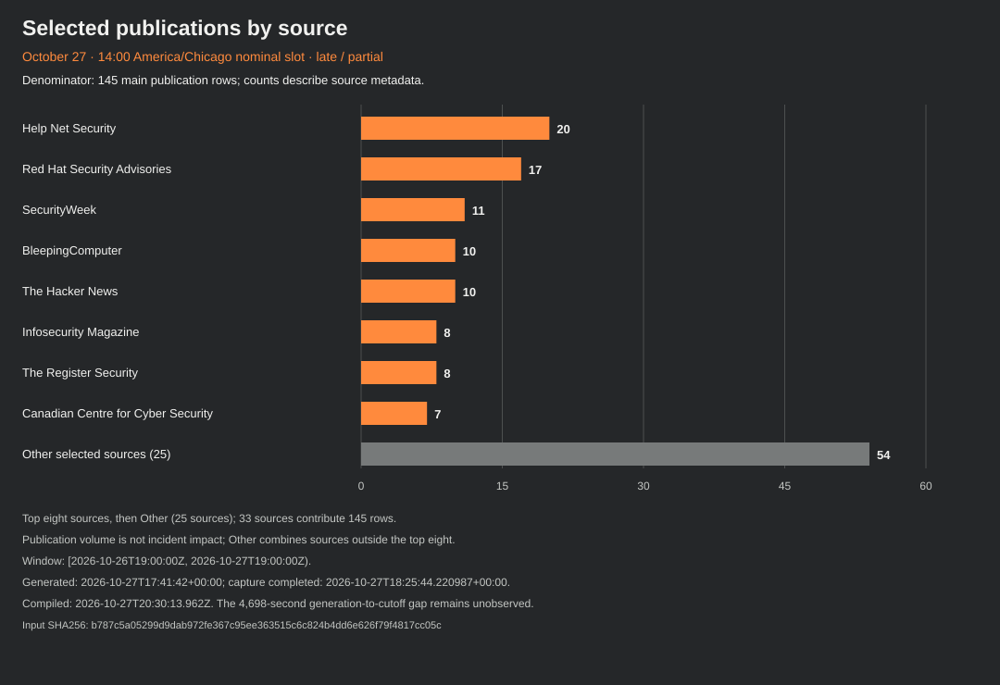
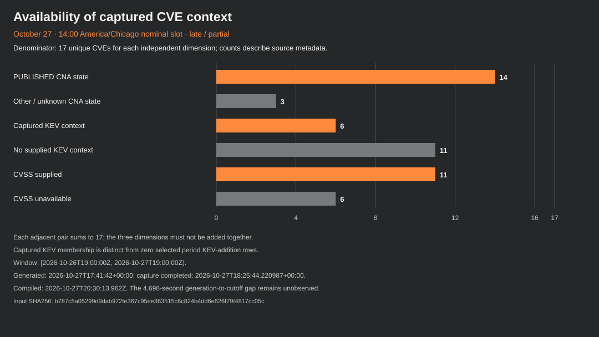
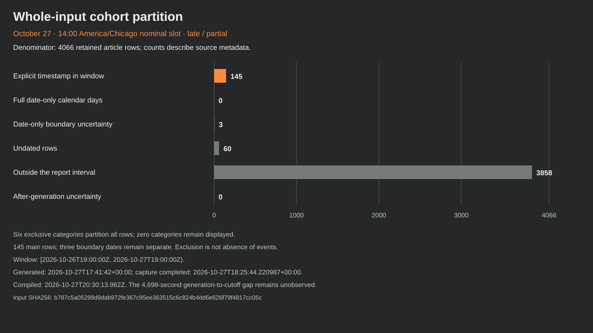

# October 27 afternoon threat intelligence

**Late, partial edition · SW-DAILY-2026-10-27-1400-CDT**

Nominal slot: **October 27, 2026 at 14:00 America/Chicago (19:00 UTC)**. The rolling 24-hour interval is **[October 26 at 19:00 UTC, October 27 at 19:00 UTC)**. This edition follows [the morning report](<../0600-CDT/README.md>).

Actual compilation: **2026-10-27T20:30:13.962Z**. The nominal slot is distinct from actual publication. Publication metadata is frozen at compilation; later delivery is tracked separately.

**Next nominal report and revision opportunity: October 27 at 22:00 America/Chicago (October 28 at 03:00 UTC).** This is a scheduled opportunity, not a delivery guarantee.

## Executive summary

The retained snapshot supports **145 explicitly timestamped publication entries from 33 sources**, mentioning **17 unique CVE identifiers** in the main cohort. These are publication and reference counts, not 145 incidents or 17 newly disclosed vulnerabilities. Three date-only boundary entries are kept separately and do not increase the main count.

The most actionable captured context concerns PHP deployment and backport qualifications, Brotli library branches, Moxa client and cellular-device conditions, Adobe Commerce version families and Android Authenticator applicability. There are **zero selected KEV-addition rows**, while **six of the 17 CVE contexts are already KEV-listed in the captured data**. Those measures describe different cohorts.

The input was generated at **17:41:42 UTC**, leaving an unobserved **4,698-second gap (1 hour 18 minutes 18 seconds)** before the nominal cutoff. Capture at 18:25 UTC and later analysis do not fill that gap. Fourteen CNA contexts are PUBLISHED; three remain UNKNOWN after failed enrichment. CVSS is supplied for eleven and unavailable for six.

## Selected developments

### 1. PHP: retain SAPI, version and backport qualifications

Captured CNA context lists the two initial PHP identifiers and upstream version boundaries. The supplementary PHP guidance separates demonstrated and configuration-dependent paths, distribution backports and the distinct follow-up identifier. It does not establish equal exploitability or a shipped fix for the third identifier.

Captured CNA and supplementary publisher context; article rows are publication metadata, not independently rechecked incident evidence. Identifiers: CVE-2026-109618, CVE-2026-109619.

### 2. Brotli: follow the embedded library and branch

The captured CNA record supplies three affected Brotli ranges and corresponding branch-boundary releases. A product that embeds the decoder needs its own vendor and package evidence; the CVSS value does not establish that any installation is exposed.

Captured structured CNA context plus bounded publication-topic metadata; no local inventory or independent package verification. Identifiers: CVE-2026-111497.

### 3. Moxa: separate client trust, embedded keys and SMS handling

The MRC Client and OnCell records describe different products and conditions. The captured MRC Client range marks 1.0.0 through 4.2.0 affected and 4.2.2 unaffected. The two OnCell records retain vendor workarounds and no invented fixed-release value. Two withheld text fields remain unavailable.

Source-attributed CNA product, custom version and workaround fields; no device exposure or implemented remediation claim. Identifiers: CVE-2026-111459, CVE-2026-111460, CVE-2026-111461.

### 4. Commerce: distinguish version families and upload context

The Adobe records retain separate input-validation and upload classifications, product blocks and custom version-family strings. Reporting about online-store compromises is retained as a topic lead; its headline count is not adopted as an independently verified impact measure.

Captured CNA and qualified catalogue context; no attribution of every reported store incident to these records. Identifiers: CVE-2025-54236, CVE-2026-48356.

### 5. Authenticator: preserve the Android-specific range and vector

The captured Microsoft record concerns Authenticator for Android, with an affected starting version of 6.0.0 and a custom less-than boundary of 6.2606.4246. Its CVSS 3.1 vector includes local access and user interaction; product and deployment applicability must be checked separately.

Captured CNA version and CVSS fields, not a finding about installed applications. Identifiers: CVE-2026-80097.

### 6. Keep failed enrichment visible

Three mentioned identifiers have UNKNOWN record state and failed CNA enrichment in the retained input. A source mention does not establish record absence, affected versions, a current fix or exploitation. The two CERT/CC publication labels remain source metadata rather than substitutes for unavailable CNA fields.

Failed or missing source context remains unknown; no synthetic baseline, CVSS or fix. Identifiers: CVE-2026-115560, CVE-2026-90975, CVE-2026-91141.

## Mitigations and applicability

### PHP: the initial pair and the separate follow-up

For CVE-2026-109618 and CVE-2026-109619, the captured CNA fields retain affected branches 8.2.*, 8.3.*, 8.4.* and 8.5.* with less-than boundaries **8.2.35, 8.3.36, 8.4.27 and 8.5.12** respectively. Supplementary PHP notices identify those upstream releases for the initial pair, while describing distribution/LTS fixes and minimal backports for 7.4, 8.0 and 8.1. A numerically lower package version alone does not establish a missing patch.

The susceptibility advisory distinguishes a demonstrated unauthenticated pre-application **mod_php** path from other SAPI qualifications. The request-state advisory separates demonstrations from candidate and configuration-dependent paths involving requests handled by the same worker. This report does not establish equal exploitability across SAPIs, configurations or installations.

The retained CISA alert revision describes temporary offline status when an organization cannot update immediately or still uses unsupported PHP 8.1 or earlier, until updated or patched. That is conditional, attributed guidance; it does not prove that every older vendor build is unpatched or unpatchable. Federal directive and catalogue due-date fields are not deadlines assigned to all readers.

The separate PHP follow-up mentions **CVE-2026-115560**, which remains UNKNOWN/failed in the captured CNA projection. The initial-pair release list is not proof of a shipped fix for this third identifier. The retained notice describes a next-regular-release plan and an interim `session.upload_progress.enabled=0` setting for the unusual path that changes `php_binary` or `php_serialize` to `php` using `ini_set()` before `session_start()`, with upload progress enabled. That conditional measure is not complete mitigation of the initial pair. No historical registry absence or current shipped third fix is established.

The structured briefs preserve all nine guidance steps and six limitations for each initial-pair record, with source dates and links separate from capture and generation clocks.

### Other products: retain the literal conditions

- **Brotli:** the supplied CNA ranges are 1.0.3–less than 1.0.10, 1.1.0–less than 1.1.1 and 1.2.0–less than 1.2.1. Match the embedded library branch and its vendor package; a library-level record does not establish every product’s applicability.
- **Moxa:** the client record and two OnCell records have separate conditions. For CVE-2026-111460, the captured vendor workaround discusses regenerating device certificate/key material through an affected-device reset. For CVE-2026-111461, it describes leaving SMS disabled when unnecessary and notes its default-disabled state. These are attributed product-specific workarounds, not actions performed by this report. Two text fields for CVE-2026-111459 remain unavailable; no replacement solution text is invented.
- **Adobe:** custom version-family strings, affected/unaffected statuses and product defaults are retained exactly in the data. Do not convert a comma-separated custom string into a numerical range or assume that a boundary proves a deployed fix.
- **Ubuntu:** the captured CVE-2023-32629 product default and its three listed range statuses are **unaffected**. They are retained as supplied and must not be inverted into an affected-version list. The captured workaround discusses unprivileged user namespaces; applicability still requires the original publisher guidance.
- **Dahua and Apple:** existing KEV membership is context. Some supplied version descriptions are bounded strings, and an unavailable CVSS value is not zero risk. Read the original vendor product and build conditions before drawing conclusions about a device.

The full **18 product blocks and 35 literal version records**, all source CVSS versions/vectors, guidance alternatives, limits and missing fields are retained in [data.json](<data.json>). Those are structured records, not 18 distinct affected products or 35 confirmed fixed versions.

## Captured CVE context

All unique identifiers mentioned by main-cohort entries are included below. CVSS values are source metrics with different versions and contexts; this table is sorted by identifier, not local risk. Full vectors and reference URLs are in the data. Failed enrichment does not establish record absence.

| Identifier | Captured state / source | CVSS | Product context |
| --- | --- | --- | --- |
| CVE-2021-33044 | PUBLISHED / ok | Unavailable | n/a / Some Dahua IP Camera, Video Intercom, PTZ Dome Camera, Thermal Camera devices |
| CVE-2021-33045 | PUBLISHED / ok | Unavailable | n/a / Some Dahua IP Camera, Video Intercom, NVR, XVR devices |
| CVE-2023-32629 | PUBLISHED / ok | 7.8 · CVSS 3.1 | Canonical / Ubuntu Kernel |
| CVE-2025-54236 | PUBLISHED / ok | 9.1 · CVSS 3.1 | Adobe / Adobe Commerce |
| CVE-2026-109618 | PUBLISHED / ok | 9.2 · CVSS 4.0 | PHP Group / PHP |
| CVE-2026-109619 | PUBLISHED / ok | 9.2 · CVSS 4.0 | PHP Group / PHP |
| CVE-2026-111459 | PUBLISHED / ok | 7.6 · CVSS 4.0 | Moxa / Moxa Remote Connect Suite (MRC Client) |
| CVE-2026-111460 | PUBLISHED / ok | 7.7 · CVSS 4.0 | Moxa / OnCell G3150A-LTE Series |
| CVE-2026-111461 | PUBLISHED / ok | 7.5 · CVSS 4.0 | Moxa / OnCell G3150A-LTE Series |
| CVE-2026-111497 | PUBLISHED / ok | 9.2 · CVSS 4.0 | Google / Brotli |
| CVE-2026-115560 | UNKNOWN / failed | Unavailable | Unavailable — failed enrichment |
| CVE-2026-25243 | PUBLISHED / ok | 7.7 · CVSS 4.0 | redis / redis |
| CVE-2026-48356 | PUBLISHED / ok | 9.3 · CVSS 3.1 | Adobe / Adobe Commerce; Adobe / Adobe Commerce B2B; Adobe / Magento Open Source; Adobe / Adobe Commerce Events |
| CVE-2026-80097 | PUBLISHED / ok | 8.6 · CVSS 3.1 | Microsoft / Microsoft Authenticator for Android |
| CVE-2026-86950 | PUBLISHED / ok | Unavailable | Apple / iOS and iPadOS; Apple / macOS |
| CVE-2026-90975 | UNKNOWN / failed | Unavailable | Unavailable — failed enrichment |
| CVE-2026-91141 | UNKNOWN / failed | Unavailable | Unavailable — failed enrichment |

The three unresolved contexts are **CVE-2026-115560, CVE-2026-90975 and CVE-2026-91141**. Their unavailable products, CVSS and guidance remain unavailable. No vendor fix or exposure is inferred from a publication label.

## KEV additions and captured membership

No selected main entry is a KEV-addition row. This does **not** establish that no additions or exploitation occurred during the interval. Six mentioned CVEs have supplied KEV context in the retained input:

| Identifier | Captured date added | Captured due date |
| --- | --- | --- |
| CVE-2021-33044 | 2024-08-21 | 2024-09-11 |
| CVE-2021-33045 | 2024-08-21 | 2024-09-11 |
| CVE-2025-54236 | 2025-10-24 | 2025-11-14 |
| CVE-2026-109618 | 2026-10-26 | 2026-10-29 |
| CVE-2026-109619 | 2026-10-26 | 2026-10-29 |
| CVE-2026-86950 | 2026-09-29 | 2026-10-13 |

The PHP date-only catalogue rows are boundary-uncertain relative to the rolling interval and are not counted as main additions. Catalogue dates, exploitation timing and publication timestamps remain separate. Ransomware fields are source classifications, not local-environment findings.

## Supply-chain and AI publication watch

Selected publication metadata includes dependency delivery, repository-token theft, an abandoned updater, signed AI-tool binaries, AI request caching, document trust and reasoning-protection topics. These leads can guide later source review; the article bodies were not independently checked for this edition. Their headlines do not establish breach totals, actor identity, a technical exploit or installed exposure.

Examples retained as topic links are [LiteLLM dependency-chain reporting](<https://www.theregister.com/security/2026/10/26/litellm-supply-chain-attack-started-with-an-exposed-master-key/5305544>); [AI agent document-trust reporting](<https://www.darkreading.com/application-security/in-the-wild-attack-ai-agents-trust-markdown>); [AI request-cache research](<https://blog.cloudflare.com/kv-cache-exposure-remediation/>); [Maven dependency-delivery research](<https://www.sonatype.com/blog/how-maven-central-builds-trust-into-dependency-delivery>); [Software-updater lifecycle reporting](<https://www.securityweek.com/dead-popcorn-time-updater-put-millions-of-computers-at-risk-of-takeover/>); [Repository token-theft reporting](<https://www.helpnetsecurity.com/2026/10/27/gheist-github-token-abuse/>); [Signed AI-tool binary research](<https://research.checkpoint.com/2026/tricks-from-the-past-deployed-via-signed-chatgpt-and-claude-binaries/>); [AI reasoning-protection reporting](<https://www.infosecurity-magazine.com/news/openai-compaction-flaw-ai/>); [AI developer-tool breach reporting](<https://www.bleepingcomputer.com/news/security/warp-discloses-breach-exposing-ai-agent-logs-user-telemetry-data/>); [Developer key-store threat reporting](<https://www.darkreading.com/endpoint-security/aokigahara-stealer-developer-keyrings-ai-assistants>). No CVE identifiers are assigned to these AI topics merely from their titles.

## Actors and campaigns

The supplied catalogue contains an earlier Microsoft attribution to **Storm-0940** and a descriptive **ConnectWise-linked application-abuse** grouping. Its evidence was published October 21 and updated October 23; its observation and the report’s snapshot clocks are separate. The attribution remains Microsoft’s statement, not independent actor identity proof. Authentication or application presence alone does not establish data theft from every environment.

**No selected publication evidence URL and no selected CVE endpoint matches those background records.** They are retained as context, with no inference of participation in this report’s interval. Aliases, shared terms or proximity to other reporting do not close that evidence gap.

## Weakness and attack-pattern context

Eleven of the seventeen main CVE contexts supply weakness identifiers, with **15 distinct CNA-supplied CWE IDs** across their overlapping memberships. A CNA classification is not independent proof of a product weakness or exposure.

The retained catalogue supplies **13 taxonomy links from two source CWE IDs**: eight from CWE-287 and five from CWE-78. These are associations to named CAPEC patterns, not thirteen observed attacks or thirteen distinct CWE categories. CWE-416 also has captured definition context. This report selects 16 taxonomy contexts: three matched catalogue CWE records and thirteen CAPEC names. These are selective background records, not a copy of the entire supplied catalogue. Among the thirteen named CAPEC patterns selected by those links, three have captured CAPEC 3.9 definition summaries; ten retain names from CWE 4.20 tables without a captured full CAPEC definition. No taxonomy link establishes that a technique was used.

## Previous-citation revision review

The bounded metadata pass reconciled **2,443 citation occurrences from 18 known reports**. It retained **1,531 literal URL groups: 1,529 canonical identities and two unsupported query identities**. All groups fall in the recent citation bucket; the older bucket is empty in this finite inventory.

Of those groups, **1,527 have unknown finite request history**, two match historically held routes and two remain unsupported. Unknown history is not evidence that a URL was never requested and does not establish eligibility or a field baseline. The AWS route remains held after its earlier redirect refusal; the Talos URL belongs to a separate completed one-request scope that also remains held. Their four and one citation associations are not new requests or two new refusals.

**Selected: 0. New requests: 0. Qualified article checks: 0. Comparable checks: 0. New public ledger records: 0.** Material change remains unavailable rather than zero. No all-updated, unchanged, no-exploitation or global-absence conclusion follows. The original date-only W43 report and future plans were excluded from the timestamped inventory.

Metadata was compiled at **2026-10-27T19:32:41.252226+00:00**, separately from the eligibility-evaluation clock at 19:30:04.481 UTC and execution completion at 19:32:41.271 UTC. The next nominal review cycle is the 22:00 Chicago report opportunity; neither held route has a new eligibility date here.

## Charts and count recipes

All three charts use the same input hash, admitted cohorts and compilation timestamp as this report and the data.

Source activity uses the main cohort (145 rows). Sources are ordered by count descending, then source ID in ASCII order. The first eight account for 91 rows; **Other** combines 25 sources and 54 rows. This is publication activity, not incident impact.

Each of the three CVE dimensions uses its own denominator of 17. PUBLISHED/other is 14/3, KEV-context/no-supplied-context is 6/11, and CVSS-supplied/unavailable is 11/6. The pairs are independent and must not be added together.

The coverage chart partitions all 4,066 retained article rows: 145 explicit timestamps, 0 fully contained date-only days, 3 boundary-uncertain dates, 60 undated, 3,858 outside the interval and 0 after-generation rows. All zero categories are retained. Exclusion and zero values are not evidence that nothing happened.

## Coverage, clocks and watchlist

| Clock or measure | Observed value |
| --- | --- |
| Nominal interval | [2026-10-26T19:00:00Z, 2026-10-27T19:00:00Z) |
| Input generated | 2026-10-27T17:41:42+00:00 |
| Capture started | 2026-10-27T18:25:34.817799+00:00 |
| Capture completed | 2026-10-27T18:25:44.220987+00:00 |
| Analysis projection completed | 2026-10-27T19:44:42.768881+00:00 |
| Analysis operation receipt completed | 2026-10-27T19:44:42.831017+00:00 |
| Outer execution completed | 2026-10-27T19:44:42.853Z |
| Report compiled | 2026-10-27T20:30:13.962Z |
| Unobserved generation-to-cutoff tail | 4,698 seconds |
| Next nominal report/revision cycle | 2026-10-27 22:00 America/Chicago = 2026-10-28T03:00:00Z |

The source input contains 4,066 article rows, 2,195 CNA contexts and 62 source-health rows. Health is **54 ok, seven partial and one failed**. CISA Advisories is failed with no last-success clock and no article rows in this snapshot; that does not prove no advisories were published. Partial sources are F5 Labs, Graham Cluley, Infosecurity Magazine, Microsoft Security, Qualys Security Blog, Snyk and Cisco Talos. Home/display URL clocks are source-status metadata, not proof of a request to that exact endpoint.

The snapshot’s declared saved window is January 1, 1998 through October 27, 2026. It is selected, capped history rather than exhaustive coverage. Empty dates, historical gaps and the large outside-window group do not establish absence of events. Publisher date-only values use a declared UTC-calendar convention with unknown publisher timezone; the three boundary rows remain outside the main count.

Two publication labels remain NULL. Two text fields in the Moxa CVE-2026-111459 context also remain NULL; the records, references and metric membership are preserved without reconstructing the withheld text. No raw article summaries, tags, reference labels, bylines, private locators or source-response hashes are published.

Watch the unresolved CNA identifiers, package/backport and SAPI applicability, source failures, date-only boundaries and the unobserved tail. Retained CNA/KEV/catalogue context has its own source clocks and is not a live environment assessment or a historical as-of-cutoff reconstruction. No local asset check, device change, remediation verification or new publisher-body recheck was performed.

## Publication inventory

Short labels below identify retained publication topics. They are editorial paraphrases, not independent validation of headline claims. M = main timestamp cohort; B = date-only boundary watch, excluded from the 145 main rows. The two unavailable labels remain withheld.

| Cohort | Publication date as supplied | Source | Editorial topic | CVE mentions |
| --- | --- | --- | --- | --- |
| B | 2026-10-26 | CISA Known Exploited Vulnerabilities | PHP memory-corruption catalog entry | CVE-2026-109618 |
| B | 2026-10-26 | CISA Known Exploited Vulnerabilities | PHP request-state catalog entry | CVE-2026-109619 |
| M | 2026-10-26T19:03:53+00:00 | Hackread | Refrigeration-control exposure reporting | None supplied |
| M | 2026-10-26T19:04:16+00:00 | Canadian Centre for Cyber Security | HashiCorp advisory notice | None supplied |
| M | 2026-10-26T19:07:02+00:00 | CERT/CC Vulnerability Notes | COVESA TCP buffer advisory | CVE-2026-91141 |
| M | 2026-10-26T19:26:20+00:00 | BleepingComputer | DreamHost account-reset reporting | None supplied |
| M | 2026-10-26T19:35:01+00:00 | Red Hat Security Advisories | Podman distribution advisory | None supplied |
| M | 2026-10-26T19:45:54+00:00 | Red Hat Security Advisories | Brotli distribution advisory | None supplied |
| M | 2026-10-26T19:48:07+00:00 | Tenable | PHP exposure research note | CVE-2026-109618, CVE-2026-109619 |
| M | 2026-10-26T20:20:56+00:00 | SecurityWeek | AI investment and safety-risk reporting | None supplied |
| M | 2026-10-26T20:30:53+00:00 | The Register Security | LiteLLM dependency-chain reporting | None supplied |
| M | 2026-10-26T20:41:22+00:00 | Security Affairs | Online-store compromise reporting | CVE-2025-54236, CVE-2026-48356 |
| M | 2026-10-26T20:43:00+00:00 | Red Hat Security Advisories | PHP 8.3 distribution advisory | None supplied |
| M | 2026-10-26T20:43:55+00:00 | Red Hat Security Advisories | Buildah distribution advisory | None supplied |
| M | 2026-10-26T20:46:49+00:00 | BleepingComputer | AI model release reporting | None supplied |
| M | 2026-10-26T20:59:26+00:00 | Dark Reading | AI agent document-trust reporting | None supplied |
| M | 2026-10-26T21:03:00+00:00 | The Record | AI safety litigation reporting | None supplied |
| M | 2026-10-26T21:03:54+00:00 | Red Hat Security Advisories | Skopeo distribution advisory | None supplied |
| M | 2026-10-26T21:04:51+00:00 | Red Hat Security Advisories | OSBuild Composer distribution advisory | None supplied |
| M | 2026-10-26T21:08:28+00:00 | BleepingComputer | AI-assisted data-access reporting | None supplied |
| M | 2026-10-26T21:12:23+00:00 | Red Hat Security Advisories | Libreswan distribution advisory | None supplied |
| M | 2026-10-26T21:27:37+00:00 | The Register Security | AI model outbound-connection reporting | None supplied |
| M | 2026-10-26T21:34:20+00:00 | Red Hat Security Advisories | Kernel distribution advisory | None supplied |
| M | 2026-10-26T21:41:01+00:00 | Red Hat Security Advisories | urllib3 distribution advisory | None supplied |
| M | 2026-10-26T21:44:33+00:00 | Dark Reading | AI security leadership commentary | None supplied |
| M | 2026-10-26T22:01:23+00:00 | Cloudflare Security | AI request-cache research | None supplied |
| M | 2026-10-26T22:08:33+00:00 | Red Hat Security Advisories | Brotli distribution advisory | None supplied |
| M | 2026-10-26T22:20:36+00:00 | BleepingComputer | Copenhagen university breach reporting | None supplied |
| M | 2026-10-26T22:29:01+00:00 | The Register Security | Withheld — source privacy omission | None supplied |
| M | 2026-10-26T22:31:12+00:00 | Red Hat Security Advisories | Brotli distribution advisory | None supplied |
| M | 2026-10-26T22:45:54+00:00 | CERT/CC Vulnerability Notes | MPC library derivation advisory | CVE-2026-90975 |
| M | 2026-10-26T23:35:41+00:00 | Red Hat Security Advisories | Ignition distribution advisory | None supplied |
| M | 2026-10-26T23:57:48+00:00 | Red Hat Security Advisories | Ignition distribution advisory | None supplied |
| B | 2026-10-27 | Debian Security Advisories | Valkey date-only advisory | None supplied |
| M | 2026-10-27T00:00:03+00:00 | Red Hat Security Advisories | Ignition distribution advisory | None supplied |
| M | 2026-10-27T00:05:13+00:00 | Red Hat Security Advisories | Ignition distribution advisory | None supplied |
| M | 2026-10-27T00:22:54+00:00 | CyberScoop | Brotli impact-assessment reporting | CVE-2026-111497 |
| M | 2026-10-27T00:26:50+00:00 | Dark Reading | AI security benchmark commentary | None supplied |
| M | 2026-10-27T00:46:45+00:00 | Red Hat Security Advisories | D-Bus proxy distribution advisory | None supplied |
| M | 2026-10-27T01:06:22+00:00 | The Register Security | Virtual desktop service incident reporting | None supplied |
| M | 2026-10-27T01:19:40+00:00 | Tenable | Brotli decoder research overview | CVE-2026-109618, CVE-2026-109619, CVE-2026-111497 |
| M | 2026-10-27T01:30:00+00:00 | SecurityWeek | New Mexico hospital disruption reporting | None supplied |
| M | 2026-10-27T02:09:55+00:00 | SANS Internet Storm Center | Apple patch research digest | None supplied |
| M | 2026-10-27T02:55:13+00:00 | SANS Internet Storm Center | Withheld — source privacy omission | None supplied |
| M | 2026-10-27T03:22:50+00:00 | CSO | AI reasoning-protection reporting | None supplied |
| M | 2026-10-27T04:33:34+00:00 | Help Net Security | AI model security-capability reporting | None supplied |
| M | 2026-10-27T04:35:12+00:00 | Red Hat Security Advisories | RHC distribution advisory | None supplied |
| M | 2026-10-27T04:37:59+00:00 | The Hacker News | PHP vulnerability reporting | CVE-2026-109618 |
| M | 2026-10-27T05:00:31+00:00 | Help Net Security | Security workforce listings | None supplied |
| M | 2026-10-27T05:30:33+00:00 | Help Net Security | Vulnerability exploitation-timing commentary | None supplied |
| M | 2026-10-27T05:40:00+00:00 | Palo Alto Networks Security Advisories | Brotli product impact advisory | CVE-2026-111497 |
| M | 2026-10-27T05:44:26+00:00 | Help Net Security | Linux system-design reporting | None supplied |
| M | 2026-10-27T06:00:26+00:00 | Help Net Security | AI agent security commentary | None supplied |
| M | 2026-10-27T06:14:22+00:00 | Help Net Security | Android authenticator reporting | None supplied |
| M | 2026-10-27T06:30:01+00:00 | Help Net Security | AI security market commentary | None supplied |
| M | 2026-10-27T06:34:47+00:00 | The Hacker News | Network-camera access reporting | None supplied |
| M | 2026-10-27T07:14:27+00:00 | SecurityWeek | Maritime vulnerability-database reporting | None supplied |
| M | 2026-10-27T07:59:09+00:00 | Troy Hunt | Weekly security research commentary | None supplied |
| M | 2026-10-27T08:20:54+00:00 | BleepingComputer | PHP vulnerability reporting | None supplied |
| M | 2026-10-27T08:22:43+00:00 | The Hacker News | AI reasoning-protection reporting | None supplied |
| M | 2026-10-27T08:25:00+00:00 | CSO | Supplier breach risk commentary | None supplied |
| M | 2026-10-27T09:00:01+00:00 | Sonatype | Maven dependency-delivery research | None supplied |
| M | 2026-10-27T09:07:11+00:00 | Security Affairs | AI model connectivity reporting | None supplied |
| M | 2026-10-27T09:25:50+00:00 | BleepingComputer | Energy-sector breach reporting | None supplied |
| M | 2026-10-27T09:33:06+00:00 | The Hacker News | Malware disruption reporting | None supplied |
| M | 2026-10-27T09:39:00+00:00 | Infosecurity Magazine | Public-safety security oversight reporting | None supplied |
| M | 2026-10-27T09:44:50+00:00 | SecurityWeek | Software-updater lifecycle reporting | None supplied |
| M | 2026-10-27T09:56:54+00:00 | Security Affairs | Dahua device-access reporting | CVE-2021-33044, CVE-2021-33045 |
| M | 2026-10-27T10:00:00+00:00 | CyberScoop | Security-monitoring disruption reporting | None supplied |
| M | 2026-10-27T10:00:21+00:00 | Cisco Talos | Security-research career discussion | None supplied |
| M | 2026-10-27T10:02:24+00:00 | SecurityWeek | NetScaler vulnerability commentary | None supplied |
| M | 2026-10-27T10:19:08+00:00 | Help Net Security | Hosting account-reset reporting | None supplied |
| M | 2026-10-27T10:30:00+00:00 | Infosecurity Magazine | AI security certification reporting | None supplied |
| M | 2026-10-27T10:36:12+00:00 | BleepingComputer | Apple legacy-device patch reporting | None supplied |
| M | 2026-10-27T10:39:41+00:00 | Security Affairs | PHP vulnerability catalog reporting | CVE-2026-109618, CVE-2026-109619 |
| M | 2026-10-27T10:44:20+00:00 | SecurityWeek | AI investment-risk reporting | None supplied |
| M | 2026-10-27T10:58:07+00:00 | Help Net Security | Repository token-theft reporting | None supplied |
| M | 2026-10-27T11:00:00+00:00 | Infosecurity Magazine | University data-exposure reporting | None supplied |
| M | 2026-10-27T11:01:26+00:00 | Schneier on Security | AI model evaluation commentary | None supplied |
| M | 2026-10-27T11:05:24+00:00 | CSO | AI model connectivity reporting | None supplied |
| M | 2026-10-27T11:17:24+00:00 | CyberInsider | Apple mobile-graphics patch reporting | CVE-2026-86950 |
| M | 2026-10-27T11:32:31+00:00 | The Hacker News | South Korean software intrusion reporting | None supplied |
| M | 2026-10-27T11:32:46+00:00 | The Hacker News | AI phishing-content reporting | None supplied |
| M | 2026-10-27T11:39:22+00:00 | Help Net Security | Copenhagen university incident reporting | None supplied |
| M | 2026-10-27T11:46:00+00:00 | The Hacker News | Hardware wallet key-management reporting | None supplied |
| M | 2026-10-27T11:49:30+00:00 | The Register Security | Email-service exposure reporting | None supplied |
| M | 2026-10-27T11:49:57+00:00 | SecurityWeek | Apple platform update reporting | None supplied |
| M | 2026-10-27T12:00:00+00:00 | UK National Cyber Security Centre | Security regulation collaboration notice | None supplied |
| M | 2026-10-27T12:00:19+00:00 | Kaspersky Securelist | Cloud isolation research | CVE-2023-32629, CVE-2026-25243 |
| M | 2026-10-27T12:00:44+00:00 | CyberInsider | Browser-local AI processing reporting | None supplied |
| M | 2026-10-27T12:02:06+00:00 | SecurityWeek | Hosting password-reset reporting | None supplied |
| M | 2026-10-27T12:09:50+00:00 | The Hacker News | Android authenticator token-handling reporting | CVE-2026-80097 |
| M | 2026-10-27T12:13:25+00:00 | Help Net Security | AI-built security governance reporting | None supplied |
| M | 2026-10-27T12:14:03+00:00 | Help Net Security | Critical-infrastructure security policy reporting | None supplied |
| M | 2026-10-27T12:24:14+00:00 | Help Net Security | Hospital service-disruption reporting | None supplied |
| M | 2026-10-27T12:30:00+00:00 | The Register Security | Windows certificate-update reporting | None supplied |
| M | 2026-10-27T12:30:00+00:00 | Infosecurity Magazine | Teams external-chat intrusion reporting | None supplied |
| M | 2026-10-27T12:34:55+00:00 | CSO | Brotli software-dependency reporting | CVE-2026-111497 |
| M | 2026-10-27T12:36:08+00:00 | Help Net Security | AI asset-detection product reporting | None supplied |
| M | 2026-10-27T12:51:04+00:00 | Help Net Security | Network-policy AI product reporting | None supplied |
| M | 2026-10-27T13:00:00+00:00 | Tenable | Public-sector AI security research | None supplied |
| M | 2026-10-27T13:00:00+00:00 | Cloudflare Security | PHP capture-the-flag research | CVE-2026-109618, CVE-2026-109619 |
| M | 2026-10-27T13:00:05+00:00 | Hackread | Cybercrime information-sharing reporting | None supplied |
| M | 2026-10-27T13:00:49+00:00 | Help Net Security | DNS and AI controls product reporting | None supplied |
| M | 2026-10-27T13:03:27+00:00 | Check Point Research | Signed AI-tool binary research | None supplied |
| M | 2026-10-27T13:10:25+00:00 | Canadian Centre for Cyber Security | Esri advisory notice | None supplied |
| M | 2026-10-27T13:11:59+00:00 | Help Net Security | Self-hosted security platform reporting | None supplied |
| M | 2026-10-27T13:13:58+00:00 | SecurityWeek | Network product patch reporting | None supplied |
| M | 2026-10-27T13:16:00+00:00 | The Record | PHP vulnerability response reporting | None supplied |
| M | 2026-10-27T13:16:18+00:00 | Canadian Centre for Cyber Security | PHP advisory revision | CVE-2026-109618, CVE-2026-109619 |
| M | 2026-10-27T13:20:00+00:00 | The Record | Internet service disruption reporting | None supplied |
| M | 2026-10-27T13:24:14+00:00 | Canadian Centre for Cyber Security | Moxa control-system advisory | CVE-2026-111459, CVE-2026-111460, CVE-2026-111461 |
| M | 2026-10-27T13:28:31+00:00 | Help Net Security | AI agent identity-product reporting | None supplied |
| M | 2026-10-27T13:29:41+00:00 | WIRED Security | AI impersonation litigation reporting | None supplied |
| M | 2026-10-27T13:30:28+00:00 | SecurityWeek | Health-plan supplier exposure reporting | None supplied |
| M | 2026-10-27T13:32:57+00:00 | TechCrunch Security | Internet-provider data-exposure reporting | None supplied |
| M | 2026-10-27T13:36:00+00:00 | The Record | Malicious mobile-app reporting | None supplied |
| M | 2026-10-27T13:59:09+00:00 | The Hacker News | Apple graphics compatibility patch reporting | CVE-2026-86950 |
| M | 2026-10-27T13:59:48+00:00 | The Hacker News | Embedded web-server TLS reporting | None supplied |
| M | 2026-10-27T14:01:11+00:00 | BleepingComputer | Business threat-trend reporting | None supplied |
| M | 2026-10-27T14:02:18+00:00 | Canadian Centre for Cyber Security | Johnson Controls advisory notice | None supplied |
| M | 2026-10-27T14:09:46+00:00 | BleepingComputer | Tailscale SSH security reporting | None supplied |
| M | 2026-10-27T14:16:43+00:00 | Help Net Security | Teams support-impersonation reporting | None supplied |
| M | 2026-10-27T14:29:26+00:00 | PortSwigger Research | SVG security research | None supplied |
| M | 2026-10-27T14:34:49+00:00 | Cybersecurity Dive | Rural hospital security assistance reporting | None supplied |
| M | 2026-10-27T14:40:39+00:00 | TechCrunch Security | PHP vulnerability reporting | None supplied |
| M | 2026-10-27T14:43:40+00:00 | Hackread | Teams external-chat access reporting | None supplied |
| M | 2026-10-27T14:45:00+00:00 | The Register Security | PHP vulnerability reporting | None supplied |
| M | 2026-10-27T14:57:00+00:00 | The Record | Hospital ambulance-diversion reporting | None supplied |
| M | 2026-10-27T15:00:00+00:00 | Infosecurity Magazine | Cybersecurity workforce coalition reporting | None supplied |
| M | 2026-10-27T15:05:12+00:00 | DataBreaches.net | Publisher operational note | None supplied |
| M | 2026-10-27T15:07:00+00:00 | The Record | Police supplier data-protection reporting | None supplied |
| M | 2026-10-27T15:13:48+00:00 | CyberScoop | Rural hospital cyber-support reporting | None supplied |
| M | 2026-10-27T15:18:19+00:00 | CyberInsider | Consumer electronics data-exposure reporting | None supplied |
| M | 2026-10-27T15:26:12+00:00 | SecurityWeek | Tailscale disclosure-response reporting | None supplied |
| M | 2026-10-27T15:27:03+00:00 | Cybersecurity Dive | PHP vulnerability reporting | None supplied |
| M | 2026-10-27T15:46:10+00:00 | Hackread | Brotli and .NET update reporting | None supplied |
| M | 2026-10-27T16:00:00+00:00 | Infosecurity Magazine | Online-store intrusion reporting | None supplied |
| M | 2026-10-27T16:00:00+00:00 | Infosecurity Magazine | AI reasoning-protection reporting | None supplied |
| M | 2026-10-27T16:15:00+00:00 | The Register Security | University hospital disruption reporting | None supplied |
| M | 2026-10-27T16:15:39+00:00 | BleepingComputer | AI developer-tool breach reporting | None supplied |
| M | 2026-10-27T16:21:17+00:00 | Canadian Centre for Cyber Security | Hitachi control-system advisory | None supplied |
| M | 2026-10-27T16:23:37+00:00 | Ubuntu Security Notices | Authd distribution advisory | None supplied |
| M | 2026-10-27T16:40:00+00:00 | Palo Alto Networks Security Advisories | PHP product impact advisory | CVE-2026-109618, CVE-2026-109619 |
| M | 2026-10-27T16:45:00+00:00 | Infosecurity Magazine | Hospital service interruption reporting | None supplied |
| M | 2026-10-27T16:47:20+00:00 | Dark Reading | Developer key-store threat reporting | None supplied |
| M | 2026-10-27T17:20:09+00:00 | Canadian Centre for Cyber Security | PHP advisory revision and unresolved identifier | CVE-2026-109618, CVE-2026-109619, CVE-2026-115560 |
| M | 2026-10-27T17:38:51+00:00 | Help Net Security | Brotli dependency-impact reporting | CVE-2026-111497 |

## Sources

References are ordered with captured CNA/vendor and catalogue links before publication-topic links. Link presence does not mean the source body was rechecked for this edition. Complete products, literal version records, CVSS vectors, source dates and structured guidance are in [data.json](<data.json>).

Input: [public saved snapshot](<https://teamstarwolf.github.io/intelligence-hub/data/feed.json>), **11,188,516 bytes**. Frozen input SHA256: `b787c5a05299d9dab972fe367c95ee363515c6c824b4dd6e626f79f4817cc05c`. This report keeps that retained input identity even if the live feed later changes.

1. [CVE-2021-33044 — captured reference](<https://www.cve.org/CVERecord?id=CVE-2021-33044>) — captured CNA reference.
2. [CVE-2021-33044 — captured reference](<https://www.dahuasecurity.com/support/cybersecurity/details/957>) — captured CNA reference.
3. [CVE-2021-33044 — captured required action](<https://www.cisa.gov/known-exploited-vulnerabilities-catalog?field_cve=CVE-2021-33044>) — captured catalogue reference.
4. [CVE-2021-33045 — captured reference](<https://www.cve.org/CVERecord?id=CVE-2021-33045>) — captured CNA reference.
5. [CVE-2021-33045 — captured required action](<https://www.cisa.gov/known-exploited-vulnerabilities-catalog?field_cve=CVE-2021-33045>) — captured catalogue reference.
6. [CVE-2023-32629 — captured reference](<https://www.cve.org/CVERecord?id=CVE-2023-32629>) — captured CNA reference.
7. [CVE-2023-32629 — captured reference](<https://ubuntu.com/security/notices/USN-6250-1>) — captured CNA reference.
8. [CVE-2023-32629 — captured reference](<https://lists.ubuntu.com/archives/kernel-team/2023-July/140920.html>) — captured CNA reference.
9. [CVE-2023-32629 — captured reference](<https://wiz.io/blog/ubuntu-overlayfs-vulnerability>) — captured CNA reference.
10. [CVE-2023-32629 — captured reference](<https://cve.mitre.org/cgi-bin/cvename.cgi?name=CVE-2023-32629>) — captured CNA reference.
11. [CVE-2025-54236 — captured reference](<https://www.cve.org/CVERecord?id=CVE-2025-54236>) — captured CNA reference.
12. [CVE-2025-54236 — captured reference](<https://helpx.adobe.com/security/products/magento/apsb25-88.html>) — captured CNA reference.
13. [CVE-2025-54236 — captured required action](<https://www.cisa.gov/known-exploited-vulnerabilities-catalog?field_cve=CVE-2025-54236>) — captured catalogue reference.
14. [CVE-2026-109618 — captured reference](<https://www.cve.org/CVERecord?id=CVE-2026-109618>) — captured CNA reference.
15. [CVE-2026-109618 — captured reference](<https://github.com/php/php-src/security/advisories/GHSA-w8hw-w9fx-j79w>) — captured CNA reference.
16. [CVE-2026-109618 — captured required action](<https://www.cisa.gov/known-exploited-vulnerabilities-catalog?field_cve=CVE-2026-109618>) — captured catalogue reference.
17. [CVE-2026-109618 — guidance reference](<https://www.php.net/archive/2026.php>) — captured publisher context.
18. [CVE-2026-109618 — guidance reference](<https://github.com/php/php-src/security/advisories/GHSA-6wmf-4rv5-p3rp>) — captured publisher context.
19. [CVE-2026-109618 — guidance reference](<https://www.cisa.gov/news-events/alerts/2026/10/21/critical-vulnerabilities-php-require-immediate-patching>) — captured publisher context.
20. [CVE-2026-109619 — captured reference](<https://www.cve.org/CVERecord?id=CVE-2026-109619>) — captured CNA reference.
21. [CVE-2026-109619 — captured required action](<https://www.cisa.gov/known-exploited-vulnerabilities-catalog?field_cve=CVE-2026-109619>) — captured catalogue reference.
22. [CVE-2026-111459 — captured reference](<https://www.cve.org/CVERecord?id=CVE-2026-111459>) — captured CNA reference.
23. [CVE-2026-111459 — captured reference](<https://www.moxa.com/en/support/product-support/security-advisory/mpsa-269510-cve-2026-111459-cve-2026-111460-cve-2026-111461-vulnerabilities-in-moxa-remote-connect-suite-mrc-client>) — captured CNA reference.
24. [CVE-2026-111460 — captured reference](<https://www.cve.org/CVERecord?id=CVE-2026-111460>) — captured CNA reference.
25. [CVE-2026-111461 — captured reference](<https://www.cve.org/CVERecord?id=CVE-2026-111461>) — captured CNA reference.
26. [CVE-2026-111497 — captured reference](<https://www.cve.org/CVERecord?id=CVE-2026-111497>) — captured CNA reference.
27. [CVE-2026-111497 — captured reference](<https://nodejs.org/en/blog/vulnerability/october-2026-security-releases>) — captured CNA reference.
28. [CVE-2026-115560 — captured reference](<https://www.cve.org/CVERecord?id=CVE-2026-115560>) — captured CNA reference.
29. [CVE-2026-25243 — captured reference](<https://www.cve.org/CVERecord?id=CVE-2026-25243>) — captured CNA reference.
30. [CVE-2026-25243 — captured reference](<https://github.com/redis/redis/security/advisories/GHSA-c8h9-259x-jff4>) — captured CNA reference.
31. [CVE-2026-25243 — captured reference](<https://github.com/redis/redis/releases/tag/8.6.3>) — captured CNA reference.
32. [CVE-2026-48356 — captured reference](<https://www.cve.org/CVERecord?id=CVE-2026-48356>) — captured CNA reference.
33. [CVE-2026-48356 — captured reference](<https://helpx.adobe.com/security/products/magento/apsb26-73.html>) — captured CNA reference.
34. [CVE-2026-80097 — captured reference](<https://www.cve.org/CVERecord?id=CVE-2026-80097>) — captured CNA reference.
35. [CVE-2026-80097 — captured reference](<https://msrc.microsoft.com/update-guide/vulnerability/CVE-2026-80097>) — captured CNA reference.
36. [CVE-2026-86950 — captured reference](<https://www.cve.org/CVERecord?id=CVE-2026-86950>) — captured CNA reference.
37. [CVE-2026-86950 — captured reference](<https://support.apple.com/en-us/149225>) — captured CNA reference.
38. [CVE-2026-86950 — captured reference](<https://support.apple.com/en-us/149226>) — captured CNA reference.
39. [CVE-2026-86950 — captured reference](<https://support.apple.com/en-us/149228>) — captured CNA reference.
40. [CVE-2026-86950 — captured reference](<https://support.apple.com/en-us/149229>) — captured CNA reference.
41. [CVE-2026-86950 — captured required action](<https://www.cisa.gov/known-exploited-vulnerabilities-catalog?field_cve=CVE-2026-86950>) — captured catalogue reference.
42. [CVE-2026-90975 — captured reference](<https://www.cve.org/CVERecord?id=CVE-2026-90975>) — captured CNA reference.
43. [CVE-2026-91141 — captured reference](<https://www.cve.org/CVERecord?id=CVE-2026-91141>) — captured CNA reference.
44. [CAPEC-108 — background source](<https://cwe.mitre.org/data/definitions/89.html>) — captured catalogue evidence.
45. [CAPEC-108 — background source](<https://cwe.mitre.org/data/definitions/78.html>) — captured catalogue evidence.
46. [CAPEC-114 — background source](<https://cwe.mitre.org/data/definitions/287.html>) — captured catalogue evidence.
47. [CAPEC-115 — background source](<https://capec.mitre.org/data/definitions/115.html>) — captured catalogue evidence.
48. [CAPEC-593 — background source](<https://capec.mitre.org/data/definitions/593.html>) — captured catalogue evidence.
49. [CAPEC-88 — background source](<https://capec.mitre.org/data/definitions/88.html>) — captured catalogue evidence.
50. [CWE-416 — background source](<https://cwe.mitre.org/data/definitions/416.html>) — captured catalogue evidence.
51. [ACTOR-storm-0940 — background source](<https://www.microsoft.com/en-us/security/blog/2026/10/21/storm-0940-uses-artex-agentic-ai-connectwise-supply-chain-compromise/>) — captured catalogue evidence.
52. [Refrigeration-control exposure reporting — Hackread](<https://hackread.com/refrigeration-controls-exposed-online-99-countries/>) — retained publication metadata.
53. [HashiCorp advisory notice — Canadian Centre for Cyber Security](<https://cyber.gc.ca/en/alerts-advisories/hashicorp-security-advisory-av26-1087>) — retained publication metadata.
54. [COVESA TCP buffer advisory — CERT/CC Vulnerability Notes](<https://kb.cert.org/vuls/id/128947>) — retained publication metadata.
55. [DreamHost account-reset reporting — BleepingComputer](<https://www.bleepingcomputer.com/news/security/dreamhost-forces-email-ftp-sftp-password-resets-in-ongoing-incident/>) — retained publication metadata.
56. [Podman distribution advisory — Red Hat Security Advisories](<https://access.redhat.com/errata/RHSA-2026:90362>) — retained publication metadata.
57. [Brotli distribution advisory — Red Hat Security Advisories](<https://access.redhat.com/errata/RHSA-2026:90449>) — retained publication metadata.
58. [PHP exposure research note — Tenable](<https://www.tenable.com/blog/discover-and-remediate-php2shell-exposure-with-tenable>) — retained publication metadata.
59. [AI investment and safety-risk reporting — SecurityWeek](<https://www.securityweek.com/anthropic-files-for-potentially-the-biggest-ipo-ever-as-ceo-warns-of-risk-to-humanity-from-ai/>) — retained publication metadata.
60. [LiteLLM dependency-chain reporting — The Register Security](<https://www.theregister.com/security/2026/10/26/litellm-supply-chain-attack-started-with-an-exposed-master-key/5305544>) — retained publication metadata.
61. [Online-store compromise reporting — Security Affairs](<https://securityaffairs.com/201795/malware/magento-campaign-infects-953-online-stores-across-five-domains.html>) — retained publication metadata.
62. [PHP 8.3 distribution advisory — Red Hat Security Advisories](<https://access.redhat.com/errata/RHSA-2026:89111>) — retained publication metadata.
63. [Buildah distribution advisory — Red Hat Security Advisories](<https://access.redhat.com/errata/RHSA-2026:90424>) — retained publication metadata.
64. [AI model release reporting — BleepingComputer](<https://www.bleepingcomputer.com/news/artificial-intelligence/openai-launches-gpt-61-terra-with-3x-faster-ai-agents-50-percent-lower-pricing/>) — retained publication metadata.
65. [AI agent document-trust reporting — Dark Reading](<https://www.darkreading.com/application-security/in-the-wild-attack-ai-agents-trust-markdown>) — retained publication metadata.
66. [AI safety litigation reporting — The Record](<https://therecord.media/texas-sues-openai-deceiving-customers>) — retained publication metadata.
67. [Skopeo distribution advisory — Red Hat Security Advisories](<https://access.redhat.com/errata/RHSA-2026:90462>) — retained publication metadata.
68. [OSBuild Composer distribution advisory — Red Hat Security Advisories](<https://access.redhat.com/errata/RHSA-2026:90493>) — retained publication metadata.
69. [AI-assisted data-access reporting — BleepingComputer](<https://www.bleepingcomputer.com/news/security/former-pentester-used-artex-ai-to-steal-82-million-data-records/>) — retained publication metadata.
70. [Libreswan distribution advisory — Red Hat Security Advisories](<https://access.redhat.com/errata/RHSA-2026:90492>) — retained publication metadata.
71. [AI model outbound-connection reporting — The Register Security](<https://www.theregister.com/ai-and-ml/2026/10/26/alibabas-qwen-ai-caught-trying-to-contact-server-in-china/5305561>) — retained publication metadata.
72. [Kernel distribution advisory — Red Hat Security Advisories](<https://access.redhat.com/errata/RHSA-2026:90365>) — retained publication metadata.
73. [urllib3 distribution advisory — Red Hat Security Advisories](<https://access.redhat.com/errata/RHSA-2026:90494>) — retained publication metadata.
74. [AI security leadership commentary — Dark Reading](<https://www.darkreading.com/cybersecurity-careers/risks-rewards-ai-redefining-ciso-role>) — retained publication metadata.
75. [AI request-cache research — Cloudflare Security](<https://blog.cloudflare.com/kv-cache-exposure-remediation/>) — retained publication metadata.
76. [Brotli distribution advisory — Red Hat Security Advisories](<https://access.redhat.com/errata/RHSA-2026:90495>) — retained publication metadata.
77. [Copenhagen university breach reporting — BleepingComputer](<https://www.bleepingcomputer.com/news/security/university-of-copenhagen-data-breach-exposes-data-of-525-000-people/>) — retained publication metadata.
78. [Publication with withheld label — The Register Security](<https://www.theregister.com/security/2026/10/26/worm-armed-42-github-repos-by-hiding-a-payload-too-big-to-fail/5305570>) — retained publication metadata.
79. [Brotli distribution advisory — Red Hat Security Advisories](<https://access.redhat.com/errata/RHSA-2026:90501>) — retained publication metadata.
80. [MPC library derivation advisory — CERT/CC Vulnerability Notes](<https://kb.cert.org/vuls/id/701544>) — retained publication metadata.
81. [Ignition distribution advisory — Red Hat Security Advisories](<https://access.redhat.com/errata/RHSA-2026:90513>) — retained publication metadata.
82. [Ignition distribution advisory — Red Hat Security Advisories](<https://access.redhat.com/errata/RHSA-2026:90514>) — retained publication metadata.
83. [Valkey date-only advisory — Debian Security Advisories](<https://lists.debian.org/debian-security-announce/2026/msg00504.html>) — retained publication metadata.
84. [Ignition distribution advisory — Red Hat Security Advisories](<https://access.redhat.com/errata/RHSA-2026:90519>) — retained publication metadata.
85. [Ignition distribution advisory — Red Hat Security Advisories](<https://access.redhat.com/errata/RHSA-2026:90518>) — retained publication metadata.
86. [Brotli impact-assessment reporting — CyberScoop](<https://cyberscoop.com/brotli-critical-vulnerability-decompression-library-node2shell-broccoli2shell/>) — retained publication metadata.
87. [AI security benchmark commentary — Dark Reading](<https://www.darkreading.com/cybersecurity-analytics/benchmarking-security-of-ai-models-poses-challenges>) — retained publication metadata.
88. [D-Bus proxy distribution advisory — Red Hat Security Advisories](<https://access.redhat.com/errata/RHSA-2026:90523>) — retained publication metadata.
89. [Virtual desktop service incident reporting — The Register Security](<https://www.theregister.com/security/2026/10/27/japanese-virtual-desktop-cloud-hacked-so-hard-it-asks-to-be-banned/5305610>) — retained publication metadata.
90. [Brotli decoder research overview — Tenable](<https://www.tenable.com/blog/brotli2shell-frequently-asked-questions-for-google-brotli-decoder-cve-2026-111497>) — retained publication metadata.
91. [New Mexico hospital disruption reporting — SecurityWeek](<https://www.securityweek.com/cybersecurity-issue-forces-a-major-new-mexico-hospital-to-divert-patients-and-close-clinics/>) — retained publication metadata.
92. [Apple patch research digest — SANS Internet Storm Center](<https://isc.sans.edu/diary/rss/33458>) — retained publication metadata.
93. [Publication with withheld label — SANS Internet Storm Center](<https://isc.sans.edu/diary/rss/33462>) — retained publication metadata.
94. [AI reasoning-protection reporting — CSO](<https://www.csoonline.com/article/4240662/openais-august-fix-for-theft-of-reasoning-traces-was-quickly-bypassed.html>) — retained publication metadata.
95. [AI model security-capability reporting — Help Net Security](<https://www.helpnetsecurity.com/2026/10/27/gpt-6-1-terra-released/>) — retained publication metadata.
96. [RHC distribution advisory — Red Hat Security Advisories](<https://access.redhat.com/errata/RHSA-2026:90725>) — retained publication metadata.
97. [PHP vulnerability reporting — The Hacker News](<https://thehackernews.com/2026/10/cisa-confirms-active-exploitation-of.html>) — retained publication metadata.
98. [Security workforce listings — Help Net Security](<https://www.helpnetsecurity.com/2026/10/27/cybersecurity-jobs-available-right-now-october-27-2026/>) — retained publication metadata.
99. [Vulnerability exploitation-timing commentary — Help Net Security](<https://www.helpnetsecurity.com/2026/10/27/rapid7-vulnerability-exploitation-trends-q3-2026-report/>) — retained publication metadata.
100. [Brotli product impact advisory — Palo Alto Networks Security Advisories](<https://security.paloaltonetworks.com/CVE-2026-111497>) — retained publication metadata.
101. [Linux system-design reporting — Help Net Security](<https://www.helpnetsecurity.com/2026/10/27/amutable-foundations-linux-system/>) — retained publication metadata.
102. [AI agent security commentary — Help Net Security](<https://www.helpnetsecurity.com/2026/10/27/llm-agent-security-video/>) — retained publication metadata.
103. [Android authenticator reporting — Help Net Security](<https://www.helpnetsecurity.com/2026/10/27/microsoft-authenticator-vulnerability-patchedcve-2026-80097/>) — retained publication metadata.
104. [AI security market commentary — Help Net Security](<https://www.helpnetsecurity.com/2026/10/27/jonathan-care-kuppingercole-analysts-ai-security-market/>) — retained publication metadata.
105. [Network-camera access reporting — The Hacker News](<https://thehackernews.com/2026/10/attackers-hijack-dahua-ip-cameras-in.html>) — retained publication metadata.
106. [Maritime vulnerability-database reporting — SecurityWeek](<https://www.securityweek.com/maritime-coalition-launches-free-vulnerability-database-for-ship-and-port-systems/>) — retained publication metadata.
107. [Weekly security research commentary — Troy Hunt](<https://www.troyhunt.com/weekly-update-527/>) — retained publication metadata.
108. [PHP vulnerability reporting — BleepingComputer](<https://www.bleepingcomputer.com/news/security/cisa-confirms-php2shell-vulnerabilities-now-exploited-in-attacks/>) — retained publication metadata.
109. [AI reasoning-protection reporting — The Hacker News](<https://thehackernews.com/2026/10/openai-compaction-flaw-let-researchers.html>) — retained publication metadata.
110. [Supplier breach risk commentary — CSO](<https://www.csoonline.com/article/4240612/the-days-of-assuming-another-companys-breach-is-someone-elses-problem-are-over.html>) — retained publication metadata.
111. [Maven dependency-delivery research — Sonatype](<https://www.sonatype.com/blog/how-maven-central-builds-trust-into-dependency-delivery>) — retained publication metadata.
112. [AI model connectivity reporting — Security Affairs](<https://securityaffairs.com/201810/ai/cohere-finds-qwen-ai-model-contacting-a-server-in-china.html>) — retained publication metadata.
113. [Energy-sector breach reporting — BleepingComputer](<https://www.bleepingcomputer.com/news/security/energy-giant-engie-discloses-data-breach-affecting-customers/>) — retained publication metadata.
114. [Malware disruption reporting — The Hacker News](<https://thehackernews.com/2026/10/australia-gets-into-amadey-malware.html>) — retained publication metadata.
115. [Public-safety security oversight reporting — Infosecurity Magazine](<https://www.infosecurity-magazine.com/news/watchdog-police-fire-service/>) — retained publication metadata.
116. [Software-updater lifecycle reporting — SecurityWeek](<https://www.securityweek.com/dead-popcorn-time-updater-put-millions-of-computers-at-risk-of-takeover/>) — retained publication metadata.
117. [Dahua device-access reporting — Security Affairs](<https://securityaffairs.com/201827/hacking/attackers-take-control-of-dahua-cameras-and-video-recorders-via-easy4ip.html>) — retained publication metadata.
118. [Security-monitoring disruption reporting — CyberScoop](<https://cyberscoop.com/warlock-ransomware-storm-2603-sharepoint-attacks-op-ed/>) — retained publication metadata.
119. [Security-research career discussion — Cisco Talos](<https://blog.talosintelligence.com/from-federal-socs-to-talos-ryan-fetterman-on-practical-security-research/>) — retained publication metadata.
120. [NetScaler vulnerability commentary — SecurityWeek](<https://www.securityweek.com/this-is-fine-what-netscaler-zero-days-tell-us-about-the-new-normal/>) — retained publication metadata.
121. [Hosting account-reset reporting — Help Net Security](<https://www.helpnetsecurity.com/2026/10/27/dreamhost-incident-email-ftp-password-resets/>) — retained publication metadata.
122. [AI security certification reporting — Infosecurity Magazine](<https://www.infosecurity-magazine.com/news/first-isc2-ai-security/>) — retained publication metadata.
123. [Apple legacy-device patch reporting — BleepingComputer](<https://www.bleepingcomputer.com/news/apple/apple-backports-coregraphics-zero-day-patches-to-older-iphones/>) — retained publication metadata.
124. [PHP vulnerability catalog reporting — Security Affairs](<https://securityaffairs.com/201840/security/u-s-cisa-adds-php-flaws-php2shell-to-its-known-exploited-vulnerabilities-catalog.html>) — retained publication metadata.
125. [AI investment-risk reporting — SecurityWeek](<https://www.securityweek.com/risks-spelled-out-for-anthropic-investors-include-possible-harms-from-runaway-ai/>) — retained publication metadata.
126. [Repository token-theft reporting — Help Net Security](<https://www.helpnetsecurity.com/2026/10/27/gheist-github-token-abuse/>) — retained publication metadata.
127. [University data-exposure reporting — Infosecurity Magazine](<https://www.infosecurity-magazine.com/news/copenhagen-university-data-breach/>) — retained publication metadata.
128. [AI model evaluation commentary — Schneier on Security](<https://www.schneier.com/blog/archives/2026/10/hiding-capabilities-in-ai-models.html>) — retained publication metadata.
129. [AI model connectivity reporting — CSO](<https://www.csoonline.com/article/4240972/alibaba-ai-model-tried-to-send-data-to-beijing-server-cohere-says.html>) — retained publication metadata.
130. [Apple mobile-graphics patch reporting — CyberInsider](<https://cyberinsider.com/apple-coregraphics-flaw-older-iphones/>) — retained publication metadata.
131. [South Korean software intrusion reporting — The Hacker News](<https://thehackernews.com/2026/10/lazarus-abuses-south-korean-security.html>) — retained publication metadata.
132. [AI phishing-content reporting — The Hacker News](<https://thehackernews.com/2026/10/ai-generated-fake-login-pages-are.html>) — retained publication metadata.
133. [Copenhagen university incident reporting — Help Net Security](<https://www.helpnetsecurity.com/2026/10/27/university-of-copenhagen-cyberattack-data-breach/>) — retained publication metadata.
134. [Hardware wallet key-management reporting — The Hacker News](<https://thehackernews.com/2026/10/keystone-to-destroy-18835-hardware.html>) — retained publication metadata.
135. [Email-service exposure reporting — The Register Security](<https://www.theregister.com/cyber-crime/2026/10/27/attack-on-email-hosting-provider-for-german-far-right-party-afd-exposed-345k-accounts/5305660>) — retained publication metadata.
136. [Apple platform update reporting — SecurityWeek](<https://www.securityweek.com/ios-macos-27-2-patch-286-bugs-fix-for-exploited-flaw-backported-to-ios-18/>) — retained publication metadata.
137. [Security regulation collaboration notice — UK National Cyber Security Centre](<https://www.ncsc.gov.uk/blogs/industry-concern-practical-action-value-working-regulators>) — retained publication metadata.
138. [Cloud isolation research — Kaspersky Securelist](<https://securelist.com/cloud-infrastructure-isolation-bypass/121609/>) — retained publication metadata.
139. [Browser-local AI processing reporting — CyberInsider](<https://cyberinsider.com/opera-on-device-ai-websites-extensions/>) — retained publication metadata.
140. [Hosting password-reset reporting — SecurityWeek](<https://www.securityweek.com/unexplained-dreamhost-incident-prompts-email-ftp-password-resets/>) — retained publication metadata.
141. [Android authenticator token-handling reporting — The Hacker News](<https://thehackernews.com/2026/10/microsoft-authenticator-flaw-let.html>) — retained publication metadata.
142. [AI-built security governance reporting — Help Net Security](<https://www.helpnetsecurity.com/2026/10/27/threataware-dimension-governed-workspace/>) — retained publication metadata.
143. [Critical-infrastructure security policy reporting — Help Net Security](<https://www.helpnetsecurity.com/2026/10/27/cisa-2030-cyber-resilience-strategy/>) — retained publication metadata.
144. [Hospital service-disruption reporting — Help Net Security](<https://www.helpnetsecurity.com/2026/10/27/university-of-new-mexico-hospitals-cyberattack/>) — retained publication metadata.
145. [Windows certificate-update reporting — The Register Security](<https://www.theregister.com/security/2026/10/27/microsoft-releases-out-of-band-windows-fixes-with-certificate-updates/5305637>) — retained publication metadata.
146. [Teams external-chat intrusion reporting — Infosecurity Magazine](<https://www.infosecurity-magazine.com/news/exploit-teams-chat-breach/>) — retained publication metadata.
147. [Brotli software-dependency reporting — CSO](<https://www.csoonline.com/article/4241027/node2shell-puts-microsoft-and-node-js-on-brotli-patch-duty.html>) — retained publication metadata.
148. [AI asset-detection product reporting — Help Net Security](<https://www.helpnetsecurity.com/2026/10/27/exeon-expands-threat-detection-to-shadow-ai-and-autonomous-agents/>) — retained publication metadata.
149. [Network-policy AI product reporting — Help Net Security](<https://www.helpnetsecurity.com/2026/10/27/firemon-agentic-ai/>) — retained publication metadata.
150. [Public-sector AI security research — Tenable](<https://www.tenable.com/blog/whole-of-state-security-sled-critical-infrastructure>) — retained publication metadata.
151. [PHP capture-the-flag research — Cloudflare Security](<https://blog.cloudflare.com/php-ctf/>) — retained publication metadata.
152. [Cybercrime information-sharing reporting — Hackread](<https://hackread.com/criminal-ip-joins-interpols-gateway-initiative-to-support-global-cybercrime-efforts/>) — retained publication metadata.
153. [DNS and AI controls product reporting — Help Net Security](<https://www.helpnetsecurity.com/2026/10/27/dnsfilter-luminate/>) — retained publication metadata.
154. [Signed AI-tool binary research — Check Point Research](<https://research.checkpoint.com/2026/tricks-from-the-past-deployed-via-signed-chatgpt-and-claude-binaries/>) — retained publication metadata.
155. [Esri advisory notice — Canadian Centre for Cyber Security](<https://cyber.gc.ca/en/alerts-advisories/esri-security-advisory-av26-1088>) — retained publication metadata.
156. [Self-hosted security platform reporting — Help Net Security](<https://www.helpnetsecurity.com/2026/10/27/sekoia-self-hosted/>) — retained publication metadata.
157. [Network product patch reporting — SecurityWeek](<https://www.securityweek.com/hpe-patches-dozens-of-critical-flaws-in-networking-products/>) — retained publication metadata.
158. [PHP vulnerability response reporting — The Record](<https://therecord.media/php-vulnerabilities-cisa-kev>) — retained publication metadata.
159. [PHP advisory revision — Canadian Centre for Cyber Security](<https://cyber.gc.ca/en/alerts-advisories/php-security-advisory-av26-1070>) — retained publication metadata.
160. [Internet service disruption reporting — The Record](<https://therecord.media/moscow-faces-internet-disruptions-as-foreign-leaders-gather>) — retained publication metadata.
161. [Moxa control-system advisory — Canadian Centre for Cyber Security](<https://cyber.gc.ca/en/alerts-advisories/control-systems-moxa-security-advisory-av26-1089>) — retained publication metadata.
162. [AI agent identity-product reporting — Help Net Security](<https://www.helpnetsecurity.com/2026/10/27/socure-agent-intelligence/>) — retained publication metadata.
163. [AI impersonation litigation reporting — WIRED Security](<https://www.wired.com/story/the-big-interview-podcast-jess-asato/>) — retained publication metadata.
164. [Health-plan supplier exposure reporting — SecurityWeek](<https://www.securityweek.com/vendor-key-leak-puts-data-of-238000-denver-health-plan-members-at-risk/>) — retained publication metadata.
165. [Internet-provider data-exposure reporting — TechCrunch Security](<https://techcrunch.com/2026/10/27/japan-internet-giant-gmo-says-hackers-posted-stolen-customer-data/>) — retained publication metadata.
166. [Malicious mobile-app reporting — The Record](<https://therecord.media/malicious-apps-russian-anxiety-gas-prices-drone-strikes>) — retained publication metadata.
167. [Apple graphics compatibility patch reporting — The Hacker News](<https://thehackernews.com/2026/10/apple-backports-fix-for-exploited.html>) — retained publication metadata.
168. [Embedded web-server TLS reporting — The Hacker News](<https://thehackernews.com/2026/10/goahead-tls-flaws-allow-revoked-client.html>) — retained publication metadata.
169. [Business threat-trend reporting — BleepingComputer](<https://www.bleepingcomputer.com/news/security/the-huntress-tragic-quadrant-ranking-threats-hitting-businesses-hardest/>) — retained publication metadata.
170. [Johnson Controls advisory notice — Canadian Centre for Cyber Security](<https://cyber.gc.ca/en/alerts-advisories/control-systems-johnson-controls-security-advisory-av26-1090>) — retained publication metadata.
171. [Tailscale SSH security reporting — BleepingComputer](<https://www.bleepingcomputer.com/news/security/tailscale-warns-of-serious-ssh-flaws-allowing-root-privilege-escalation/>) — retained publication metadata.
172. [Teams support-impersonation reporting — Help Net Security](<https://www.helpnetsecurity.com/2026/10/27/microsoft-teams-social-engineering-fake-it-help-desk/>) — retained publication metadata.
173. [SVG security research — PortSwigger Research](<https://portswigger.net/research/scalable-vector-grief>) — retained publication metadata.
174. [Rural hospital security assistance reporting — Cybersecurity Dive](<https://www.cybersecuritydive.com/news/healthcare-cybersecurity-white-house-pilot-program-launch/872872/>) — retained publication metadata.
175. [PHP vulnerability reporting — TechCrunch Security](<https://techcrunch.com/2026/10/27/us-government-says-hackers-are-now-exploiting-critical-php-web-bugs/>) — retained publication metadata.
176. [Teams external-chat access reporting — Hackread](<https://hackread.com/hackers-abuse-microsoft-teams-external-chats-pc/>) — retained publication metadata.
177. [PHP vulnerability reporting — The Register Security](<https://www.theregister.com/cyber-crime/2026/10/27/cisa-confirms-php2shell-under-attack-as-researchers-clock-successful-exploits/5305681>) — retained publication metadata.
178. [Hospital ambulance-diversion reporting — The Record](<https://therecord.media/university-of-new-mexico-hospital-diverts-cyber-incident>) — retained publication metadata.
179. [Cybersecurity workforce coalition reporting — Infosecurity Magazine](<https://www.infosecurity-magazine.com/news/isc2-launches-cyberai-workforce/>) — retained publication metadata.
180. [Publisher operational note — DataBreaches.net](<https://databreaches.net/2026/10/27/system-note-october-27-2026/>) — retained publication metadata.
181. [Police supplier data-protection reporting — The Record](<https://therecord.media/uk-police-data-breached-from-suppliers-watchdog-report>) — retained publication metadata.
182. [Rural hospital cyber-support reporting — CyberScoop](<https://cyberscoop.com/oncd-rural-hospital-cybersecurity-pilot-project-lifeline-250/>) — retained publication metadata.
183. [Consumer electronics data-exposure reporting — CyberInsider](<https://cyberinsider.com/sony-data-breach/>) — retained publication metadata.
184. [Tailscale disclosure-response reporting — SecurityWeek](<https://www.securityweek.com/tailscale-rushes-patches-after-uncoordinated-disclosure-of-tailworm-flaws/>) — retained publication metadata.
185. [PHP vulnerability reporting — Cybersecurity Dive](<https://www.cybersecuritydive.com/news/cisa-security-researchers-exploitation-php-flaws/872886/>) — retained publication metadata.
186. [Brotli and .NET update reporting — Hackread](<https://hackread.com/microsoft-issues-net-fixes-brotli-linux-privilege-escalation/>) — retained publication metadata.
187. [Online-store intrusion reporting — Infosecurity Magazine](<https://www.infosecurity-magazine.com/news/hackers-infect-953-online-stores/>) — retained publication metadata.
188. [AI reasoning-protection reporting — Infosecurity Magazine](<https://www.infosecurity-magazine.com/news/openai-compaction-flaw-ai/>) — retained publication metadata.
189. [University hospital disruption reporting — The Register Security](<https://www.theregister.com/cyber-crime/2026/10/27/day-2-of-canceled-classes-at-university-of-new-mexico-after-health-sciences-center-cyberattack/5305690>) — retained publication metadata.
190. [AI developer-tool breach reporting — BleepingComputer](<https://www.bleepingcomputer.com/news/security/warp-discloses-breach-exposing-ai-agent-logs-user-telemetry-data/>) — retained publication metadata.
191. [Hitachi control-system advisory — Canadian Centre for Cyber Security](<https://cyber.gc.ca/en/alerts-advisories/control-systems-hitachi-security-advisory-av26-1091>) — retained publication metadata.
192. [Authd distribution advisory — Ubuntu Security Notices](<https://ubuntu.com/security/notices/USN-8957-1>) — retained publication metadata.
193. [PHP product impact advisory — Palo Alto Networks Security Advisories](<https://security.paloaltonetworks.com/CVE-2026-109618>) — retained publication metadata.
194. [Hospital service interruption reporting — Infosecurity Magazine](<https://www.infosecurity-magazine.com/news/cyber-unmhealth-surgeries/>) — retained publication metadata.
195. [Developer key-store threat reporting — Dark Reading](<https://www.darkreading.com/endpoint-security/aokigahara-stealer-developer-keyrings-ai-assistants>) — retained publication metadata.
196. [PHP advisory revision and unresolved identifier — Canadian Centre for Cyber Security](<https://cyber.gc.ca/en/alerts-advisories/al26-026-critical-vulnerabilities-impacting-php-cve-2026-109618-cve-2026-109619>) — retained publication metadata.
197. [Brotli dependency-impact reporting — Help Net Security](<https://www.helpnetsecurity.com/2026/10/27/node2shell-broccoli2shell-vulnerability-cve-2026-111497/>) — retained publication metadata.
