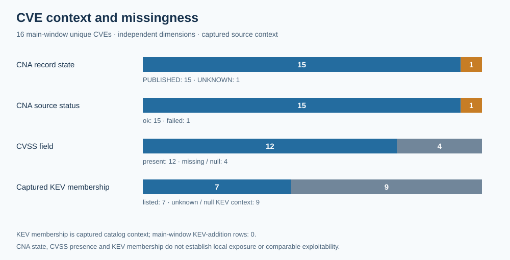
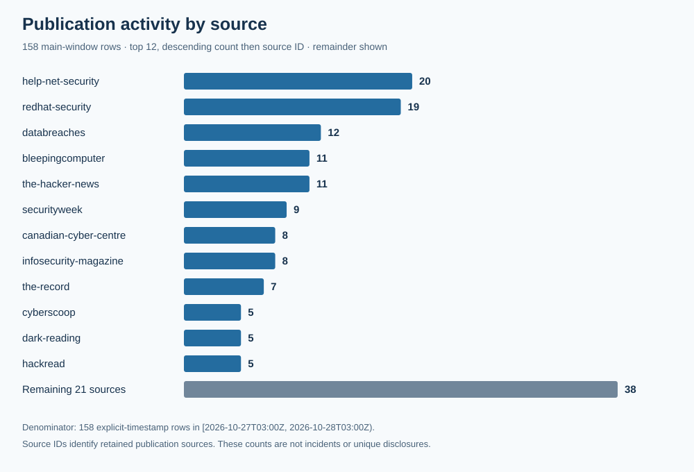
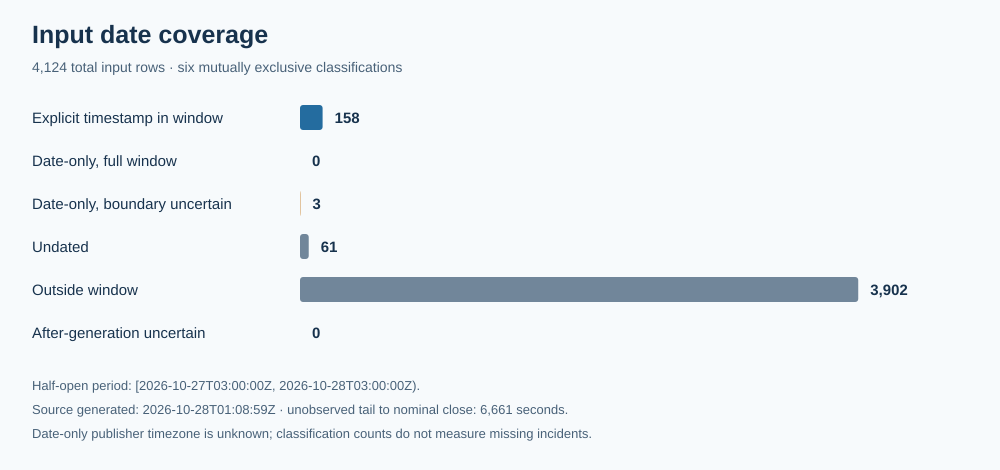

# Star Wolf Security Daily — October 27, 2026, 22:00 CDT

Edition **SW-DAILY-2026-10-27-2200-CDT** · **Partial coverage; compiled late and retrospectively**

The reporting period is **[October 27, 2026 at 03:00Z, October 28 at 03:00Z)**, equivalent to October 26 at 22:00 through October 27 at 22:00 America/Chicago. The source input was generated **October 28 at 01:08:59Z**, leaving **6,661 seconds (1 hour, 51 minutes, 1 second)** to the nominal close unobserved. It was captured October 28 at 05:16:48.850332–05:16:59.887518Z. This edition was actually compiled **2026-10-30T01:02:04.308Z**; later capture and compilation do not establish what was known at the nominal close.

[Previous edition: SW-DAILY-2026-10-27-1400-CDT](../1400-CDT/) · [Structured data and complete publication index](data.json)

## Executive summary

The admitted window contains **158 timestamped publication rows** mentioning **16 unique CVEs**. The main cohort contains **zero KEV-addition rows**; **seven of its CVEs have captured KEV membership**. These measure different things. Two October 27 KEV-addition dates, for Brotli and Commerce, are date-only and cross the window boundary under the declared UTC-calendar convention, so they remain outside the main count.

The most useful operational distinction is in PHP: the two initial vulnerabilities have source-attributed upstream release and backport context, while the separate follow-up does not have an established shipped fix in these inputs. Downstream Brotli use, product-specific Commerce branches, Moxa client and gateway conditions, AWS API MCP Server token handling, and EDK2 firmware applicability merit targeted supplier review. These publications do not establish installed exposure, new disclosure, or an incident in an organization.

CNA context is available with status **ok for 15 CVEs**; the CVE-2026-115560 attempt failed and its state remains **UNKNOWN**. Four CVSS fields are missing. The complete product/version statements, source clocks, CVSS vectors and source URLs, weakness context, mitigation steps and limitations remain in the structured briefs. Scores from different CVSS versions are not an organization-specific risk ranking.

## Selected notable developments

Six developments are included because the retained structured records support a useful, qualified brief. They are not a forced top-ten list or a ranking of local risk. Publication dates identify the admitted source rows; supplementary CNA and publisher context retains its own clocks in data.json.

### 1. PHP: distinguish the initial pair from the follow-up

Captured CNA context marks the initial pair as PUBLISHED, each with CVSS 4.0 9.2 and captured KEV membership dated October 26. PHP’s October 21 notice lists upstream 8.2.35, 8.3.36, 8.4.27 and 8.5.12 for the pair, while documenting distribution/LTS fixes and minimal backports for 7.4, 8.0 and 8.1. Displayed version alone does not establish patch status. The mod_php demonstration, other SAPI qualifications, and same-worker request-state prerequisites must remain distinct. The separate October 23 follow-up does not establish a shipped fix for CVE-2026-115560; its CNA attempt failed and its record state is UNKNOWN. The conditional upload-progress setting is not complete mitigation of the initial pair.

[CVE-2026-109618 / CVE-2026-109619 / CVE-2026-115560 — source 1](https://www.php.net/archive/2026.php) · [CVE-2026-109618 / CVE-2026-109619 / CVE-2026-115560 — source 2](https://github.com/php/php-src/security/advisories/GHSA-w8hw-w9fx-j79w) · [CVE-2026-109618 / CVE-2026-109619 / CVE-2026-115560 — source 3](https://github.com/php/php-src/security/advisories/GHSA-6wmf-4rv5-p3rp) · [CVE-2026-109618 / CVE-2026-109619 / CVE-2026-115560 — source 4](https://www.cisa.gov/news-events/alerts/2026/10/21/critical-vulnerabilities-php-require-immediate-patching)

### 2. Brotli: confirm downstream version applicability

The captured Google CNA record describes Brotli decoder memory-safety context and CVSS 4.0 9.2. Its affected ranges are 1.0.3 to below 1.0.10, 1.1.0 to below 1.1.1, and 1.2.0 to below 1.2.1. Check downstream product guidance rather than assuming every consumer shares an affected build or configuration. Captured KEV membership is separate from the date-only October 27 catalog-addition row, whose exact window membership is uncertain.

[CVE-2026-111497 — source 1](https://www.cve.org/CVERecord?id=CVE-2026-111497) · [CVE-2026-111497 — source 2](https://security.paloaltonetworks.com/CVE-2026-111497) · [CVE-2026-111497 — source 3](https://cyber.gc.ca/en/alerts-advisories/google-security-advisory-av26-1085)

### 3. Commerce: retain product-specific branch ranges

Adobe’s captured CNA record covers Commerce, Commerce B2B, Magento Open Source and Commerce Events, with separate affected and unaffected branch statements retained in data.json. It supplies CVSS 3.1 9.3. Preserve those branch strings rather than collapsing them into a universal patch threshold. The October 27 KEV-addition date is boundary-uncertain; captured KEV membership does not make it a main-window catalog addition.

[CVE-2026-48356 — source 1](https://www.cve.org/CVERecord?id=CVE-2026-48356) · [CVE-2026-48356 — source 2](https://cyber.gc.ca/en/alerts-advisories/adobe-security-advisory-av26-697)

### 4. Moxa: separate client and gateway conditions

The captured CNA context separates MRC Client server-configuration validation from OnCell G3150A-LTE key and SMS-command conditions. MRC Client 1.0.0 through 4.2.0 is marked affected and 4.2.2 unaffected; the OnCell records list version 1.0.0 with affected default status. Their CVSS 4.0 scores are 7.6, 7.7 and 7.5. Two unavailable MRC guidance text fields remain null. Use the vendor advisory for exact applicability and handling.

[CVE-2026-111459 / CVE-2026-111460 / CVE-2026-111461 — source 1](https://www.moxa.com/en/support/product-support/security-advisory/mpsa-269510-cve-2026-111459-cve-2026-111460-cve-2026-111461-vulnerabilities-in-moxa-remote-connect-suite-mrc-client) · [CVE-2026-111459 / CVE-2026-111460 / CVE-2026-111461 — source 2](https://cyber.gc.ca/en/alerts-advisories/control-systems-moxa-security-advisory-av26-1089)

### 5. AWS API MCP Server: review token audience handling

The captured CNA record describes OAuth token audience validation in aws-api-mcp-server and marks 1.3.0 to below 1.6.0 affected, with CVSS 4.0 7.3. Loaded mitigation guidance remains needs-review: a structured affected range and a package-reference URL do not by themselves establish a tested remediation for a deployment. Follow the retained AWS and project advisories.

[CVE-2026-115413 — source 1](https://www.cve.org/CVERecord?id=CVE-2026-115413) · [CVE-2026-115413 — source 2](https://aws.amazon.com/security/security-bulletins/2026-152-aws/) · [CVE-2026-115413 — source 3](https://github.com/awslabs/mcp/security/advisories/GHSA-4prq-p2x5-w9fh)

### 6. EDK2: verify firmware applicability with suppliers

The captured TianoCore CNA record concerns EDK2 PXE-driver context, marks versions through edk2-stable202608 affected, and supplies CVSS 4.0 9.5. It does not establish which systems ship that code or a current OEM firmware fix. Loaded mitigation guidance is needs-review; consult the project advisory and the relevant system supplier.

[CVE-2026-97631 — source 1](https://www.cve.org/CVERecord?id=CVE-2026-97631) · [CVE-2026-97631 — source 2](https://github.com/tianocore/edk2/security/advisories/GHSA-99cj-7hg9-mp4m)

## KEV additions and CVE context

**Main-window catalog additions: 0.** The separate boundary watch contains two date-only catalog rows dated October 27: [CVE-2026-111497](https://www.cisa.gov/known-exploited-vulnerabilities-catalog?field_cve=CVE-2026-111497) and [CVE-2026-48356](https://www.cisa.gov/known-exploited-vulnerabilities-catalog?field_cve=CVE-2026-48356). Publisher timezone and exact publication instant are unknown. Neither is converted into a main-window addition. A catalog addition is not the start time of exploitation.

The table contains all 16 CVEs mentioned in the main cohort. “Listed” is retained KEV context; “unknown / null” preserves missing KEV context and must not be read as confirmed absence of exploitation. CVSS values are source-attributed scores with their recorded versions.

| CVE | CNA status / record state | CVSS score / version | Captured KEV context | Retained product context |
|---|---|---|---|---|
| [CVE-2021-33044](https://www.cve.org/CVERecord?id=CVE-2021-33044) | ok / PUBLISHED | missing | Listed · 2024-08-21 | Some Dahua IP Camera, Video Intercom, PTZ Dome Camera, Thermal Camera devices |
| [CVE-2021-33045](https://www.cve.org/CVERecord?id=CVE-2021-33045) | ok / PUBLISHED | missing | Listed · 2024-08-21 | Some Dahua IP Camera, Video Intercom, NVR, XVR devices |
| [CVE-2023-32629](https://www.cve.org/CVERecord?id=CVE-2023-32629) | ok / PUBLISHED | 7.8 / v3.1 | unknown / null | Ubuntu Kernel |
| [CVE-2026-109618](https://www.cve.org/CVERecord?id=CVE-2026-109618) | ok / PUBLISHED | 9.2 / v4.0 | Listed · 2026-10-26 | PHP |
| [CVE-2026-109619](https://www.cve.org/CVERecord?id=CVE-2026-109619) | ok / PUBLISHED | 9.2 / v4.0 | Listed · 2026-10-26 | PHP |
| [CVE-2026-111459](https://www.cve.org/CVERecord?id=CVE-2026-111459) | ok / PUBLISHED | 7.6 / v4.0 | unknown / null | Moxa Remote Connect Suite (MRC Client) |
| [CVE-2026-111460](https://www.cve.org/CVERecord?id=CVE-2026-111460) | ok / PUBLISHED | 7.7 / v4.0 | unknown / null | OnCell G3150A-LTE Series |
| [CVE-2026-111461](https://www.cve.org/CVERecord?id=CVE-2026-111461) | ok / PUBLISHED | 7.5 / v4.0 | unknown / null | OnCell G3150A-LTE Series |
| [CVE-2026-111497](https://www.cve.org/CVERecord?id=CVE-2026-111497) | ok / PUBLISHED | 9.2 / v4.0 | Listed · 2026-10-27 | Brotli |
| [CVE-2026-115413](https://www.cve.org/CVERecord?id=CVE-2026-115413) | ok / PUBLISHED | 7.3 / v4.0 | unknown / null | aws-api-mcp-server |
| [CVE-2026-115560](https://www.cve.org/CVERecord?id=CVE-2026-115560) | failed / UNKNOWN | missing | unknown / null | unknown |
| [CVE-2026-25243](https://www.cve.org/CVERecord?id=CVE-2026-25243) | ok / PUBLISHED | 7.7 / v4.0 | unknown / null | redis |
| [CVE-2026-48356](https://www.cve.org/CVERecord?id=CVE-2026-48356) | ok / PUBLISHED | 9.3 / v3.1 | Listed · 2026-10-27 | Adobe Commerce; Adobe Commerce B2B; Magento Open Source; Adobe Commerce Events |
| [CVE-2026-80097](https://www.cve.org/CVERecord?id=CVE-2026-80097) | ok / PUBLISHED | 8.6 / v3.1 | unknown / null | Microsoft Authenticator for Android |
| [CVE-2026-86950](https://www.cve.org/CVERecord?id=CVE-2026-86950) | ok / PUBLISHED | missing | Listed · 2026-09-29 | iOS and iPadOS; macOS |
| [CVE-2026-97631](https://www.cve.org/CVERecord?id=CVE-2026-97631) | ok / PUBLISHED | 9.5 / v4.0 | unknown / null | EDK2 |

Full version bounds, default statuses, source timestamps, guidance status, CWE statements and source links are retained for every brief in [data.json](data.json). Empty or null source fields remain unknown. This includes the unusual Ubuntu version/status statements as supplied; they are not silently normalized into an affected range. Dahua model/version strings are retained as bounded source text and are not completed from inference.

## Campaigns and actors

The supplied catalog includes **background** from Microsoft’s October 21 account, revised October 23, of ConnectWise-linked application-credential abuse. Microsoft attributes the reported activity to **Storm-0940** and describes its alignment; that attribution is not independent identity verification. The descriptive campaign grouping is not an authenticated campaign name. Compromised application credentials or authentication alone do not establish exfiltration, universal customer compromise, or a vulnerability in Microsoft corporate products. These catalog records have no matched window publication evidence and are not counted as new activity in this edition. [Microsoft background account](https://www.microsoft.com/en-us/security/blog/2026/10/21/storm-0940-uses-artex-agentic-ai-connectwise-supply-chain-compromise/)

Source-attributed mitigation relationships recommend least privilege for multi-tenant application consent, review of application access, evidence preservation, and conditional authorized response supported by confirmed suspicious activity. The complete supplied entities and relationships, their evidence clocks and context limits remain in the structured catalog. CWE-to-CAPEC mappings are taxonomy context, not evidence that an attack pattern was observed.

## Supply chain and AI

Brotli dependency and firmware-supplier applicability are review questions supported by retained product context; they do not establish that every downstream product is vulnerable. The AWS API MCP Server record supports review of an integration component’s token audience handling. The input establishes no new AI incident in this window. The Microsoft/ConnectWise account above remains prior background; its presence does not turn this edition into evidence of a new supply-chain compromise.

## Mitigation priorities

1. **Resolve applicability before assigning action.** Match product, branch, package/backport evidence, SAPI, request prerequisites and deployment conditions against the cited supplier record. No asset inventory was checked here.
2. **Keep PHP guidance conditional and separated.** PHP lists 8.2.35, 8.3.36, 8.4.27 and 8.5.12 for the initial pair and describes distribution/LTS fixes and minimal backports for 7.4, 8.0 and 8.1. A lower displayed version alone does not prove an unpatched package. The demonstrated mod_php route and qualified other-SAPI or same-worker cases do not establish equal exploitability. CISA’s October 23 revision advises temporary offline status when updates cannot be applied immediately or unsupported PHP 8.1 or earlier continues in use, until patched or updated. That is attributed conditional guidance, not a finding about every older build. [PHP notice](https://www.php.net/archive/2026.php), [CISA revised alert](https://www.cisa.gov/news-events/alerts/2026/10/21/critical-vulnerabilities-php-require-immediate-patching)
3. **Treat the PHP follow-up separately.** PHP’s October 23 notice describes a next-regular-release plan and the interim setting `session.upload_progress.enabled=0` for an unusual path involving `php_binary` or `php_serialize` switched to `php` through `ini_set()` before `session_start()`, with upload progress enabled. That conditional measure is not complete mitigation of the initial pair. Neither a shipped third fix nor historical registry absence is established. [PHP notice](https://www.php.net/archive/2026.php)
4. **Use exact supplier guidance for downstream and operational products.** Preserve Brotli ranges, each Commerce branch, Moxa product distinctions and EDK2 supplier context. The loaded AWS API MCP and EDK2 mitigation states remain needs-review; an affected range does not itself verify a deployment’s remediation.
5. **Confirm authorized changes.** Verify installed versions and configuration against vendor guidance and retain evidence. The feed neither patches devices nor verifies outcomes. Captured CISA due dates are catalog/federal directive data, not deadlines assigned to every reader.

Each initial PHP-pair brief retains all **nine guidance steps and six limitations**, including the publication-date, SAPI, backport and later-follow-up qualifications. Other briefs retain their source-specific guidance and null fields in [data.json](data.json).

## Watchlist

- **Next nominal reporting opportunity.** Based on this retrospective compilation clock, the next nominal daily opportunity is October 29, 2026 at 22:00 America/Chicago (October 30 at 03:00Z). It is an opportunity, not evidence that a report has run.
- **PHP follow-up and package evidence.** Revisit the failed CNA enrichment and actual vendor/package evidence for CVE-2026-115560; do not extend the initial-pair release list to it.
- **Boundary catalog dates.** Keep the October 27 date-only Brotli and Commerce KEV-addition rows uncertain until publication-time evidence supports membership; do not count them as main-window additions.
- **Downstream and firmware applicability.** Match Brotli consumers, Moxa products and EDK2-based firmware against the cited supplier-specific ranges and guidance before assigning asset action.
- **Incomplete source coverage.** Retained source health includes 54 ok, seven partial and one failed source. Inspect specific health clocks in data.json; the aggregate is not a completeness guarantee.

## Previous-citation review

A finite-history review covered **19 prior reports**, **2,640 citation occurrences** and **1,644 literal URL groups**. There are **1,642 supported canonical identities** and **two unsupported literal identities**. By the latest associated report clock, **1,408 groups are recent and 236 older**; 37 groups occur across both report-clock buckets. Occurrence totals are 2,307 recent and 333 older. These are report-clock groupings, not source publication or source-check times.

The review found **1,640 groups with unknown finite history, two held in a separate scope and two unsupported groups**. None became eligible or selected; there were **zero new source requests, qualified checks, semantic comparisons or public ledger records**, and all 12 request slots were unused. **Comparison: not checked.** No qualified revision-field baseline was established, so the result cannot support a statement that a source changed or stayed unchanged. Unknown or held per-URL eligibility has no invented next-check time, and the finite retained history does not justify a global claim that a source was never requested.

The actual evaluation occurred October 30 at 00:42:36.326Z; citation-plan metadata was compiled at 00:46:31.319038Z and reconciliation completed at 00:46:31.492311Z. Those actual clocks remain distinct from the October 28 at 03:00Z nominal cutoff. Existing ledgers remain untouched; this edition adds no source-revision records.

## Coverage and limits

The 158 main-window rows come from 33 source IDs. The top 12 account for 120 rows, with 38 across the remaining 21. These are publication activity counts, not incidents or unique disclosures. All main rows have publisher-feed origin. Retained source health is **54 ok, seven partial and one failed** across 62 configured sources; each source’s status and attempt/success clocks remain in data.json.

Source-health URLs identify publisher home or display pages. Their status and attempt/success clocks are retained source-status metadata and do not prove a GET of that exact URL.

| Input date class | Rows | Main metrics |
|---|---:|---|
| Explicit timestamp in window | 158 | Included |
| Date-only, full window | 0 | Included if present |
| Date-only, boundary uncertain | 3 | Excluded; separately retained |
| Undated | 61 | Excluded |
| Outside window | 3,902 | Excluded |
| After-generation uncertain | 0 | Excluded |
| **Total** | **4,124** | **158 main rows** |

- This edition counts retained declared publications, catalog-addition rows and CVE mentions; these are not incident, disclosure, exploitation or installed-exposure counts.
- The input was generated before the nominal window close, leaving 6,661 seconds unobserved. Capture and retrospective compilation occurred later and do not reconstruct an as-of-close snapshot.
- The half-open period is [2026-10-27T03:00:00Z, 2026-10-28T03:00:00Z). Only 158 explicit-timestamp rows enter main metrics; three date-only boundary rows remain separately uncertain.
- Date-only records use a declared UTC-calendar convention with unknown publisher timezone. No exact publication instant is assigned to them.
- Sixty-one undated rows and 3,902 outside-window rows remain outside main metrics. Zero after-generation-uncertain rows is a classification result, not assurance that nothing happened later.
- Captured KEV membership is separate from period catalog additions and does not establish when exploitation began. Seven main CVEs have retained KEV context; nine have unknown or null KEV context.
- CNA source status is 15 ok and one failed; CVSS is present for 12 CVEs and missing for four. Missing context is unknown, not evidence of safety or registry absence.
- CNA products, versions, CVSS versions and scores, CWE/CAPEC taxonomy, mitigations and source-attributed actor context remain bounded source statements. They do not establish a current fix, equal exploitability or applicability to an environment.
- The PHP pair retains nine source-attributed guidance steps and six limitations per CVE. Its initial-pair release list does not establish a shipped fix for CVE-2026-115560.
- Overlapping rolling daily editions and their unique CVE counts must not be added together. This edition contains no monthly trend rows.
- Retained source URLs provide attribution to the captured material; their presence is not a new fetch, availability check or proof of unchanged content.
- Two publication titles and two MRC guidance text fields remain null. Other index labels identify publication source and clock without repeating headline claims.

## Sources

The [retained Intelligence Hub input](https://teamstarwolf.github.io/intelligence-hub/data/feed.json) is the qualified compilation source, generated October 28 at 01:08:59Z. [data.json](data.json) contains the complete 161-row main-plus-boundary publication index, all 16 structured CVE briefs, the supplied 41-entity/35-relationship catalog, all source-health rows, and a deduplicated public citation inventory. Every citation records its URL, neutral label, evidence level and kind. Retained source links provide attribution and are not new fetch or unchanged-content proofs.

The selected developments link their CNA, vendor and advisory evidence inline. Publication-index labels identify the source and declared clock; they do not repeat headlines as fact assertions. Two withheld publication titles remain null, as do two unavailable MRC guidance text fields.
