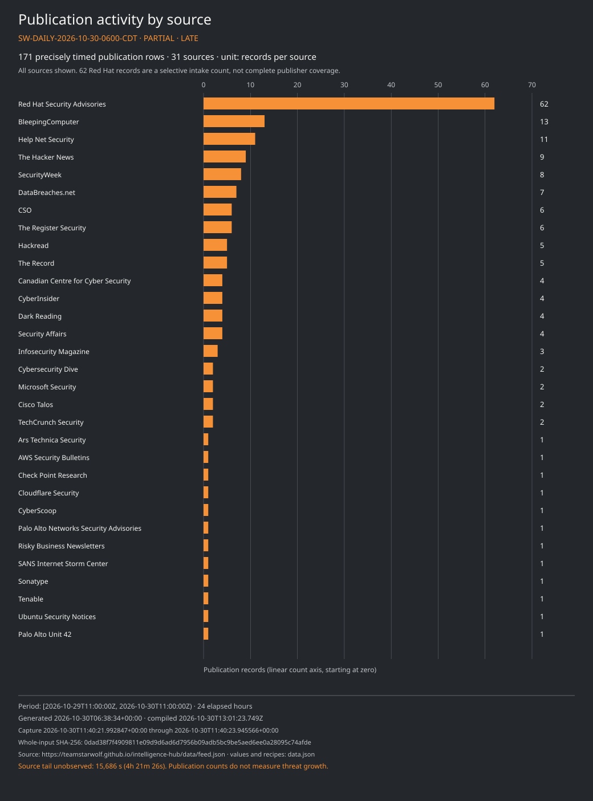
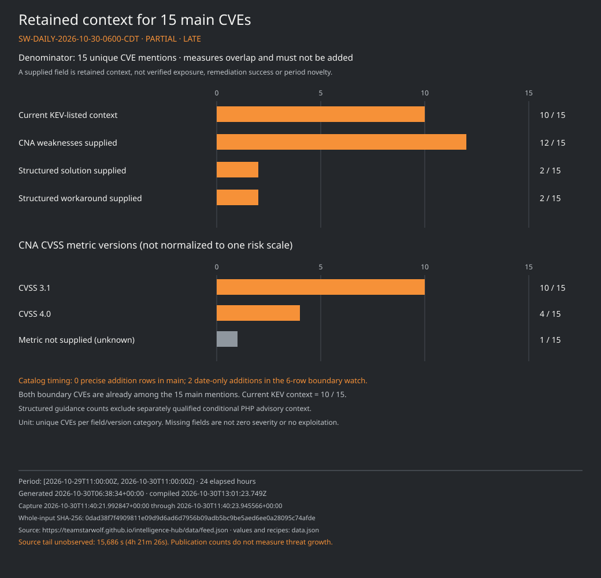
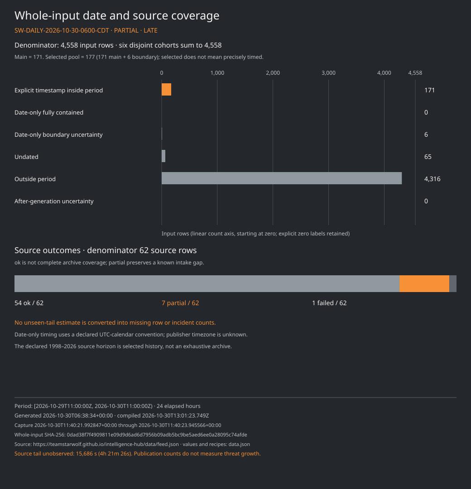

# Team Star Wolf · Daily intelligence report

**SW-DAILY-2026-10-30-0600-CDT · 30 October 2026, 06:00 CDT · PARTIAL · LATE**

## Edition and evidence clocks

| Item | Value |
| --- | --- |
| Nominal slot | 2026-10-30 06:00 America/Chicago (UTC−05:00), 11:00 UTC |
| Half-open period | 2026-10-29 06:00 CDT through 2026-10-30 06:00 CDT; `[2026-10-29T11:00:00Z, 2026-10-30T11:00:00Z)` |
| Duration | 24 elapsed hours |
| Actual compilation | 2026-10-30T13:01:23.749Z |
| Actual analysis completed | 2026-10-30T12:25:36.230240+00:00 |
| Source generated | 2026-10-30T06:38:34+00:00 |
| Source capture | 2026-10-30T11:40:21.992847+00:00 through 2026-10-30T11:40:23.945566+00:00 |
| Source input | [Qualified Hub snapshot](https://teamstarwolf.github.io/intelligence-hub/data/feed.json), schema 6; 11,516,558 bytes |
| Whole-input SHA-256 | `0dad38f7f4909811e09d9d6ad6d7956b09adb5bc9be5aed6ee0a28095c74afde` |
| Declared snapshot horizon | 1998-01-01 through 2026-10-30; selected history, not an exhaustive archive |
| Previous completed edition | [SW-DAILY-2026-10-27-2200-CDT](../../2026-10-27/2200-CDT/README.md) |
| Next nominal opportunity | 2026-10-30 14:00 America/Chicago (UTC−05:00), 19:00 UTC; no delivery guarantee |

Generation leaves the final **15,686 seconds (4h 21m 26s)** of the nominal period unobserved by this snapshot. Capture after cutoff and later analysis/compilation do not fill that gap. This edition does not establish a publication or deployment clock. [Matching data](data.json) preserves the original source clocks and six disjoint row cohorts.

## Executive summary

- **171 publication rows from 31 sources** have declared explicit timestamps inside the period. They mention **15 unique CVEs**. These are publication and association counts, not incidents, new disclosures or installed exposure. Red Hat contributes 62 of the 171 rows; source volume is an intake characteristic, not a threat ranking.
- **Six date-only rows** remain on the boundary watchlist: four Debian publication records and two CISA KEV additions dated 29 October. Their exact time and publisher timezone are unknown. Both KEV CVEs already occur among the 15 main mentions, so they do not increase that unique count.
- **Zero KEV additions can be precisely placed in the elapsed-hour cohort.** This coexists with two date-only boundary additions and ten currently KEV-listed CVEs in the main retained context. It does not mean no additions or exploitation occurred.
- Retained CNA guidance requires product, version and deployment checks. PHP SAPI/request-state and distribution-backport qualifications are especially consequential; numeric version comparisons alone cannot establish exposure or remediation.
- Source outcomes are **54 ok, seven partial and one failed** out of 62. The dedicated prior-citation review failed during preflight: zero articles were fetched or compared, while citation inventory, URL selection and change totals remain unavailable.

## Selected notable developments

### PHP: preserve SAPI, request-state and backport qualifications

CVE-2026-109618 and CVE-2026-109619 occur in the main publication cohort, but the retained CNA and advisory context is older than this reporting window. The CNA marks PHP 8.2/8.3/8.4/8.5 branches below 8.2.35/8.3.36/8.4.27/8.5.12 as affected. These structured ranges must be read with the publisher conditions.

- **Initial-pair upstream and backport releases** — PHP identifies 8.5.12, 8.4.27, 8.3.36 and 8.2.35 for the initial pair. It also describes distribution/LTS fixes and minimal backports for 7.4, 8.0 and 8.1; a numerically lower package can contain a backport, so version alone cannot settle patch status. [Source](https://www.php.net/archive/2026.php); notice date 2026-10-21.
- **Demonstrated susceptibility is SAPI-specific** — The PHP advisory describes an unauthenticated demonstration before application execution under mod_php and qualifies other SAPIs. It does not establish identical demonstrated exploitability across every SAPI, configuration, release or patched package. [Source](https://github.com/php/php-src/security/advisories/GHSA-w8hw-w9fx-j79w); notice date 2026-10-21.
- **Request-state prerequisites remain conditional** — The separate PHP advisory distinguishes demonstrated cases from candidate paths and configuration-dependent state shared by requests in one worker. No deployment prerequisites were verified for this report. [Source](https://github.com/php/php-src/security/advisories/GHSA-6wmf-4rv5-p3rp); notice date 2026-10-21.
- **CISA temporary-offline advice has conditions** — CISA recommends temporary offline status until patched or updated when an organization cannot update immediately or remains on unsupported PHP 8.1 or earlier. This is conditional advice; it does not establish that every lower-numbered vendor package lacks a backport. The retained page establishes a revision date, not its first-publication time. [Source](https://www.cisa.gov/news-events/alerts/2026/10/21/critical-vulnerabilities-php-require-immediate-patching); revision date 2026-10-23.
- **Later PHP follow-up is separate from the initial pair** — For CVE-2026-115560, PHP described a next-regular-release plan and an interim session.upload_progress.enabled=0 setting for the unusual path where php_binary or php_serialize changes to php with ini_set() before session_start(), while upload progress stays enabled. That measure does not completely mitigate the initial pair. A shipped third fix and historical registry absence are not established. [Source](https://www.php.net/archive/2026.php); notice date 2026-10-23.

Both initial-pair CNA metrics are **CVSS 4.0, 9.2**, from their respective [CNA records](https://www.cve.org/CVERecord?id=CVE-2026-109618). Their retained CISA addition date is 26 October, rather than a precisely timed addition in this period. The complete vector, CISA action scope, weaknesses, source dates and bounded version entries remain in data.json and the appendix.

### Cisco ASA/FTD and GitLab: boundary additions, not precise elapsed-hour events

CISA’s retained catalog dates CVE-2026-76418 and CVE-2026-97229 to **2026-10-29**. A date alone spans midnight-to-midnight under the declared UTC-calendar convention and overlaps the 11:00 UTC boundary. Both stay outside the precise main count as catalog rows, although publisher rows already mention both CVEs in the main cohort. A catalog addition does not date an incident or the start of exploitation. [CISA ASA/FTD context](https://www.cisa.gov/known-exploited-vulnerabilities-catalog?field_cve=CVE-2026-76418) · [CISA GitLab context](https://www.cisa.gov/known-exploited-vulnerabilities-catalog?field_cve=CVE-2026-97229).

The Cisco CNA lists ASA and FTD separately with bounded affected-version entries and a **CVSS 3.1 score of 8.6**. No structured solution or workaround is supplied here. GitLab’s retained CNA lists 19.2 below 19.2.8, 19.3 below 19.3.5 and 19.4 below 19.4.2, recommends the applicable release or later, and supplies **CVSS 3.1, 10.0**. Those facts do not establish that any reader’s installation was updated. [Cisco advisory](https://sec.cloudapps.cisco.com/security/center/content/CiscoSecurityAdvisory/cisco-sa-asaftd-tunnel-dos-s6mgkb75) · [GitLab release reference](https://docs.gitlab.com/releases/patches/patch-release-gitlab-19-4-2-released/).

### Runtime and authorization guidance: keep branches and missingness distinct

The Brotli CNA separates three affected intervals and recommends the applicable **1.0.10, 1.1.1 or 1.2.1** release; its retained metric is **CVSS 4.0, 9.2**. This is branch-specific library/binary guidance, not evidence that every dependent product contains the same build. [CNA record](https://www.cve.org/CVERecord?id=CVE-2026-111497) · [Node.js reference](https://nodejs.org/en/blog/vulnerability/october-2026-security-releases).

The two .NET records retain separate CWE-94 and CWE-276 associations, six platform/version entries each, and different **CVSS 3.1 metrics (8.8 and 7.8)**. Their affected upper bounds do not by themselves establish shipped fixes; no structured solution or workaround is supplied. AWS Private CA issuer retains distinct ordinary and EKS build bounds below **1.10.1** and **1.10.1-eksbuild.1**, a CWE-863 association, and **CVSS 4.0, 8.4**; its structured remediation fields are also empty. [Microsoft code-generation record](https://www.cve.org/CVERecord?id=CVE-2026-102870) · [Microsoft permissions record](https://www.cve.org/CVERecord?id=CVE-2026-114148) · [AWS advisory](https://aws.amazon.com/security/security-bulletins/2026-156-aws/).

### Kernel and VMware: product-specific applicability controls the interpretation

CVE-2026-46300 and CVE-2026-98432 carry Linux git intervals and affected/unaffected release entries. Their retained **CVSS 3.1 scores are 7.8 and 9.8**. Branch entries, original commits and distribution backports must remain distinct; no universal fixed distribution version is established. Only the first has a retained KEV match, which does not prove absence of exploitation for the second. [First CNA record](https://www.cve.org/CVERecord?id=CVE-2026-46300) · [Second CNA record](https://www.cve.org/CVERecord?id=CVE-2026-98432).

CVE-2026-41709 lists Cloud Foundation, vSphere Foundation, ESX and Telco Cloud Platform with separate version/build conditions. The retained metric is **CVSS 3.1, 2.7** and a current KEV match is present. A lower numeric score does not override the product and deployment conditions or produce an organization-specific risk rank. No structured solution or workaround is supplied in the projection. [CNA record](https://www.cve.org/CVERecord?id=CVE-2026-41709) · [Broadcom advisory](https://support.broadcom.com/web/ecx/support-content-notification/-/external/content/SecurityAdvisories/0/38017).

### Older CVEs in current publications remain older context

CVE-2021-44228 and CVE-2023-20198 appear in the main association set, with retained KEV dates in 2021 and 2023. Their appearance does not make them newly disclosed or newly exploited. The Log4j CNA projection has no CVSS metric and a custom version bound; its CISA action text was withheld for privacy. IOS XE guidance retains its Web UI internet/untrusted-network conditions. Oracle Application Object Library CVE-2026-101767 supplies a 12.2.3–12.2.15 affected custom range and **CVSS 3.1, 9.8**, with solution, workaround and weakness fields not supplied. [Log4j record](https://www.cve.org/CVERecord?id=CVE-2021-44228) · [Cisco record](https://www.cve.org/CVERecord?id=CVE-2023-20198) · [Oracle record](https://www.cve.org/CVERecord?id=CVE-2026-101767).

## Main CVE context register

Every row below is retained context associated with a main-cohort mention. CNA metric sources are the linked CVE records; values retain their original metric versions. Empty guidance or KEV fields remain unknown.

| CVE / CNA source | Bounded products | Retained metric | Retained KEV context | CNA weaknesses |
| --- | --- | --- | --- | --- |
| [CVE-2021-44228](https://www.cve.org/CVERecord?id=CVE-2021-44228) | Apache Software Foundation Apache Log4j2 | Not supplied | Listed 2021-12-10 | CWE-502, CWE-400, CWE-20 |
| [CVE-2023-20198](https://www.cve.org/CVERecord?id=CVE-2023-20198) | Cisco Cisco IOS XE Software | 10 · CVSS 3.1 | Listed 2023-10-16 | CWE-420 |
| [CVE-2026-101767](https://www.cve.org/CVERecord?id=CVE-2026-101767) | Oracle Corporation Oracle Application Object Library | 9.8 · CVSS 3.1 | No match in retained KEV input; exploitation unknown | Not supplied |
| [CVE-2026-102870](https://www.cve.org/CVERecord?id=CVE-2026-102870) | Microsoft .NET 10.0 installed on Linux; Microsoft .NET 10.0 installed on Mac OS; Microsoft .NET 10.0 installed on Windows; Microsoft .NET 11.0 installed on Linux; Microsoft .NET 11.0 installed on Mac OS; Microsoft .NET 11.0 installed on Windows | 8.8 · CVSS 3.1 | No match in retained KEV input; exploitation unknown | CWE-94 |
| [CVE-2026-109618](https://www.cve.org/CVERecord?id=CVE-2026-109618) | PHP Group PHP | 9.2 · CVSS 4.0 | Listed 2026-10-26 | CWE-416, CWE-755, CWE-824, CWE-1325, CWE-1419 |
| [CVE-2026-109619](https://www.cve.org/CVERecord?id=CVE-2026-109619) | PHP Group PHP | 9.2 · CVSS 4.0 | Listed 2026-10-26 | CWE-416, CWE-755, CWE-824, CWE-1325, CWE-1419 |
| [CVE-2026-111497](https://www.cve.org/CVERecord?id=CVE-2026-111497) | Google Brotli | 9.2 · CVSS 4.0 | Listed 2026-10-27 | CWE-787, CWE-252 |
| [CVE-2026-114148](https://www.cve.org/CVERecord?id=CVE-2026-114148) | Microsoft .NET 10.0 installed on Linux; Microsoft .NET 10.0 installed on Mac OS; Microsoft .NET 10.0 installed on Windows; Microsoft .NET 11.0 installed on Linux; Microsoft .NET 11.0 installed on Mac OS; Microsoft .NET 11.0 installed on Windows | 7.8 · CVSS 3.1 | No match in retained KEV input; exploitation unknown | CWE-276 |
| [CVE-2026-119115](https://www.cve.org/CVERecord?id=CVE-2026-119115) | AWS aws-privateca-issuer | 8.4 · CVSS 4.0 | No match in retained KEV input; exploitation unknown | CWE-863 |
| [CVE-2026-20127](https://www.cve.org/CVERecord?id=CVE-2026-20127) | Cisco Cisco Catalyst SD-WAN Manager | 10 · CVSS 3.1 | Listed 2026-02-25 | CWE-287 |
| [CVE-2026-41709](https://www.cve.org/CVERecord?id=CVE-2026-41709) | VMware Cloud Foundation; VMware vSphere Foundation; VMware ESX; VMware Telco Cloud Platform | 2.7 · CVSS 3.1 | Listed 2026-10-28 | CWE-778 |
| [CVE-2026-46300](https://www.cve.org/CVERecord?id=CVE-2026-46300) | Linux Linux | 7.8 · CVSS 3.1 | Listed 2026-10-28 | Not supplied |
| [CVE-2026-76418](https://www.cve.org/CVERecord?id=CVE-2026-76418) | Cisco Cisco Secure Firewall Adaptive Security Appliance (ASA) Software; Cisco Cisco Secure Firewall Threat Defense (FTD) Software | 8.6 · CVSS 3.1 | Listed 2026-10-29 | CWE-690 |
| [CVE-2026-97229](https://www.cve.org/CVERecord?id=CVE-2026-97229) | GitLab GitLab | 10 · CVSS 3.1 | Listed 2026-10-29 | CWE-190 |
| [CVE-2026-98432](https://www.cve.org/CVERecord?id=CVE-2026-98432) | Linux Linux | 9.8 · CVSS 3.1 | No match in retained KEV input; exploitation unknown | Not supplied |

There are **14 supplied CVSS metrics: ten version 3.1 and four version 4.0; one is not supplied**. Twelve of 15 CVEs have supplied CNA weakness identifiers. Two have a structured solution and two have a structured workaround; these measures overlap and do not measure remediation success. CVSS versions are not normalized or interpreted as local risk.

## KEV additions and watchlist

| Measure | Value | Meaning |
| --- | --- | --- |
| Precisely assigned addition rows | 0 | No catalog-addition row has an explicit instant inside the 171-row main cohort |
| Date-only boundary addition rows | 2 | CVE-2026-76418 and CVE-2026-97229, dated 2026-10-29; not precisely assignable |
| Current KEV-listed main CVEs | 10 / 15 | Retained catalog context, not ten new exploits or ten additions |

Watch the source-generation gap, date-only timing, platform/SAPI and vendor-package applicability, and guidance fields that are not supplied. Confirm any authorized mitigation against the original vendor package/build and deployment evidence. CISA due dates are catalog/federal directive data, not deadlines automatically assigned to every reader. Ransomware **Unknown** is missing context, not a finding of no ransomware use.

## Weakness taxonomy, actors, supply chain and AI

CVE-to-CWE associations come from the CNA’s structured problemTypes. The selected set includes CWE-287 for CVE-2026-20127 and CWE-416 for both PHP records. The retained official **CWE 4.20** page for CWE-287, revised 2026-04-30, lists CAPEC-114, 115, 151, 194, 22, 57, 593 and 633 as related attack patterns. Retained CAPEC-115 and CAPEC-593 pages identify **CAPEC 3.9**, with their own source dates. These are taxonomy links, not observed attack paths, incident counts or proof of how a CVE was exploited. The selected CWE-416 entity has no supplied CAPEC relationship in this projection; no relationship is invented. [CWE-287](https://cwe.mitre.org/data/definitions/287.html) · [CWE-416](https://cwe.mitre.org/data/definitions/416.html) · [CAPEC-115](https://capec.mitre.org/data/definitions/115.html) · [CAPEC-593](https://capec.mitre.org/data/definitions/593.html).

No separately qualified in-window actor/campaign or supply-chain/AI conclusion is established by this projection. The retained Microsoft account, published 21 October and revised 23 October, attributes older ConnectWise-linked application abuse to **Storm-0940** and describes its alignment; those are Microsoft’s claims, not authenticated actor identity. The descriptive campaign grouping and any AI/supply-chain wording remain older source context with no selected in-window evidence-URL match. Authentication alone does not prove data theft. No new period activity is inferred from a name, alias, URL slug or co-mention. [Older Microsoft account](https://www.microsoft.com/en-us/security/blog/2026/10/21/storm-0940-uses-artex-agentic-ai-connectwise-supply-chain-compromise/).

## Actual-data charts

All three charts use the matching data.json counts, denominators, whole-input digest and frozen compilation clock. Publication volume, context availability and source intake are not threat-growth measures.

## Source outcomes and previous-citation review

The 62 source rows report **54 ok, seven partial and one failed**. Partial sources are F5 Labs, Graham Cluley, Infosecurity Magazine, Qualys Security Blog, Red Hat Security Advisories, Snyk and Cisco Talos. The separate **CISA Advisories** source failed; the successful CISA Cybersecurity Advisories category subset does not repair or replace that outcome. An ok result does not establish complete archive coverage, and legacy Threatpost intake does not make archived items current. The data file publishes exactly the eight source-health fields: id, name, kind, url, status, last_attempt, last_success and articles. Source identifiers are canonical publisher labels, not article bylines.

The dedicated prior-citation inventory attempt stopped during preflight. **No article was fetched or semantically compared in this edition. Citation/URL selection totals are unavailable, not zero or unchanged. Prior review records remain dated evidence.** The eligible metadata pool contained eight reports (one recent, seven older), but citation occurrences, distinct literal URLs, canonical URLs, selected URLs, changed security fields, unresolved URLs and cap-excluded URLs remain **null**. There is no invented per-URL failure or unchanged record.

## Limits and method

- Partial and late: source generation precedes cutoff by 15,686 seconds; capture, analysis and compilation are later clocks and do not fill that gap.
- Publication/catalog-addition rows and CVE mentions do not count incidents, newly disclosed flaws, first exploitation or installed exposure.
- All fifteen main CVEs retain bounded current CNA/KEV context, not evidence of what was known at the period cutoff or direct primary-body reverification.
- Date-only boundary rows use an unknown-publisher-timezone UTC-calendar convention; six rows are outside the precise main count.
- Sixty-five undated rows, 4,316 outside-period rows and zero after-generation-uncertain rows remain separately classified, not discarded from the whole-input denominator.
- Selected historical coverage and source intake caps/gaps cannot establish exhaustive source silence or absence of events.
- An ok source outcome does not establish complete publisher coverage; seven sources are partial and one failed. The CISA category subset does not erase the failure of the separate all-advisories source.
- CVSS versions and product contexts differ. Missing metrics and mitigations remain unknown; no local risk score or automatic patch instruction is inferred.
- CNA weaknesses and official CAPEC relationships are taxonomy; actor names, aliases and co-mentions do not establish identity or current participation.
- The prior-citation inventory failed at preflight. Unknown selection/change totals remain null; existing prior-review records do not become new checks.
- All 177 source editorial titles remain private and pending editorial review. Seven upstream privacy omissions comprise five titles and two context-text fields; the candidate uses newly written neutral labels and paraphrases. Raw titles, summaries, tags, reference labels, article bylines and private proofs are excluded.
- This report uses a qualified generic CNA/context projection. Original publisher and CNA bodies were not independently reopened or reverified for this edition. The official source remains authoritative for applicability; no installed inventory was examined.

## Primary-first references

The source URL and whole-input digest above identify the snapshot used. The following links are retained primary references, not a claim that each body was fetched or rechecked during this edition. The data file also retains the 177 selected publication-record IDs, original source clocks, validated URLs and cohort membership without their pending editorial titles.

| CNA record | Retained primary references |
| --- | --- |
| [CVE-2021-44228](https://www.cve.org/CVERecord?id=CVE-2021-44228) | [Primary reference 1](https://logging.apache.org/log4j/2.x/security.html) · [Primary reference 2](https://tools.cisco.com/security/center/content/CiscoSecurityAdvisory/cisco-sa-apache-log4j-qRuKNEbd) · [Primary reference 3](https://security.netapp.com/advisory/ntap-20211210-0007/) · [Primary reference 4](https://psirt.global.sonicwall.com/vuln-detail/SNWLID-2021-0032) · [Primary reference 5](https://www.oracle.com/security-alerts/alert-cve-2021-44228.html) · [Primary reference 6](https://www.debian.org/security/2021/dsa-5020) · [Primary reference 7](https://lists.debian.org/debian-lts-announce/2021/12/msg00007.html) · [Primary reference 8](https://lists.fedoraproject.org/archives/list/package-announce%40lists.fedoraproject.org/message/VU57UJDCFIASIO35GC55JMKSRXJMCDFM/) · [Primary reference 9](https://msrc-blog.microsoft.com/2021/12/11/microsofts-response-to-cve-2021-44228-apache-log4j2/) · [Primary reference 10](https://tools.cisco.com/security/center/content/CiscoSecurityAdvisory/cisco-sa-apache-log4j-qRuKNEbd) · [Primary reference 11](https://www.kb.cert.org/vuls/id/930724) · [Primary reference 12](https://cert-portal.siemens.com/productcert/pdf/ssa-661247.pdf) · [Primary reference 13](https://www.intel.com/content/www/us/en/security-center/advisory/intel-sa-00646.html) · [Primary reference 14](https://tools.cisco.com/security/center/content/CiscoSecurityAdvisory/cisco-sa-apache-log4j-qRuKNEbd) |
| [CVE-2023-20198](https://www.cve.org/CVERecord?id=CVE-2023-20198) | [Primary reference 1](https://sec.cloudapps.cisco.com/security/center/content/CiscoSecurityAdvisory/cisco-sa-iosxe-webui-privesc-j22SaA4z) |
| [CVE-2026-101767](https://www.cve.org/CVERecord?id=CVE-2026-101767) | [Primary reference 1](https://www.oracle.com/security-alerts/cpuoct2026.html) |
| [CVE-2026-102870](https://www.cve.org/CVERecord?id=CVE-2026-102870) | [Primary reference 1](https://msrc.microsoft.com/update-guide/vulnerability/CVE-2026-102870) |
| [CVE-2026-109618](https://www.cve.org/CVERecord?id=CVE-2026-109618) | [Primary reference 1](https://github.com/php/php-src/security/advisories/GHSA-w8hw-w9fx-j79w) |
| [CVE-2026-109619](https://www.cve.org/CVERecord?id=CVE-2026-109619) | [Primary reference 1](https://github.com/php/php-src/security/advisories/GHSA-6wmf-4rv5-p3rp) |
| [CVE-2026-111497](https://www.cve.org/CVERecord?id=CVE-2026-111497) | [Primary reference 1](https://nodejs.org/en/blog/vulnerability/october-2026-security-releases) · [Primary reference 2](https://github.com/andybalholm/brotli/releases/tag/v1.2.7) |
| [CVE-2026-114148](https://www.cve.org/CVERecord?id=CVE-2026-114148) | [Primary reference 1](https://msrc.microsoft.com/update-guide/vulnerability/CVE-2026-114148) |
| [CVE-2026-119115](https://www.cve.org/CVERecord?id=CVE-2026-119115) | [Primary reference 1](https://github.com/cert-manager/aws-privateca-issuer/releases/tag/v1.10.1) · [Primary reference 2](https://github.com/cert-manager/aws-privateca-issuer/security/advisories/GHSA-hjrh-q6pg-mh82) · [Primary reference 3](https://aws.amazon.com/security/security-bulletins/2026-156-aws/) |
| [CVE-2026-20127](https://www.cve.org/CVERecord?id=CVE-2026-20127) | [Primary reference 1](https://sec.cloudapps.cisco.com/security/center/content/CiscoSecurityAdvisory/cisco-sa-sdwan-rpa-EHchtZk) |
| [CVE-2026-41709](https://www.cve.org/CVERecord?id=CVE-2026-41709) | [Primary reference 1](https://support.broadcom.com/web/ecx/support-content-notification/-/external/content/SecurityAdvisories/0/38017) |
| [CVE-2026-46300](https://www.cve.org/CVERecord?id=CVE-2026-46300) | [Primary reference 1](https://git.kernel.org/stable/c/3599e6b3cc1ada96883d496a50a210d3afbb6987) · [Primary reference 2](https://git.kernel.org/stable/c/2f2b16022a2e10ca7bccfb98db5ed2ec0f72641c) · [Primary reference 3](https://git.kernel.org/stable/c/9d3e5fd19fe1063bf607219e8562fbd567b8e8d5) · [Primary reference 4](https://git.kernel.org/stable/c/78bf6b6bb19541d19fbda6242e7cfe2c682763c0) · [Primary reference 5](https://git.kernel.org/stable/c/760e1addc27ba1a7beb4a0a7e8b3e9ec49e7a34e) · [Primary reference 6](https://git.kernel.org/stable/c/3bd9e113d50034db99d7ef69fd8e5242d15e414a) · [Primary reference 7](https://git.kernel.org/stable/c/3884358a9286b17f389a72b1426fc4547c23c111) · [Primary reference 8](https://git.kernel.org/stable/c/f84eca5817390257cef78013d0112481c503b4a3) |
| [CVE-2026-76418](https://www.cve.org/CVERecord?id=CVE-2026-76418) | [Primary reference 1](https://sec.cloudapps.cisco.com/security/center/content/CiscoSecurityAdvisory/cisco-sa-asaftd-tunnel-dos-s6mgkb75) |
| [CVE-2026-97229](https://www.cve.org/CVERecord?id=CVE-2026-97229) | [Primary reference 1](https://gitlab.com/gitlab-org/gitlab/-/work_items/630686) · [Primary reference 2](https://hackerone.com/reports/4055749) · [Primary reference 3](https://hackerone.com/reports/4058589) · [Primary reference 4](https://docs.gitlab.com/releases/patches/patch-release-gitlab-19-4-2-released/) |
| [CVE-2026-98432](https://www.cve.org/CVERecord?id=CVE-2026-98432) | [Primary reference 1](https://git.kernel.org/stable/c/b3b027ef0cd322bfa839b9aaf5b27551eea54cf6) · [Primary reference 2](https://git.kernel.org/stable/c/95a8c8fa9f27dce64c40c41c062de7728bf34ab5) · [Primary reference 3](https://git.kernel.org/stable/c/89b5b1eb7d633c33832b7ff2c02e19a144705036) · [Primary reference 4](https://git.kernel.org/stable/c/742f73df544e03744f2981c467d6542fe8172a2a) · [Primary reference 5](https://git.kernel.org/stable/c/11a03ce3c4a62d84c10ccdfe47f8075006498568) · [Primary reference 6](https://git.kernel.org/stable/c/a47406c769f72c070386985488f1c4d057df86b2) · [Primary reference 7](https://git.kernel.org/stable/c/26d4c36d318cffbbd160884a0e4cec0da4da4936) · [Primary reference 8](https://git.kernel.org/stable/c/e3f33b0a1d89d738e2b913dab519226eaf76e15b) |

PHP/CISA qualified context and official CWE/CAPEC references are linked beside the claims they support. The older Microsoft source is separately dated and outside the main evidence-URL matches.

## Appendix: exact bounded CNA version entries

The tables preserve supplied product/default/entry status, version strings, comparison bounds and version types. A blank bound is shown as an em dash; it does not mean every later release is fixed. Custom and git identifiers are retained without converting them to semantic versions. These are bounded record entries, not complete vendor matrices.

### CVE-2021-44228 — Apache Log4j2 retained applicability

The retained record uses a custom log4j-core* bound beginning at 2.0-beta9; that string is not a complete, orderable fixed-version statement.

No structured solution or workaround is supplied here. The CISA action text was withheld for privacy; use the linked official sources.

| Product | Default status | Starting/version value | Entry status | Less than | Less than or equal | Version type |
| --- | --- | --- | --- | --- | --- | --- |
| Apache Software Foundation / Apache Log4j2 | unknown | 2.0-beta9 | affected | log4j-core* | — | custom |

CVSS: **not supplied**, rather than zero.

Retained CISA context: added 2021-12-10; recorded due date 2021-12-24; ransomware field **Known**. CISA action text is withheld for privacy; no replacement action is invented.

Weakness context: CWE-502, CWE-400, CWE-20. Source record updated 2025-10-21T23:25:23+00:00; retrieved 2026-10-30T01:05:11+00:00; attempted 2026-10-30T01:05:10+00:00. [CNA record](https://www.cve.org/CVERecord?id=CVE-2021-44228). [CISA context](https://www.cisa.gov/known-exploited-vulnerabilities-catalog?field_cve=CVE-2021-44228).

### CVE-2023-20198 — Cisco IOS XE Web UI conditions

The bounded record lists twelve affected IOS XE versions. CISA guidance concerns the Web UI exposed to the internet or untrusted networks; applicability requires the vendor deployment conditions.

The projection supplies CISA guidance, but no structured solution or workaround.

| Product | Default status | Starting/version value | Entry status | Less than | Less than or equal | Version type |
| --- | --- | --- | --- | --- | --- | --- |
| Cisco / Cisco IOS XE Software | unknown | 16.1.1 | affected | — | — | not supplied |
| Cisco / Cisco IOS XE Software | unknown | 16.1.2 | affected | — | — | not supplied |
| Cisco / Cisco IOS XE Software | unknown | 16.1.3 | affected | — | — | not supplied |
| Cisco / Cisco IOS XE Software | unknown | 16.2.1 | affected | — | — | not supplied |
| Cisco / Cisco IOS XE Software | unknown | 16.2.2 | affected | — | — | not supplied |
| Cisco / Cisco IOS XE Software | unknown | 16.3.1 | affected | — | — | not supplied |
| Cisco / Cisco IOS XE Software | unknown | 16.3.2 | affected | — | — | not supplied |
| Cisco / Cisco IOS XE Software | unknown | 16.3.3 | affected | — | — | not supplied |
| Cisco / Cisco IOS XE Software | unknown | 16.3.1a | affected | — | — | not supplied |
| Cisco / Cisco IOS XE Software | unknown | 16.3.4 | affected | — | — | not supplied |
| Cisco / Cisco IOS XE Software | unknown | 16.3.5 | affected | — | — | not supplied |
| Cisco / Cisco IOS XE Software | unknown | 16.3.5b | affected | — | — | not supplied |

Retained CNA metric: **10 (CVSS 3.1)**, vector `CVSS:3.1/AV:N/AC:L/PR:N/UI:N/S:C/C:H/I:H/A:H`; [metric source](https://www.cve.org/CVERecord?id=CVE-2023-20198).

Retained CISA context: added 2023-10-16; recorded due date 2023-10-20; ransomware field **Unknown**. CISA calls for BOD 23-02 compliance and vendor mitigations for relevant IOS XE Web UI exposure, with vendor-directed compromise assessment and reporting of positive findings to CISA.

Weakness context: CWE-420. Source record updated 2025-10-21T23:05:34+00:00; retrieved 2026-10-30T01:05:05+00:00; attempted 2026-10-30T01:05:04+00:00. [CNA record](https://www.cve.org/CVERecord?id=CVE-2023-20198). [CISA context](https://www.cisa.gov/known-exploited-vulnerabilities-catalog?field_cve=CVE-2023-20198).

### CVE-2026-101767 — Oracle Application Object Library applicability

Oracle Application Object Library 12.2.3 through 12.2.15 is marked affected in the retained custom range.

A solution, workaround and CNA weakness identifier are not supplied in this projection.

| Product | Default status | Starting/version value | Entry status | Less than | Less than or equal | Version type |
| --- | --- | --- | --- | --- | --- | --- |
| Oracle Corporation / Oracle Application Object Library | unknown | 12.2.3 | affected | — | 12.2.15 | custom |

Retained CNA metric: **9.8 (CVSS 3.1)**, vector `CVSS:3.1/AV:N/AC:L/PR:N/UI:N/S:U/C:H/I:H/A:H`; [metric source](https://www.cve.org/CVERecord?id=CVE-2026-101767).

No match in this retained KEV input; this does not establish absence of exploitation. No CISA action is supplied here.

Weakness context: not supplied. Source record updated 2026-10-21T10:55:19+00:00; retrieved 2026-10-30T01:46:40+00:00; attempted 2026-10-30T01:46:39+00:00. [CNA record](https://www.cve.org/CVERecord?id=CVE-2026-101767).

### CVE-2026-102870 — .NET code-generation weakness context

For Linux, Mac OS and Windows, the retained ranges cover .NET 10 from 10.0.0 below 10.0.403 and .NET 11 from 11.0.0-preview.1 below 11.0.100-rc.3. These affected-range bounds do not by themselves establish a shipped fix.

No structured solution or workaround is supplied; consult Microsoft for applicability and remediation.

| Product | Default status | Starting/version value | Entry status | Less than | Less than or equal | Version type |
| --- | --- | --- | --- | --- | --- | --- |
| Microsoft / .NET 10.0 installed on Linux | unknown | 10.0.0 | affected | 10.0.403 | — | custom |
| Microsoft / .NET 10.0 installed on Mac OS | unknown | 10.0.0 | affected | 10.0.403 | — | custom |
| Microsoft / .NET 10.0 installed on Windows | unknown | 10.0.0 | affected | 10.0.403 | — | custom |
| Microsoft / .NET 11.0 installed on Linux | unknown | 11.0.0-preview.1 | affected | 11.0.100-rc.3 | — | custom |
| Microsoft / .NET 11.0 installed on Mac OS | unknown | 11.0.0-preview.1 | affected | 11.0.100-rc.3 | — | custom |
| Microsoft / .NET 11.0 installed on Windows | unknown | 11.0.0-preview.1 | affected | 11.0.100-rc.3 | — | custom |

Retained CNA metric: **8.8 (CVSS 3.1)**, vector `CVSS:3.1/AV:N/AC:L/PR:N/UI:R/S:U/C:H/I:H/A:H/E:U/RL:O/RC:C`; [metric source](https://www.cve.org/CVERecord?id=CVE-2026-102870).

No match in this retained KEV input; this does not establish absence of exploitation. No CISA action is supplied here.

Weakness context: CWE-94. Source record updated 2026-10-29T15:20:26+00:00; retrieved 2026-10-30T01:04:25+00:00; attempted 2026-10-30T01:04:25+00:00. [CNA record](https://www.cve.org/CVERecord?id=CVE-2026-102870).

### CVE-2026-109618 — PHP conditional susceptibility and backports

PHP 8.2.*, 8.3.*, 8.4.* and 8.5.* are marked affected below 8.2.35, 8.3.36, 8.4.27 and 8.5.12 respectively; SAPI, request-state and package/backport conditions remain essential.

The structured workaround points to the PHP security advisory. Additional retained PHP and CISA guidance is qualified separately below.

| Product | Default status | Starting/version value | Entry status | Less than | Less than or equal | Version type |
| --- | --- | --- | --- | --- | --- | --- |
| PHP Group / PHP | unaffected | 8.2.* | affected | 8.2.35 | — | semver |
| PHP Group / PHP | unaffected | 8.3.* | affected | 8.3.36 | — | semver |
| PHP Group / PHP | unaffected | 8.4.* | affected | 8.4.27 | — | semver |
| PHP Group / PHP | unaffected | 8.5.* | affected | 8.5.12 | — | semver |

Retained CNA metric: **9.2 (CVSS 4.0)**, vector `CVSS:4.0/AV:N/AC:H/AT:P/PR:N/UI:N/VC:H/VI:H/VA:H/SC:N/SI:N/SA:N`; [metric source](https://www.cve.org/CVERecord?id=CVE-2026-109618).

Retained CISA context: added 2026-10-26; recorded due date 2026-10-29; ransomware field **Unknown**. CISA directs vendor mitigations with the applicable BOD 26-04 risk-prioritization and forensic-triage guidance; cloud applicability or discontinuation when mitigations are unavailable remains conditional on the cited instructions and asset exposure.

Weakness context: CWE-416, CWE-755, CWE-824, CWE-1325, CWE-1419. Source record updated 2026-10-29T06:08:47+00:00; retrieved 2026-10-30T01:04:40+00:00; attempted 2026-10-30T01:04:40+00:00. [CNA record](https://www.cve.org/CVERecord?id=CVE-2026-109618). [CISA context](https://www.cisa.gov/known-exploited-vulnerabilities-catalog?field_cve=CVE-2026-109618).

### CVE-2026-109619 — PHP request-state prerequisites

The same four bounded PHP branch ranges apply, with configuration-dependent same-worker request-state prerequisites; demonstrations and candidate cases remain distinct.

The structured workaround points to the PHP security advisory. Additional retained PHP and CISA guidance is qualified separately below.

| Product | Default status | Starting/version value | Entry status | Less than | Less than or equal | Version type |
| --- | --- | --- | --- | --- | --- | --- |
| PHP Group / PHP | unaffected | 8.2.* | affected | 8.2.35 | — | semver |
| PHP Group / PHP | unaffected | 8.3.* | affected | 8.3.36 | — | semver |
| PHP Group / PHP | unaffected | 8.4.* | affected | 8.4.27 | — | semver |
| PHP Group / PHP | unaffected | 8.5.* | affected | 8.5.12 | — | semver |

Retained CNA metric: **9.2 (CVSS 4.0)**, vector `CVSS:4.0/AV:N/AC:H/AT:P/PR:N/UI:N/VC:H/VI:H/VA:H/SC:N/SI:N/SA:N`; [metric source](https://www.cve.org/CVERecord?id=CVE-2026-109619).

Retained CISA context: added 2026-10-26; recorded due date 2026-10-29; ransomware field **Unknown**. CISA directs vendor mitigations with the applicable BOD 26-04 risk-prioritization and forensic-triage guidance; cloud applicability or discontinuation when mitigations are unavailable remains conditional on the cited instructions and asset exposure.

Weakness context: CWE-416, CWE-755, CWE-824, CWE-1325, CWE-1419. Source record updated 2026-10-28T03:55:47+00:00; retrieved 2026-10-30T01:04:40+00:00; attempted 2026-10-30T01:04:40+00:00. [CNA record](https://www.cve.org/CVERecord?id=CVE-2026-109619). [CISA context](https://www.cisa.gov/known-exploited-vulnerabilities-catalog?field_cve=CVE-2026-109619).

### CVE-2026-111497 — Brotli branch-specific guidance

The retained affected intervals are 1.0.3 below 1.0.10, 1.1.0 below 1.1.1, and 1.2.0 below 1.2.1. Select the applicable branch and downstream package context.

The CNA recommends moving affected Brotli libraries or binaries to the applicable 1.0.10, 1.1.1 or 1.2.1 release. No workaround is supplied.

| Product | Default status | Starting/version value | Entry status | Less than | Less than or equal | Version type |
| --- | --- | --- | --- | --- | --- | --- |
| Google / Brotli | unaffected | 1.0.3 | affected | 1.0.10 | — | semver |
| Google / Brotli | unaffected | 1.1.0 | affected | 1.1.1 | — | semver |
| Google / Brotli | unaffected | 1.2.0 | affected | 1.2.1 | — | semver |

Retained CNA metric: **9.2 (CVSS 4.0)**, vector `CVSS:4.0/AV:N/AC:L/AT:P/PR:N/UI:N/VC:H/VI:H/VA:H/SC:N/SI:N/SA:N`; [metric source](https://www.cve.org/CVERecord?id=CVE-2026-111497).

Retained CISA context: added 2026-10-27; recorded due date 2026-11-10; ransomware field **Unknown**. CISA directs vendor mitigations with the applicable BOD 26-04 risk-prioritization and forensic-triage guidance; cloud applicability or discontinuation when mitigations are unavailable remains conditional on the cited instructions and asset exposure.

Weakness context: CWE-787, CWE-252. Source record updated 2026-10-28T03:55:48+00:00; retrieved 2026-10-30T01:04:40+00:00; attempted 2026-10-30T01:04:40+00:00. [CNA record](https://www.cve.org/CVERecord?id=CVE-2026-111497). [CISA context](https://www.cisa.gov/known-exploited-vulnerabilities-catalog?field_cve=CVE-2026-111497).

### CVE-2026-114148 — .NET permission conditions

The retained .NET 10 and 11 version/platform ranges match those stated for CVE-2026-102870, across Linux, Mac OS and Windows; this record concerns CNA-provided CWE-276.

No structured solution or workaround is supplied; an affected upper bound alone is not a fix-shipped claim.

| Product | Default status | Starting/version value | Entry status | Less than | Less than or equal | Version type |
| --- | --- | --- | --- | --- | --- | --- |
| Microsoft / .NET 10.0 installed on Linux | unknown | 10.0.0 | affected | 10.0.403 | — | custom |
| Microsoft / .NET 10.0 installed on Mac OS | unknown | 10.0.0 | affected | 10.0.403 | — | custom |
| Microsoft / .NET 10.0 installed on Windows | unknown | 10.0.0 | affected | 10.0.403 | — | custom |
| Microsoft / .NET 11.0 installed on Linux | unknown | 11.0.0-preview.1 | affected | 11.0.100-rc.3 | — | custom |
| Microsoft / .NET 11.0 installed on Mac OS | unknown | 11.0.0-preview.1 | affected | 11.0.100-rc.3 | — | custom |
| Microsoft / .NET 11.0 installed on Windows | unknown | 11.0.0-preview.1 | affected | 11.0.100-rc.3 | — | custom |

Retained CNA metric: **7.8 (CVSS 3.1)**, vector `CVSS:3.1/AV:L/AC:L/PR:L/UI:N/S:U/C:H/I:H/A:H/E:U/RL:O/RC:C`; [metric source](https://www.cve.org/CVERecord?id=CVE-2026-114148).

No match in this retained KEV input; this does not establish absence of exploitation. No CISA action is supplied here.

Weakness context: CWE-276. Source record updated 2026-10-29T15:21:47+00:00; retrieved 2026-10-30T01:04:25+00:00; attempted 2026-10-30T01:04:25+00:00. [CNA record](https://www.cve.org/CVERecord?id=CVE-2026-114148).

### CVE-2026-119115 — AWS Private CA issuer authorization

Two custom affected ranges start at 0 and end below 1.10.1 and below 1.10.1-eksbuild.1. Keep the ordinary and EKS build forms distinct.

No structured solution or workaround is supplied, although the retained references include an advisory and release. Their presence is not independent verification of deployment remediation.

| Product | Default status | Starting/version value | Entry status | Less than | Less than or equal | Version type |
| --- | --- | --- | --- | --- | --- | --- |
| AWS / aws-privateca-issuer | unaffected | 0 | affected | 1.10.1 | — | custom |
| AWS / aws-privateca-issuer | unaffected | 0 | affected | 1.10.1-eksbuild.1 | — | custom |

Retained CNA metric: **8.4 (CVSS 4.0)**, vector `CVSS:4.0/AV:N/AC:L/AT:N/PR:L/UI:N/VC:N/VI:H/VA:N/SC:L/SI:H/SA:N`; [metric source](https://www.cve.org/CVERecord?id=CVE-2026-119115).

No match in this retained KEV input; this does not establish absence of exploitation. No CISA action is supplied here.

Weakness context: CWE-863. Source record updated 2026-10-29T16:37:08+00:00; retrieved 2026-10-30T01:04:25+00:00; attempted 2026-10-30T01:04:25+00:00. [CNA record](https://www.cve.org/CVERecord?id=CVE-2026-119115).

### CVE-2026-20127 — Cisco SD-WAN authentication context

The bounded record lists twelve affected Cisco Catalyst SD-WAN Manager versions; the exact version entries remain in data.json.

No structured solution or workaround is supplied. CISA cites separate SD-WAN exposure, hunt and hardening instructions.

| Product | Default status | Starting/version value | Entry status | Less than | Less than or equal | Version type |
| --- | --- | --- | --- | --- | --- | --- |
| Cisco / Cisco Catalyst SD-WAN Manager | unknown | 20.1.12 | affected | — | — | not supplied |
| Cisco / Cisco Catalyst SD-WAN Manager | unknown | 19.2.1 | affected | — | — | not supplied |
| Cisco / Cisco Catalyst SD-WAN Manager | unknown | 18.4.4 | affected | — | — | not supplied |
| Cisco / Cisco Catalyst SD-WAN Manager | unknown | 18.4.5 | affected | — | — | not supplied |
| Cisco / Cisco Catalyst SD-WAN Manager | unknown | 20.1.1.1 | affected | — | — | not supplied |
| Cisco / Cisco Catalyst SD-WAN Manager | unknown | 20.1.1 | affected | — | — | not supplied |
| Cisco / Cisco Catalyst SD-WAN Manager | unknown | 19.3.0 | affected | — | — | not supplied |
| Cisco / Cisco Catalyst SD-WAN Manager | unknown | 19.2.2 | affected | — | — | not supplied |
| Cisco / Cisco Catalyst SD-WAN Manager | unknown | 19.2.099 | affected | — | — | not supplied |
| Cisco / Cisco Catalyst SD-WAN Manager | unknown | 18.3.6 | affected | — | — | not supplied |
| Cisco / Cisco Catalyst SD-WAN Manager | unknown | 18.3.7 | affected | — | — | not supplied |
| Cisco / Cisco Catalyst SD-WAN Manager | unknown | 19.2.0 | affected | — | — | not supplied |

Retained CNA metric: **10 (CVSS 3.1)**, vector `CVSS:3.1/AV:N/AC:L/PR:N/UI:N/S:C/C:H/I:H/A:H`; [metric source](https://www.cve.org/CVERecord?id=CVE-2026-20127).

Retained CISA context: added 2026-02-25; recorded due date 2026-02-27; ransomware field **Unknown**. CISA cites Emergency Directive 26-03 and its SD-WAN Hunt and Hardening Guidance, with applicable BOD 22-01 cloud guidance or discontinuation when mitigations are unavailable.

Weakness context: CWE-287. Source record updated 2026-06-16T17:57:59+00:00; retrieved 2026-10-30T01:04:38+00:00; attempted 2026-10-30T01:04:38+00:00. [CNA record](https://www.cve.org/CVERecord?id=CVE-2026-20127). [CISA context](https://www.cisa.gov/known-exploited-vulnerabilities-catalog?field_cve=CVE-2026-20127).

### CVE-2026-41709 — VMware product and build-specific applicability

Cloud Foundation, vSphere Foundation, ESX and Telco Cloud Platform have separate affected versions and custom build bounds. The retained 9.1/9.0/5.x/8.0 entries must not be collapsed into one version comparison.

No structured solution or workaround is supplied. CNA build bounds and the Broadcom advisory require product-specific interpretation.

| Product | Default status | Starting/version value | Entry status | Less than | Less than or equal | Version type |
| --- | --- | --- | --- | --- | --- | --- |
| VMware / Cloud Foundation | unaffected | 9.1.x.x | affected | — | — | not supplied |
| VMware / Cloud Foundation | unaffected | 9.0.x.x | affected | — | — | not supplied |
| VMware / Cloud Foundation | unaffected | 5.x | affected | 5.2.4 | — | custom |
| VMware / vSphere Foundation | unaffected | 9.1.x.x | affected | — | — | not supplied |
| VMware / vSphere Foundation | unaffected | 9.0.x.x | affected | — | — | not supplied |
| VMware / ESX | unaffected | 9.1.x.x | affected | ESXi-9.1.0.0-25370933 | — | custom |
| VMware / ESX | unaffected | 9.0.x.x | affected | ESXi-9.0.2.0100-25595025 | — | custom |
| VMware / ESX | unaffected | 8.0 | affected | ESXi80U3j-25429389 | — | custom |
| VMware / Telco Cloud Platform | unaffected | 5.1.x | affected | — | — | not supplied |
| VMware / Telco Cloud Platform | unaffected | 5.0.x | affected | — | — | not supplied |

Retained CNA metric: **2.7 (CVSS 3.1)**, vector `CVSS:3.1/AV:N/AC:L/PR:H/UI:N/S:U/C:N/I:L/A:N`; [metric source](https://www.cve.org/CVERecord?id=CVE-2026-41709).

Retained CISA context: added 2026-10-28; recorded due date 2026-11-11; ransomware field **Unknown**. CISA directs vendor mitigations with the applicable BOD 26-04 risk-prioritization and forensic-triage guidance; cloud applicability or discontinuation when mitigations are unavailable remains conditional on the cited instructions and asset exposure.

Weakness context: CWE-778. Source record updated 2026-10-29T03:56:50+00:00; retrieved 2026-10-30T01:04:25+00:00; attempted 2026-10-30T01:04:24+00:00. [CNA record](https://www.cve.org/CVERecord?id=CVE-2026-41709). [CISA context](https://www.cisa.gov/known-exploited-vulnerabilities-catalog?field_cve=CVE-2026-41709).

### CVE-2026-46300 — Linux branch and commit conditions

The retained Linux record combines eight affected git intervals with affected/unaffected release entries, including a 3.9 introduction. Vendor backports and branch-specific evidence govern package applicability.

No structured solution or workaround is supplied. The preserved unaffected release/commit entries are not a universal distribution fixed-version assertion.

| Product | Default status | Starting/version value | Entry status | Less than | Less than or equal | Version type |
| --- | --- | --- | --- | --- | --- | --- |
| Linux / Linux | unaffected | cef401de7be8c4e155c6746bfccf721a4fa5fab9 | affected | 3599e6b3cc1ada96883d496a50a210d3afbb6987 | — | git |
| Linux / Linux | unaffected | cef401de7be8c4e155c6746bfccf721a4fa5fab9 | affected | 2f2b16022a2e10ca7bccfb98db5ed2ec0f72641c | — | git |
| Linux / Linux | unaffected | cef401de7be8c4e155c6746bfccf721a4fa5fab9 | affected | 9d3e5fd19fe1063bf607219e8562fbd567b8e8d5 | — | git |
| Linux / Linux | unaffected | cef401de7be8c4e155c6746bfccf721a4fa5fab9 | affected | 78bf6b6bb19541d19fbda6242e7cfe2c682763c0 | — | git |
| Linux / Linux | unaffected | cef401de7be8c4e155c6746bfccf721a4fa5fab9 | affected | 760e1addc27ba1a7beb4a0a7e8b3e9ec49e7a34e | — | git |
| Linux / Linux | unaffected | cef401de7be8c4e155c6746bfccf721a4fa5fab9 | affected | 3bd9e113d50034db99d7ef69fd8e5242d15e414a | — | git |
| Linux / Linux | unaffected | cef401de7be8c4e155c6746bfccf721a4fa5fab9 | affected | 3884358a9286b17f389a72b1426fc4547c23c111 | — | git |
| Linux / Linux | unaffected | cef401de7be8c4e155c6746bfccf721a4fa5fab9 | affected | f84eca5817390257cef78013d0112481c503b4a3 | — | git |
| Linux / Linux | affected | 3.9 | affected | — | — | not supplied |
| Linux / Linux | affected | 0 | unaffected | 3.9 | — | semver |
| Linux / Linux | affected | 5.10.257 | unaffected | — | 5.10.* | semver |
| Linux / Linux | affected | 5.15.208 | unaffected | — | 5.15.* | semver |
| Linux / Linux | affected | 6.1.174 | unaffected | — | 6.1.* | semver |
| Linux / Linux | affected | 6.6.141 | unaffected | — | 6.6.* | semver |
| Linux / Linux | affected | 6.12.91 | unaffected | — | 6.12.* | semver |
| Linux / Linux | affected | 6.18.33 | unaffected | — | 6.18.* | semver |
| Linux / Linux | affected | 7.0.10 | unaffected | — | 7.0.* | semver |
| Linux / Linux | affected | 7.1 | unaffected | — | * | original_commit_for_fix |

Retained CNA metric: **7.8 (CVSS 3.1)**, vector `CVSS:3.1/AV:L/AC:L/PR:L/UI:N/S:U/C:H/I:H/A:H`; [metric source](https://www.cve.org/CVERecord?id=CVE-2026-46300).

Retained CISA context: added 2026-10-28; recorded due date 2026-10-31; ransomware field **Unknown**. CISA directs vendor mitigations with the applicable BOD 26-04 risk-prioritization and forensic-triage guidance; cloud applicability or discontinuation when mitigations are unavailable remains conditional on the cited instructions and asset exposure.

Weakness context: not supplied. Source record updated 2026-10-29T03:55:37+00:00; retrieved 2026-10-30T01:04:25+00:00; attempted 2026-10-30T01:04:24+00:00. [CNA record](https://www.cve.org/CVERecord?id=CVE-2026-46300). [CISA context](https://www.cisa.gov/known-exploited-vulnerabilities-catalog?field_cve=CVE-2026-46300).

### CVE-2026-76418 — Cisco ASA and FTD boundary watch

Cisco ASA and FTD have separate bounded lists of twelve affected versions each. The retained CVSS vector describes availability impact; it does not prove an incident or installed exposure.

No structured solution or workaround is supplied. The CISA addition is date-only and cannot be precisely located inside this elapsed-hour period.

| Product | Default status | Starting/version value | Entry status | Less than | Less than or equal | Version type |
| --- | --- | --- | --- | --- | --- | --- |
| Cisco / Cisco Secure Firewall Adaptive Security Appliance (ASA) Software | unknown | 9.16.1 | affected | — | — | not supplied |
| Cisco / Cisco Secure Firewall Adaptive Security Appliance (ASA) Software | unknown | 9.16.1.28 | affected | — | — | not supplied |
| Cisco / Cisco Secure Firewall Adaptive Security Appliance (ASA) Software | unknown | 9.16.2 | affected | — | — | not supplied |
| Cisco / Cisco Secure Firewall Adaptive Security Appliance (ASA) Software | unknown | 9.16.2.3 | affected | — | — | not supplied |
| Cisco / Cisco Secure Firewall Adaptive Security Appliance (ASA) Software | unknown | 9.16.2.7 | affected | — | — | not supplied |
| Cisco / Cisco Secure Firewall Adaptive Security Appliance (ASA) Software | unknown | 9.16.2.11 | affected | — | — | not supplied |
| Cisco / Cisco Secure Firewall Adaptive Security Appliance (ASA) Software | unknown | 9.16.2.13 | affected | — | — | not supplied |
| Cisco / Cisco Secure Firewall Adaptive Security Appliance (ASA) Software | unknown | 9.16.2.14 | affected | — | — | not supplied |
| Cisco / Cisco Secure Firewall Adaptive Security Appliance (ASA) Software | unknown | 9.16.3.3 | affected | — | — | not supplied |
| Cisco / Cisco Secure Firewall Adaptive Security Appliance (ASA) Software | unknown | 9.16.3 | affected | — | — | not supplied |
| Cisco / Cisco Secure Firewall Adaptive Security Appliance (ASA) Software | unknown | 9.16.3.14 | affected | — | — | not supplied |
| Cisco / Cisco Secure Firewall Adaptive Security Appliance (ASA) Software | unknown | 9.18.1 | affected | — | — | not supplied |
| Cisco / Cisco Secure Firewall Threat Defense (FTD) Software | unknown | 7.0.0 | affected | — | — | not supplied |
| Cisco / Cisco Secure Firewall Threat Defense (FTD) Software | unknown | 7.0.0.1 | affected | — | — | not supplied |
| Cisco / Cisco Secure Firewall Threat Defense (FTD) Software | unknown | 7.0.1 | affected | — | — | not supplied |
| Cisco / Cisco Secure Firewall Threat Defense (FTD) Software | unknown | 7.0.1.1 | affected | — | — | not supplied |
| Cisco / Cisco Secure Firewall Threat Defense (FTD) Software | unknown | 7.0.2 | affected | — | — | not supplied |
| Cisco / Cisco Secure Firewall Threat Defense (FTD) Software | unknown | 7.2.0 | affected | — | — | not supplied |
| Cisco / Cisco Secure Firewall Threat Defense (FTD) Software | unknown | 7.0.2.1 | affected | — | — | not supplied |
| Cisco / Cisco Secure Firewall Threat Defense (FTD) Software | unknown | 7.0.3 | affected | — | — | not supplied |
| Cisco / Cisco Secure Firewall Threat Defense (FTD) Software | unknown | 7.2.0.1 | affected | — | — | not supplied |
| Cisco / Cisco Secure Firewall Threat Defense (FTD) Software | unknown | 7.0.4 | affected | — | — | not supplied |
| Cisco / Cisco Secure Firewall Threat Defense (FTD) Software | unknown | 7.2.1 | affected | — | — | not supplied |
| Cisco / Cisco Secure Firewall Threat Defense (FTD) Software | unknown | 7.0.5 | affected | — | — | not supplied |

Retained CNA metric: **8.6 (CVSS 3.1)**, vector `CVSS:3.1/AV:N/AC:L/PR:N/UI:N/S:C/C:N/I:N/A:H`; [metric source](https://www.cve.org/CVERecord?id=CVE-2026-76418).

Retained CISA context: added 2026-10-29; recorded due date 2026-11-01; ransomware field **Unknown**. CISA directs vendor mitigations with the applicable BOD 26-04 risk-prioritization and forensic-triage guidance; cloud applicability or discontinuation when mitigations are unavailable remains conditional on the cited instructions and asset exposure.

Weakness context: CWE-690. Source record updated 2026-10-29T19:58:23+00:00; retrieved 2026-10-30T01:04:24+00:00; attempted 2026-10-30T01:04:24+00:00. [CNA record](https://www.cve.org/CVERecord?id=CVE-2026-76418). [CISA context](https://www.cisa.gov/known-exploited-vulnerabilities-catalog?field_cve=CVE-2026-76418).

### CVE-2026-97229 — GitLab branch guidance and boundary watch

GitLab 19.2 below 19.2.8, 19.3 below 19.3.5 and 19.4 below 19.4.2 are marked affected.

The CNA advises the applicable 19.2.8, 19.3.5 or 19.4.2 release or later. No workaround is supplied. The CISA addition remains date-only boundary evidence.

| Product | Default status | Starting/version value | Entry status | Less than | Less than or equal | Version type |
| --- | --- | --- | --- | --- | --- | --- |
| GitLab / GitLab | unaffected | 19.2 | affected | 19.2.8 | — | semver |
| GitLab / GitLab | unaffected | 19.3 | affected | 19.3.5 | — | semver |
| GitLab / GitLab | unaffected | 19.4 | affected | 19.4.2 | — | semver |

Retained CNA metric: **10 (CVSS 3.1)**, vector `CVSS:3.1/AV:N/AC:L/PR:N/UI:N/S:C/C:H/I:H/A:H`; [metric source](https://www.cve.org/CVERecord?id=CVE-2026-97229).

Retained CISA context: added 2026-10-29; recorded due date 2026-11-01; ransomware field **Unknown**. CISA directs vendor mitigations with the applicable BOD 26-04 risk-prioritization and forensic-triage guidance; cloud applicability or discontinuation when mitigations are unavailable remains conditional on the cited instructions and asset exposure.

Weakness context: CWE-190. Source record updated 2026-10-29T19:58:23+00:00; retrieved 2026-10-30T01:46:36+00:00; attempted 2026-10-30T01:46:36+00:00. [CNA record](https://www.cve.org/CVERecord?id=CVE-2026-97229). [CISA context](https://www.cisa.gov/known-exploited-vulnerabilities-catalog?field_cve=CVE-2026-97229).

### CVE-2026-98432 — Linux retained release and backport conditions

The bounded Linux record contains eight affected git intervals and release entries including a 4.4 introduction. Full branch bounds are preserved rather than normalized into a single fixed version.

No structured solution, workaround or CNA weakness is supplied. The record does not establish which distribution packages contain backports.

| Product | Default status | Starting/version value | Entry status | Less than | Less than or equal | Version type |
| --- | --- | --- | --- | --- | --- | --- |
| Linux / Linux | unaffected | 079096f103faca2dd87342cca6f23d4b34da8871 | affected | b3b027ef0cd322bfa839b9aaf5b27551eea54cf6 | — | git |
| Linux / Linux | unaffected | 079096f103faca2dd87342cca6f23d4b34da8871 | affected | 95a8c8fa9f27dce64c40c41c062de7728bf34ab5 | — | git |
| Linux / Linux | unaffected | 079096f103faca2dd87342cca6f23d4b34da8871 | affected | 89b5b1eb7d633c33832b7ff2c02e19a144705036 | — | git |
| Linux / Linux | unaffected | 079096f103faca2dd87342cca6f23d4b34da8871 | affected | 742f73df544e03744f2981c467d6542fe8172a2a | — | git |
| Linux / Linux | unaffected | 079096f103faca2dd87342cca6f23d4b34da8871 | affected | 11a03ce3c4a62d84c10ccdfe47f8075006498568 | — | git |
| Linux / Linux | unaffected | 079096f103faca2dd87342cca6f23d4b34da8871 | affected | a47406c769f72c070386985488f1c4d057df86b2 | — | git |
| Linux / Linux | unaffected | 079096f103faca2dd87342cca6f23d4b34da8871 | affected | 26d4c36d318cffbbd160884a0e4cec0da4da4936 | — | git |
| Linux / Linux | unaffected | 079096f103faca2dd87342cca6f23d4b34da8871 | affected | e3f33b0a1d89d738e2b913dab519226eaf76e15b | — | git |
| Linux / Linux | affected | 4.4 | affected | — | — | not supplied |
| Linux / Linux | affected | 0 | unaffected | 4.4 | — | semver |
| Linux / Linux | affected | 5.10.272 | unaffected | — | 5.10.* | semver |
| Linux / Linux | affected | 5.15.223 | unaffected | — | 5.15.* | semver |
| Linux / Linux | affected | 6.1.190 | unaffected | — | 6.1.* | semver |
| Linux / Linux | affected | 6.6.159 | unaffected | — | 6.6.* | semver |
| Linux / Linux | affected | 6.12.113 | unaffected | — | 6.12.* | semver |
| Linux / Linux | affected | 6.18.56 | unaffected | — | 6.18.* | semver |
| Linux / Linux | affected | 7.2.10 | unaffected | — | 7.2.* | semver |
| Linux / Linux | affected | 7.3 | unaffected | — | * | original_commit_for_fix |

Retained CNA metric: **9.8 (CVSS 3.1)**, vector `CVSS:3.1/AV:N/AC:L/PR:N/UI:N/S:U/C:H/I:H/A:H`; [metric source](https://www.cve.org/CVERecord?id=CVE-2026-98432).

No match in this retained KEV input; this does not establish absence of exploitation. No CISA action is supplied here.

Weakness context: not supplied. Source record updated 2026-10-24T14:08:46+00:00; retrieved 2026-10-30T01:04:25+00:00; attempted 2026-10-30T01:04:24+00:00. [CNA record](https://www.cve.org/CVERecord?id=CVE-2026-98432).
