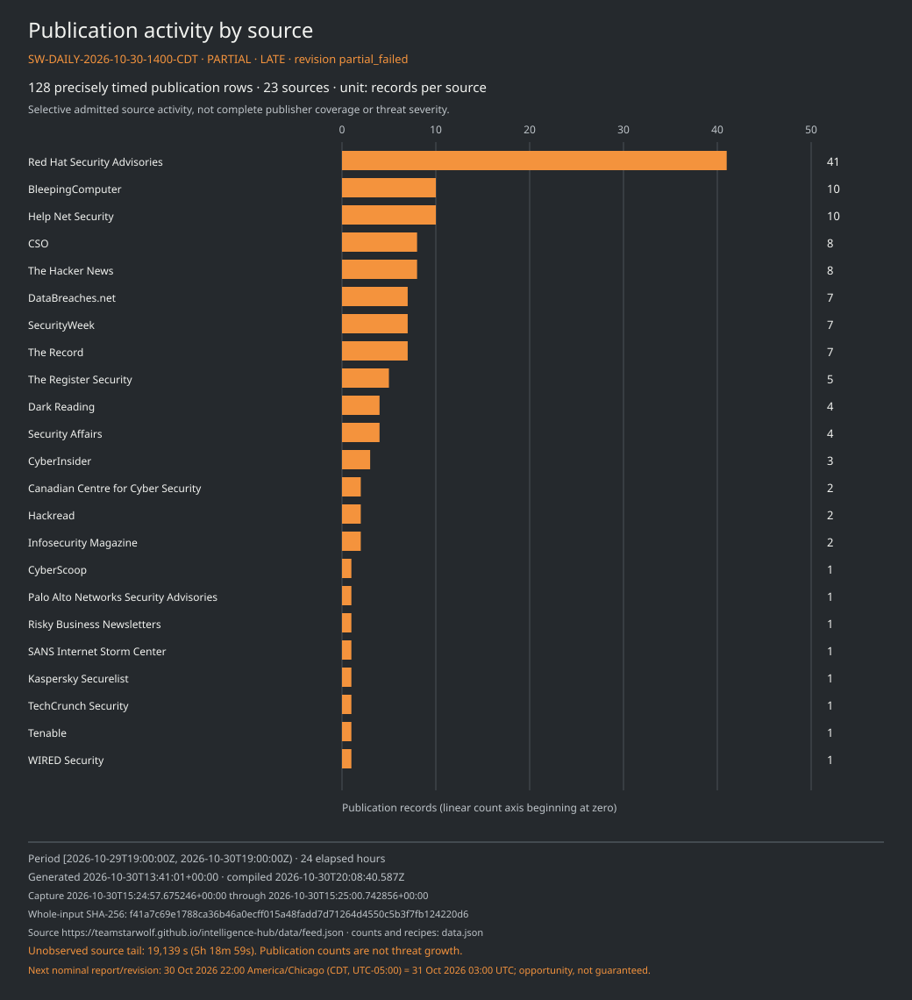
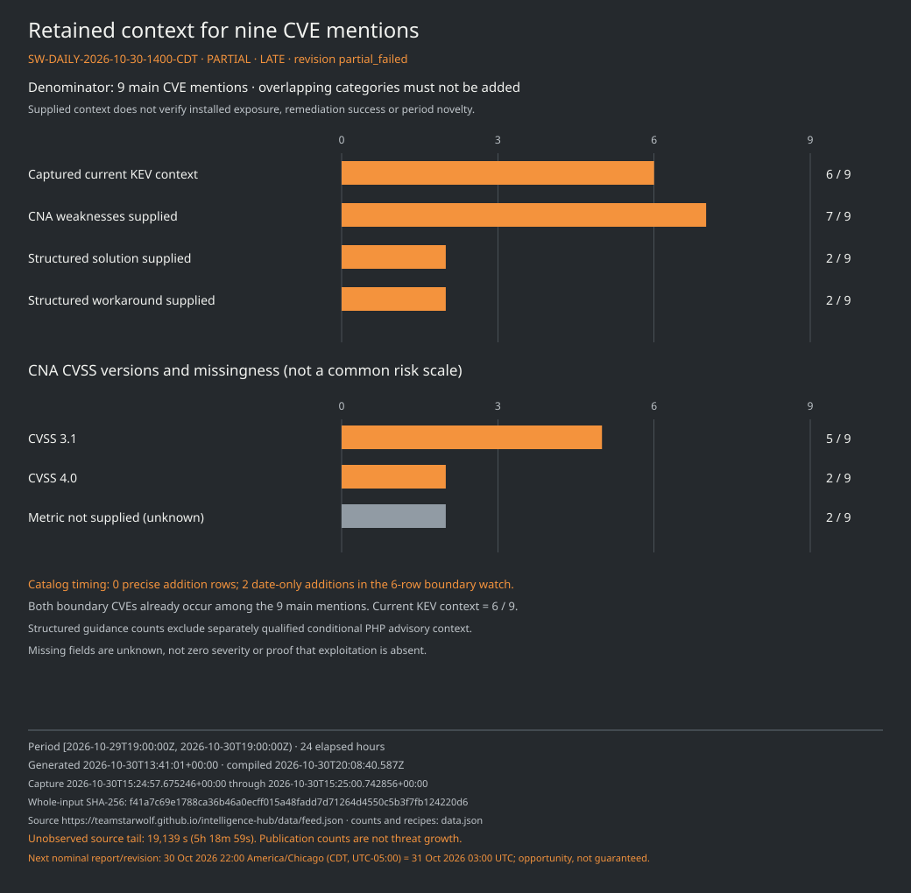
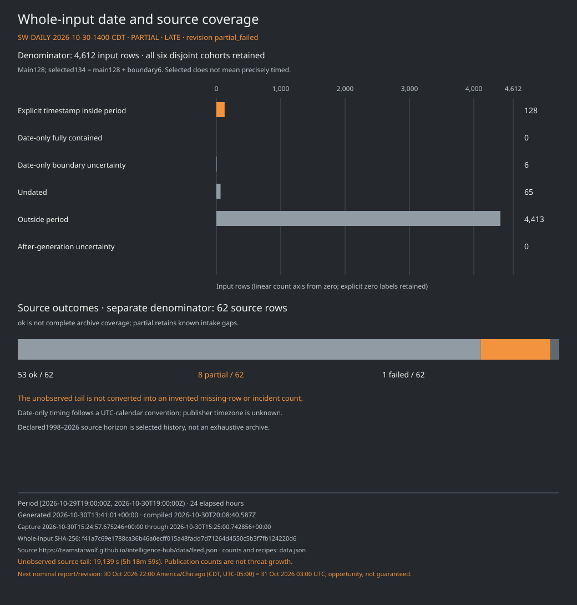

# Team Star Wolf · Daily intelligence report

**SW-DAILY-2026-10-30-1400-CDT · 30 October 2026, 14:00 CDT · PARTIAL · LATE**

**Prior-citation review: partial_failed.** A failed inventory is disclosed separately from the qualified source-cohort analysis.

## Edition and evidence clocks

| Item | Value |
| --- | --- |
| Nominal slot | 2026-10-30 14:00 America/Chicago (UTC−05:00), 19:00 UTC |
| Half-open period | `[2026-10-29T19:00:00Z, 2026-10-30T19:00:00Z)`; 29 October 14:00 CDT through 30 October 14:00 CDT |
| Duration | 24 elapsed hours; start included, end excluded |
| Actual compilation | 2026-10-30T20:08:40.587Z |
| Actual analysis completed | 2026-10-30T20:00:17.498824+00:00 |
| Source generated | 2026-10-30T13:41:01+00:00 |
| Original capture interval | 2026-10-30T15:24:57.675246+00:00 through 2026-10-30T15:25:00.742856+00:00 |
| Input | [Qualified retained Hub snapshot](https://teamstarwolf.github.io/intelligence-hub/data/feed.json), schema 6; 11,550,718 bytes |
| Whole-input SHA-256 | `f41a7c69e1788ca36b46a0ecff015a48fadd7d71264d4550c5b3f7fb124220d6` |
| Declared source horizon | 1998-01-01 through 2026-10-30; selected retained history |
| Previous completed edition | [SW-DAILY-2026-10-30-0600-CDT](../0600-CDT/README.md) |
| Next nominal opportunity | 30 October 22:00 America/Chicago (CDT), 2026-10-31T03:00:00Z; no delivery guarantee |

Source generation leaves **19,139 seconds (5h 18m 59s)** before the nominal cutoff unobserved by this snapshot. Capture, analysis and compilation are separate later clocks; none fills that gap. [Matching data](data.json) keeps the original interval and source-record clocks. This is a selected source subset, with no claim of complete coverage through cutoff.

## Executive summary

- **128 precisely timed publication rows from 23 sources mention nine unique CVEs.** These are declared publication and CVE-association measures, not incidents, new disclosures, first exploitations or installed exposure. Red Hat contributes 41 of the 128 rows; this is an intake count, not a threat ranking.
- **Six date-only rows remain boundary uncertainty:** four Debian publication records and two CISA catalog-addition records. The two CVEs already appear among the nine main mentions. No date-only row is promoted into the precise main cohort.
- **Zero KEV addition rows are precisely assignable to this elapsed-hour period.** This coexists with two date-only boundary additions and six currently KEV-listed CVEs among the main retained context. It does not establish that no additions or exploitation occurred.
- The retained guidance requires product, platform and configuration checks: PHP SAPI/request-state and vendor-backport conditions, TeamViewer product/platform bounds, Drupal Commerce Core missing guidance, and Linux release/commit distinctions remain explicit.
- Source outcomes are **53 ok, eight partial and one failed out of 62**. Prior-citation extraction failed after preflight without an accepted inventory or receipt. Publisher GETs, qualified article checks and semantic comparisons are zero; inventory, selection, changed-field and held-membership totals remain unknown.

## Selected notable developments

### PHP: SAPI and backport conditions remain decisive

The main publication association set includes CVE-2026-109618 and CVE-2026-109619. Their retained CNA branches are PHP 8.2.*, 8.3.*, 8.4.* and 8.5.* below 8.2.35, 8.3.36, 8.4.27 and 8.5.12. Both CNA metrics are **CVSS 4.0, 9.2**; each [CNA record](https://www.cve.org/CVERecord?id=CVE-2026-109618) identifies its own metric source. Their captured CISA addition date is 26 October, rather than a precisely timed addition in this period.

- **Initial pair: upstream releases and backports** — PHP identifies 8.5.12, 8.4.27, 8.3.36 and 8.2.35 for the initial pair. It also describes distribution/LTS fixes and minimal backports for 7.4, 8.0 and 8.1. A lower displayed vendor-package version can contain a backport; package evidence remains necessary. [Source](https://www.php.net/archive/2026.php); notice date 2026-10-21.
- **Demonstration and other SAPIs** — PHP describes an unauthenticated mod_php demonstration before application execution and qualifies susceptibility for other SAPIs. Broad web-serving risk does not establish identical demonstrated exploitability for every SAPI, deployment, release or patched package. [Source](https://github.com/php/php-src/security/advisories/GHSA-w8hw-w9fx-j79w); notice date 2026-10-21.
- **Request-state prerequisites** — The separate advisory distinguishes demonstrations from candidate paths and configuration-dependent state shared by requests in one worker. No deployment prerequisites were verified for this edition. [Source](https://github.com/php/php-src/security/advisories/GHSA-6wmf-4rv5-p3rp); notice date 2026-10-21.
- **Conditional CISA advice** — CISA advises temporary offline status until patched or updated when an organization cannot update immediately or continues using unsupported PHP 8.1 or earlier. That condition does not prove every lower-numbered vendor build is unpatched. The retained evidence establishes a revision date, not initial publication time. [Source](https://www.cisa.gov/news-events/alerts/2026/10/21/critical-vulnerabilities-php-require-immediate-patching); revision date 2026-10-23.
- **Separate follow-up path** — For the later CVE-2026-115560, PHP described a next-regular-release plan and session.upload_progress.enabled=0 as an interim measure for the unusual path that switches php_binary or php_serialize to php with ini_set() before session_start(), while upload progress remains enabled. This does not completely mitigate the initial pair. A shipped third fix or historical registry absence is not established. [Source](https://www.php.net/archive/2026.php); notice date 2026-10-23.

These supplementary conditions are source-attributed retained context. They do not change CNA state, CVSS, KEV classification, or establish exposure or remediation on a device.

### TeamViewer: retain each product and platform condition

CVE-2026-111585 supplies separate **Full Client, Portable and Remote Control** objects, with eleven bounded custom version conditions. General entries end below **15.83**. Legacy Windows 7/8 entries run from 15.64.0 below 15.64.10, while Full Client 14.7 platform entries end below 14.7.48868 and its 13.2 Windows/Linux/macOS entries have separate bounds. The appendix preserves every string and platform qualifier. The CNA recommends the applicable product’s latest available release and supplies **CVSS 3.1, 8.8** with user interaction in the vector; no workaround is supplied. Those source fields do not verify that any installation has been updated. [CNA record](https://www.cve.org/CVERecord?id=CVE-2026-111585) · [TeamViewer bulletin](https://www.teamviewer.com/en/resources/trust-center/security-bulletins/tv-2026-1011/).

### Drupal Commerce Core: missing fields stay unknown

For CVE-2026-118539, the CNA marks **0.0.0 below 2.41** and **3.0.0 below 3.3.13** as affected, with default status unknown and a **CWE-862** association. CVSS, structured solution and workaround fields are not supplied. An affected-range endpoint is not by itself proof of a shipped or applied fix; no exploitation conclusion follows from missing KEV context. [CNA record](https://www.cve.org/CVERecord?id=CVE-2026-118539) · [Drupal advisory](https://www.drupal.org/sa-contrib-2026-254).

### Linux: preserve commit intervals, branches and package scope

CVE-2026-46300 and CVE-2026-98432 each retain **eight git intervals and ten release-condition entries**. Their introduction entries are 3.9 and 4.4 respectively; affected/unaffected status and each branch bound remain in the appendix and data file. Their metrics are **CVSS 3.1, 7.8 and 9.8**. Only the first has a captured current KEV match; exploitation of the second remains unknown. The projection supplies no structured solution or workaround for either. Upstream entries do not establish which distribution packages carry backports, and no installed package was examined. [First CNA record](https://www.cve.org/CVERecord?id=CVE-2026-46300) · [Second CNA record](https://www.cve.org/CVERecord?id=CVE-2026-98432).

### Cisco ASA/FTD and GitLab: catalog dates remain on the boundary watch

The retained CISA additions for CVE-2026-76418 and CVE-2026-97229 are **date-only 2026-10-29**. Under the declared UTC-calendar convention, that day overlaps the 19:00 UTC start boundary; the publisher timezone and exact time remain unknown. Both catalog rows stay outside the precise main count, while both CVEs already occur in main publication mentions. A catalog addition does not date an incident or the start of exploitation. [CISA Cisco context](https://www.cisa.gov/known-exploited-vulnerabilities-catalog?field_cve=CVE-2026-76418) · [CISA GitLab context](https://www.cisa.gov/known-exploited-vulnerabilities-catalog?field_cve=CVE-2026-97229).

Cisco’s CNA keeps **twelve ASA and twelve FTD version entries**, **CVSS 3.1, 8.6**, and no structured solution/workaround. GitLab retains affected 19.2 below 19.2.8, 19.3 below 19.3.5 and 19.4 below 19.4.2, a recommendation for the applicable release or later, and **CVSS 3.1, 10.0**. No deployed remediation is verified. [Cisco advisory](https://sec.cloudapps.cisco.com/security/center/content/CiscoSecurityAdvisory/cisco-sa-asaftd-tunnel-dos-s6mgkb75) · [GitLab release reference](https://docs.gitlab.com/releases/patches/patch-release-gitlab-19-4-2-released/).

## Main CVE context register

The register preserves all nine bounded CNA contexts associated with main publication mentions. A mention is not a new disclosure. In particular, CVE-2021-44228 retains its 2021 KEV date, a custom Log4j2 bound and missing CVSS; unsafe CISA-action text remains null.

| CVE / metric source | Bounded products | Retained CVSS metric | Captured KEV context | CNA weaknesses |
| --- | --- | --- | --- | --- |
| [CVE-2021-44228](https://www.cve.org/CVERecord?id=CVE-2021-44228) | Apache Software Foundation Apache Log4j2 | Not supplied | Listed 2021-12-10 | CWE-502, CWE-400, CWE-20 |
| [CVE-2026-109618](https://www.cve.org/CVERecord?id=CVE-2026-109618) | PHP Group PHP | 9.2 · CVSS 4.0 | Listed 2026-10-26 | CWE-416, CWE-755, CWE-824, CWE-1325, CWE-1419 |
| [CVE-2026-109619](https://www.cve.org/CVERecord?id=CVE-2026-109619) | PHP Group PHP | 9.2 · CVSS 4.0 | Listed 2026-10-26 | CWE-416, CWE-755, CWE-824, CWE-1325, CWE-1419 |
| [CVE-2026-111585](https://www.cve.org/CVERecord?id=CVE-2026-111585) | TeamViewer Full Client; TeamViewer Portable; TeamViewer Remote Control | 8.8 · CVSS 3.1 | No retained match; exploitation unknown | CWE-190 |
| [CVE-2026-118539](https://www.cve.org/CVERecord?id=CVE-2026-118539) | Drupal Commerce Core | Not supplied | No retained match; exploitation unknown | CWE-862 |
| [CVE-2026-46300](https://www.cve.org/CVERecord?id=CVE-2026-46300) | Linux Linux | 7.8 · CVSS 3.1 | Listed 2026-10-28 | Not supplied |
| [CVE-2026-76418](https://www.cve.org/CVERecord?id=CVE-2026-76418) | Cisco Cisco Secure Firewall Adaptive Security Appliance (ASA) Software; Cisco Cisco Secure Firewall Threat Defense (FTD) Software | 8.6 · CVSS 3.1 | Listed 2026-10-29 | CWE-690 |
| [CVE-2026-97229](https://www.cve.org/CVERecord?id=CVE-2026-97229) | GitLab GitLab | 10 · CVSS 3.1 | Listed 2026-10-29 | CWE-190 |
| [CVE-2026-98432](https://www.cve.org/CVERecord?id=CVE-2026-98432) | Linux Linux | 9.8 · CVSS 3.1 | No retained match; exploitation unknown | Not supplied |

There are **seven supplied metrics: five CVSS 3.1 and two CVSS 4.0; two metrics are not supplied**. Seven of nine records supply CNA weakness identifiers, yielding 17 memberships across 11 distinct identifiers. Two records supply structured solutions and two supply structured workaround excerpts. These overlapping measures are field availability, not mitigation success or a local risk ranking. Every metric keeps its source URL and original vector/version.

## KEV additions and watchlist

| Measure | Value | Scope |
| --- | --- | --- |
| Precisely assigned addition rows | 0 | No explicit catalog-addition instant inside the main 128-row cohort |
| Date-only boundary additions | 2 | Both dated 2026-10-29, with uncertain elapsed-hour membership |
| Current KEV-listed main CVEs | 6 / 9 | Retained catalog membership; not six new exploits or additions |

- Review the 19139-second source tail and source gaps; later capture/analysis/compilation do not establish through-cutoff coverage.
- Keep date-only CISA and Debian rows as boundary uncertainty; never add their two CVEs to the nine main mentions.
- Check exact TeamViewer product/platform and Drupal Commerce Core branch conditions against original vendor guidance. Missing structured fields remain unknown.
- For PHP, verify SAPI/request prerequisites and vendor backport evidence; initial-pair releases and conditional follow-up advice remain separate.
- For Linux, distinguish git intervals, upstream release entries and actual distribution packages. No installed patch state was checked.
- The next report/revision opportunity is 22:00 America/Chicago on 30October (2026-10-31T 03Z), not a delivery guarantee or permission to retry failed/held sources.

CISA due dates are catalog/federal directive data, not automatic deadlines for every reader. A ransomware value of **Unknown** is missing context, not a finding that ransomware use is absent.

## Weakness taxonomy, actors, supply chain and AI

CVE-to-CWE membership comes only from CNA structured problemTypes. The supplied background contains **41 entities and 35 explicit relations**: six CWE entities, 29 CAPEC entities, one actor, one descriptive campaign grouping, two mitigations and two product contexts. Thirty relationships are catalogue mappings and five are attributed publisher claims. They are not period attacks or an activity census.

Only **CWE-416** matches a selected CNA weakness entity; no supplied relationship matches the selected CVE/weakness cohort, and no selected publication evidence URL matches the background graph. The official CWE/CAPEC labels retain per-source versions and dates in data.json, including **CWE 4.20** and **CAPEC 3.9** where supplied. A taxonomy mapping does not establish an observed attack path, and no missing relationship is invented. [CWE-416 background source](https://cwe.mitre.org/data/definitions/416.html).

The older Microsoft account was published 21 October and revised 23 October. Microsoft attributes reported ConnectWise-linked application abuse to the **Storm-0940** label and describes its alignment. Those are publisher claims, not authenticated actor identity or new activity in this period. The descriptive campaign grouping is not an independently established campaign name; authentication alone does not prove data theft. Microsoft’s source distinguishes application-based customer access from compromise or a vulnerability in its corporate systems, products or services. Its recommendations for application permissions, monitoring, evidence preservation and response retain their environment/authorization conditions. [Older Microsoft account](https://www.microsoft.com/en-us/security/blog/2026/10/21/storm-0940-uses-artex-agentic-ai-connectwise-supply-chain-compromise/).

No separately qualified in-window supply-chain or AI conclusion is established. Older source wording, names, aliases, co-mentions and URL slugs do not establish current participation, causation or identity.

## Actual-data charts

The three charts use this edition’s matching data.json, whole-input digest, frozen compilation clock and explicit count recipes. Publication activity and context availability are not threat-growth measures.

## Source outcomes

The 62 source rows record **53 ok, eight partial and one failed**. Source clocks and article counts below belong to the retained snapshot, not new checks in this edition. The complete data file retains exactly eight source-health fields: id, name, kind, url, status, last_attempt, last_success and articles. Canonical publisher names identify sources, not article bylines.

| Source with a gap | Status | Retained article rows | Last attempt | Last success |
| --- | --- | --- | --- | --- |
| CISA Advisories | failed | 0 | 2026-10-30T13:40:55+00:00 | Not supplied |
| F5 Labs | partial | 237 | 2026-10-30T13:40:59+00:00 | 2026-10-30T13:40:59+00:00 |
| Graham Cluley | partial | 7 | 2026-10-30T13:40:59+00:00 | 2026-10-30T13:40:59+00:00 |
| Infosecurity Magazine | partial | 176 | 2026-10-30T13:41:00+00:00 | 2026-10-30T13:41:00+00:00 |
| Microsoft Security | partial | 20 | 2026-10-30T13:40:55+00:00 | 2026-10-30T13:40:55+00:00 |
| Qualys Security Blog | partial | 11 | 2026-10-30T13:41:00+00:00 | 2026-10-30T13:41:00+00:00 |
| Red Hat Security Advisories | partial | 334 | 2026-10-30T13:40:58+00:00 | 2026-10-30T13:40:58+00:00 |
| Snyk | partial | 152 | 2026-10-30T13:40:58+00:00 | 2026-10-30T13:40:58+00:00 |
| Cisco Talos | partial | 20 | 2026-10-30T13:40:55+00:00 | 2026-10-30T13:40:56+00:00 |

An ok outcome is not complete publisher coverage. The successful CISA Cybersecurity Advisories category subset does not repair or replace the separate CISA Advisories failure. Partial outcomes retain known intake gaps; legacy/archive items do not become current news merely because a source fetch succeeds.

## Previous-citation review: failed inventory, unknown totals

One dedicated prior-citation inventory attempt **failed after preflight during extraction**. It produced **no accepted inventory or receipt**. Completion of local report-body reading is unknown; there is no claim that all prior cited material was checked. The failed attempt was not retried.

| Outcome measure | Value |
| --- | --- |
| Candidate pool / citation occurrences / literal or canonical URL totals | Unknown (null) |
| Selected URLs / changed fields / unresolved / cap exclusions / actual held membership | Unknown (null) |
| Publisher GETs / attempted article URLs | 0 / 0 |
| Qualified article checks / comparable results / semantic comparisons | 0 / 0 / 0 |
| Accepted current per-URL records | None (`[]`) |

Existing held-source controls remain controls, rather than new pool membership or per-URL refusal observations. Unknown history is not never-requested, eligible, a qualified baseline or a cooldown reset. No unchanged, all-updated or global-absence outcome is claimed; older review records remain dated evidence. The report records **partial_failed**, separately from the catalog’s partial cycle state.

## Limits and method

- PARTIAL and LATE: generation 13:41:01UTC leaves 5h 18m 59s before the 19:00UTC cutoff. Original capture 15:24:57.675246..15:25:00.742856UTC and later analysis/compile do not fill the gap.
- Publication/catalog-addition rows and declared CVE mentions are not incident, new disclosure, first-exploitation or installed-exposure counts.
- Nine current retained CNA/KEV contexts do not reconstruct historical knowledge at cutoff. Direct publisher/CNA bodies were not reopened or independently reverified for this edition.
- Six date-only boundary rows remain outside the 128 precise main rows;65 undated, 4413 outside and 0 after-generation-uncertain rows remain explicit in the 4612-row partition.
- Source outcomes 53ok/8partial/1failed do not establish publisher completeness or archive silence. The successful CISA category subset does not erase the separate all-advisories failure.
- All 14 products and 85 bounded version conditions retain default/status/range/version-type distinctions. Missing guidance and two missing CVSS metrics remain unknown; upper bounds alone do not prove shipped fixes.
- Seven source-title fields and two unsafe CNA text values were withheld upstream; all 134 private source titles remain excluded. This report uses neutral labels and qualified new paraphrases.
- CNA weakness data and supplied official taxonomy are distinct from observed attacks. All 41 entities/35 relations remain dated background, with no selected article evidence URL matches.
- Prior-citation review failed after preflight during extraction; no accepted inventory/receipt. Body completion and URL selection/change/held membership are unknown, while publisher GETs/checks/comparisons are zero. No unchanged/all-updated outcome is claimed.
- CISA catalog due dates and ransomware Unknown have their own source scope; they are not automatic visitor deadlines or proof that ransomware use/exploitation is absent.

## Primary-first references

Each linked CNA record is the metric and structured-context source; the additional URLs are retained attributed CNA references, not bodies newly fetched or reverified for this report. All **49 reference occurrences** remain in data.json, including repeated URLs as supplied. A retained public social-post reference is merely a reference; no account, byline, identity or exploitation claim is extracted from it. The data file also keeps 134 neutral publication-record labels with original IDs, source IDs, safe URLs, clocks and cohort membership; it reproduces no pending source headline.

| CNA record | Additional retained CNA references |
| --- | --- |
| [CVE-2021-44228](https://www.cve.org/CVERecord?id=CVE-2021-44228) | [CNA reference 1](https://logging.apache.org/log4j/2.x/security.html) · [CNA reference 2](https://tools.cisco.com/security/center/content/CiscoSecurityAdvisory/cisco-sa-apache-log4j-qRuKNEbd) · [CNA reference 3](https://security.netapp.com/advisory/ntap-20211210-0007/) · [CNA reference 4](https://psirt.global.sonicwall.com/vuln-detail/SNWLID-2021-0032) · [CNA reference 5](https://www.oracle.com/security-alerts/alert-cve-2021-44228.html) · [CNA reference 6](https://www.debian.org/security/2021/dsa-5020) · [CNA reference 7](https://lists.debian.org/debian-lts-announce/2021/12/msg00007.html) · [CNA reference 8](https://lists.fedoraproject.org/archives/list/package-announce%40lists.fedoraproject.org/message/VU57UJDCFIASIO35GC55JMKSRXJMCDFM/) · [CNA reference 9](https://msrc-blog.microsoft.com/2021/12/11/microsofts-response-to-cve-2021-44228-apache-log4j2/) · [CNA reference 10](https://tools.cisco.com/security/center/content/CiscoSecurityAdvisory/cisco-sa-apache-log4j-qRuKNEbd) · [CNA reference 11](https://www.kb.cert.org/vuls/id/930724) · [CNA reference 12](https://twitter.com/kurtseifried/status/1469345530182455296) · [CNA reference 13](https://cert-portal.siemens.com/productcert/pdf/ssa-661247.pdf) · [CNA reference 14](https://www.intel.com/content/www/us/en/security-center/advisory/intel-sa-00646.html) · [CNA reference 15](https://tools.cisco.com/security/center/content/CiscoSecurityAdvisory/cisco-sa-apache-log4j-qRuKNEbd) |
| [CVE-2026-109618](https://www.cve.org/CVERecord?id=CVE-2026-109618) | [CNA reference 1](https://github.com/php/php-src/security/advisories/GHSA-w8hw-w9fx-j79w) |
| [CVE-2026-109619](https://www.cve.org/CVERecord?id=CVE-2026-109619) | [CNA reference 1](https://github.com/php/php-src/security/advisories/GHSA-6wmf-4rv5-p3rp) |
| [CVE-2026-111585](https://www.cve.org/CVERecord?id=CVE-2026-111585) | [CNA reference 1](https://www.teamviewer.com/en/resources/trust-center/security-bulletins/tv-2026-1011/) |
| [CVE-2026-118539](https://www.cve.org/CVERecord?id=CVE-2026-118539) | [CNA reference 1](https://www.drupal.org/sa-contrib-2026-254) |
| [CVE-2026-46300](https://www.cve.org/CVERecord?id=CVE-2026-46300) | [CNA reference 1](https://git.kernel.org/stable/c/3599e6b3cc1ada96883d496a50a210d3afbb6987) · [CNA reference 2](https://git.kernel.org/stable/c/2f2b16022a2e10ca7bccfb98db5ed2ec0f72641c) · [CNA reference 3](https://git.kernel.org/stable/c/9d3e5fd19fe1063bf607219e8562fbd567b8e8d5) · [CNA reference 4](https://git.kernel.org/stable/c/78bf6b6bb19541d19fbda6242e7cfe2c682763c0) · [CNA reference 5](https://git.kernel.org/stable/c/760e1addc27ba1a7beb4a0a7e8b3e9ec49e7a34e) · [CNA reference 6](https://git.kernel.org/stable/c/3bd9e113d50034db99d7ef69fd8e5242d15e414a) · [CNA reference 7](https://git.kernel.org/stable/c/3884358a9286b17f389a72b1426fc4547c23c111) · [CNA reference 8](https://git.kernel.org/stable/c/f84eca5817390257cef78013d0112481c503b4a3) |
| [CVE-2026-76418](https://www.cve.org/CVERecord?id=CVE-2026-76418) | [CNA reference 1](https://sec.cloudapps.cisco.com/security/center/content/CiscoSecurityAdvisory/cisco-sa-asaftd-tunnel-dos-s6mgkb75) |
| [CVE-2026-97229](https://www.cve.org/CVERecord?id=CVE-2026-97229) | [CNA reference 1](https://gitlab.com/gitlab-org/gitlab/-/work_items/630686) · [CNA reference 2](https://hackerone.com/reports/4055749) · [CNA reference 3](https://hackerone.com/reports/4058589) · [CNA reference 4](https://docs.gitlab.com/releases/patches/patch-release-gitlab-19-4-2-released/) |
| [CVE-2026-98432](https://www.cve.org/CVERecord?id=CVE-2026-98432) | [CNA reference 1](https://git.kernel.org/stable/c/b3b027ef0cd322bfa839b9aaf5b27551eea54cf6) · [CNA reference 2](https://git.kernel.org/stable/c/95a8c8fa9f27dce64c40c41c062de7728bf34ab5) · [CNA reference 3](https://git.kernel.org/stable/c/89b5b1eb7d633c33832b7ff2c02e19a144705036) · [CNA reference 4](https://git.kernel.org/stable/c/742f73df544e03744f2981c467d6542fe8172a2a) · [CNA reference 5](https://git.kernel.org/stable/c/11a03ce3c4a62d84c10ccdfe47f8075006498568) · [CNA reference 6](https://git.kernel.org/stable/c/a47406c769f72c070386985488f1c4d057df86b2) · [CNA reference 7](https://git.kernel.org/stable/c/26d4c36d318cffbbd160884a0e4cec0da4da4936) · [CNA reference 8](https://git.kernel.org/stable/c/e3f33b0a1d89d738e2b913dab519226eaf76e15b) |

The five PHP/CISA context qualifications and older Microsoft/official taxonomy sources are linked beside their scoped claims.

## Appendix: all bounded CNA version conditions

These tables preserve all **14 product objects and 85 version conditions**. Default and entry status, custom/git/semver/original-commit version type, and strict versus inclusive bounds remain distinct. An em dash displays an empty supplied bound; it does not mean a fixed release. These are bounded records, not complete vendor matrices.

### CVE-2021-44228 — Log 4j 2 custom-range context

The retained Apache Log 4j 2 record starts at 2.0-beta 9 and supplies log 4j-core* as a custom upper-bound string. Preserve that string; it is not a complete or normally orderable fixed-version statement.

No structured solution or workaround is supplied here. Two unsafe CISA-action text values remain null rather than being reconstructed.

| Product | Default status | Version/start value | Entry status | Less than | Less than or equal | Version type |
| --- | --- | --- | --- | --- | --- | --- |
| Apache Software Foundation / Apache Log4j2 | unknown | 2.0-beta9 | affected | log4j-core* | — | custom |

CNA CVSS metric: **not supplied**, rather than zero.

Captured CISA context: addition date 2021-12-10; recorded due date 2021-12-24; ransomware field **Known**. Unsafe action text remains null; no replacement action is invented.

Source record updated 2025-10-21T23:25:23+00:00; retrieved 2026-10-30T01:05:11+00:00; attempted 2026-10-30T01:05:10+00:00. [CNA record](https://www.cve.org/CVERecord?id=CVE-2021-44228). [CISA context](https://www.cisa.gov/known-exploited-vulnerabilities-catalog?field_cve=CVE-2021-44228).

### CVE-2026-109618 — PHP SAPI and backport applicability

The retained affected PHP branches are 8.2.*, 8.3.*, 8.4.* and 8.5.* below 8.2.35, 8.3.36, 8.4.27 and 8.5.12 respectively. SAPI, request and vendor-backport conditions remain essential.

The CNA points to the PHP advisory for mitigation strategies. The five separately dated PHP/CISA qualifications below do not establish universal exploitability or a patch state for any installation.

| Product | Default status | Version/start value | Entry status | Less than | Less than or equal | Version type |
| --- | --- | --- | --- | --- | --- | --- |
| PHP Group / PHP | unaffected | 8.2.* | affected | 8.2.35 | — | semver |
| PHP Group / PHP | unaffected | 8.3.* | affected | 8.3.36 | — | semver |
| PHP Group / PHP | unaffected | 8.4.* | affected | 8.4.27 | — | semver |
| PHP Group / PHP | unaffected | 8.5.* | affected | 8.5.12 | — | semver |

CNA metric: **9.2 (CVSS 4.0)**, vector `CVSS:4.0/AV:N/AC:H/AT:P/PR:N/UI:N/VC:H/VI:H/VA:H/SC:N/SI:N/SA:N`; [metric source](https://www.cve.org/CVERecord?id=CVE-2026-109618).

Captured CISA context: addition date 2026-10-26; recorded due date 2026-10-29; ransomware field **Unknown**. CISA calls for vendor-directed mitigations under the applicable BOD 26-04 risk-prioritization and forensic-triage guidance, with the cited cloud-service guidance or discontinuation if mitigations are unavailable. Asset exposure and the original instructions govern applicability; no deadline or patch state is assigned to every reader.

Source record updated 2026-10-29T06:08:47+00:00; retrieved 2026-10-30T01:04:40+00:00; attempted 2026-10-30T01:04:40+00:00. [CNA record](https://www.cve.org/CVERecord?id=CVE-2026-109618). [CISA context](https://www.cisa.gov/known-exploited-vulnerabilities-catalog?field_cve=CVE-2026-109618).

### CVE-2026-109619 — PHP request-state conditions

The same four PHP branch bounds are retained. Configuration-dependent request state in the same worker and the distinction between demonstrated and candidate cases remain material.

The CNA points to the PHP advisory for mitigation strategies. Neither a branch number nor the broad web-serving description establishes equal demonstrated exploitability across SAPIs or packages.

| Product | Default status | Version/start value | Entry status | Less than | Less than or equal | Version type |
| --- | --- | --- | --- | --- | --- | --- |
| PHP Group / PHP | unaffected | 8.2.* | affected | 8.2.35 | — | semver |
| PHP Group / PHP | unaffected | 8.3.* | affected | 8.3.36 | — | semver |
| PHP Group / PHP | unaffected | 8.4.* | affected | 8.4.27 | — | semver |
| PHP Group / PHP | unaffected | 8.5.* | affected | 8.5.12 | — | semver |

CNA metric: **9.2 (CVSS 4.0)**, vector `CVSS:4.0/AV:N/AC:H/AT:P/PR:N/UI:N/VC:H/VI:H/VA:H/SC:N/SI:N/SA:N`; [metric source](https://www.cve.org/CVERecord?id=CVE-2026-109619).

Captured CISA context: addition date 2026-10-26; recorded due date 2026-10-29; ransomware field **Unknown**. CISA calls for vendor-directed mitigations under the applicable BOD 26-04 risk-prioritization and forensic-triage guidance, with the cited cloud-service guidance or discontinuation if mitigations are unavailable. Asset exposure and the original instructions govern applicability; no deadline or patch state is assigned to every reader.

Source record updated 2026-10-28T03:55:47+00:00; retrieved 2026-10-30T01:04:40+00:00; attempted 2026-10-30T01:04:40+00:00. [CNA record](https://www.cve.org/CVERecord?id=CVE-2026-109619). [CISA context](https://www.cisa.gov/known-exploited-vulnerabilities-catalog?field_cve=CVE-2026-109619).

### CVE-2026-111585 — TeamViewer product and platform bounds

Full Client, Portable and Remote Control have distinct custom version entries. General ranges end below 15.83; legacy Windows 7/8 and Full Client 13.2/14.7 platform-specific entries have their own bounds. All eleven entries remain explicit.

The CNA recommends the latest available release; no workaround is supplied. The version bounds and source recommendation do not verify that a particular installation has been updated.

| Product | Default status | Version/start value | Entry status | Less than | Less than or equal | Version type |
| --- | --- | --- | --- | --- | --- | --- |
| TeamViewer / Full Client | unaffected | 0 | affected | 15.83 | — | custom |
| TeamViewer / Full Client | unaffected | 15.64.0 (Legacy Windows 7 &amp; 8) | affected | 15.64.10 (Legacy Windows 7 &amp; 8) | — | custom |
| TeamViewer / Full Client | unaffected | 14.7.0 (Windows) | affected | 14.7.48868 (Windows) | — | custom |
| TeamViewer / Full Client | unaffected | 14.7.0 (Linux) | affected | 14.7.48868 (Linux) | — | custom |
| TeamViewer / Full Client | unaffected | 14.7.0 (macOS) | affected | 14.7.48868 (macOS) | — | custom |
| TeamViewer / Full Client | unaffected | 13.2.0 (Windows) | affected | 13.2.36231 (Windows) | — | custom |
| TeamViewer / Full Client | unaffected | 13.2.0 (Linux) | affected | 13.2.154008 (Linux) | — | custom |
| TeamViewer / Full Client | unaffected | 13.2.0 (macOS) | affected | 13.2.154007 (macOS) | — | custom |
| TeamViewer / Portable | unaffected | 0 | affected | 15.83 | — | custom |
| TeamViewer / Portable | unaffected | 15.64.0 (Legacy Windows 7 &amp; 8) | affected | 15.64.10 (Legacy Windows 7 &amp; 8) | — | custom |
| TeamViewer / Remote Control | unaffected | 0 | affected | 15.83 | — | custom |

CNA metric: **8.8 (CVSS 3.1)**, vector `CVSS:3.1/AV:N/AC:L/PR:N/UI:R/S:U/C:H/I:H/A:H`; [metric source](https://www.cve.org/CVERecord?id=CVE-2026-111585).

No match in this retained KEV context; exploitation remains unknown. No CISA action is supplied.

Source record updated 2026-10-27T15:19:40+00:00; retrieved 2026-10-30T12:47:46+00:00; attempted 2026-10-30T12:47:46+00:00. [CNA record](https://www.cve.org/CVERecord?id=CVE-2026-111585).

### CVE-2026-118539 — Drupal Commerce Core authorization context

The CNA marks Commerce Core from 0.0.0 below 2.41 and from 3.0.0 below 3.3.13 as affected, with default status unknown.

CVSS, a structured solution and a workaround are not supplied. The affected-range endpoints alone do not establish that a fix was shipped or applied.

| Product | Default status | Version/start value | Entry status | Less than | Less than or equal | Version type |
| --- | --- | --- | --- | --- | --- | --- |
| Drupal / Commerce Core | unknown | 0.0.0 | affected | 2.41 | — | semver |
| Drupal / Commerce Core | unknown | 3.0.0 | affected | 3.3.13 | — | semver |

CNA CVSS metric: **not supplied**, rather than zero.

No match in this retained KEV context; exploitation remains unknown. No CISA action is supplied.

Source record updated 2026-10-30T03:09:13+00:00; retrieved 2026-10-30T12:47:46+00:00; attempted 2026-10-30T12:47:46+00:00. [CNA record](https://www.cve.org/CVERecord?id=CVE-2026-118539).

### CVE-2026-46300 — Linux branch and commit applicability

The retained Linux record contains eight affected git intervals and ten release-condition entries, including a 3.9 introduction. Branch-specific unaffected entries and package backports require their own interpretation.

No structured solution or workaround is supplied. Do not collapse git conditions, upstream release entries and distribution backports into a universal fixed-package version.

| Product | Default status | Version/start value | Entry status | Less than | Less than or equal | Version type |
| --- | --- | --- | --- | --- | --- | --- |
| Linux / Linux | unaffected | cef401de7be8c4e155c6746bfccf721a4fa5fab9 | affected | 3599e6b3cc1ada96883d496a50a210d3afbb6987 | — | git |
| Linux / Linux | unaffected | cef401de7be8c4e155c6746bfccf721a4fa5fab9 | affected | 2f2b16022a2e10ca7bccfb98db5ed2ec0f72641c | — | git |
| Linux / Linux | unaffected | cef401de7be8c4e155c6746bfccf721a4fa5fab9 | affected | 9d3e5fd19fe1063bf607219e8562fbd567b8e8d5 | — | git |
| Linux / Linux | unaffected | cef401de7be8c4e155c6746bfccf721a4fa5fab9 | affected | 78bf6b6bb19541d19fbda6242e7cfe2c682763c0 | — | git |
| Linux / Linux | unaffected | cef401de7be8c4e155c6746bfccf721a4fa5fab9 | affected | 760e1addc27ba1a7beb4a0a7e8b3e9ec49e7a34e | — | git |
| Linux / Linux | unaffected | cef401de7be8c4e155c6746bfccf721a4fa5fab9 | affected | 3bd9e113d50034db99d7ef69fd8e5242d15e414a | — | git |
| Linux / Linux | unaffected | cef401de7be8c4e155c6746bfccf721a4fa5fab9 | affected | 3884358a9286b17f389a72b1426fc4547c23c111 | — | git |
| Linux / Linux | unaffected | cef401de7be8c4e155c6746bfccf721a4fa5fab9 | affected | f84eca5817390257cef78013d0112481c503b4a3 | — | git |
| Linux / Linux | affected | 3.9 | affected | — | — | Not supplied |
| Linux / Linux | affected | 0 | unaffected | 3.9 | — | semver |
| Linux / Linux | affected | 5.10.257 | unaffected | — | 5.10.* | semver |
| Linux / Linux | affected | 5.15.208 | unaffected | — | 5.15.* | semver |
| Linux / Linux | affected | 6.1.174 | unaffected | — | 6.1.* | semver |
| Linux / Linux | affected | 6.6.141 | unaffected | — | 6.6.* | semver |
| Linux / Linux | affected | 6.12.91 | unaffected | — | 6.12.* | semver |
| Linux / Linux | affected | 6.18.33 | unaffected | — | 6.18.* | semver |
| Linux / Linux | affected | 7.0.10 | unaffected | — | 7.0.* | semver |
| Linux / Linux | affected | 7.1 | unaffected | — | * | original_commit_for_fix |

CNA metric: **7.8 (CVSS 3.1)**, vector `CVSS:3.1/AV:L/AC:L/PR:L/UI:N/S:U/C:H/I:H/A:H`; [metric source](https://www.cve.org/CVERecord?id=CVE-2026-46300).

Captured CISA context: addition date 2026-10-28; recorded due date 2026-10-31; ransomware field **Unknown**. CISA calls for vendor-directed mitigations under the applicable BOD 26-04 risk-prioritization and forensic-triage guidance, with the cited cloud-service guidance or discontinuation if mitigations are unavailable. Asset exposure and the original instructions govern applicability; no deadline or patch state is assigned to every reader.

Source record updated 2026-10-29T03:55:37+00:00; retrieved 2026-10-30T01:04:25+00:00; attempted 2026-10-30T01:04:24+00:00. [CNA record](https://www.cve.org/CVERecord?id=CVE-2026-46300). [CISA context](https://www.cisa.gov/known-exploited-vulnerabilities-catalog?field_cve=CVE-2026-46300).

### CVE-2026-76418 — Cisco ASA and FTD separate version lists

The CNA supplies separate bounded lists of twelve affected ASA versions and twelve FTD versions. Their default statuses are unknown.

No structured solution or workaround is supplied. The retained CISA addition date is date-only boundary evidence, not a precise event inside this period.

| Product | Default status | Version/start value | Entry status | Less than | Less than or equal | Version type |
| --- | --- | --- | --- | --- | --- | --- |
| Cisco / Cisco Secure Firewall Adaptive Security Appliance (ASA) Software | unknown | 9.16.1 | affected | — | — | Not supplied |
| Cisco / Cisco Secure Firewall Adaptive Security Appliance (ASA) Software | unknown | 9.16.1.28 | affected | — | — | Not supplied |
| Cisco / Cisco Secure Firewall Adaptive Security Appliance (ASA) Software | unknown | 9.16.2 | affected | — | — | Not supplied |
| Cisco / Cisco Secure Firewall Adaptive Security Appliance (ASA) Software | unknown | 9.16.2.3 | affected | — | — | Not supplied |
| Cisco / Cisco Secure Firewall Adaptive Security Appliance (ASA) Software | unknown | 9.16.2.7 | affected | — | — | Not supplied |
| Cisco / Cisco Secure Firewall Adaptive Security Appliance (ASA) Software | unknown | 9.16.2.11 | affected | — | — | Not supplied |
| Cisco / Cisco Secure Firewall Adaptive Security Appliance (ASA) Software | unknown | 9.16.2.13 | affected | — | — | Not supplied |
| Cisco / Cisco Secure Firewall Adaptive Security Appliance (ASA) Software | unknown | 9.16.2.14 | affected | — | — | Not supplied |
| Cisco / Cisco Secure Firewall Adaptive Security Appliance (ASA) Software | unknown | 9.16.3.3 | affected | — | — | Not supplied |
| Cisco / Cisco Secure Firewall Adaptive Security Appliance (ASA) Software | unknown | 9.16.3 | affected | — | — | Not supplied |
| Cisco / Cisco Secure Firewall Adaptive Security Appliance (ASA) Software | unknown | 9.16.3.14 | affected | — | — | Not supplied |
| Cisco / Cisco Secure Firewall Adaptive Security Appliance (ASA) Software | unknown | 9.18.1 | affected | — | — | Not supplied |
| Cisco / Cisco Secure Firewall Threat Defense (FTD) Software | unknown | 7.0.0 | affected | — | — | Not supplied |
| Cisco / Cisco Secure Firewall Threat Defense (FTD) Software | unknown | 7.0.0.1 | affected | — | — | Not supplied |
| Cisco / Cisco Secure Firewall Threat Defense (FTD) Software | unknown | 7.0.1 | affected | — | — | Not supplied |
| Cisco / Cisco Secure Firewall Threat Defense (FTD) Software | unknown | 7.0.1.1 | affected | — | — | Not supplied |
| Cisco / Cisco Secure Firewall Threat Defense (FTD) Software | unknown | 7.0.2 | affected | — | — | Not supplied |
| Cisco / Cisco Secure Firewall Threat Defense (FTD) Software | unknown | 7.2.0 | affected | — | — | Not supplied |
| Cisco / Cisco Secure Firewall Threat Defense (FTD) Software | unknown | 7.0.2.1 | affected | — | — | Not supplied |
| Cisco / Cisco Secure Firewall Threat Defense (FTD) Software | unknown | 7.0.3 | affected | — | — | Not supplied |
| Cisco / Cisco Secure Firewall Threat Defense (FTD) Software | unknown | 7.2.0.1 | affected | — | — | Not supplied |
| Cisco / Cisco Secure Firewall Threat Defense (FTD) Software | unknown | 7.0.4 | affected | — | — | Not supplied |
| Cisco / Cisco Secure Firewall Threat Defense (FTD) Software | unknown | 7.2.1 | affected | — | — | Not supplied |
| Cisco / Cisco Secure Firewall Threat Defense (FTD) Software | unknown | 7.0.5 | affected | — | — | Not supplied |

CNA metric: **8.6 (CVSS 3.1)**, vector `CVSS:3.1/AV:N/AC:L/PR:N/UI:N/S:C/C:N/I:N/A:H`; [metric source](https://www.cve.org/CVERecord?id=CVE-2026-76418).

Captured CISA context: addition date 2026-10-29; recorded due date 2026-11-01; ransomware field **Unknown**. CISA calls for vendor-directed mitigations under the applicable BOD 26-04 risk-prioritization and forensic-triage guidance, with the cited cloud-service guidance or discontinuation if mitigations are unavailable. Asset exposure and the original instructions govern applicability; no deadline or patch state is assigned to every reader.

Source record updated 2026-10-29T19:58:23+00:00; retrieved 2026-10-30T01:04:24+00:00; attempted 2026-10-30T01:04:24+00:00. [CNA record](https://www.cve.org/CVERecord?id=CVE-2026-76418). [CISA context](https://www.cisa.gov/known-exploited-vulnerabilities-catalog?field_cve=CVE-2026-76418).

### CVE-2026-97229 — GitLab branch-specific guidance

Retained affected ranges are 19.2 below 19.2.8, 19.3 below 19.3.5 and 19.4 below 19.4.2.

The CNA recommends the applicable 19.2.8,19.3.5 or 19.4.2 release or later. No workaround is supplied; installed remediation remains unverified.

| Product | Default status | Version/start value | Entry status | Less than | Less than or equal | Version type |
| --- | --- | --- | --- | --- | --- | --- |
| GitLab / GitLab | unaffected | 19.2 | affected | 19.2.8 | — | semver |
| GitLab / GitLab | unaffected | 19.3 | affected | 19.3.5 | — | semver |
| GitLab / GitLab | unaffected | 19.4 | affected | 19.4.2 | — | semver |

CNA metric: **10 (CVSS 3.1)**, vector `CVSS:3.1/AV:N/AC:L/PR:N/UI:N/S:C/C:H/I:H/A:H`; [metric source](https://www.cve.org/CVERecord?id=CVE-2026-97229).

Captured CISA context: addition date 2026-10-29; recorded due date 2026-11-01; ransomware field **Unknown**. CISA calls for vendor-directed mitigations under the applicable BOD 26-04 risk-prioritization and forensic-triage guidance, with the cited cloud-service guidance or discontinuation if mitigations are unavailable. Asset exposure and the original instructions govern applicability; no deadline or patch state is assigned to every reader.

Source record updated 2026-10-29T19:58:23+00:00; retrieved 2026-10-30T01:46:36+00:00; attempted 2026-10-30T01:46:36+00:00. [CNA record](https://www.cve.org/CVERecord?id=CVE-2026-97229). [CISA context](https://www.cisa.gov/known-exploited-vulnerabilities-catalog?field_cve=CVE-2026-97229).

### CVE-2026-98432 — Linux retained backport and release conditions

The bounded record preserves eight affected git intervals and ten release-condition entries, including a 4.4 introduction. No distribution package applicability was examined.

No structured solution, workaround or CNA weakness is supplied. Upstream release/commit conditions do not establish every vendor backport or an installed patch state.

| Product | Default status | Version/start value | Entry status | Less than | Less than or equal | Version type |
| --- | --- | --- | --- | --- | --- | --- |
| Linux / Linux | unaffected | 079096f103faca2dd87342cca6f23d4b34da8871 | affected | b3b027ef0cd322bfa839b9aaf5b27551eea54cf6 | — | git |
| Linux / Linux | unaffected | 079096f103faca2dd87342cca6f23d4b34da8871 | affected | 95a8c8fa9f27dce64c40c41c062de7728bf34ab5 | — | git |
| Linux / Linux | unaffected | 079096f103faca2dd87342cca6f23d4b34da8871 | affected | 89b5b1eb7d633c33832b7ff2c02e19a144705036 | — | git |
| Linux / Linux | unaffected | 079096f103faca2dd87342cca6f23d4b34da8871 | affected | 742f73df544e03744f2981c467d6542fe8172a2a | — | git |
| Linux / Linux | unaffected | 079096f103faca2dd87342cca6f23d4b34da8871 | affected | 11a03ce3c4a62d84c10ccdfe47f8075006498568 | — | git |
| Linux / Linux | unaffected | 079096f103faca2dd87342cca6f23d4b34da8871 | affected | a47406c769f72c070386985488f1c4d057df86b2 | — | git |
| Linux / Linux | unaffected | 079096f103faca2dd87342cca6f23d4b34da8871 | affected | 26d4c36d318cffbbd160884a0e4cec0da4da4936 | — | git |
| Linux / Linux | unaffected | 079096f103faca2dd87342cca6f23d4b34da8871 | affected | e3f33b0a1d89d738e2b913dab519226eaf76e15b | — | git |
| Linux / Linux | affected | 4.4 | affected | — | — | Not supplied |
| Linux / Linux | affected | 0 | unaffected | 4.4 | — | semver |
| Linux / Linux | affected | 5.10.272 | unaffected | — | 5.10.* | semver |
| Linux / Linux | affected | 5.15.223 | unaffected | — | 5.15.* | semver |
| Linux / Linux | affected | 6.1.190 | unaffected | — | 6.1.* | semver |
| Linux / Linux | affected | 6.6.159 | unaffected | — | 6.6.* | semver |
| Linux / Linux | affected | 6.12.113 | unaffected | — | 6.12.* | semver |
| Linux / Linux | affected | 6.18.56 | unaffected | — | 6.18.* | semver |
| Linux / Linux | affected | 7.2.10 | unaffected | — | 7.2.* | semver |
| Linux / Linux | affected | 7.3 | unaffected | — | * | original_commit_for_fix |

CNA metric: **9.8 (CVSS 3.1)**, vector `CVSS:3.1/AV:N/AC:L/PR:N/UI:N/S:U/C:H/I:H/A:H`; [metric source](https://www.cve.org/CVERecord?id=CVE-2026-98432).

No match in this retained KEV context; exploitation remains unknown. No CISA action is supplied.

Source record updated 2026-10-24T14:08:46+00:00; retrieved 2026-10-30T01:04:25+00:00; attempted 2026-10-30T01:04:24+00:00. [CNA record](https://www.cve.org/CVERecord?id=CVE-2026-98432).
