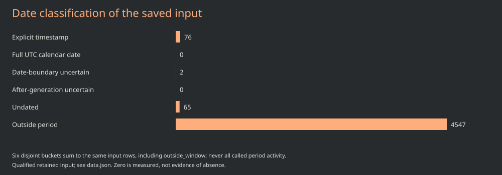
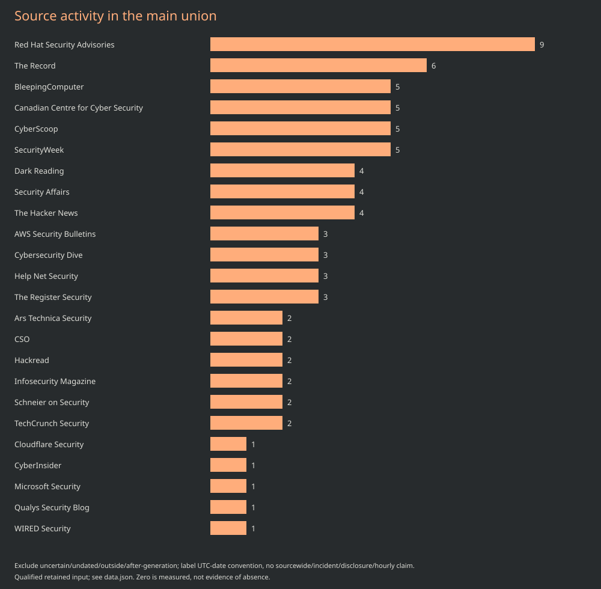
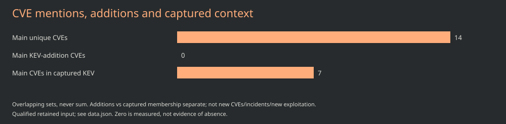

# November 1, 2026 · 06:00 Chicago · 48-hour edition

**Late publication; partial source subset.** Period: [2026-10-30T12:00:00Z, 2026-11-01T12:00:00Z), America/Chicago calendar as specified below. Nominal reporting opportunity: **November 1, 2026 at 06:00 CST (12:00 UTC)**. Actual compilation: **2026-11-01T16:35:01.913Z**. Publication time was not observed at compilation; it is not asserted here.

Input generation: **2026-10-30T23:03:35+00:00**; original capture **2026-10-30T23:21:46.745324+00:00 through 2026-10-30T23:21:48.291337+00:00**. The later qualification and analysis do not make this a newer snapshot. [Data and exact membership](data.json). [Immutable prior edition](https://github.com/TeamStarWolf/intelligence-hub/blob/e11be8c5447054c1cb940161bee83b069ee8ec13/reports/daily/2026-10-30/1400-CDT/README.md).

## Executive summary

The main selection contains **76** declared publication entries: **76** explicit timestamps and **0** full dates selected under a UTC-calendar convention. They mention **14 unique CVEs**, with **0 KEV catalog-addition rows** and **7 main CVEs in captured current KEV context**. These are distinct, overlapping units, not incident or newly disclosed/exploited counts.

The input precedes period end by **132985 seconds**; snapshot generation precedes the shared nominal publication opportunity by **132,985 seconds**. Missing coverage is not filled by compilation. The source status projection contains 53 ok, 7 partial and 2 failed sources; it does not establish that every publisher was admitted.

## Selected developments

- **[Enclave-tool version scope](https://aws.amazon.com/security/security-bulletins/rss/2026-157-aws/)** - The retained AWS publication entry is dated October 30 and declares two CVE identifiers; the technical context below covers only the enclave-tool record. Source: AWS Security Bulletins; declared publication 2026-10-30T16:34:46+00:00. Declared identifiers: CVE-2026-119116, CVE-2026-119148.
- **[FreeRTOS interval review](https://aws.amazon.com/security/security-bulletins/rss/2026-158-aws/)** - The captured AWS entry associates its October 30 bulletin with a FreeRTOS-Kernel identifier; the version interval below comes from retained CNA metadata. Source: AWS Security Bulletins; declared publication 2026-10-30T17:39:33+00:00. Declared identifiers: CVE-2026-119086.
- **[AWS bulletin 159](https://aws.amazon.com/security/security-bulletins/rss/2026-159-aws/)** - The retained AWS feed records bulletin 159 on October 30 and associates it with CVE-2026-119117; no technical assessment is included for that identifier here. Source: AWS Security Bulletins; declared publication 2026-10-30T18:18:40+00:00. Declared identifiers: CVE-2026-119117.
- **[Commerce version boundaries](https://cyber.gc.ca/en/alerts-advisories/drupal-security-advisory-av26-1105)** - The Canadian cyber centre entry is dated October 30 and associated in the Hub with a Commerce Core identifier; the two recorded version intervals remain separate. Source: Canadian Centre for Cyber Security; declared publication 2026-10-30T15:43:17+00:00. Declared identifiers: CVE-2026-118539.
- **[Access-platform advisory context](https://cyber.gc.ca/en/alerts-advisories/ivanti-security-advisory-av26-1035)** - The Canadian advisory entry declares multiple Ivanti identifiers; the selected product context covers one Connect Secure record and preserves a separate failed enrichment. Source: Canadian Centre for Cyber Security; declared publication 2026-10-30T18:01:12+00:00. Declared identifiers: CVE-2026-104935, CVE-2026-109412, CVE-2026-111357, CVE-2026-118527.
- **[Linux branch applicability](https://cyber.gc.ca/en/alerts-advisories/linux-security-advisory-av26-1108)** - The Canadian cyber centre publication entry links to a Linux identifier; its captured version data requires branch-specific interpretation. Source: Canadian Centre for Cyber Security; declared publication 2026-10-30T21:34:05+00:00. Declared identifiers: CVE-2026-98432.

These are selected retained publication records; original article bodies were not rechecked and no headline was treated as technical or exposure evidence.

## KEV additions vs current context

The main union has **0** catalog-addition rows covering **0** distinct CVE IDs. Separately, **7** main CVEs have captured current KEV context. Date-boundary rows remain outside main counts. Zero main-window additions does not mean zero uncertain-date additions or no exploitation. Complete IDs and entry membership are in data.json.

## CVE products, versions, CVSS and mitigation limits

Technical facts below are a selected retained CNA/CISA projection, not new primary-record requests, an as-of-close reconstruction, a tested remediation plan or evidence of the reader's exposure. Longer overlapping editions link to the first eligible full context.

### CVE-2026-119116

[Retained record reference](https://www.cve.org/CVERecord?id=CVE-2026-119116). Captured status: **ok / PUBLISHED**; record-declared update 2026-10-30T16:21:02+00:00. Technical CNA/CISA projection retained in the October 30 input; not primary-rechecked or established as historically known at the article publication instant.

AWS kmstool-enclave. The captured custom rule marks versions from 0 below 0.4.6 affected and gives an unaffected default; this is a record interval, not a verified upgrade recommendation.

**AWS / kmstool-enclave** - default status: **unaffected**. Empty cells below are not supplied bounds.

| Version | Status | Less than | Less than or equal | Version scheme |
| --- | --- | --- | --- | --- |
| 0 | affected | 0.4.6 | not supplied | custom |

Captured CVSS 4.0: **8.7**, vector CVSS:4.0/AV:L/AC:H/AT:N/PR:L/UI:N/VC:H/VI:H/VA:H/SC:H/SI:H/SA:L ([metric source](https://www.cve.org/CVERecord?id=CVE-2026-119116)). This is not a local risk score.

No solutions or workarounds are populated in the loaded structured arrays; a complete vendor fix or deployment assessment is not established.

Solutions/workarounds in the selected structured arrays: **empty**. This is missing structured guidance, not proof of a complete fix or no available fix. Captured catalog context only; not first-exploitation time, local exposure or an automatic mitigation instruction.

CNA weakness identifiers: [CWE-416](https://www.cve.org/CVERecord?id=CVE-2026-119116), [CWE-415](https://www.cve.org/CVERecord?id=CVE-2026-119116). No observed CAPEC/attack mapping is established.

### CVE-2026-119086

[Retained record reference](https://www.cve.org/CVERecord?id=CVE-2026-119086). Captured status: **ok / PUBLISHED**; record-declared update 2026-10-30T17:36:37+00:00. Technical CNA/CISA projection retained in the October 30 input; not primary-rechecked or established as historically known at the article publication instant.

FreeRTOS-Kernel. The recorded affected interval begins at 7.4.0 and includes 11.3.2; its version scheme is custom and the default is unaffected.

**FreeRTOS / FreeRTOS-Kernel** - default status: **unaffected**. Empty cells below are not supplied bounds.

| Version | Status | Less than | Less than or equal | Version scheme |
| --- | --- | --- | --- | --- |
| 7.4.0 | affected | not supplied | 11.3.2 | custom |

Captured CVSS 4.0: **8.2**, vector CVSS:4.0/AV:L/AC:L/AT:N/PR:L/UI:N/VC:N/VI:H/VA:N/SC:N/SI:H/SA:N ([metric source](https://www.cve.org/CVERecord?id=CVE-2026-119086)). This is not a local risk score.

The projection contains no solution/workaround text; do not infer that the next release fixes every deployment.

Solutions/workarounds in the selected structured arrays: **empty**. This is missing structured guidance, not proof of a complete fix or no available fix. Captured catalog context only; not first-exploitation time, local exposure or an automatic mitigation instruction.

CNA weakness identifiers: [CWE-843](https://www.cve.org/CVERecord?id=CVE-2026-119086), [CWE-121](https://www.cve.org/CVERecord?id=CVE-2026-119086). No observed CAPEC/attack mapping is established.

### CVE-2026-118539

[Retained record reference](https://www.cve.org/CVERecord?id=CVE-2026-118539). Captured status: **ok / PUBLISHED**; record-declared update 2026-10-30T03:09:13+00:00. Technical CNA/CISA projection retained in the October 30 input; not primary-rechecked or established as historically known at the article publication instant.

Drupal Commerce Core. The CNA projection marks versions from 0.0.0 below 2.41 and from 3.0.0 below 3.3.13 affected; the default status is unknown.

**Drupal / Commerce Core** - default status: **unknown**. Empty cells below are not supplied bounds.

| Version | Status | Less than | Less than or equal | Version scheme |
| --- | --- | --- | --- | --- |
| 0.0.0 | affected | 2.41 | not supplied | semver |
| 3.0.0 | affected | 3.3.13 | not supplied | semver |

CVSS: **not supplied or UNKNOWN**; no zero score is substituted.

No CVSS, solution or workaround is supplied here. Versions outside those two rows must not be promoted to verified fixed releases.

Solutions/workarounds in the selected structured arrays: **empty**. This is missing structured guidance, not proof of a complete fix or no available fix. Captured catalog context only; not first-exploitation time, local exposure or an automatic mitigation instruction.

CNA weakness identifiers: [CWE-862](https://www.cve.org/CVERecord?id=CVE-2026-118539). No observed CAPEC/attack mapping is established.

### CVE-2026-104935

[Retained record reference](https://www.cve.org/CVERecord?id=CVE-2026-104935). Captured status: **ok / PUBLISHED**; record-declared update 2026-10-13T19:58:23+00:00. Technical CNA/CISA projection retained in the October 30 input; not primary-rechecked or established as historically known at the article publication instant.

Ivanti Connect Secure. The projection uses an affected default and explicitly marks 25.1.3.0, 25.1.3.1, 22.8R2.5 and 22.7R2.14 unaffected; the rows are not a complete upgrade or backport matrix.

**Ivanti / Connect Secure** - default status: **affected**. Empty cells below are not supplied bounds.

| Version | Status | Less than | Less than or equal | Version scheme |
| --- | --- | --- | --- | --- |
| 25.1.3.0 | unaffected | not supplied | not supplied | custom |
| 25.1.3.1 | unaffected | not supplied | not supplied | custom |
| 22.8R2.5 | unaffected | not supplied | not supplied | custom |
| 22.7R2.14 | unaffected | not supplied | not supplied | custom |

Captured CVSS 3.1: **8.6**, vector CVSS:3.1/AV:N/AC:L/PR:N/UI:N/S:U/C:H/I:L/A:L ([metric source](https://www.cve.org/CVERecord?id=CVE-2026-104935)). This is not a local risk score.

Captured CISA context points to vendor-directed mitigation and applicable federal guidance. Reader applicability, configured exposure and remediation were not checked.

Solutions/workarounds in the selected structured arrays: **empty**. This is missing structured guidance, not proof of a complete fix or no available fix. Captured catalog context only; not first-exploitation time, local exposure or an automatic mitigation instruction.

Captured KEV catalog metadata: added 2026-10-13, catalog due date 2026-10-16, ransomware field Unknown. These are catalog/agency metadata, not a reader deadline or first-exploitation timestamp.

CNA weakness identifiers: [CWE-290](https://www.cve.org/CVERecord?id=CVE-2026-104935). No observed CAPEC/attack mapping is established.

### CVE-2026-98432

[Retained record reference](https://www.cve.org/CVERecord?id=CVE-2026-98432). Captured status: **ok / PUBLISHED**; record-declared update 2026-10-24T14:08:46+00:00. Technical CNA/CISA projection retained in the October 30 input; not primary-rechecked or established as historically known at the article publication instant.

Complex Linux product/version matrix is intentionally not exported. No affected or fixed branch range, commit identifier or distribution backport conclusion is asserted.

Captured CVSS 3.1: **9.8**, vector CVSS:3.1/AV:N/AC:L/PR:N/UI:N/S:U/C:H/I:H/A:H ([metric source](https://www.cve.org/CVERecord?id=CVE-2026-98432)). This is not a local risk score.

Reference only: consult the complete record and applicable publisher/distribution material; product/version applicability is not established here.

Solutions/workarounds in the selected structured arrays: **empty**. This is missing structured guidance, not proof of a complete fix or no available fix. Captured catalog context only; not first-exploitation time, local exposure or an automatic mitigation instruction.

CNA weakness identifiers: not supplied/projected for this context. No observed CAPEC/attack mapping is established.

### CVE-2026-118527

[Retained record reference](https://www.cve.org/CVERecord?id=CVE-2026-118527). Captured status: **failed / UNKNOWN**; record-declared update not supplied. Technical CNA/CISA projection retained in the October 30 input; not primary-rechecked or established as historically known at the article publication instant.

UNKNOWN: the retained enrichment failed; no product/version table or fix assertion is established. Other Ivanti identifiers are not transferred.

CVSS: **not supplied or UNKNOWN**; no zero score is substituted.

Do not attach the other Ivanti product rows, scores or fix assertions to this identifier. Captured catalog membership cannot substitute for the missing CNA record.

Solutions/workarounds in the selected structured arrays: **empty**. This is missing structured guidance, not proof of a complete fix or no available fix. Captured catalog context only; not first-exploitation time, local exposure or an automatic mitigation instruction.

Captured KEV catalog metadata: added 2026-10-30, catalog due date 2026-11-13, ransomware field Unknown. These are catalog/agency metadata, not a reader deadline or first-exploitation timestamp.

CNA weakness identifiers: not supplied/projected for this context. No observed CAPEC/attack mapping is established.

## CWE/CAPEC, actors, supply chain and AI

CNA weakness IDs, when present in the selected full contexts, are CVE-to-CWE associations. No observed CAPEC/attack mapping is asserted. Actor/campaign, AI and supply-chain-compromise claims are **not assessed**; a package advisory, URL wording or co-mention is not enough.

## Watchlist and date precision

| Classification | Entry count | Scope |
| --- | --- | --- |
| Explicit timestamp | 76 | Declared timestamp inside half-open period |
| Full UTC calendar date | 0 | UTC-calendar convention; publisher timezone unknown |
| Date-boundary uncertain | 2 | Separate from main union |
| After-generation uncertain | 0 | Separate from main union |
| Undated | 65 | Separate from main union |
| Outside period | 4547 | Separate from main union |

| Boundary-watch entry | Declared date | CVE identifiers |
| --- | --- | --- |
| kev-CVE-2026-111357 | 2026-10-30 | CVE-2026-111357 |
| kev-CVE-2026-118527 | 2026-10-30 | CVE-2026-118527 |

Date-only days do not establish an exact publication instant or guaranteed elapsed-hour membership. Undated, outside-window and after-generation uncertainty are not zero activity. The six groups partition all 4,690 saved input entries; only the two admitted main groups form period metrics.

## Charts and source limits

Each chart uses the exact data.json membership, count recipe and retained input. Source bars describe admitted publication entries; CVE bars overlap and must never be added together. Source labels use the captured source-health display name for each source ID, or the ID when that display metadata is missing; entry-level name variants remain in data.json.

| Source status metadata | Status | Stored articles | Last attempt | Last success |
| --- | --- | --- | --- | --- |
| [CISA Advisories](https://www.cisa.gov/cybersecurity-advisories) | failed | 0 | 2026-10-30T23:03:29+00:00 | unknown |
| [F5 Labs](https://www.f5.com/labs) | partial | 237 | 2026-10-30T23:03:32+00:00 | 2026-10-30T23:03:33+00:00 |
| [Graham Cluley](https://grahamcluley.com/) | partial | 7 | 2026-10-30T23:03:32+00:00 | 2026-10-30T23:03:33+00:00 |
| [Infosecurity Magazine](https://www.infosecurity-magazine.com/) | partial | 177 | 2026-10-30T23:03:33+00:00 | 2026-10-30T23:03:33+00:00 |
| [Microsoft Security](https://www.microsoft.com/en-us/security/blog/) | partial | 21 | 2026-10-30T23:03:29+00:00 | 2026-10-30T23:03:29+00:00 |
| [Qualys Security Blog](https://blog.qualys.com/) | partial | 12 | 2026-10-30T23:03:34+00:00 | 2026-10-30T23:03:34+00:00 |
| [SANS Internet Storm Center](https://isc.sans.edu/) | failed | 20 | 2026-10-30T23:03:30+00:00 | 2026-10-30T22:29:12+00:00 |
| [Snyk](https://snyk.io/blog/) | partial | 152 | 2026-10-30T23:03:32+00:00 | 2026-10-30T23:03:32+00:00 |
| [Cisco Talos](https://blog.talosintelligence.com/) | partial | 20 | 2026-10-30T23:03:29+00:00 | 2026-10-30T23:03:29+00:00 |

Source URLs above are display/home status metadata, not proof of a new exact endpoint request. Selected long-term coverage is nonexhaustive; an empty month or failed source does not establish absence of events. The full eight-field source-health projection is in data.json.

## Prior-citation review

The dedicated offline inventory attempt **failed without an accepted URL inventory**. Citation occurrence/URL/eligibility/selection/changed/unresolved/cap-excluded totals remain **unknown (null)**. No new original-article GET, qualified article check or comparison was completed. Empty records and zero operations do not mean unchanged content, all-updated sources or source-wide absence. Held routes remain inactive; no per-URL next eligibility result is established.

## Primary-first references

- [Vendor guidance reference](https://aws.amazon.com/security/security-bulletins/2026-157-aws/) - retained-CNA-projection; not body rechecked.
- [Vendor guidance reference](https://aws.amazon.com/security/security-bulletins/2026-158-aws/) - retained-CNA-projection; not body rechecked.
- [Vendor guidance reference](https://github.com/aws/aws-nitro-enclaves-sdk-c/releases/tag/v0.4.6) - retained-CNA-projection; not body rechecked.
- [CVE record/reference metadata](https://github.com/aws/aws-nitro-enclaves-sdk-c/security/advisories/GHSA-cfhm-qfw4-j7qq) - retained-CNA-projection; not body rechecked.
- [Vendor guidance reference](https://github.com/FreeRTOS/FreeRTOS-Kernel/releases/tag/V11.3.3) - retained-CNA-projection; not body rechecked.
- [CVE record/reference metadata](https://github.com/FreeRTOS/FreeRTOS-Kernel/security/advisories/GHSA-56j9-g43f-8g6v) - retained-CNA-projection; not body rechecked.
- [CVE record/reference metadata](https://hub.ivanti.com/s/article/Security-Advisory-Ivanti-Connect-Secure-CVE-2026-104935) - retained-CNA-projection; not body rechecked.
- [CVE record/reference metadata](https://www.cve.org/CVERecord?id=CVE-2026-104935) - retained-CNA-projection; not body rechecked.
- [CVE record/reference metadata](https://www.cve.org/CVERecord?id=CVE-2026-118527) - retained-CNA-projection; not body rechecked.
- [CVE record/reference metadata](https://www.cve.org/CVERecord?id=CVE-2026-118539) - retained-CNA-projection; not body rechecked.
- [CVE record/reference metadata](https://www.cve.org/CVERecord?id=CVE-2026-119086) - retained-CNA-projection; not body rechecked.
- [CVE record/reference metadata](https://www.cve.org/CVERecord?id=CVE-2026-119116) - retained-CNA-projection; not body rechecked.
- [CVE record/reference metadata](https://www.cve.org/CVERecord?id=CVE-2026-98432) - retained-CNA-projection; not body rechecked.
- [CVE record/reference metadata](https://www.drupal.org/sa-contrib-2026-254) - retained-CNA-projection; not body rechecked.
- [Enclave-tool version scope](https://aws.amazon.com/security/security-bulletins/rss/2026-157-aws/) - captured-feed-metadata.
- [FreeRTOS interval review](https://aws.amazon.com/security/security-bulletins/rss/2026-158-aws/) - captured-feed-metadata.
- [AWS bulletin 159](https://aws.amazon.com/security/security-bulletins/rss/2026-159-aws/) - captured-feed-metadata.
- [Commerce version boundaries](https://cyber.gc.ca/en/alerts-advisories/drupal-security-advisory-av26-1105) - captured-feed-metadata.
- [Access-platform advisory context](https://cyber.gc.ca/en/alerts-advisories/ivanti-security-advisory-av26-1035) - captured-feed-metadata.
- [Linux branch applicability](https://cyber.gc.ca/en/alerts-advisories/linux-security-advisory-av26-1108) - captured-feed-metadata.

Reference URLs were present in the retained projection; listing them is not an HTTP check or source-body qualification. No direct article quotes are reproduced.

## Next nominal report/revision opportunity

**November 1, 2026 at 14:00 America/Chicago (CST; 20:00 UTC)**. This is a requested opportunity, subject to app/computer availability, with no punctual delivery guarantee. Per-URL eligibility, the requested ten-minute feed checks, actual snapshot clocks and actual report publication are separate.
