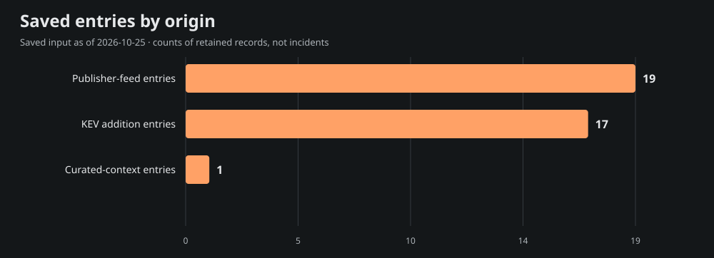
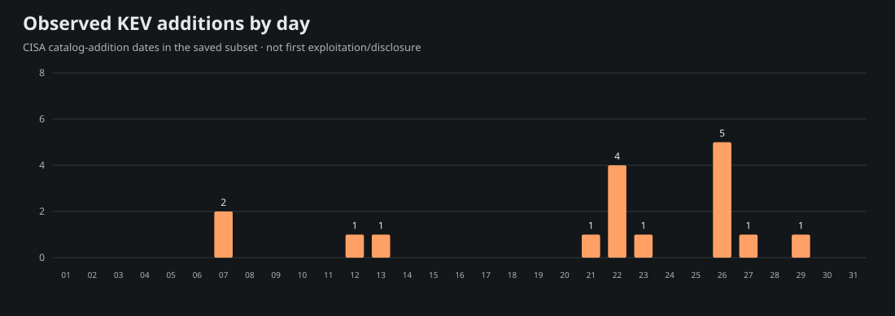
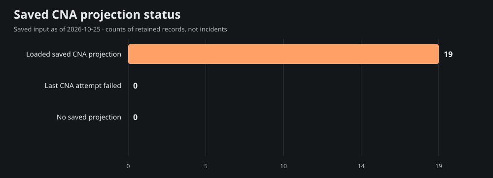

# Team Star Wolf Intelligence Hub
## January 2026 · retrospective

**Edition:** SW-MONTHLY-2026-01-RETRO · **Coverage:** selective, incomplete saved-source subset

**Period:** 2026-01-01T00:00:00-06:00 inclusive to 2026-02-01T00:00:00-06:00 exclusive (America/Chicago).

**Compiled:** 2026-10-25T21:55:23.373Z · **Input generated:** 2026-10-25T21:13:41+00:00 · **Captured:** 2026-10-25T21:29:50.108068Z

This is a retrospective compilation. A closed calendar period does not imply complete evidence. Saved entries, curated context and CNA projections are attributed below; no primary article or CNA record was fetched or independently verified for this edition.

## 1. Executive summary

The admitted saved subset contains **37 entries**: 19 publisher-feed entries, 17 CISA KEV catalog-addition entries and 1 curated-context entry. These mention **19 distinct CVE IDs**; they are not counts of incidents, newly disclosed vulnerabilities, exploited systems or affected devices.

The 5 selected developments below emphasize saved curated context, advisory metadata and dated KEV additions. Selection is bounded and source-based rather than a severity/risk ranking. The report samples 15 of 19 mentioned CVEs for current saved product, score and mitigation context; full entry/cohort/chart data are in [data.json](<https://github.com/TeamStarWolf/intelligence-hub/blob/main/reports/monthly/2026-01/data.json>).

Saved curated context highlights [Canadian Cyber Centre warns of exploited Ivanti EPMM flaws](<https://www.cyber.gc.ca/en/alerts-advisories/ivanti-security-advisory-av26-068>). These remain the saved curation’s source-attributed account, including any later-update caveats; they are not claims that the whole account was known during the historical period.

|Metric|Observed value|Meaning|
|---|---:|---|
|Saved entries|37|Canonical-URL rows in the selected date recipe|
|Unique mentioned CVEs|19|Union of IDs, not newly published CVEs|
|KEV additions|17|Catalog-addition rows, not first exploitation|
|Aware timestamps|19|Chicago-aware instant membership|
|Date-only rows|18|Literal calendar precision; timezone unknown|
|Cutoff-date rows with unknown time|0|Included calendar-overlap rows, not exact-time evidence|

## 2. Selected source-attributed developments

Up to 10 entries are selected; 5 qualify under this saved-source selection recipe. A headline or CVE mention is a source lead, not a directly re-read incident narrative.

### 1. Canadian Cyber Centre warns of exploited Ivanti EPMM flaws

- **Saved source:** [Canadian Centre for Cyber Security](<https://www.cyber.gc.ca/en/alerts-advisories/ivanti-security-advisory-av26-068>) · curated source context · advisory
- **Recorded date:** 2026-01-29 · publication · calendar-day precision
- **CVE mentions:** CVE-2026-1281, CVE-2026-1340
- **Saved exploitation label:** known; a mention alone is not exploitation evidence.
- **Saved curation context, observed October 25:** The advisory covers CVE-2026-1281 and CVE-2026-1340 in Ivanti EPMM and records vendor-reported exploitation. Its April update adds later KEV context. Review exact versions and vendor analysis guidance; the January publication and subsequent updates remain distinct.

### 2. CVE-2026-1281 · Ivanti Endpoint Manager Mobile (EPMM) Code Injection Vulnerability

- **Saved source:** [CISA Known Exploited Vulnerabilities](<https://www.cisa.gov/known-exploited-vulnerabilities-catalog?field_cve=CVE-2026-1281>) · saved Hub entry · kev
- **Recorded date:** 2026-01-29 · CISA catalog addition · calendar-day precision
- **CVE mentions:** CVE-2026-1281
- **Saved exploitation label:** known; a mention alone is not exploitation evidence.
- **Context limit:** Saved headline/metadata only; no article-body facts, actor attribution or remediation are inferred.

### 3. CVE-2026-24858 · Fortinet Multiple Products Authentication Bypass Using an Alternate Path or Channel Vulnerability

- **Saved source:** [CISA Known Exploited Vulnerabilities](<https://www.cisa.gov/known-exploited-vulnerabilities-catalog?field_cve=CVE-2026-24858>) · saved Hub entry · kev
- **Recorded date:** 2026-01-27 · CISA catalog addition · calendar-day precision
- **CVE mentions:** CVE-2026-24858
- **Saved exploitation label:** known; a mention alone is not exploitation evidence.
- **Context limit:** Saved headline/metadata only; no article-body facts, actor attribution or remediation are inferred.

### 4. CVE-2018-14634 · Linux Kernel Integer Overflow Vulnerability

- **Saved source:** [CISA Known Exploited Vulnerabilities](<https://www.cisa.gov/known-exploited-vulnerabilities-catalog?field_cve=CVE-2018-14634>) · saved Hub entry · kev
- **Recorded date:** 2026-01-26 · CISA catalog addition · calendar-day precision
- **CVE mentions:** CVE-2018-14634
- **Saved exploitation label:** known; a mention alone is not exploitation evidence.
- **Context limit:** Saved headline/metadata only; no article-body facts, actor attribution or remediation are inferred.

### 5. Analyzing React2Shell Threat Actors

- **Saved source:** [F5 Labs](<https://www.f5.com/labs/articles/analyzing-react2shell-threat-actors>) · saved Hub entry · research
- **Recorded date:** 2026-01-16T17:00:00+00:00 · publication · timestamp with offset
- **CVE mentions:** CVE-2025-55182
- **Saved exploitation label:** unknown; a mention alone is not exploitation evidence.
- **Context limit:** Saved headline/metadata only; no article-body facts, actor attribution or remediation are inferred.

## 3. CISA KEV additions and CVE context

The saved input contains **17** KEV catalog-addition rows in this period. Catalog addition is separate from initial disclosure, first exploitation and the CVE identifier’s year. These are current-catalog observations captured October 25, not a frozen catalog from the historical month.

Showing 17 of 17 rows below; all admitted rows are retained in data.json.

|Added|CVE|Saved vendor/product tags|Current saved federal due date|
|---|---|---|---|
|2026-01-29|[CVE-2026-1281](<https://www.cisa.gov/known-exploited-vulnerabilities-catalog?field_cve=CVE-2026-1281>)|Ivanti · Endpoint Manager Mobile (EPMM)|2026-02-01|
|2026-01-27|[CVE-2026-24858](<https://www.cisa.gov/known-exploited-vulnerabilities-catalog?field_cve=CVE-2026-24858>)|Fortinet · Multiple Products|2026-01-30|
|2026-01-26|[CVE-2018-14634](<https://www.cisa.gov/known-exploited-vulnerabilities-catalog?field_cve=CVE-2018-14634>)|Linux · Kernel|2026-02-16|
|2026-01-26|[CVE-2025-52691](<https://www.cisa.gov/known-exploited-vulnerabilities-catalog?field_cve=CVE-2025-52691>)|SmarterTools · SmarterMail|2026-02-16|
|2026-01-26|[CVE-2026-21509](<https://www.cisa.gov/known-exploited-vulnerabilities-catalog?field_cve=CVE-2026-21509>)|Microsoft · Office|2026-02-16|
|2026-01-26|[CVE-2026-23760](<https://www.cisa.gov/known-exploited-vulnerabilities-catalog?field_cve=CVE-2026-23760>)|SmarterTools · SmarterMail|2026-02-16|
|2026-01-26|[CVE-2026-24061](<https://www.cisa.gov/known-exploited-vulnerabilities-catalog?field_cve=CVE-2026-24061>)|GNU · InetUtils|2026-02-16|
|2026-01-23|[CVE-2024-37079](<https://www.cisa.gov/known-exploited-vulnerabilities-catalog?field_cve=CVE-2024-37079>)|Broadcom · VMware vCenter Server|2026-02-13|
|2026-01-22|[CVE-2025-31125](<https://www.cisa.gov/known-exploited-vulnerabilities-catalog?field_cve=CVE-2025-31125>)|Vite · Vitejs|2026-02-12|
|2026-01-22|[CVE-2025-34026](<https://www.cisa.gov/known-exploited-vulnerabilities-catalog?field_cve=CVE-2025-34026>)|Versa · Concerto|2026-02-12|
|2026-01-22|[CVE-2025-54313](<https://www.cisa.gov/known-exploited-vulnerabilities-catalog?field_cve=CVE-2025-54313>)|Prettier · eslint-config-prettier|2026-02-12|
|2026-01-22|[CVE-2025-68645](<https://www.cisa.gov/known-exploited-vulnerabilities-catalog?field_cve=CVE-2025-68645>)|Synacor · Zimbra Collaboration Suite (ZCS)|2026-02-12|
|2026-01-21|[CVE-2026-20045](<https://www.cisa.gov/known-exploited-vulnerabilities-catalog?field_cve=CVE-2026-20045>)|Cisco · Unified Communications Manager|2026-02-11|
|2026-01-13|[CVE-2026-20805](<https://www.cisa.gov/known-exploited-vulnerabilities-catalog?field_cve=CVE-2026-20805>)|Microsoft · Windows|2026-02-03|
|2026-01-12|[CVE-2025-8110](<https://www.cisa.gov/known-exploited-vulnerabilities-catalog?field_cve=CVE-2025-8110>)|Gogs · Gogs|2026-02-02|
|2026-01-07|[CVE-2009-0556](<https://www.cisa.gov/known-exploited-vulnerabilities-catalog?field_cve=CVE-2009-0556>)|Microsoft · Office|2026-01-28|
|2026-01-07|[CVE-2025-37164](<https://www.cisa.gov/known-exploited-vulnerabilities-catalog?field_cve=CVE-2025-37164>)|Hewlett Packard Enterprise (HPE) · OneView|2026-01-28|

Federal due dates are source catalog data, not deadlines assigned to this site’s visitors. Ransomware and exploitation assertions, where supplied, remain source-scoped in data.json.

### Current saved CNA sample

These 15 sampled projections are current context from the saved input. Their record-state, retrieval/update/attempt clocks and CNA score version remain explicit. Loaded projections can include rejected records; failed enrichment may retain older successful content. No source record was re-read for this report.

|CVE|Projection / record state|Saved CVSS|Saved guidance status|
|---|---|---|---|
|[CVE-2026-1281](<https://www.cve.org/CVERecord?id=CVE-2026-1281>)|ok / PUBLISHED|9.8 (v3.1; saved CNA metric)|cisa-action|
|[CVE-2026-1340](<https://www.cve.org/CVERecord?id=CVE-2026-1340>)|ok / PUBLISHED|9.8 (v3.1; saved CNA metric)|cisa-action|
|[CVE-2026-24858](<https://www.cve.org/CVERecord?id=CVE-2026-24858>)|ok / PUBLISHED|9.4 (v3.1; saved CNA metric)|publisher-guidance|
|[CVE-2018-14634](<https://www.cve.org/CVERecord?id=CVE-2018-14634>)|ok / PUBLISHED|7.8 (v3.0; saved CNA metric)|cisa-action|
|[CVE-2025-55182](<https://www.cve.org/CVERecord?id=CVE-2025-55182>)|ok / PUBLISHED|10 (v3.1; saved CNA metric)|cisa-action|
|[CVE-2009-0556](<https://www.cve.org/CVERecord?id=CVE-2009-0556>)|ok / PUBLISHED|Not supplied in saved projection|cisa-action|
|[CVE-2024-37079](<https://www.cve.org/CVERecord?id=CVE-2024-37079>)|ok / PUBLISHED|9.8 (v3.1; saved CNA metric)|cisa-action|
|[CVE-2025-31125](<https://www.cve.org/CVERecord?id=CVE-2025-31125>)|ok / PUBLISHED|5.3 (v3.1; saved CNA metric)|cisa-action|
|[CVE-2025-34026](<https://www.cve.org/CVERecord?id=CVE-2025-34026>)|ok / PUBLISHED|9.2 (v4.0; saved CNA metric)|cisa-action|
|[CVE-2025-37164](<https://www.cve.org/CVERecord?id=CVE-2025-37164>)|ok / PUBLISHED|10 (v3.1; saved CNA metric)|cisa-action|
|[CVE-2025-52691](<https://www.cve.org/CVERecord?id=CVE-2025-52691>)|ok / PUBLISHED|10 (v3.1; saved CNA metric)|publisher-guidance|
|[CVE-2025-54313](<https://www.cve.org/CVERecord?id=CVE-2025-54313>)|ok / PUBLISHED|7.5 (v3.1; saved CNA metric)|cisa-action|
|[CVE-2025-68645](<https://www.cve.org/CVERecord?id=CVE-2025-68645>)|ok / PUBLISHED|Not supplied in saved projection|cisa-action|
|[CVE-2025-8110](<https://www.cve.org/CVERecord?id=CVE-2025-8110>)|ok / PUBLISHED|8.7 (v4.0; saved CNA metric)|cisa-action|
|[CVE-2026-20045](<https://www.cve.org/CVERecord?id=CVE-2026-20045>)|ok / PUBLISHED|8.2 (v3.1; saved CNA metric)|cisa-action|

## 4. Campaigns and actors

**not_projected.** Schema 4 supplied no structured actor/campaign entity or relationship projection. Names in saved headlines, research or curated prose are not promoted into attribution, aliases or ATT&CK/CAPEC relationships. This does not establish that no campaign occurred.

## 5. Supply chain and AI security

Only exact saved tags select the following topic leads; this is not inferred impact or attack taxonomy.
No admitted entry selected by the exact supply-chain/ai-security/prompt-injection tag filter. That is a limitation of this saved subset, not evidence of absence.

## 6. Mitigation and product context

This is current saved projection context, not patch verification or knowledge backdated into the report month. Exact installed versions/configuration were not assessed. Full bounded product/version statements, source links and saved analysis steps are in data.json. CWE, CAPEC and actor fields are **not_projected**, rather than empty-proof of no weakness or attack pattern.

### CVE-2026-1281

- **Current saved state:** ok / PUBLISHED; 9.8 (v3.1; saved CNA metric).
- **Clocks:** retrieved 2026-10-24T22:24:23+00:00; record updated 2026-10-07T18:00:12+00:00; attempted 2026-10-24T22:24:22+00:00.
- **Saved product labels:** Ivanti / Endpoint Manager Mobile 
- **Saved CISA action excerpt:** Apply mitigations per vendor instructions, follow applicable BOD 22-01 guidance for cloud services, or discontinue use of the product if mitigations are unavailable.
- **Source pointer:** [Saved record reference](<https://www.cve.org/CVERecord?id=CVE-2026-1281>). No direct source review or environment applicability is established.

### CVE-2026-1340

- **Current saved state:** ok / PUBLISHED; 9.8 (v3.1; saved CNA metric).
- **Clocks:** retrieved 2026-10-24T22:24:22+00:00; record updated 2026-04-09T03:55:54+00:00; attempted 2026-10-24T22:24:22+00:00.
- **Saved product labels:** Ivanti / Endpoint Manager Mobile 
- **Saved CISA action excerpt:** Apply mitigations per vendor instructions, follow applicable BOD 22-01 guidance for cloud services, or discontinue use of the product if mitigations are unavailable.
- **Source pointer:** [Saved record reference](<https://www.cve.org/CVERecord?id=CVE-2026-1340>). No direct source review or environment applicability is established.

### CVE-2026-24858

- **Current saved state:** ok / PUBLISHED; 9.4 (v3.1; saved CNA metric).
- **Clocks:** retrieved 2026-10-24T22:24:18+00:00; record updated 2026-06-09T14:27:53+00:00; attempted 2026-10-24T22:24:18+00:00.
- **Saved product labels:** Fortinet / FortiWeb; Fortinet / FortiNAC-F; Fortinet / FortiOS (first 3 shown; full bounded projection in data.json)
- **Saved CISA action excerpt:** Apply mitigations per vendor instructions, follow applicable BOD 22-01 guidance for cloud services, or discontinue use of the product if mitigations are unavailable.
- **Saved publisher solution excerpt (shortened):** Upgrade to upcoming FortiOS version 8.0.0 or above Upgrade to FortiOS version 7.6.6 or above Upgrade to FortiOS version 7.4.11 or above Upgrade to FortiOS version 7.2.13 or above Upgrade to FortiOS version 7.0.19 or above Upgrade to upcoming FortiManager version 8.0.0 or above Upgrade to FortiManager version 7.6.6 or above Upgrade to FortiManager version 7.…
- **Source pointer:** [Saved record reference](<https://www.cve.org/CVERecord?id=CVE-2026-24858>). No direct source review or environment applicability is established.

### CVE-2018-14634

- **Current saved state:** ok / PUBLISHED; 7.8 (v3.0; saved CNA metric).
- **Clocks:** retrieved 2026-10-24T22:25:13+00:00; record updated 2026-01-27T13:34:52+00:00; attempted 2026-10-24T22:25:12+00:00.
- **Saved product labels:** The Linux Foundation / kernel 
- **Saved CISA action excerpt:** Apply mitigations per vendor instructions, follow applicable BOD 22-01 guidance for cloud services, or discontinue use of the product if mitigations are unavailable.
- **Source pointer:** [Saved record reference](<https://www.cve.org/CVERecord?id=CVE-2018-14634>). No direct source review or environment applicability is established.

### CVE-2025-55182

- **Current saved state:** ok / PUBLISHED; 10 (v3.1; saved CNA metric).
- **Clocks:** retrieved 2026-10-24T22:24:29+00:00; record updated 2026-10-07T17:58:00+00:00; attempted 2026-10-24T22:24:29+00:00.
- **Saved product labels:** Meta / react-server-dom-webpack; Meta / react-server-dom-turbopack; Meta / react-server-dom-parcel 
- **Saved CISA action excerpt:** Apply mitigations per vendor instructions, follow applicable BOD 22-01 guidance for cloud services, or discontinue use of the product if mitigations are unavailable.
- **Source pointer:** [Saved record reference](<https://www.cve.org/CVERecord?id=CVE-2025-55182>). No direct source review or environment applicability is established.

### CVE-2009-0556

- **Current saved state:** ok / PUBLISHED; Not supplied in saved projection.
- **Clocks:** retrieved 2026-10-24T23:19:15+00:00; record updated 2026-01-08T04:55:23+00:00; attempted 2026-10-24T23:19:15+00:00.
- **Saved product labels:** n/a / n/a 
- **Saved CISA action excerpt:** Apply mitigations per vendor instructions, follow applicable BOD 22-01 guidance for cloud services, or discontinue use of the product if mitigations are unavailable.
- **Source pointer:** [Saved record reference](<https://www.cve.org/CVERecord?id=CVE-2009-0556>). No direct source review or environment applicability is established.

### CVE-2024-37079

- **Current saved state:** ok / PUBLISHED; 9.8 (v3.1; saved CNA metric).
- **Clocks:** retrieved 2026-10-24T22:24:38+00:00; record updated 2026-01-24T04:55:16+00:00; attempted 2026-10-24T22:24:38+00:00.
- **Saved product labels:** n/a / VMware vCenter Server; n/a / VMware Cloud Foundation 
- **Saved CISA action excerpt:** Apply mitigations per vendor instructions, follow applicable BOD 22-01 guidance for cloud services, or discontinue use of the product if mitigations are unavailable.
- **Source pointer:** [Saved record reference](<https://www.cve.org/CVERecord?id=CVE-2024-37079>). No direct source review or environment applicability is established.

### CVE-2025-31125

- **Current saved state:** ok / PUBLISHED; 5.3 (v3.1; saved CNA metric).
- **Clocks:** retrieved 2026-10-24T22:24:31+00:00; record updated 2026-01-23T16:58:37+00:00; attempted 2026-10-24T22:24:31+00:00.
- **Saved product labels:** vitejs / vite 
- **Saved CISA action excerpt:** Apply mitigations per vendor instructions, follow applicable BOD 22-01 guidance for cloud services, or discontinue use of the product if mitigations are unavailable.
- **Source pointer:** [Saved record reference](<https://www.cve.org/CVERecord?id=CVE-2025-31125>). No direct source review or environment applicability is established.

### CVE-2025-34026

- **Current saved state:** ok / PUBLISHED; 9.2 (v4.0; saved CNA metric).
- **Clocks:** retrieved 2026-10-24T22:24:31+00:00; record updated 2026-01-23T14:34:06+00:00; attempted 2026-10-24T22:24:31+00:00.
- **Saved product labels:** Versa / Concerto 
- **Saved CISA action excerpt:** Apply mitigations per vendor instructions, follow applicable BOD 22-01 guidance for cloud services, or discontinue use of the product if mitigations are unavailable.
- **Source pointer:** [Saved record reference](<https://www.cve.org/CVERecord?id=CVE-2025-34026>). No direct source review or environment applicability is established.

### CVE-2025-37164

- **Current saved state:** ok / PUBLISHED; 10 (v3.1; saved CNA metric).
- **Clocks:** retrieved 2026-10-24T22:24:31+00:00; record updated 2026-02-26T16:07:33+00:00; attempted 2026-10-24T22:24:31+00:00.
- **Saved product labels:** Hewlett Packard Enterprise (HPE) / HPE OneView 
- **Saved CISA action excerpt:** Apply mitigations per vendor instructions, follow applicable BOD 22-01 guidance for cloud services, or discontinue use of the product if mitigations are unavailable.
- **Source pointer:** [Saved record reference](<https://www.cve.org/CVERecord?id=CVE-2025-37164>). No direct source review or environment applicability is established.

### CVE-2025-52691

- **Current saved state:** ok / PUBLISHED; 10 (v3.1; saved CNA metric).
- **Clocks:** retrieved 2026-10-24T22:24:29+00:00; record updated 2026-02-26T16:07:23+00:00; attempted 2026-10-24T22:24:29+00:00.
- **Saved product labels:** SmarterTools / SmarterMail 
- **Saved CISA action excerpt:** Apply mitigations per vendor instructions, follow applicable BOD 22-01 guidance for cloud services, or discontinue use of the product if mitigations are unavailable.
- **Saved publisher solution excerpt:** Users and administrators of affected product versions are advised to update to SmarterMail version Build 9413 immediately.
- **Source pointer:** [Saved record reference](<https://www.cve.org/CVERecord?id=CVE-2025-52691>). No direct source review or environment applicability is established.

### CVE-2025-54313

- **Current saved state:** ok / PUBLISHED; 7.5 (v3.1; saved CNA metric).
- **Clocks:** retrieved 2026-10-24T22:24:29+00:00; record updated 2026-02-26T17:50:26+00:00; attempted 2026-10-24T22:24:29+00:00.
- **Saved product labels:** prettier / eslint-config-prettier 
- **Saved CISA action excerpt:** Apply mitigations per vendor instructions, follow applicable BOD 22-01 guidance for cloud services, or discontinue use of the product if mitigations are unavailable.
- **Source pointer:** [Saved record reference](<https://www.cve.org/CVERecord?id=CVE-2025-54313>). No direct source review or environment applicability is established.

### CVE-2025-68645

- **Current saved state:** ok / PUBLISHED; Not supplied in saved projection.
- **Clocks:** retrieved 2026-10-24T22:24:27+00:00; record updated 2026-02-26T16:07:24+00:00; attempted 2026-10-24T22:24:27+00:00.
- **Saved product labels:** n/a / n/a 
- **Saved CISA action excerpt:** Apply mitigations per vendor instructions, follow applicable BOD 22-01 guidance for cloud services, or discontinue use of the product if mitigations are unavailable.
- **Source pointer:** [Saved record reference](<https://www.cve.org/CVERecord?id=CVE-2025-68645>). No direct source review or environment applicability is established.

### CVE-2025-8110

- **Current saved state:** ok / PUBLISHED; 8.7 (v4.0; saved CNA metric).
- **Clocks:** retrieved 2026-10-24T22:24:27+00:00; record updated 2026-02-26T16:21:06+00:00; attempted 2026-10-24T22:24:27+00:00.
- **Saved product labels:** Gogs / Gogs 
- **Saved CISA action excerpt:** Apply mitigations per vendor instructions, follow applicable BOD 22-01 guidance for cloud services, or discontinue use of the product if mitigations are unavailable.
- **Source pointer:** [Saved record reference](<https://www.cve.org/CVERecord?id=CVE-2025-8110>). No direct source review or environment applicability is established.

### CVE-2026-20045

- **Current saved state:** ok / PUBLISHED; 8.2 (v3.1; saved CNA metric).
- **Clocks:** retrieved 2026-10-24T22:24:22+00:00; record updated 2026-02-26T14:44:34+00:00; attempted 2026-10-24T22:24:21+00:00.
- **Saved product labels:** Cisco / Cisco Unified Communications Manager; Cisco / Cisco Unified Communications Manager IM and Presence Service; Cisco / Cisco Unity Connection 
- **Saved CISA action excerpt:** Apply mitigations per vendor instructions, follow applicable BOD 22-01 guidance for cloud services, or discontinue use of the product if mitigations are unavailable.
- **Source pointer:** [Saved record reference](<https://www.cve.org/CVERecord?id=CVE-2026-20045>). No direct source review or environment applicability is established.

## 7. Changes to prior reporting

**Revision watch: not_run · no_baseline.** No primary citation was rechecked and no material-change claim is made. The 48–96-hour citation review policy remains planned; raw hashes or timestamps alone would not prove a material security change.

## 8. Watchlist for the next review

- The saved input provides loaded projections for all 19 mentioned CVEs. A source-review priority is whether publisher conditions changed after the displayed clocks; no such check is recorded here.
- Review primary conditions for the 15 sampled CVEs; their saved retrieval/update clocks describe current context, not what was known in 2026-01.
- Actor/CWE/CAPEC mapping and prior-source revision checks remain unprojected/not run; no attribution or material-change claim is made.

Next nominal report/review cycle: **2026-10-25T22:00:00-05:00** (2026-10-26T03:00:00.000Z). **Planned; activation not verified for this edition.** Individual citation eligibility/caps/cooldowns may defer a source; this is not an on-time delivery or all-articles-checked promise.

## 9. Coverage and limitations

The whole input saved 62 source ledgers:54 ok,7 partial and1 failed. These describe last saved attempts around input generation, **not source health during 2026-01**. Source-specific period rows and origin dimensions are in data.json. The whole input window was 2016-10-25 through 2026-10-25, with bounded retained feed history.

- Saved publisher headlines and curated summaries are source-attributed leads, not direct article-body fact verification.
- Counts describe a bounded retained public subset, not all incidents, newly disclosed vulnerabilities, attacks or exposed systems.
- KEV addition dates identify catalog additions, not first disclosure/exploitation; current catalog membership can differ from a historical catalog.
- Input observed October 25; individual CNA update/retrieval and source-status clocks are retained separately and are not backdated into the report period.
- The 60 globally missing primary dates remain unassigned; failed/partial feed intake and bounded retention create coverage gaps.
- Date-only records retain calendar precision and unknown timezone; October cutoff-day records have unknown time relative to the exact MTD cutoff.
- No private account/social metrics, environment inventory, raw primary sources, actor aliases, inferred CWE/CAPEC links or oldW43 claims are included.
- Next nominal report/review cycle is planned until separate activation/readback; no unattended timing or per-source fetch guarantee.

**Date recipe:** aware timestamps use America/Chicago instant membership in the stated half-open period; date-only rows retain their literal calendar date/timezone unknown. Missing dates are globally unassigned. October MTD admits cutoff-date-only rows as calendar overlap with exact time unknown. Source event/publication/KEV dates are not interchangeable.

**Chart recipes:** every plotted row, unit, as-of clock and evidence ID is in data.json. Charts use actual admitted counts; no November/December future bars or social/account metrics are generated.

## 10. Primary-first source pointers

Input: [Saved Intelligence Hub snapshot](<https://teamstarwolf.github.io/intelligence-hub/data/feed.json>) · schema 4 · SHA-256 `eb44f9aaa505efe604fb2f17c88397dec08fc77d00d554dc096ab720573f4199`. Captured 2026-10-25T21:29:50.108068Z, generated 2026-10-25T21:13:41+00:00. Structural qualification is not a raw-primary-article/CNA truth claim.

- [Saved Intelligence Hub input](<https://teamstarwolf.github.io/intelligence-hub/data/feed.json>) — saved\_hub\_entry / input
- [CISA KEV catalog reference](<https://www.cisa.gov/known-exploited-vulnerabilities-catalog>) — saved\_hub\_entry / catalog
- [CVE-2026-1281 saved record reference](<https://www.cve.org/CVERecord?id=CVE-2026-1281>) — CNA\_projection / record
- [CVE-2026-1340 saved record reference](<https://www.cve.org/CVERecord?id=CVE-2026-1340>) — CNA\_projection / record
- [CVE-2026-24858 saved record reference](<https://www.cve.org/CVERecord?id=CVE-2026-24858>) — CNA\_projection / record
- [CVE-2018-14634 saved record reference](<https://www.cve.org/CVERecord?id=CVE-2018-14634>) — CNA\_projection / record
- [CVE-2018-14634 saved publisher guidance reference](<https://access.redhat.com/errata/RHSA-2018:3540>) — CNA\_projection / guidance
- [CVE-2025-55182 saved record reference](<https://www.cve.org/CVERecord?id=CVE-2025-55182>) — CNA\_projection / record
- [CVE-2009-0556 saved record reference](<https://www.cve.org/CVERecord?id=CVE-2009-0556>) — CNA\_projection / record
- [CVE-2009-0556 saved publisher guidance reference](<https://docs.microsoft.com/en-us/security-updates/securitybulletins/2009/ms09-017>) — CNA\_projection / guidance
- [CVE-2024-37079 saved record reference](<https://www.cve.org/CVERecord?id=CVE-2024-37079>) — CNA\_projection / record
- [CVE-2025-31125 saved record reference](<https://www.cve.org/CVERecord?id=CVE-2025-31125>) — CNA\_projection / record
- [CVE-2025-34026 saved record reference](<https://www.cve.org/CVERecord?id=CVE-2025-34026>) — CNA\_projection / record
- [CVE-2025-34026 saved publisher guidance reference](<https://projectdiscovery.io/blog/versa-concerto-authentication-bypass-rce>) — CNA\_projection / guidance
- [CVE-2025-37164 saved record reference](<https://www.cve.org/CVERecord?id=CVE-2025-37164>) — CNA\_projection / record
- [CVE-2025-52691 saved record reference](<https://www.cve.org/CVERecord?id=CVE-2025-52691>) — CNA\_projection / record
- [CVE-2025-54313 saved record reference](<https://www.cve.org/CVERecord?id=CVE-2025-54313>) — CNA\_projection / record
- [CVE-2025-68645 saved record reference](<https://www.cve.org/CVERecord?id=CVE-2025-68645>) — CNA\_projection / record
- [CVE-2025-8110 saved record reference](<https://www.cve.org/CVERecord?id=CVE-2025-8110>) — CNA\_projection / record
- [CVE-2026-20045 saved record reference](<https://www.cve.org/CVERecord?id=CVE-2026-20045>) — CNA\_projection / record
- [Canadian Cyber Centre warns of exploited Ivanti EPMM flaws](<https://www.cyber.gc.ca/en/alerts-advisories/ivanti-security-advisory-av26-068>) — library\_curationsource / advisory
- [CVE-2026-1281 · Ivanti Endpoint Manager Mobile (EPMM) Code Injection Vulnerability](<https://www.cisa.gov/known-exploited-vulnerabilities-catalog?field_cve=CVE-2026-1281>) — saved\_hub\_entry / kev
- [CVE-2026-24858 · Fortinet Multiple Products Authentication Bypass Using an Alternate Path or Channel Vulnerability](<https://www.cisa.gov/known-exploited-vulnerabilities-catalog?field_cve=CVE-2026-24858>) — saved\_hub\_entry / kev
- [CVE-2018-14634 · Linux Kernel Integer Overflow Vulnerability](<https://www.cisa.gov/known-exploited-vulnerabilities-catalog?field_cve=CVE-2018-14634>) — saved\_hub\_entry / kev
- [Analyzing React2Shell Threat Actors](<https://www.f5.com/labs/articles/analyzing-react2shell-threat-actors>) — saved\_hub\_entry / research

---
Data companion: [data.json](data.json). Generation and revision-check statuses describe this edition. Planned next-cycle times are not a guarantee of delivery.
