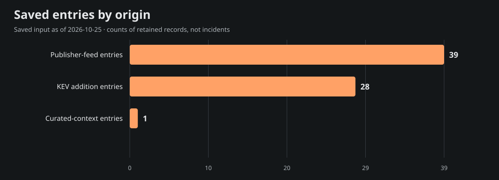
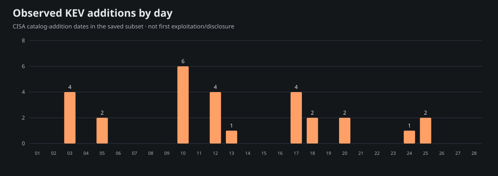
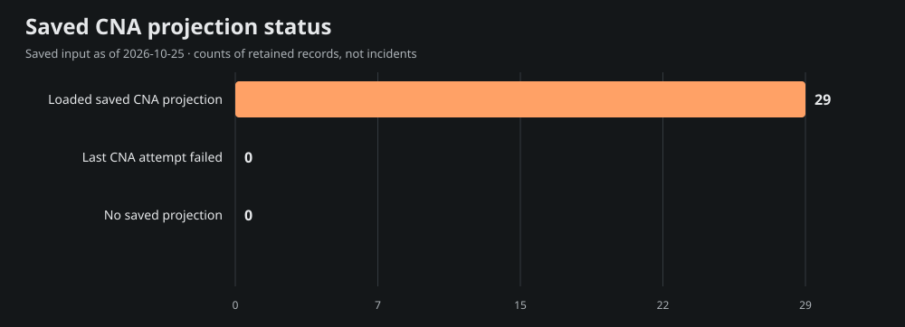

# Team Star Wolf Intelligence Hub
## February 2026 · retrospective

**Edition:** SW-MONTHLY-2026-02-RETRO · **Coverage:** selective, incomplete saved-source subset

**Period:** 2026-02-01T00:00:00-06:00 inclusive to 2026-03-01T00:00:00-06:00 exclusive (America/Chicago).

**Compiled:** 2026-10-25T21:55:23.373Z · **Input generated:** 2026-10-25T21:13:41+00:00 · **Captured:** 2026-10-25T21:29:50.108068Z

This is a retrospective compilation. A closed calendar period does not imply complete evidence. Saved entries, curated context and CNA projections are attributed below; no primary article or CNA record was fetched or independently verified for this edition.

## 1. Executive summary

The admitted saved subset contains **68 entries**: 39 publisher-feed entries, 28 CISA KEV catalog-addition entries and 1 curated-context entry. These mention **29 distinct CVE IDs**; they are not counts of incidents, newly disclosed vulnerabilities, exploited systems or affected devices.

The 6 selected developments below emphasize saved curated context, advisory metadata and dated KEV additions. Selection is bounded and source-based rather than a severity/risk ranking. The report samples 15 of 29 mentioned CVEs for current saved product, score and mitigation context; full entry/cohort/chart data are in [data.json](<https://github.com/TeamStarWolf/intelligence-hub/blob/main/reports/monthly/2026-02/data.json>).

Saved curated context highlights [ESET analyzes PromptSpy's model-assisted Android persistence](<https://www.welivesecurity.com/en/eset-research/promptspy-ushers-in-era-android-threats-using-genai/>). These remain the saved curation’s source-attributed account, including any later-update caveats; they are not claims that the whole account was known during the historical period.

|Metric|Observed value|Meaning|
|---|---:|---|
|Saved entries|68|Canonical-URL rows in the selected date recipe|
|Unique mentioned CVEs|29|Union of IDs, not newly published CVEs|
|KEV additions|28|Catalog-addition rows, not first exploitation|
|Aware timestamps|39|Chicago-aware instant membership|
|Date-only rows|29|Literal calendar precision; timezone unknown|
|Cutoff-date rows with unknown time|0|Included calendar-overlap rows, not exact-time evidence|

## 2. Selected source-attributed developments

Up to 10 entries are selected; 6 qualify under this saved-source selection recipe. A headline or CVE mention is a source lead, not a directly re-read incident narrative.

### 1. ESET analyzes PromptSpy's model-assisted Android persistence

- **Saved source:** [ESET Research](<https://www.welivesecurity.com/en/eset-research/promptspy-ushers-in-era-android-threats-using-genai/>) · curated source context · research
- **Recorded date:** 2026-02-19 · publication · calendar-day precision
- **CVE mentions:** None projected; no ID inferred from this title.
- **Saved exploitation label:** unknown; a mention alone is not exploitation evidence.
- **Saved curation context, observed October 25:** ESET analyzes Android malware that asks Gemini for UI actions supporting persistence and includes remote-access functionality. ESET had not observed PromptSpy in its telemetry and considers a proof of concept possible. This is research evidence, not confirmed widespread deployment.

### 2. CVE-2022-20775 · Cisco SD-WAN Path Traversal Vulnerability

- **Saved source:** [CISA Known Exploited Vulnerabilities](<https://www.cisa.gov/known-exploited-vulnerabilities-catalog?field_cve=CVE-2022-20775>) · saved Hub entry · kev
- **Recorded date:** 2026-02-25 · CISA catalog addition · calendar-day precision
- **CVE mentions:** CVE-2022-20775
- **Saved exploitation label:** known; a mention alone is not exploitation evidence.
- **Context limit:** Saved headline/metadata only; no article-body facts, actor attribution or remediation are inferred.

### 3. CVE-2026-20127 · Cisco Catalyst SD-WAN Controller and Manager Authentication Bypass Vulnerability

- **Saved source:** [CISA Known Exploited Vulnerabilities](<https://www.cisa.gov/known-exploited-vulnerabilities-catalog?field_cve=CVE-2026-20127>) · saved Hub entry · kev
- **Recorded date:** 2026-02-25 · CISA catalog addition · calendar-day precision
- **CVE mentions:** CVE-2026-20127
- **Saved exploitation label:** known; a mention alone is not exploitation evidence.
- **Context limit:** Saved headline/metadata only; no article-body facts, actor attribution or remediation are inferred.

### 4. CVE-2026-25108 · Soliton Systems K.K FileZen OS Command Injection Vulnerability

- **Saved source:** [CISA Known Exploited Vulnerabilities](<https://www.cisa.gov/known-exploited-vulnerabilities-catalog?field_cve=CVE-2026-25108>) · saved Hub entry · kev
- **Recorded date:** 2026-02-24 · CISA catalog addition · calendar-day precision
- **CVE mentions:** CVE-2026-25108
- **Saved exploitation label:** known; a mention alone is not exploitation evidence.
- **Context limit:** Saved headline/metadata only; no article-body facts, actor attribution or remediation are inferred.

### 5. Active exploitation of Cisco Catalyst SD-WAN by UAT-8616

- **Saved source:** [Cisco Talos Threat Advisory (category subset)](<https://blog.talosintelligence.com/uat-8616-sd-wan/>) · saved Hub entry · research
- **Recorded date:** 2026-02-25T16:13:36+00:00 · publication · timestamp with offset
- **CVE mentions:** CVE-2022-20775, CVE-2026-20127
- **Saved exploitation label:** unknown; a mention alone is not exploitation evidence.
- **Context limit:** Saved headline/metadata only; no article-body facts, actor attribution or remediation are inferred.

### 6. Apache ActiveMQ Exploit Leads to LockBit Ransomware

- **Saved source:** [The DFIR Report](<https://thedfirreport.com/2026/02/23/apache-activemq-exploit-leads-to-lockbit-ransomware/>) · saved Hub entry · research
- **Recorded date:** 2026-02-23T14:09:43+00:00 · publication · timestamp with offset
- **CVE mentions:** CVE-2023-46604
- **Saved exploitation label:** unknown; a mention alone is not exploitation evidence.
- **Context limit:** Saved headline/metadata only; no article-body facts, actor attribution or remediation are inferred.

## 3. CISA KEV additions and CVE context

The saved input contains **28** KEV catalog-addition rows in this period. Catalog addition is separate from initial disclosure, first exploitation and the CVE identifier’s year. These are current-catalog observations captured October 25, not a frozen catalog from the historical month.

Showing 28 of 28 rows below; all admitted rows are retained in data.json.

|Added|CVE|Saved vendor/product tags|Current saved federal due date|
|---|---|---|---|
|2026-02-25|[CVE-2022-20775](<https://www.cisa.gov/known-exploited-vulnerabilities-catalog?field_cve=CVE-2022-20775>)|Cisco · SD-WAN|2026-02-27|
|2026-02-25|[CVE-2026-20127](<https://www.cisa.gov/known-exploited-vulnerabilities-catalog?field_cve=CVE-2026-20127>)|Cisco · Catalyst SD-WAN Controller and Manager|2026-02-27|
|2026-02-24|[CVE-2026-25108](<https://www.cisa.gov/known-exploited-vulnerabilities-catalog?field_cve=CVE-2026-25108>)|Soliton Systems K.K · FileZen|2026-03-17|
|2026-02-20|[CVE-2025-49113](<https://www.cisa.gov/known-exploited-vulnerabilities-catalog?field_cve=CVE-2025-49113>)|Roundcube · Webmail|2026-03-13|
|2026-02-20|[CVE-2025-68461](<https://www.cisa.gov/known-exploited-vulnerabilities-catalog?field_cve=CVE-2025-68461>)|Roundcube · Webmail|2026-03-13|
|2026-02-18|[CVE-2021-22175](<https://www.cisa.gov/known-exploited-vulnerabilities-catalog?field_cve=CVE-2021-22175>)|GitLab · GitLab|2026-03-11|
|2026-02-18|[CVE-2026-22769](<https://www.cisa.gov/known-exploited-vulnerabilities-catalog?field_cve=CVE-2026-22769>)|Dell · RecoverPoint for Virtual Machines (RP4VMs)|2026-02-21|
|2026-02-17|[CVE-2008-0015](<https://www.cisa.gov/known-exploited-vulnerabilities-catalog?field_cve=CVE-2008-0015>)|Microsoft · Windows|2026-03-10|
|2026-02-17|[CVE-2020-7796](<https://www.cisa.gov/known-exploited-vulnerabilities-catalog?field_cve=CVE-2020-7796>)|Synacor · Zimbra Collaboration Suite|2026-03-10|
|2026-02-17|[CVE-2024-7694](<https://www.cisa.gov/known-exploited-vulnerabilities-catalog?field_cve=CVE-2024-7694>)|TeamT5 · ThreatSonar Anti-Ransomware|2026-03-10|
|2026-02-17|[CVE-2026-2441](<https://www.cisa.gov/known-exploited-vulnerabilities-catalog?field_cve=CVE-2026-2441>)|Google · Chromium|2026-03-10|
|2026-02-13|[CVE-2026-1731](<https://www.cisa.gov/known-exploited-vulnerabilities-catalog?field_cve=CVE-2026-1731>)|BeyondTrust · Remote Support (RS) and Privileged Remote Access (PRA)|2026-02-16|
|2026-02-12|[CVE-2024-43468](<https://www.cisa.gov/known-exploited-vulnerabilities-catalog?field_cve=CVE-2024-43468>)|Microsoft · Configuration Manager|2026-03-05|
|2026-02-12|[CVE-2025-15556](<https://www.cisa.gov/known-exploited-vulnerabilities-catalog?field_cve=CVE-2025-15556>)|Notepad++ · Notepad++|2026-03-05|
|2026-02-12|[CVE-2025-40536](<https://www.cisa.gov/known-exploited-vulnerabilities-catalog?field_cve=CVE-2025-40536>)|SolarWinds · Web Help Desk|2026-02-15|
|2026-02-12|[CVE-2026-20700](<https://www.cisa.gov/known-exploited-vulnerabilities-catalog?field_cve=CVE-2026-20700>)|Apple · Multiple Products|2026-03-05|
|2026-02-10|[CVE-2026-21510](<https://www.cisa.gov/known-exploited-vulnerabilities-catalog?field_cve=CVE-2026-21510>)|Microsoft · Windows|2026-03-03|
|2026-02-10|[CVE-2026-21513](<https://www.cisa.gov/known-exploited-vulnerabilities-catalog?field_cve=CVE-2026-21513>)|Microsoft · Windows|2026-03-03|
|2026-02-10|[CVE-2026-21514](<https://www.cisa.gov/known-exploited-vulnerabilities-catalog?field_cve=CVE-2026-21514>)|Microsoft · Office|2026-03-03|
|2026-02-10|[CVE-2026-21519](<https://www.cisa.gov/known-exploited-vulnerabilities-catalog?field_cve=CVE-2026-21519>)|Microsoft · Windows|2026-03-03|
|2026-02-10|[CVE-2026-21525](<https://www.cisa.gov/known-exploited-vulnerabilities-catalog?field_cve=CVE-2026-21525>)|Microsoft · Windows|2026-03-03|
|2026-02-10|[CVE-2026-21533](<https://www.cisa.gov/known-exploited-vulnerabilities-catalog?field_cve=CVE-2026-21533>)|Microsoft · Windows|2026-03-03|
|2026-02-05|[CVE-2025-11953](<https://www.cisa.gov/known-exploited-vulnerabilities-catalog?field_cve=CVE-2025-11953>)|React Native Community · CLI|2026-02-26|
|2026-02-05|[CVE-2026-24423](<https://www.cisa.gov/known-exploited-vulnerabilities-catalog?field_cve=CVE-2026-24423>)|SmarterTools · SmarterMail|2026-02-26|
|2026-02-03|[CVE-2019-19006](<https://www.cisa.gov/known-exploited-vulnerabilities-catalog?field_cve=CVE-2019-19006>)|Sangoma · FreePBX|2026-02-24|
|2026-02-03|[CVE-2021-39935](<https://www.cisa.gov/known-exploited-vulnerabilities-catalog?field_cve=CVE-2021-39935>)|GitLab · Community and Enterprise Editions|2026-02-24|
|2026-02-03|[CVE-2025-40551](<https://www.cisa.gov/known-exploited-vulnerabilities-catalog?field_cve=CVE-2025-40551>)|SolarWinds · Web Help Desk|2026-02-06|
|2026-02-03|[CVE-2025-64328](<https://www.cisa.gov/known-exploited-vulnerabilities-catalog?field_cve=CVE-2025-64328>)|Sangoma · FreePBX|2026-02-24|

Federal due dates are source catalog data, not deadlines assigned to this site’s visitors. Ransomware and exploitation assertions, where supplied, remain source-scoped in data.json.

### Current saved CNA sample

These 15 sampled projections are current context from the saved input. Their record-state, retrieval/update/attempt clocks and CNA score version remain explicit. Loaded projections can include rejected records; failed enrichment may retain older successful content. No source record was re-read for this report.

|CVE|Projection / record state|Saved CVSS|Saved guidance status|
|---|---|---|---|
|[CVE-2022-20775](<https://www.cve.org/CVERecord?id=CVE-2022-20775>)|ok / PUBLISHED|7.8 (v3.1; saved CNA metric)|cisa-action|
|[CVE-2026-20127](<https://www.cve.org/CVERecord?id=CVE-2026-20127>)|ok / PUBLISHED|10 (v3.1; saved CNA metric)|cisa-action|
|[CVE-2026-25108](<https://www.cve.org/CVERecord?id=CVE-2026-25108>)|ok / PUBLISHED|8.7 (v4.0; saved CNA metric)|cisa-action|
|[CVE-2023-46604](<https://www.cve.org/CVERecord?id=CVE-2023-46604>)|ok / PUBLISHED|10 (v3.1; saved CNA metric)|cisa-action|
|[CVE-2008-0015](<https://www.cve.org/CVERecord?id=CVE-2008-0015>)|ok / PUBLISHED|Not supplied in saved projection|cisa-action|
|[CVE-2019-19006](<https://www.cve.org/CVERecord?id=CVE-2019-19006>)|ok / PUBLISHED|Not supplied in saved projection|cisa-action|
|[CVE-2020-7796](<https://www.cve.org/CVERecord?id=CVE-2020-7796>)|ok / PUBLISHED|Not supplied in saved projection|cisa-action|
|[CVE-2021-22175](<https://www.cve.org/CVERecord?id=CVE-2021-22175>)|ok / PUBLISHED|6.8 (v3.1; saved CNA metric)|cisa-action|
|[CVE-2021-39935](<https://www.cve.org/CVERecord?id=CVE-2021-39935>)|ok / PUBLISHED|6.8 (v3.1; saved CNA metric)|cisa-action|
|[CVE-2024-43468](<https://www.cve.org/CVERecord?id=CVE-2024-43468>)|ok / PUBLISHED|9.8 (v3.1; saved CNA metric)|cisa-action|
|[CVE-2024-7694](<https://www.cve.org/CVERecord?id=CVE-2024-7694>)|ok / PUBLISHED|7.2 (v3.1; saved CNA metric)|publisher-guidance|
|[CVE-2025-11953](<https://www.cve.org/CVERecord?id=CVE-2025-11953>)|ok / PUBLISHED|9.8 (v3.1; saved CNA metric)|cisa-action|
|[CVE-2025-15556](<https://www.cve.org/CVERecord?id=CVE-2025-15556>)|ok / PUBLISHED|7.7 (v4.0; saved CNA metric)|cisa-action|
|[CVE-2025-40536](<https://www.cve.org/CVERecord?id=CVE-2025-40536>)|ok / PUBLISHED|8.1 (v3.1; saved CNA metric)|publisher-guidance|
|[CVE-2025-40551](<https://www.cve.org/CVERecord?id=CVE-2025-40551>)|ok / PUBLISHED|9.8 (v3.1; saved CNA metric)|publisher-guidance|

## 4. Campaigns and actors

**not_projected.** Schema 4 supplied no structured actor/campaign entity or relationship projection. Names in saved headlines, research or curated prose are not promoted into attribution, aliases or ATT&CK/CAPEC relationships. This does not establish that no campaign occurred.

## 5. Supply chain and AI security

Only exact saved tags select the following topic leads; this is not inferred impact or attack taxonomy.

- [ESET analyzes PromptSpy's model-assisted Android persistence](<https://www.welivesecurity.com/en/eset-research/promptspy-ushers-in-era-android-threats-using-genai/>) — saved tags: ai-security; curated source context.
  Saved curation context: ESET analyzes Android malware that asks Gemini for UI actions supporting persistence and includes remote-access functionality. ESET had not observed PromptSpy in its telemetry and considers a proof of concept possible. This is research evidence, not confirmed widespread deployment.

## 6. Mitigation and product context

This is current saved projection context, not patch verification or knowledge backdated into the report month. Exact installed versions/configuration were not assessed. Full bounded product/version statements, source links and saved analysis steps are in data.json. CWE, CAPEC and actor fields are **not_projected**, rather than empty-proof of no weakness or attack pattern.

### CVE-2022-20775

- **Current saved state:** ok / PUBLISHED; 7.8 (v3.1; saved CNA metric).
- **Clocks:** retrieved 2026-10-24T22:24:52+00:00; record updated 2026-03-02T13:12:09+00:00; attempted 2026-10-24T22:24:51+00:00.
- **Saved product labels:** Cisco / Cisco Catalyst SD-WAN; Cisco / Cisco Catalyst SD-WAN Manager; Cisco / Cisco SD-WAN vContainer (first 3 shown; full bounded projection in data.json)
- **Saved CISA action excerpt (shortened):** Please adhere to CISA’s guidelines to assess exposure and mitigate risks associated with Cisco SD-WAN devices as outlines in CISA’s Emergency Directive 26-03 (URL listed below in Notes) and CISA’s “Hunt &amp; Hardening Guidance for Cisco SD-WAN Devices (URL listed below in Notes). Adhere to the applicable BOD 22-01 guidance for cloud services or discontinue use…
- **Source pointer:** [Saved record reference](<https://www.cve.org/CVERecord?id=CVE-2022-20775>). No direct source review or environment applicability is established.

### CVE-2026-20127

- **Current saved state:** ok / PUBLISHED; 10 (v3.1; saved CNA metric).
- **Clocks:** retrieved 2026-10-24T22:24:21+00:00; record updated 2026-06-16T17:57:59+00:00; attempted 2026-10-24T22:24:21+00:00.
- **Saved product labels:** Cisco / Cisco Catalyst SD-WAN Manager 
- **Saved CISA action excerpt (shortened):** Please adhere to CISA’s guidelines to assess exposure and mitigate risks associated with Cisco SD-WAN devices as outlines in CISA’s Emergency Directive 26-03 (URL listed below in Notes) and CISA’s “Hunt &amp; Hardening Guidance for Cisco SD-WAN Devices (URL listed below in Notes). Adhere to the applicable BOD 22-01 guidance for cloud services or discontinue use…
- **Source pointer:** [Saved record reference](<https://www.cve.org/CVERecord?id=CVE-2026-20127>). No direct source review or environment applicability is established.

### CVE-2026-25108

- **Current saved state:** ok / PUBLISHED; 8.7 (v4.0; saved CNA metric).
- **Clocks:** retrieved 2026-10-24T22:24:18+00:00; record updated 2026-02-26T14:44:20+00:00; attempted 2026-10-24T22:24:18+00:00.
- **Saved product labels:** Soliton Systems K.K. / FileZen; Soliton Systems K.K. / FileZen 
- **Saved CISA action excerpt:** Apply mitigations per vendor instructions, follow applicable BOD 22-01 guidance for cloud services, or discontinue use of the product if mitigations are unavailable.
- **Source pointer:** [Saved record reference](<https://www.cve.org/CVERecord?id=CVE-2026-25108>). No direct source review or environment applicability is established.

### CVE-2023-46604

- **Current saved state:** ok / PUBLISHED; 10 (v3.1; saved CNA metric).
- **Clocks:** retrieved 2026-10-24T22:24:42+00:00; record updated 2025-11-03T21:50:00+00:00; attempted 2026-10-24T22:24:42+00:00.
- **Saved product labels:** Apache Software Foundation / Apache ActiveMQ; Apache Software Foundation / Apache ActiveMQ Legacy OpenWire Module 
- **Saved CISA action excerpt:** Apply mitigations per vendor instructions or discontinue use of the product if mitigations are unavailable.
- **Source pointer:** [Saved record reference](<https://www.cve.org/CVERecord?id=CVE-2023-46604>). No direct source review or environment applicability is established.

### CVE-2008-0015

- **Current saved state:** ok / PUBLISHED; Not supplied in saved projection.
- **Clocks:** retrieved 2026-10-24T23:19:15+00:00; record updated 2026-02-18T04:56:26+00:00; attempted 2026-10-24T23:19:15+00:00.
- **Saved product labels:** n/a / n/a 
- **Saved CISA action excerpt:** Apply mitigations per vendor instructions, follow applicable BOD 22-01 guidance for cloud services, or discontinue use of the product if mitigations are unavailable.
- **Source pointer:** [Saved record reference](<https://www.cve.org/CVERecord?id=CVE-2008-0015>). No direct source review or environment applicability is established.

### CVE-2019-19006

- **Current saved state:** ok / PUBLISHED; Not supplied in saved projection.
- **Clocks:** retrieved 2026-10-24T22:25:08+00:00; record updated 2026-02-03T17:20:23+00:00; attempted 2026-10-24T22:25:07+00:00.
- **Saved product labels:** n/a / n/a 
- **Saved CISA action excerpt:** Apply mitigations per vendor instructions, follow applicable BOD 22-01 guidance for cloud services, or discontinue use of the product if mitigations are unavailable.
- **Source pointer:** [Saved record reference](<https://www.cve.org/CVERecord?id=CVE-2019-19006>). No direct source review or environment applicability is established.

### CVE-2020-7796

- **Current saved state:** ok / PUBLISHED; Not supplied in saved projection.
- **Clocks:** retrieved 2026-10-24T22:25:01+00:00; record updated 2026-02-18T04:56:25+00:00; attempted 2026-10-24T22:25:01+00:00.
- **Saved product labels:** n/a / n/a 
- **Saved CISA action excerpt:** Apply mitigations per vendor instructions, follow applicable BOD 22-01 guidance for cloud services, or discontinue use of the product if mitigations are unavailable.
- **Source pointer:** [Saved record reference](<https://www.cve.org/CVERecord?id=CVE-2020-7796>). No direct source review or environment applicability is established.

### CVE-2021-22175

- **Current saved state:** ok / PUBLISHED; 6.8 (v3.1; saved CNA metric).
- **Clocks:** retrieved 2026-10-24T22:24:59+00:00; record updated 2026-10-01T18:12:57+00:00; attempted 2026-10-24T22:24:59+00:00.
- **Saved product labels:** GitLab / GitLab 
- **Saved CISA action excerpt:** Apply mitigations per vendor instructions, follow applicable BOD 22-01 guidance for cloud services, or discontinue use of the product if mitigations are unavailable.
- **Source pointer:** [Saved record reference](<https://www.cve.org/CVERecord?id=CVE-2021-22175>). No direct source review or environment applicability is established.

### CVE-2021-39935

- **Current saved state:** ok / PUBLISHED; 6.8 (v3.1; saved CNA metric).
- **Clocks:** retrieved 2026-10-24T22:24:54+00:00; record updated 2026-02-03T17:20:23+00:00; attempted 2026-10-24T22:24:53+00:00.
- **Saved product labels:** GitLab / GitLab 
- **Saved CISA action excerpt:** Apply mitigations per vendor instructions, follow applicable BOD 22-01 guidance for cloud services, or discontinue use of the product if mitigations are unavailable.
- **Source pointer:** [Saved record reference](<https://www.cve.org/CVERecord?id=CVE-2021-39935>). No direct source review or environment applicability is established.

### CVE-2024-43468

- **Current saved state:** ok / PUBLISHED; 9.8 (v3.1; saved CNA metric).
- **Clocks:** retrieved 2026-10-24T22:24:37+00:00; record updated 2026-08-19T16:26:47+00:00; attempted 2026-10-24T22:24:37+00:00.
- **Saved product labels:** Microsoft / Microsoft Configuration Manager 
- **Saved CISA action excerpt:** Apply mitigations per vendor instructions, follow applicable BOD 22-01 guidance for cloud services, or discontinue use of the product if mitigations are unavailable.
- **Source pointer:** [Saved record reference](<https://www.cve.org/CVERecord?id=CVE-2024-43468>). No direct source review or environment applicability is established.

### CVE-2024-7694

- **Current saved state:** ok / PUBLISHED; 7.2 (v3.1; saved CNA metric).
- **Clocks:** retrieved 2026-10-24T22:24:35+00:00; record updated 2026-02-18T04:56:25+00:00; attempted 2026-10-24T22:24:35+00:00.
- **Saved product labels:** TeamT5 / ThreatSonar Anti-Ransomware 
- **Saved CISA action excerpt:** Apply mitigations per vendor instructions, follow applicable BOD 22-01 guidance for cloud services, or discontinue use of the product if mitigations are unavailable.
- **Saved publisher solution excerpt:** Update to version 3.5.0 or later, or install the patch Hotfix-20240715.
- **Source pointer:** [Saved record reference](<https://www.cve.org/CVERecord?id=CVE-2024-7694>). No direct source review or environment applicability is established.

### CVE-2025-11953

- **Current saved state:** ok / PUBLISHED; 9.8 (v3.1; saved CNA metric).
- **Clocks:** retrieved 2026-10-24T22:24:34+00:00; record updated 2026-02-26T17:47:39+00:00; attempted 2026-10-24T22:24:34+00:00.
- **Saved product labels:** Not stated / @react-native-community/cli-server-api 
- **Saved CISA action excerpt:** Apply mitigations per vendor instructions, follow applicable BOD 22-01 guidance for cloud services, or discontinue use of the product if mitigations are unavailable.
- **Source pointer:** [Saved record reference](<https://www.cve.org/CVERecord?id=CVE-2025-11953>). No direct source review or environment applicability is established.

### CVE-2025-15556

- **Current saved state:** ok / PUBLISHED; 7.7 (v4.0; saved CNA metric).
- **Clocks:** retrieved 2026-10-24T22:24:34+00:00; record updated 2026-03-05T01:29:51+00:00; attempted 2026-10-24T22:24:34+00:00.
- **Saved product labels:** notepad-plus-plus / notepad-plus-plus 
- **Saved CISA action excerpt:** Apply mitigations per vendor instructions, follow applicable BOD 22-01 guidance for cloud services, or discontinue use of the product if mitigations are unavailable.
- **Source pointer:** [Saved record reference](<https://www.cve.org/CVERecord?id=CVE-2025-15556>). No direct source review or environment applicability is established.

### CVE-2025-40536

- **Current saved state:** ok / PUBLISHED; 8.1 (v3.1; saved CNA metric).
- **Clocks:** retrieved 2026-10-24T22:24:30+00:00; record updated 2026-02-26T15:04:49+00:00; attempted 2026-10-24T22:24:30+00:00.
- **Saved product labels:** SolarWinds / Web Help Desk 
- **Saved CISA action excerpt:** Apply mitigations per vendor instructions, follow applicable BOD 22-01 guidance for cloud services, or discontinue use of the product if mitigations are unavailable.
- **Saved publisher solution excerpt:** SolarWinds recommends customers upgrade to Web Help Desk version 2026.1.
- **Source pointer:** [Saved record reference](<https://www.cve.org/CVERecord?id=CVE-2025-40536>). No direct source review or environment applicability is established.

### CVE-2025-40551

- **Current saved state:** ok / PUBLISHED; 9.8 (v3.1; saved CNA metric).
- **Clocks:** retrieved 2026-10-24T22:24:30+00:00; record updated 2026-10-07T17:55:29+00:00; attempted 2026-10-24T22:24:30+00:00.
- **Saved product labels:** SolarWinds / Web Help Desk 
- **Saved CISA action excerpt:** Apply mitigations per vendor instructions, follow applicable BOD 22-01 guidance for cloud services, or discontinue use of the product if mitigations are unavailable.
- **Saved publisher solution excerpt:** SolarWinds recommends customers upgrade to Web Help Desk version 2026.1.
- **Source pointer:** [Saved record reference](<https://www.cve.org/CVERecord?id=CVE-2025-40551>). No direct source review or environment applicability is established.

## 7. Changes to prior reporting

**Revision watch: not_run · no_baseline.** No primary citation was rechecked and no material-change claim is made. The 48–96-hour citation review policy remains planned; raw hashes or timestamps alone would not prove a material security change.

## 8. Watchlist for the next review

- The saved input provides loaded projections for all 29 mentioned CVEs. A source-review priority is whether publisher conditions changed after the displayed clocks; no such check is recorded here.
- Review primary conditions for the 15 sampled CVEs; their saved retrieval/update clocks describe current context, not what was known in 2026-02.
- Actor/CWE/CAPEC mapping and prior-source revision checks remain unprojected/not run; no attribution or material-change claim is made.

Next nominal report/review cycle: **2026-10-25T22:00:00-05:00** (2026-10-26T03:00:00.000Z). **Planned; activation not verified for this edition.** Individual citation eligibility/caps/cooldowns may defer a source; this is not an on-time delivery or all-articles-checked promise.

## 9. Coverage and limitations

The whole input saved 62 source ledgers:54 ok,7 partial and1 failed. These describe last saved attempts around input generation, **not source health during 2026-02**. Source-specific period rows and origin dimensions are in data.json. The whole input window was 2016-10-25 through 2026-10-25, with bounded retained feed history.

- Saved publisher headlines and curated summaries are source-attributed leads, not direct article-body fact verification.
- Counts describe a bounded retained public subset, not all incidents, newly disclosed vulnerabilities, attacks or exposed systems.
- KEV addition dates identify catalog additions, not first disclosure/exploitation; current catalog membership can differ from a historical catalog.
- Input observed October 25; individual CNA update/retrieval and source-status clocks are retained separately and are not backdated into the report period.
- The 60 globally missing primary dates remain unassigned; failed/partial feed intake and bounded retention create coverage gaps.
- Date-only records retain calendar precision and unknown timezone; October cutoff-day records have unknown time relative to the exact MTD cutoff.
- No private account/social metrics, environment inventory, raw primary sources, actor aliases, inferred CWE/CAPEC links or oldW43 claims are included.
- Next nominal report/review cycle is planned until separate activation/readback; no unattended timing or per-source fetch guarantee.

**Date recipe:** aware timestamps use America/Chicago instant membership in the stated half-open period; date-only rows retain their literal calendar date/timezone unknown. Missing dates are globally unassigned. October MTD admits cutoff-date-only rows as calendar overlap with exact time unknown. Source event/publication/KEV dates are not interchangeable.

**Chart recipes:** every plotted row, unit, as-of clock and evidence ID is in data.json. Charts use actual admitted counts; no November/December future bars or social/account metrics are generated.

## 10. Primary-first source pointers

Input: [Saved Intelligence Hub snapshot](<https://teamstarwolf.github.io/intelligence-hub/data/feed.json>) · schema 4 · SHA-256 `eb44f9aaa505efe604fb2f17c88397dec08fc77d00d554dc096ab720573f4199`. Captured 2026-10-25T21:29:50.108068Z, generated 2026-10-25T21:13:41+00:00. Structural qualification is not a raw-primary-article/CNA truth claim.

- [Saved Intelligence Hub input](<https://teamstarwolf.github.io/intelligence-hub/data/feed.json>) — saved\_hub\_entry / input
- [CISA KEV catalog reference](<https://www.cisa.gov/known-exploited-vulnerabilities-catalog>) — saved\_hub\_entry / catalog
- [CVE-2022-20775 saved record reference](<https://www.cve.org/CVERecord?id=CVE-2022-20775>) — CNA\_projection / record
- [CVE-2026-20127 saved record reference](<https://www.cve.org/CVERecord?id=CVE-2026-20127>) — CNA\_projection / record
- [CVE-2026-25108 saved record reference](<https://www.cve.org/CVERecord?id=CVE-2026-25108>) — CNA\_projection / record
- [CVE-2023-46604 saved record reference](<https://www.cve.org/CVERecord?id=CVE-2023-46604>) — CNA\_projection / record
- [CVE-2023-46604 saved publisher guidance reference](<https://activemq.apache.org/security-advisories.data/CVE-2023-46604-announcement.txt>) — CNA\_projection / guidance
- [CVE-2008-0015 saved record reference](<https://www.cve.org/CVERecord?id=CVE-2008-0015>) — CNA\_projection / record
- [CVE-2008-0015 saved publisher guidance reference](<https://docs.microsoft.com/en-us/security-updates/securitybulletins/2009/ms09-032>) — CNA\_projection / guidance
- [CVE-2019-19006 saved record reference](<https://www.cve.org/CVERecord?id=CVE-2019-19006>) — CNA\_projection / record
- [CVE-2020-7796 saved record reference](<https://www.cve.org/CVERecord?id=CVE-2020-7796>) — CNA\_projection / record
- [CVE-2021-22175 saved record reference](<https://www.cve.org/CVERecord?id=CVE-2021-22175>) — CNA\_projection / record
- [CVE-2021-39935 saved record reference](<https://www.cve.org/CVERecord?id=CVE-2021-39935>) — CNA\_projection / record
- [CVE-2024-43468 saved record reference](<https://www.cve.org/CVERecord?id=CVE-2024-43468>) — CNA\_projection / record
- [CVE-2024-43468 saved publisher guidance reference](<https://msrc.microsoft.com/update-guide/vulnerability/CVE-2024-43468>) — CNA\_projection / guidance
- [CVE-2024-7694 saved record reference](<https://www.cve.org/CVERecord?id=CVE-2024-7694>) — CNA\_projection / record
- [CVE-2025-11953 saved record reference](<https://www.cve.org/CVERecord?id=CVE-2025-11953>) — CNA\_projection / record
- [CVE-2025-11953 saved publisher guidance reference](<https://github.com/react-native-community/cli/commit/15089907d1f1301b22c72d7f68846a2ef20df547>) — CNA\_projection / guidance
- [CVE-2025-15556 saved record reference](<https://www.cve.org/CVERecord?id=CVE-2025-15556>) — CNA\_projection / record
- [CVE-2025-15556 saved publisher guidance reference](<https://community.notepad-plus-plus.org/topic/27298/notepad-v8-8-9-vulnerability-fix>) — CNA\_projection / guidance
- [CVE-2025-40536 saved record reference](<https://www.cve.org/CVERecord?id=CVE-2025-40536>) — CNA\_projection / record
- [CVE-2025-40536 saved publisher guidance reference](<https://www.solarwinds.com/trust-center/security-advisories/CVE-2025-40536>) — CNA\_projection / guidance
- [CVE-2025-40551 saved record reference](<https://www.cve.org/CVERecord?id=CVE-2025-40551>) — CNA\_projection / record
- [CVE-2025-40551 saved publisher guidance reference](<https://www.solarwinds.com/trust-center/security-advisories/CVE-2025-40551>) — CNA\_projection / guidance
- [ESET analyzes PromptSpy's model-assisted Android persistence](<https://www.welivesecurity.com/en/eset-research/promptspy-ushers-in-era-android-threats-using-genai/>) — library\_curationsource / research
- [CVE-2022-20775 · Cisco SD-WAN Path Traversal Vulnerability](<https://www.cisa.gov/known-exploited-vulnerabilities-catalog?field_cve=CVE-2022-20775>) — saved\_hub\_entry / kev
- [CVE-2026-20127 · Cisco Catalyst SD-WAN Controller and Manager Authentication Bypass Vulnerability](<https://www.cisa.gov/known-exploited-vulnerabilities-catalog?field_cve=CVE-2026-20127>) — saved\_hub\_entry / kev
- [CVE-2026-25108 · Soliton Systems K.K FileZen OS Command Injection Vulnerability](<https://www.cisa.gov/known-exploited-vulnerabilities-catalog?field_cve=CVE-2026-25108>) — saved\_hub\_entry / kev
- [Active exploitation of Cisco Catalyst SD-WAN by UAT-8616](<https://blog.talosintelligence.com/uat-8616-sd-wan/>) — saved\_hub\_entry / research
- [Apache ActiveMQ Exploit Leads to LockBit Ransomware](<https://thedfirreport.com/2026/02/23/apache-activemq-exploit-leads-to-lockbit-ransomware/>) — saved\_hub\_entry / research

---
Data companion: [data.json](data.json). Generation and revision-check statuses describe this edition. Planned next-cycle times are not a guarantee of delivery.
