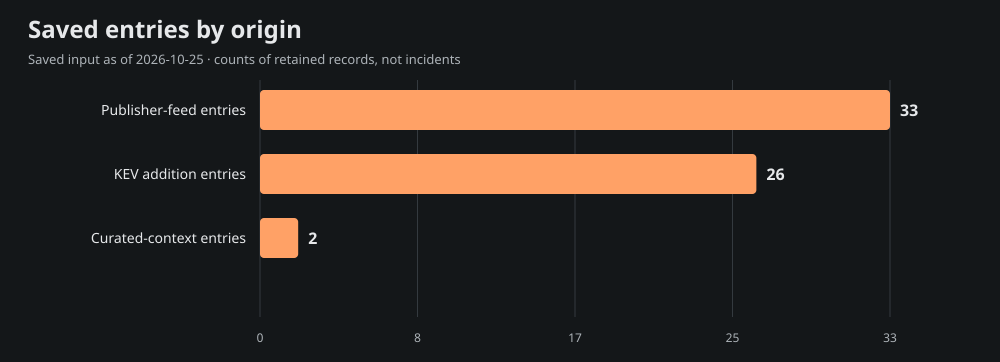
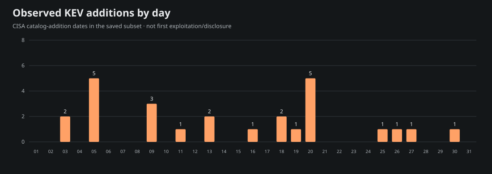
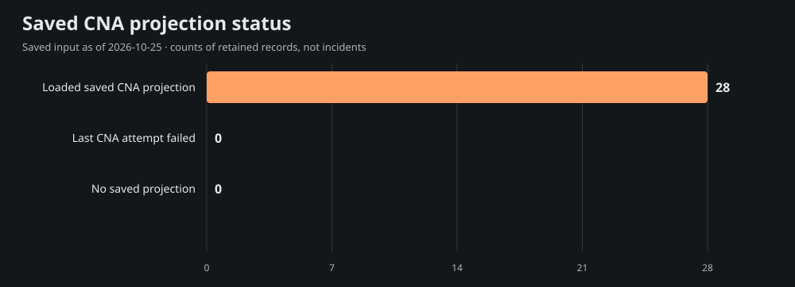

# Team Star Wolf Intelligence Hub
## March 2026 · retrospective

**Edition:** SW-MONTHLY-2026-03-RETRO · **Coverage:** selective, incomplete saved-source subset

**Period:** 2026-03-01T00:00:00-06:00 inclusive to 2026-04-01T00:00:00-05:00 exclusive (America/Chicago).

**Compiled:** 2026-10-25T21:55:23.373Z · **Input generated:** 2026-10-25T21:13:41+00:00 · **Captured:** 2026-10-25T21:29:50.108068Z

This is a retrospective compilation. A closed calendar period does not imply complete evidence. Saved entries, curated context and CNA projections are attributed below; no primary article or CNA record was fetched or independently verified for this edition.

## 1. Executive summary

The admitted saved subset contains **61 entries**: 33 publisher-feed entries, 26 CISA KEV catalog-addition entries and 2 curated-context entries. These mention **28 distinct CVE IDs**; they are not counts of incidents, newly disclosed vulnerabilities, exploited systems or affected devices.

The 7 selected developments below emphasize saved curated context, advisory metadata and dated KEV additions. Selection is bounded and source-based rather than a severity/risk ranking. The report samples 15 of 28 mentioned CVEs for current saved product, score and mitigation context; full entry/cohort/chart data are in [data.json](<https://github.com/TeamStarWolf/intelligence-hub/blob/main/reports/monthly/2026-03/data.json>).

Saved curated context highlights [LiteLLM reports compromised March PyPI releases](<https://docs.litellm.ai/blog/security-update-march-2026>); [Aqua discloses Trivy release and GitHub Action compromise](<https://github.com/aquasecurity/trivy/security/advisories/GHSA-69fq-xp46-6x23>). These remain the saved curation’s source-attributed account, including any later-update caveats; they are not claims that the whole account was known during the historical period.

|Metric|Observed value|Meaning|
|---|---:|---|
|Saved entries|61|Canonical-URL rows in the selected date recipe|
|Unique mentioned CVEs|28|Union of IDs, not newly published CVEs|
|KEV additions|26|Catalog-addition rows, not first exploitation|
|Aware timestamps|33|Chicago-aware instant membership|
|Date-only rows|28|Literal calendar precision; timezone unknown|
|Cutoff-date rows with unknown time|0|Included calendar-overlap rows, not exact-time evidence|

## 2. Selected source-attributed developments

Up to 10 entries are selected; 7 qualify under this saved-source selection recipe. A headline or CVE mention is a source lead, not a directly re-read incident narrative.

### 1. LiteLLM reports compromised March PyPI releases

- **Saved source:** [LiteLLM](<https://docs.litellm.ai/blog/security-update-march-2026>) · curated source context · incident
- **Recorded date:** 2026-03-24 · publication · calendar-day precision
- **CVE mentions:** None projected; no ID inferred from this title.
- **Saved exploitation label:** known; a mention alone is not exploitation evidence.
- **Saved curation context, observed October 25:** LiteLLM identifies malicious PyPI releases 1.82.7 and 1.82.8. Its follow-up describes a compromised CI scanning dependency and release-credential exposure. Match installed artifacts and release windows before applying the vendor's incident-response guidance.

### 2. Aqua discloses Trivy release and GitHub Action compromise

- **Saved source:** [Aqua Security](<https://github.com/aquasecurity/trivy/security/advisories/GHSA-69fq-xp46-6x23>) · curated source context · incident
- **Recorded date:** 2026-03-21 · publication · calendar-day precision
- **CVE mentions:** None projected; no ID inferred from this title.
- **Saved exploitation label:** known; a mention alone is not exploitation evidence.
- **Saved curation context, observed October 25:** Aqua's advisory describes malicious Trivy releases and altered Action tags, followed by compromised container images. Review artifact versions, digests and exposure windows against retained CI evidence; changing a mutable tag alone does not resolve potentially stolen credentials.

### 3. CVE-2026-3055 · Citrix NetScaler Out-of-Bounds Read Vulnerability

- **Saved source:** [CISA Known Exploited Vulnerabilities](<https://www.cisa.gov/known-exploited-vulnerabilities-catalog?field_cve=CVE-2026-3055>) · saved Hub entry · kev
- **Recorded date:** 2026-03-30 · CISA catalog addition · calendar-day precision
- **CVE mentions:** CVE-2026-3055
- **Saved exploitation label:** known; a mention alone is not exploitation evidence.
- **Context limit:** Saved headline/metadata only; no article-body facts, actor attribution or remediation are inferred.

### 4. CVE-2025-53521 · F5 BIG-IP Stack-Based Buffer Overflow Vulnerability

- **Saved source:** [CISA Known Exploited Vulnerabilities](<https://www.cisa.gov/known-exploited-vulnerabilities-catalog?field_cve=CVE-2025-53521>) · saved Hub entry · kev
- **Recorded date:** 2026-03-27 · CISA catalog addition · calendar-day precision
- **CVE mentions:** CVE-2025-53521
- **Saved exploitation label:** known; a mention alone is not exploitation evidence.
- **Context limit:** Saved headline/metadata only; no article-body facts, actor attribution or remediation are inferred.

### 5. CVE-2026-33634 · Aquasecurity Trivy Embedded Malicious Code Vulnerability

- **Saved source:** [CISA Known Exploited Vulnerabilities](<https://www.cisa.gov/known-exploited-vulnerabilities-catalog?field_cve=CVE-2026-33634>) · saved Hub entry · kev
- **Recorded date:** 2026-03-26 · CISA catalog addition · calendar-day precision
- **CVE mentions:** CVE-2026-33634
- **Saved exploitation label:** known; a mention alone is not exploitation evidence.
- **Context limit:** Saved headline/metadata only; no article-body facts, actor attribution or remediation are inferred.

### 6. Please, We Beg, Just One Weekend Free Of Appliances (Citrix NetScaler CVE-2026-3055 Memory Overread Part 2)

- **Saved source:** [watchTowr Labs](<https://labs.watchtowr.com/please-we-beg-just-one-weekend-free-of-appliances-citrix-netscaler-cve-2026-3055-memory-overread-part-2/>) · saved Hub entry · research
- **Recorded date:** 2026-03-29T20:07:28+00:00 · publication · timestamp with offset
- **CVE mentions:** CVE-2025-5777, CVE-2026-3055
- **Saved exploitation label:** unknown; a mention alone is not exploitation evidence.
- **Context limit:** Saved headline/metadata only; no article-body facts, actor attribution or remediation are inferred.

### 7. Looking at the SmarterMail API Vulnerability CVE-2026-24423

- **Saved source:** [F5 Labs](<https://www.f5.com/labs/articles/looking-at-the-smartermail-api-vulnerability-cve-2026-24423>) · saved Hub entry · research
- **Recorded date:** 2026-03-12T21:14:28+00:00 · publication · timestamp with offset
- **CVE mentions:** CVE-2026-24423
- **Saved exploitation label:** unknown; a mention alone is not exploitation evidence.
- **Context limit:** Saved headline/metadata only; no article-body facts, actor attribution or remediation are inferred.

## 3. CISA KEV additions and CVE context

The saved input contains **26** KEV catalog-addition rows in this period. Catalog addition is separate from initial disclosure, first exploitation and the CVE identifier’s year. These are current-catalog observations captured October 25, not a frozen catalog from the historical month.

Showing 26 of 26 rows below; all admitted rows are retained in data.json.

|Added|CVE|Saved vendor/product tags|Current saved federal due date|
|---|---|---|---|
|2026-03-30|[CVE-2026-3055](<https://www.cisa.gov/known-exploited-vulnerabilities-catalog?field_cve=CVE-2026-3055>)|Citrix · NetScaler|2026-04-02|
|2026-03-27|[CVE-2025-53521](<https://www.cisa.gov/known-exploited-vulnerabilities-catalog?field_cve=CVE-2025-53521>)|F5 · BIG-IP|2026-03-30|
|2026-03-26|[CVE-2026-33634](<https://www.cisa.gov/known-exploited-vulnerabilities-catalog?field_cve=CVE-2026-33634>)|Aquasecurity · Trivy|2026-04-09|
|2026-03-25|[CVE-2026-33017](<https://www.cisa.gov/known-exploited-vulnerabilities-catalog?field_cve=CVE-2026-33017>)|Langflow · Langflow|2026-04-08|
|2026-03-20|[CVE-2025-31277](<https://www.cisa.gov/known-exploited-vulnerabilities-catalog?field_cve=CVE-2025-31277>)|Apple · Multiple Products|2026-04-03|
|2026-03-20|[CVE-2025-32432](<https://www.cisa.gov/known-exploited-vulnerabilities-catalog?field_cve=CVE-2025-32432>)|Craft CMS · Craft CMS|2026-04-03|
|2026-03-20|[CVE-2025-43510](<https://www.cisa.gov/known-exploited-vulnerabilities-catalog?field_cve=CVE-2025-43510>)|Apple · Multiple Products|2026-04-03|
|2026-03-20|[CVE-2025-43520](<https://www.cisa.gov/known-exploited-vulnerabilities-catalog?field_cve=CVE-2025-43520>)|Apple · Multiple Products|2026-04-03|
|2026-03-20|[CVE-2025-54068](<https://www.cisa.gov/known-exploited-vulnerabilities-catalog?field_cve=CVE-2025-54068>)|Laravel · Livewire|2026-04-03|
|2026-03-19|[CVE-2026-20131](<https://www.cisa.gov/known-exploited-vulnerabilities-catalog?field_cve=CVE-2026-20131>)|Cisco · Secure Firewall Management Center (FMC)|2026-03-22|
|2026-03-18|[CVE-2025-66376](<https://www.cisa.gov/known-exploited-vulnerabilities-catalog?field_cve=CVE-2025-66376>)|Synacor · Zimbra Collaboration Suite (ZCS)|2026-04-01|
|2026-03-18|[CVE-2026-20963](<https://www.cisa.gov/known-exploited-vulnerabilities-catalog?field_cve=CVE-2026-20963>)|Microsoft · SharePoint|2026-03-21|
|2026-03-16|[CVE-2025-47813](<https://www.cisa.gov/known-exploited-vulnerabilities-catalog?field_cve=CVE-2025-47813>)|Wing FTP Server · Wing FTP Server|2026-03-30|
|2026-03-13|[CVE-2026-3909](<https://www.cisa.gov/known-exploited-vulnerabilities-catalog?field_cve=CVE-2026-3909>)|Google · Skia|2026-03-27|
|2026-03-13|[CVE-2026-3910](<https://www.cisa.gov/known-exploited-vulnerabilities-catalog?field_cve=CVE-2026-3910>)|Google · Chromium V8|2026-03-27|
|2026-03-11|[CVE-2025-68613](<https://www.cisa.gov/known-exploited-vulnerabilities-catalog?field_cve=CVE-2025-68613>)|n8n · n8n|2026-03-25|
|2026-03-09|[CVE-2021-22054](<https://www.cisa.gov/known-exploited-vulnerabilities-catalog?field_cve=CVE-2021-22054>)|Omnissa · Workspace One UEM|2026-03-23|
|2026-03-09|[CVE-2025-26399](<https://www.cisa.gov/known-exploited-vulnerabilities-catalog?field_cve=CVE-2025-26399>)|SolarWinds · Web Help Desk|2026-03-12|
|2026-03-09|[CVE-2026-1603](<https://www.cisa.gov/known-exploited-vulnerabilities-catalog?field_cve=CVE-2026-1603>)|Ivanti · Endpoint Manager (EPM)|2026-03-23|
|2026-03-05|[CVE-2017-7921](<https://www.cisa.gov/known-exploited-vulnerabilities-catalog?field_cve=CVE-2017-7921>)|Hikvision · Multiple Products|2026-03-26|
|2026-03-05|[CVE-2021-22681](<https://www.cisa.gov/known-exploited-vulnerabilities-catalog?field_cve=CVE-2021-22681>)|Rockwell · Multiple Products|2026-03-26|
|2026-03-05|[CVE-2021-30952](<https://www.cisa.gov/known-exploited-vulnerabilities-catalog?field_cve=CVE-2021-30952>)|Apple · Multiple Products|2026-03-26|
|2026-03-05|[CVE-2023-41974](<https://www.cisa.gov/known-exploited-vulnerabilities-catalog?field_cve=CVE-2023-41974>)|Apple · iOS and iPadOS|2026-03-26|
|2026-03-05|[CVE-2023-43000](<https://www.cisa.gov/known-exploited-vulnerabilities-catalog?field_cve=CVE-2023-43000>)|Apple · Multiple Products|2026-03-26|
|2026-03-03|[CVE-2026-21385](<https://www.cisa.gov/known-exploited-vulnerabilities-catalog?field_cve=CVE-2026-21385>)|Qualcomm · Multiple Chipsets|2026-03-24|
|2026-03-03|[CVE-2026-22719](<https://www.cisa.gov/known-exploited-vulnerabilities-catalog?field_cve=CVE-2026-22719>)|Broadcom · VMware Aria Operations|2026-03-24|

Federal due dates are source catalog data, not deadlines assigned to this site’s visitors. Ransomware and exploitation assertions, where supplied, remain source-scoped in data.json.

### Current saved CNA sample

These 15 sampled projections are current context from the saved input. Their record-state, retrieval/update/attempt clocks and CNA score version remain explicit. Loaded projections can include rejected records; failed enrichment may retain older successful content. No source record was re-read for this report.

|CVE|Projection / record state|Saved CVSS|Saved guidance status|
|---|---|---|---|
|[CVE-2026-3055](<https://www.cve.org/CVERecord?id=CVE-2026-3055>)|ok / PUBLISHED|9.3 (v4.0; saved CNA metric)|cisa-action|
|[CVE-2025-53521](<https://www.cve.org/CVERecord?id=CVE-2025-53521>)|ok / PUBLISHED|9.3 (v4.0; saved CNA metric)|cisa-action|
|[CVE-2026-33634](<https://www.cve.org/CVERecord?id=CVE-2026-33634>)|ok / PUBLISHED|9.4 (v4.0; saved CNA metric)|cisa-action|
|[CVE-2025-5777](<https://www.cve.org/CVERecord?id=CVE-2025-5777>)|ok / PUBLISHED|9.3 (v4.0; saved CNA metric)|cisa-action|
|[CVE-2026-24423](<https://www.cve.org/CVERecord?id=CVE-2026-24423>)|ok / PUBLISHED|9.3 (v4.0; saved CNA metric)|cisa-action|
|[CVE-2017-7921](<https://www.cve.org/CVERecord?id=CVE-2017-7921>)|ok / PUBLISHED|Not supplied in saved projection|cisa-action|
|[CVE-2021-22054](<https://www.cve.org/CVERecord?id=CVE-2021-22054>)|ok / PUBLISHED|Not supplied in saved projection|cisa-action|
|[CVE-2021-22681](<https://www.cve.org/CVERecord?id=CVE-2021-22681>)|ok / PUBLISHED|Not supplied in saved projection|cisa-action|
|[CVE-2021-30952](<https://www.cve.org/CVERecord?id=CVE-2021-30952>)|ok / PUBLISHED|Not supplied in saved projection|cisa-action|
|[CVE-2023-41974](<https://www.cve.org/CVERecord?id=CVE-2023-41974>)|ok / PUBLISHED|Not supplied in saved projection|cisa-action|
|[CVE-2023-43000](<https://www.cve.org/CVERecord?id=CVE-2023-43000>)|ok / PUBLISHED|Not supplied in saved projection|cisa-action|
|[CVE-2025-26399](<https://www.cve.org/CVERecord?id=CVE-2025-26399>)|ok / PUBLISHED|9.8 (v3.1; saved CNA metric)|publisher-guidance|
|[CVE-2025-31277](<https://www.cve.org/CVERecord?id=CVE-2025-31277>)|ok / PUBLISHED|Not supplied in saved projection|cisa-action|
|[CVE-2025-32432](<https://www.cve.org/CVERecord?id=CVE-2025-32432>)|ok / PUBLISHED|10 (v3.1; saved CNA metric)|cisa-action|
|[CVE-2025-43510](<https://www.cve.org/CVERecord?id=CVE-2025-43510>)|ok / PUBLISHED|Not supplied in saved projection|cisa-action|

## 4. Campaigns and actors

**not_projected.** Schema 4 supplied no structured actor/campaign entity or relationship projection. Names in saved headlines, research or curated prose are not promoted into attribution, aliases or ATT&CK/CAPEC relationships. This does not establish that no campaign occurred.

## 5. Supply chain and AI security

Only exact saved tags select the following topic leads; this is not inferred impact or attack taxonomy.

- [LiteLLM reports compromised March PyPI releases](<https://docs.litellm.ai/blog/security-update-march-2026>) — saved tags: supply-chain, ai-security; curated source context.
  Saved curation context: LiteLLM identifies malicious PyPI releases 1.82.7 and 1.82.8. Its follow-up describes a compromised CI scanning dependency and release-credential exposure. Match installed artifacts and release windows before applying the vendor's incident-response guidance.

- [Aqua discloses Trivy release and GitHub Action compromise](<https://github.com/aquasecurity/trivy/security/advisories/GHSA-69fq-xp46-6x23>) — saved tags: supply-chain; curated source context.
  Saved curation context: Aqua's advisory describes malicious Trivy releases and altered Action tags, followed by compromised container images. Review artifact versions, digests and exposure windows against retained CI evidence; changing a mutable tag alone does not resolve potentially stolen credentials.

## 6. Mitigation and product context

This is current saved projection context, not patch verification or knowledge backdated into the report month. Exact installed versions/configuration were not assessed. Full bounded product/version statements, source links and saved analysis steps are in data.json. CWE, CAPEC and actor fields are **not_projected**, rather than empty-proof of no weakness or attack pattern.

### CVE-2026-3055

- **Current saved state:** ok / PUBLISHED; 9.3 (v4.0; saved CNA metric).
- **Clocks:** retrieved 2026-10-24T22:24:17+00:00; record updated 2026-03-31T03:55:32+00:00; attempted 2026-10-24T22:24:17+00:00.
- **Saved product labels:** NetScaler / ADC; NetScaler / Gateway 
- **Saved CISA action excerpt:** Apply mitigations per vendor instructions, follow applicable BOD 22-01 guidance for cloud services, or discontinue use of the product if mitigations are unavailable.
- **Source pointer:** [Saved record reference](<https://www.cve.org/CVERecord?id=CVE-2026-3055>). No direct source review or environment applicability is established.

### CVE-2025-53521

- **Current saved state:** ok / PUBLISHED; 9.3 (v4.0; saved CNA metric).
- **Clocks:** retrieved 2026-10-24T22:24:29+00:00; record updated 2026-03-31T16:04:27+00:00; attempted 2026-10-24T22:24:29+00:00.
- **Saved product labels:** F5 / BIG-IP 
- **Saved CISA action excerpt:** Apply mitigations per vendor instructions, follow applicable BOD 22-01 guidance for cloud services, or discontinue use of the product if mitigations are unavailable.
- **Source pointer:** [Saved record reference](<https://www.cve.org/CVERecord?id=CVE-2025-53521>). No direct source review or environment applicability is established.

### CVE-2026-33634

- **Current saved state:** ok / PUBLISHED; 9.4 (v4.0; saved CNA metric).
- **Clocks:** retrieved 2026-10-24T22:24:17+00:00; record updated 2026-03-30T14:40:28+00:00; attempted 2026-10-24T22:24:17+00:00.
- **Saved product labels:** aquasecurity / setup-trivy; aquasecurity / trivy-action; aquasecurity / trivy (first 3 shown; full bounded projection in data.json)
- **Saved CISA action excerpt:** Apply mitigations per vendor instructions, follow applicable BOD 22-01 guidance for cloud services, or discontinue use of the product if mitigations are unavailable.
- **Source pointer:** [Saved record reference](<https://www.cve.org/CVERecord?id=CVE-2026-33634>). No direct source review or environment applicability is established.

### CVE-2025-5777

- **Current saved state:** ok / PUBLISHED; 9.3 (v4.0; saved CNA metric).
- **Clocks:** retrieved 2026-10-24T22:24:29+00:00; record updated 2026-10-07T17:58:25+00:00; attempted 2026-10-24T22:24:29+00:00.
- **Saved product labels:** NetScaler / ADC; NetScaler / Gateway 
- **Saved CISA action excerpt:** Apply mitigations per vendor instructions, follow applicable BOD 22-01 guidance for cloud services, or discontinue use of the product if mitigations are unavailable.
- **Source pointer:** [Saved record reference](<https://www.cve.org/CVERecord?id=CVE-2025-5777>). No direct source review or environment applicability is established.

### CVE-2026-24423

- **Current saved state:** ok / PUBLISHED; 9.3 (v4.0; saved CNA metric).
- **Clocks:** retrieved 2026-10-24T22:24:18+00:00; record updated 2026-08-04T03:56:04+00:00; attempted 2026-10-24T22:24:18+00:00.
- **Saved product labels:** SmarterTools / SmarterMail 
- **Saved CISA action excerpt:** Apply mitigations per vendor instructions, follow applicable BOD 22-01 guidance for cloud services, or discontinue use of the product if mitigations are unavailable.
- **Source pointer:** [Saved record reference](<https://www.cve.org/CVERecord?id=CVE-2026-24423>). No direct source review or environment applicability is established.

### CVE-2017-7921

- **Current saved state:** ok / PUBLISHED; Not supplied in saved projection.
- **Clocks:** retrieved 2026-10-24T22:25:14+00:00; record updated 2026-03-06T05:01:18+00:00; attempted 2026-10-24T22:25:14+00:00.
- **Saved product labels:** n/a / Hikvision Cameras 
- **Saved CISA action excerpt:** Apply mitigations per vendor instructions, follow applicable BOD 22-01 guidance for cloud services, or discontinue use of the product if mitigations are unavailable.
- **Source pointer:** [Saved record reference](<https://www.cve.org/CVERecord?id=CVE-2017-7921>). No direct source review or environment applicability is established.

### CVE-2021-22054

- **Current saved state:** ok / PUBLISHED; Not supplied in saved projection.
- **Clocks:** retrieved 2026-10-24T22:24:59+00:00; record updated 2026-10-01T18:11:30+00:00; attempted 2026-10-24T22:24:59+00:00.
- **Saved product labels:** n/a / VMware Workspace ONE UEM console 
- **Saved CISA action excerpt:** Apply mitigations per vendor instructions, follow applicable BOD 22-01 guidance for cloud services, or discontinue use of the product if mitigations are unavailable.
- **Source pointer:** [Saved record reference](<https://www.cve.org/CVERecord?id=CVE-2021-22054>). No direct source review or environment applicability is established.

### CVE-2021-22681

- **Current saved state:** ok / PUBLISHED; Not supplied in saved projection.
- **Clocks:** retrieved 2026-10-24T22:24:59+00:00; record updated 2026-03-06T05:01:20+00:00; attempted 2026-10-24T22:24:58+00:00.
- **Saved product labels:** n/a / Rockwell Automation Studio 5000 Logix Designer, RSLogix 5000, Logix Controllers 
- **Saved CISA action excerpt:** Apply mitigations per vendor instructions, follow applicable BOD 22-01 guidance for cloud services, or discontinue use of the product if mitigations are unavailable.
- **Source pointer:** [Saved record reference](<https://www.cve.org/CVERecord?id=CVE-2021-22681>). No direct source review or environment applicability is established.

### CVE-2021-30952

- **Current saved state:** ok / PUBLISHED; Not supplied in saved projection.
- **Clocks:** retrieved 2026-10-24T22:24:56+00:00; record updated 2026-03-06T05:01:17+00:00; attempted 2026-10-24T22:24:56+00:00.
- **Saved product labels:** Apple / watchOS; Apple / iOS and iPadOS; Apple / macOS (first 3 shown; full bounded projection in data.json)
- **Saved CISA action excerpt:** Apply mitigations per vendor instructions, follow applicable BOD 22-01 guidance for cloud services, or discontinue use of the product if mitigations are unavailable.
- **Source pointer:** [Saved record reference](<https://www.cve.org/CVERecord?id=CVE-2021-30952>). No direct source review or environment applicability is established.

### CVE-2023-41974

- **Current saved state:** ok / PUBLISHED; Not supplied in saved projection.
- **Clocks:** retrieved 2026-10-24T22:24:43+00:00; record updated 2026-03-12T00:52:05+00:00; attempted 2026-10-24T22:24:42+00:00.
- **Saved product labels:** Apple / iOS and iPadOS; Apple / iOS and iPadOS 
- **Saved CISA action excerpt:** Apply mitigations per vendor instructions, follow applicable BOD 22-01 guidance for cloud services, or discontinue use of the product if mitigations are unavailable.
- **Source pointer:** [Saved record reference](<https://www.cve.org/CVERecord?id=CVE-2023-41974>). No direct source review or environment applicability is established.

### CVE-2023-43000

- **Current saved state:** ok / PUBLISHED; Not supplied in saved projection.
- **Clocks:** retrieved 2026-10-24T22:24:42+00:00; record updated 2026-09-21T19:03:00+00:00; attempted 2026-10-24T22:24:42+00:00.
- **Saved product labels:** Apple / macOS; Apple / iOS and iPadOS; Apple / Safari (first 3 shown; full bounded projection in data.json)
- **Saved CISA action excerpt:** Apply mitigations per vendor instructions, follow applicable BOD 22-01 guidance for cloud services, or discontinue use of the product if mitigations are unavailable.
- **Source pointer:** [Saved record reference](<https://www.cve.org/CVERecord?id=CVE-2023-43000>). No direct source review or environment applicability is established.

### CVE-2025-26399

- **Current saved state:** ok / PUBLISHED; 9.8 (v3.1; saved CNA metric).
- **Clocks:** retrieved 2026-10-24T22:24:32+00:00; record updated 2026-08-04T03:55:57+00:00; attempted 2026-10-24T22:24:32+00:00.
- **Saved product labels:** SolarWinds / Web Help Desk 
- **Saved CISA action excerpt:** Apply mitigations per vendor instructions, follow applicable BOD 22-01 guidance for cloud services, or discontinue use of the product if mitigations are unavailable.
- **Saved publisher solution excerpt:** SolarWinds recommends customers to upgrade to Web Help Desk version 12.8.7 HF1 as soon as is practical.
- **Source pointer:** [Saved record reference](<https://www.cve.org/CVERecord?id=CVE-2025-26399>). No direct source review or environment applicability is established.

### CVE-2025-31277

- **Current saved state:** ok / PUBLISHED; Not supplied in saved projection.
- **Clocks:** retrieved 2026-10-24T22:24:31+00:00; record updated 2026-09-21T19:09:17+00:00; attempted 2026-10-24T22:24:31+00:00.
- **Saved product labels:** Apple / Safari; Apple / iOS and iPadOS; Apple / macOS (first 3 shown; full bounded projection in data.json)
- **Saved CISA action excerpt:** Apply mitigations per vendor instructions, follow applicable BOD 22-01 guidance for cloud services, or discontinue use of the product if mitigations are unavailable.
- **Source pointer:** [Saved record reference](<https://www.cve.org/CVERecord?id=CVE-2025-31277>). No direct source review or environment applicability is established.

### CVE-2025-32432

- **Current saved state:** ok / PUBLISHED; 10 (v3.1; saved CNA metric).
- **Clocks:** retrieved 2026-10-24T22:24:31+00:00; record updated 2026-03-21T04:00:57+00:00; attempted 2026-10-24T22:24:31+00:00.
- **Saved product labels:** craftcms / cms 
- **Saved CISA action excerpt:** Apply mitigations per vendor instructions, follow applicable BOD 22-01 guidance for cloud services, or discontinue use of the product if mitigations are unavailable.
- **Source pointer:** [Saved record reference](<https://www.cve.org/CVERecord?id=CVE-2025-32432>). No direct source review or environment applicability is established.

### CVE-2025-43510

- **Current saved state:** ok / PUBLISHED; Not supplied in saved projection.
- **Clocks:** retrieved 2026-10-24T22:24:30+00:00; record updated 2026-04-02T18:16:23+00:00; attempted 2026-10-24T22:24:30+00:00.
- **Saved product labels:** Apple / iOS and iPadOS; Apple / macOS; Apple / tvOS (first 3 shown; full bounded projection in data.json)
- **Saved CISA action excerpt:** Apply mitigations per vendor instructions, follow applicable BOD 22-01 guidance for cloud services, or discontinue use of the product if mitigations are unavailable.
- **Source pointer:** [Saved record reference](<https://www.cve.org/CVERecord?id=CVE-2025-43510>). No direct source review or environment applicability is established.

## 7. Changes to prior reporting

**Revision watch: not_run · no_baseline.** No primary citation was rechecked and no material-change claim is made. The 48–96-hour citation review policy remains planned; raw hashes or timestamps alone would not prove a material security change.

## 8. Watchlist for the next review

- The saved input provides loaded projections for all 28 mentioned CVEs. A source-review priority is whether publisher conditions changed after the displayed clocks; no such check is recorded here.
- Review primary conditions for the 15 sampled CVEs; their saved retrieval/update clocks describe current context, not what was known in 2026-03.
- Actor/CWE/CAPEC mapping and prior-source revision checks remain unprojected/not run; no attribution or material-change claim is made.

Next nominal report/review cycle: **2026-10-25T22:00:00-05:00** (2026-10-26T03:00:00.000Z). **Planned; activation not verified for this edition.** Individual citation eligibility/caps/cooldowns may defer a source; this is not an on-time delivery or all-articles-checked promise.

## 9. Coverage and limitations

The whole input saved 62 source ledgers:54 ok,7 partial and1 failed. These describe last saved attempts around input generation, **not source health during 2026-03**. Source-specific period rows and origin dimensions are in data.json. The whole input window was 2016-10-25 through 2026-10-25, with bounded retained feed history.

- Saved publisher headlines and curated summaries are source-attributed leads, not direct article-body fact verification.
- Counts describe a bounded retained public subset, not all incidents, newly disclosed vulnerabilities, attacks or exposed systems.
- KEV addition dates identify catalog additions, not first disclosure/exploitation; current catalog membership can differ from a historical catalog.
- Input observed October 25; individual CNA update/retrieval and source-status clocks are retained separately and are not backdated into the report period.
- The 60 globally missing primary dates remain unassigned; failed/partial feed intake and bounded retention create coverage gaps.
- Date-only records retain calendar precision and unknown timezone; October cutoff-day records have unknown time relative to the exact MTD cutoff.
- No private account/social metrics, environment inventory, raw primary sources, actor aliases, inferred CWE/CAPEC links or oldW43 claims are included.
- Next nominal report/review cycle is planned until separate activation/readback; no unattended timing or per-source fetch guarantee.

**Date recipe:** aware timestamps use America/Chicago instant membership in the stated half-open period; date-only rows retain their literal calendar date/timezone unknown. Missing dates are globally unassigned. October MTD admits cutoff-date-only rows as calendar overlap with exact time unknown. Source event/publication/KEV dates are not interchangeable.

**Chart recipes:** every plotted row, unit, as-of clock and evidence ID is in data.json. Charts use actual admitted counts; no November/December future bars or social/account metrics are generated.

## 10. Primary-first source pointers

Input: [Saved Intelligence Hub snapshot](<https://teamstarwolf.github.io/intelligence-hub/data/feed.json>) · schema 4 · SHA-256 `eb44f9aaa505efe604fb2f17c88397dec08fc77d00d554dc096ab720573f4199`. Captured 2026-10-25T21:29:50.108068Z, generated 2026-10-25T21:13:41+00:00. Structural qualification is not a raw-primary-article/CNA truth claim.

- [Saved Intelligence Hub input](<https://teamstarwolf.github.io/intelligence-hub/data/feed.json>) — saved\_hub\_entry / input
- [CISA KEV catalog reference](<https://www.cisa.gov/known-exploited-vulnerabilities-catalog>) — saved\_hub\_entry / catalog
- [CVE-2026-3055 saved record reference](<https://www.cve.org/CVERecord?id=CVE-2026-3055>) — CNA\_projection / record
- [CVE-2025-53521 saved record reference](<https://www.cve.org/CVERecord?id=CVE-2025-53521>) — CNA\_projection / record
- [CVE-2025-53521 saved publisher guidance reference](<https://my.f5.com/manage/s/article/K000156741>) — CNA\_projection / guidance
- [CVE-2026-33634 saved record reference](<https://www.cve.org/CVERecord?id=CVE-2026-33634>) — CNA\_projection / record
- [CVE-2025-5777 saved record reference](<https://www.cve.org/CVERecord?id=CVE-2025-5777>) — CNA\_projection / record
- [CVE-2026-24423 saved record reference](<https://www.cve.org/CVERecord?id=CVE-2026-24423>) — CNA\_projection / record
- [CVE-2026-24423 saved publisher guidance reference](<https://www.smartertools.com/smartermail/release-notes/current>) — CNA\_projection / guidance
- [CVE-2017-7921 saved record reference](<https://www.cve.org/CVERecord?id=CVE-2017-7921>) — CNA\_projection / record
- [CVE-2021-22054 saved record reference](<https://www.cve.org/CVERecord?id=CVE-2021-22054>) — CNA\_projection / record
- [CVE-2021-22681 saved record reference](<https://www.cve.org/CVERecord?id=CVE-2021-22681>) — CNA\_projection / record
- [CVE-2021-30952 saved record reference](<https://www.cve.org/CVERecord?id=CVE-2021-30952>) — CNA\_projection / record
- [CVE-2021-30952 saved publisher guidance reference](<https://lists.fedoraproject.org/archives/list/package-announce%40lists.fedoraproject.org/message/7EQVZ3CEMTINLBZ7PBC7WRXVEVCRHNSM/>) — CNA\_projection / guidance
- [CVE-2023-41974 saved record reference](<https://www.cve.org/CVERecord?id=CVE-2023-41974>) — CNA\_projection / record
- [CVE-2023-43000 saved record reference](<https://www.cve.org/CVERecord?id=CVE-2023-43000>) — CNA\_projection / record
- [CVE-2025-26399 saved record reference](<https://www.cve.org/CVERecord?id=CVE-2025-26399>) — CNA\_projection / record
- [CVE-2025-31277 saved record reference](<https://www.cve.org/CVERecord?id=CVE-2025-31277>) — CNA\_projection / record
- [CVE-2025-32432 saved record reference](<https://www.cve.org/CVERecord?id=CVE-2025-32432>) — CNA\_projection / record
- [CVE-2025-43510 saved record reference](<https://www.cve.org/CVERecord?id=CVE-2025-43510>) — CNA\_projection / record
- [LiteLLM reports compromised March PyPI releases](<https://docs.litellm.ai/blog/security-update-march-2026>) — library\_curationsource / incident
- [Aqua discloses Trivy release and GitHub Action compromise](<https://github.com/aquasecurity/trivy/security/advisories/GHSA-69fq-xp46-6x23>) — library\_curationsource / incident
- [CVE-2026-3055 · Citrix NetScaler Out-of-Bounds Read Vulnerability](<https://www.cisa.gov/known-exploited-vulnerabilities-catalog?field_cve=CVE-2026-3055>) — saved\_hub\_entry / kev
- [CVE-2025-53521 · F5 BIG-IP Stack-Based Buffer Overflow Vulnerability](<https://www.cisa.gov/known-exploited-vulnerabilities-catalog?field_cve=CVE-2025-53521>) — saved\_hub\_entry / kev
- [CVE-2026-33634 · Aquasecurity Trivy Embedded Malicious Code Vulnerability](<https://www.cisa.gov/known-exploited-vulnerabilities-catalog?field_cve=CVE-2026-33634>) — saved\_hub\_entry / kev
- [Please, We Beg, Just One Weekend Free Of Appliances (Citrix NetScaler CVE-2026-3055 Memory Overread Part 2)](<https://labs.watchtowr.com/please-we-beg-just-one-weekend-free-of-appliances-citrix-netscaler-cve-2026-3055-memory-overread-part-2/>) — saved\_hub\_entry / research
- [Looking at the SmarterMail API Vulnerability CVE-2026-24423](<https://www.f5.com/labs/articles/looking-at-the-smartermail-api-vulnerability-cve-2026-24423>) — saved\_hub\_entry / research

---
Data companion: [data.json](data.json). Generation and revision-check statuses describe this edition. Planned next-cycle times are not a guarantee of delivery.
