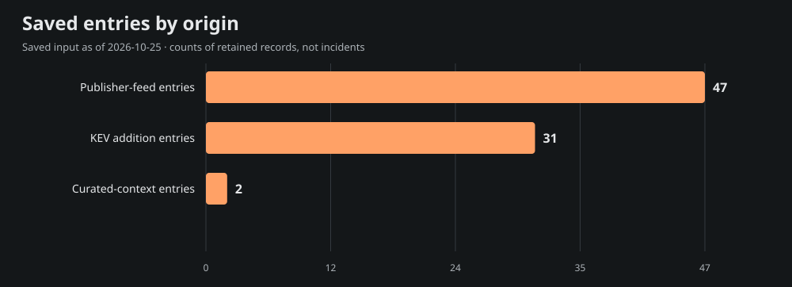
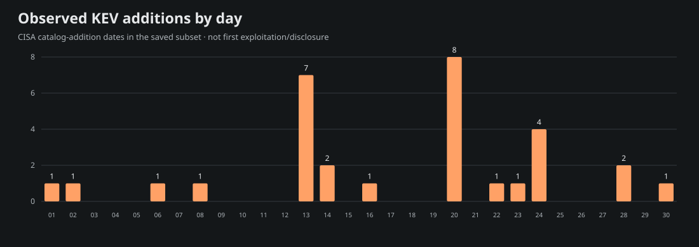
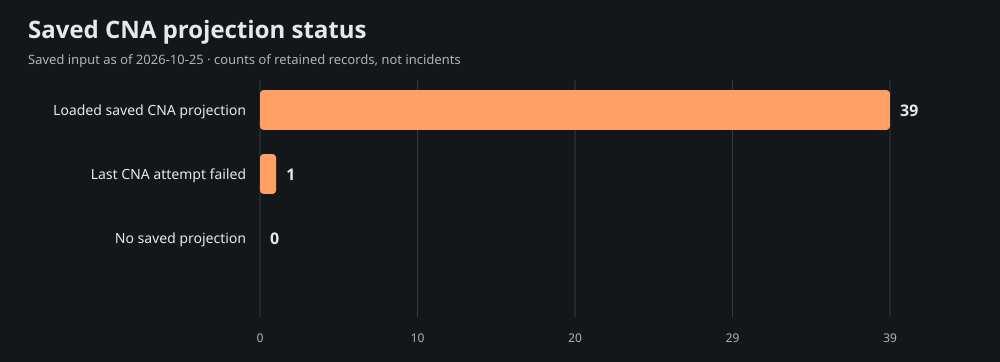

# Team Star Wolf Intelligence Hub
## April 2026 · retrospective

**Edition:** SW-MONTHLY-2026-04-RETRO · **Coverage:** selective, incomplete saved-source subset

**Period:** 2026-04-01T00:00:00-05:00 inclusive to 2026-05-01T00:00:00-05:00 exclusive (America/Chicago).

**Compiled:** 2026-10-25T21:55:23.373Z · **Input generated:** 2026-10-25T21:13:41+00:00 · **Captured:** 2026-10-25T21:29:50.108068Z

This is a retrospective compilation. A closed calendar period does not imply complete evidence. Saved entries, curated context and CNA projections are attributed below; no primary article or CNA record was fetched or independently verified for this edition.

## 1. Executive summary

The admitted saved subset contains **80 entries**: 47 publisher-feed entries, 31 CISA KEV catalog-addition entries and 2 curated-context entries. These mention **40 distinct CVE IDs**; they are not counts of incidents, newly disclosed vulnerabilities, exploited systems or affected devices.

The 9 selected developments below emphasize saved curated context, advisory metadata and dated KEV additions. Selection is bounded and source-based rather than a severity/risk ranking. The report samples 15 of 40 mentioned CVEs for current saved product, score and mitigation context; full entry/cohort/chart data are in [data.json](<https://github.com/TeamStarWolf/intelligence-hub/blob/main/reports/monthly/2026-04/data.json>).

Saved curated context highlights [Google studies prompt-injection attempts on the public web](<https://blog.google/security/prompt-injections-web/>); [US agencies warn of disruptive intrusions into exposed PLCs](<https://www.ic3.gov/CSA/2026/260407.pdf>). These remain the saved curation’s source-attributed account, including any later-update caveats; they are not claims that the whole account was known during the historical period.

|Metric|Observed value|Meaning|
|---|---:|---|
|Saved entries|80|Canonical-URL rows in the selected date recipe|
|Unique mentioned CVEs|40|Union of IDs, not newly published CVEs|
|KEV additions|31|Catalog-addition rows, not first exploitation|
|Aware timestamps|47|Chicago-aware instant membership|
|Date-only rows|33|Literal calendar precision; timezone unknown|
|Cutoff-date rows with unknown time|0|Included calendar-overlap rows, not exact-time evidence|

## 2. Selected source-attributed developments

Up to 10 entries are selected; 9 qualify under this saved-source selection recipe. A headline or CVE mention is a source lead, not a directly re-read incident narrative.

### 1. Google studies prompt-injection attempts on the public web

- **Saved source:** [Google Security](<https://blog.google/security/prompt-injections-web/>) · curated source context · research
- **Recorded date:** 2026-04-23 · publication · calendar-day precision
- **CVE mentions:** None projected; no ID inferred from this title.
- **Saved exploitation label:** reported; a mention alone is not exploitation evidence.
- **Saved curation context, observed October 25:** Google's web study distinguishes benign examples from attempts to steer browsing agents toward manipulation, exfiltration or destruction. The study is not exhaustive and observed instructions do not prove successful compromise. Treat retrieved pages as untrusted data in agent workflows.

### 2. US agencies warn of disruptive intrusions into exposed PLCs

- **Saved source:** [FBI, CISA and US government partners](<https://www.ic3.gov/CSA/2026/260407.pdf>) · curated source context · advisory
- **Recorded date:** 2026-04-07 · publication · calendar-day precision
- **CVE mentions:** None projected; no ID inferred from this title.
- **Saved exploitation label:** known; a mention alone is not exploitation evidence.
- **Saved curation context, observed October 25:** The joint advisory reports Iran-affiliated activity against internet-facing PLCs, including project-file access and HMI/SCADA manipulation causing disruption. It recommends controlled OT connectivity and vendor-specific hardening. It does not establish exposure of any particular local device.

### 3. Defending Against China-Nexus Covert Networks of Compromised Devices

- **Saved source:** [CISA Cybersecurity Advisories (category subset)](<https://www.cisa.gov/news-events/cybersecurity-advisories/aa26-113a>) · saved Hub entry · advisory
- **Recorded date:** 2026-04-21T15:12:37+00:00 · publication · timestamp with offset
- **CVE mentions:** None projected; no ID inferred from this title.
- **Saved exploitation label:** unknown; a mention alone is not exploitation evidence.
- **Context limit:** Saved headline/metadata only; no article-body facts, actor attribution or remediation are inferred.

### 4. Iranian-Affiliated Cyber Actors Exploit Programmable Logic Controllers Across US Critical Infrastructure

- **Saved source:** [CISA Cybersecurity Advisories (category subset)](<https://www.cisa.gov/news-events/cybersecurity-advisories/aa26-097a>) · saved Hub entry · advisory
- **Recorded date:** 2026-04-06T11:03:58+00:00 · publication · timestamp with offset
- **CVE mentions:** None projected; no ID inferred from this title.
- **Saved exploitation label:** unknown; a mention alone is not exploitation evidence.
- **Context limit:** Saved headline/metadata only; no article-body facts, actor attribution or remediation are inferred.

### 5. CVE-2026-41940 · WebPros cPanel &amp; WHM and WP2 (WordPress Squared) Missing Authentication for Critical Function Vulnerability

- **Saved source:** [CISA Known Exploited Vulnerabilities](<https://www.cisa.gov/known-exploited-vulnerabilities-catalog?field_cve=CVE-2026-41940>) · saved Hub entry · kev
- **Recorded date:** 2026-04-30 · CISA catalog addition · calendar-day precision
- **CVE mentions:** CVE-2026-41940
- **Saved exploitation label:** known; a mention alone is not exploitation evidence.
- **Context limit:** Saved headline/metadata only; no article-body facts, actor attribution or remediation are inferred.

### 6. CVE-2024-1708 · ConnectWise ScreenConnect Path Traversal Vulnerability

- **Saved source:** [CISA Known Exploited Vulnerabilities](<https://www.cisa.gov/known-exploited-vulnerabilities-catalog?field_cve=CVE-2024-1708>) · saved Hub entry · kev
- **Recorded date:** 2026-04-28 · CISA catalog addition · calendar-day precision
- **CVE mentions:** CVE-2024-1708
- **Saved exploitation label:** known; a mention alone is not exploitation evidence.
- **Context limit:** Saved headline/metadata only; no article-body facts, actor attribution or remediation are inferred.

### 7. CVE-2026-32202 · Microsoft Windows Protection Mechanism Failure Vulnerability

- **Saved source:** [CISA Known Exploited Vulnerabilities](<https://www.cisa.gov/known-exploited-vulnerabilities-catalog?field_cve=CVE-2026-32202>) · saved Hub entry · kev
- **Recorded date:** 2026-04-28 · CISA catalog addition · calendar-day precision
- **CVE mentions:** CVE-2026-32202
- **Saved exploitation label:** known; a mention alone is not exploitation evidence.
- **Context limit:** Saved headline/metadata only; no article-body facts, actor attribution or remediation are inferred.

### 8. The Internet Is Falling Down, Falling Down, Falling Down (cPanel &amp; WHM Authentication Bypass CVE-2026-41940)

- **Saved source:** [watchTowr Labs](<https://labs.watchtowr.com/the-internet-is-falling-down-falling-down-falling-down-cpanel-whm-authentication-bypass-cve-2026-41940/>) · saved Hub entry · research
- **Recorded date:** 2026-04-29T17:19:19+00:00 · publication · timestamp with offset
- **CVE mentions:** CVE-2026-41940
- **Saved exploitation label:** unknown; a mention alone is not exploitation evidence.
- **Context limit:** Saved headline/metadata only; no article-body facts, actor attribution or remediation are inferred.

### 9. Don't Panic: The Thymeleaf Template Injection That Only Hurts If You Let It (CVE-2026-40478)

- **Saved source:** [Snyk](<https://snyk.io/blog/thymeleaf-injection/>) · saved Hub entry · research
- **Recorded date:** 2026-04-29T00:00:00+00:00 · publication · timestamp with offset
- **CVE mentions:** CVE-2026-40478
- **Saved exploitation label:** unknown; a mention alone is not exploitation evidence.
- **Context limit:** Saved headline/metadata only; no article-body facts, actor attribution or remediation are inferred.

## 3. CISA KEV additions and CVE context

The saved input contains **31** KEV catalog-addition rows in this period. Catalog addition is separate from initial disclosure, first exploitation and the CVE identifier’s year. These are current-catalog observations captured October 25, not a frozen catalog from the historical month.

Showing 31 of 31 rows below; all admitted rows are retained in data.json.

|Added|CVE|Saved vendor/product tags|Current saved federal due date|
|---|---|---|---|
|2026-04-30|[CVE-2026-41940](<https://www.cisa.gov/known-exploited-vulnerabilities-catalog?field_cve=CVE-2026-41940>)|WebPros · cPanel &amp; WHM and WP2 (WordPress Squared)|2026-05-03|
|2026-04-28|[CVE-2024-1708](<https://www.cisa.gov/known-exploited-vulnerabilities-catalog?field_cve=CVE-2024-1708>)|ConnectWise · ScreenConnect|2026-05-12|
|2026-04-28|[CVE-2026-32202](<https://www.cisa.gov/known-exploited-vulnerabilities-catalog?field_cve=CVE-2026-32202>)|Microsoft · Windows|2026-05-12|
|2026-04-24|[CVE-2024-57726](<https://www.cisa.gov/known-exploited-vulnerabilities-catalog?field_cve=CVE-2024-57726>)|SimpleHelp · SimpleHelp|2026-05-08|
|2026-04-24|[CVE-2024-57728](<https://www.cisa.gov/known-exploited-vulnerabilities-catalog?field_cve=CVE-2024-57728>)|SimpleHelp · SimpleHelp|2026-05-08|
|2026-04-24|[CVE-2024-7399](<https://www.cisa.gov/known-exploited-vulnerabilities-catalog?field_cve=CVE-2024-7399>)|Samsung · MagicINFO 9 Server|2026-05-08|
|2026-04-24|[CVE-2025-29635](<https://www.cisa.gov/known-exploited-vulnerabilities-catalog?field_cve=CVE-2025-29635>)|D-Link · DIR-823X|2026-05-08|
|2026-04-23|[CVE-2026-39987](<https://www.cisa.gov/known-exploited-vulnerabilities-catalog?field_cve=CVE-2026-39987>)|Marimo · Marimo|2026-05-07|
|2026-04-22|[CVE-2026-33825](<https://www.cisa.gov/known-exploited-vulnerabilities-catalog?field_cve=CVE-2026-33825>)|Microsoft · Defender|2026-05-06|
|2026-04-20|[CVE-2023-27351](<https://www.cisa.gov/known-exploited-vulnerabilities-catalog?field_cve=CVE-2023-27351>)|PaperCut · NG/MF|2026-05-04|
|2026-04-20|[CVE-2024-27199](<https://www.cisa.gov/known-exploited-vulnerabilities-catalog?field_cve=CVE-2024-27199>)|JetBrains · TeamCity|2026-05-04|
|2026-04-20|[CVE-2025-2749](<https://www.cisa.gov/known-exploited-vulnerabilities-catalog?field_cve=CVE-2025-2749>)|Kentico · Kentico Xperience|2026-05-04|
|2026-04-20|[CVE-2025-32975](<https://www.cisa.gov/known-exploited-vulnerabilities-catalog?field_cve=CVE-2025-32975>)|Quest · KACE Systems Management Appliance (SMA)|2026-05-04|
|2026-04-20|[CVE-2025-48700](<https://www.cisa.gov/known-exploited-vulnerabilities-catalog?field_cve=CVE-2025-48700>)|Synacor · Zimbra Collaboration Suite (ZCS)|2026-04-23|
|2026-04-20|[CVE-2026-20122](<https://www.cisa.gov/known-exploited-vulnerabilities-catalog?field_cve=CVE-2026-20122>)|Cisco · Catalyst SD-WAN Manger|2026-04-23|
|2026-04-20|[CVE-2026-20128](<https://www.cisa.gov/known-exploited-vulnerabilities-catalog?field_cve=CVE-2026-20128>)|Cisco · Catalyst SD-WAN Manager|2026-04-23|
|2026-04-20|[CVE-2026-20133](<https://www.cisa.gov/known-exploited-vulnerabilities-catalog?field_cve=CVE-2026-20133>)|Cisco · Catalyst SD-WAN Manager|2026-04-23|
|2026-04-16|[CVE-2026-34197](<https://www.cisa.gov/known-exploited-vulnerabilities-catalog?field_cve=CVE-2026-34197>)|Apache · ActiveMQ|2026-04-30|
|2026-04-14|[CVE-2009-0238](<https://www.cisa.gov/known-exploited-vulnerabilities-catalog?field_cve=CVE-2009-0238>)|Microsoft · Office|2026-04-28|
|2026-04-14|[CVE-2026-32201](<https://www.cisa.gov/known-exploited-vulnerabilities-catalog?field_cve=CVE-2026-32201>)|Microsoft · SharePoint Server|2026-04-28|
|2026-04-13|[CVE-2012-1854](<https://www.cisa.gov/known-exploited-vulnerabilities-catalog?field_cve=CVE-2012-1854>)|Microsoft · Visual Basic for Applications (VBA)|2026-04-27|
|2026-04-13|[CVE-2020-9715](<https://www.cisa.gov/known-exploited-vulnerabilities-catalog?field_cve=CVE-2020-9715>)|Adobe · Acrobat|2026-04-27|
|2026-04-13|[CVE-2023-21529](<https://www.cisa.gov/known-exploited-vulnerabilities-catalog?field_cve=CVE-2023-21529>)|Microsoft · Exchange Server|2026-04-27|
|2026-04-13|[CVE-2023-36424](<https://www.cisa.gov/known-exploited-vulnerabilities-catalog?field_cve=CVE-2023-36424>)|Microsoft · Windows|2026-04-27|
|2026-04-13|[CVE-2025-60710](<https://www.cisa.gov/known-exploited-vulnerabilities-catalog?field_cve=CVE-2025-60710>)|Microsoft · Windows|2026-04-27|
|2026-04-13|[CVE-2026-21643](<https://www.cisa.gov/known-exploited-vulnerabilities-catalog?field_cve=CVE-2026-21643>)|Fortinet · FortiClient EMS|2026-04-16|
|2026-04-13|[CVE-2026-34621](<https://www.cisa.gov/known-exploited-vulnerabilities-catalog?field_cve=CVE-2026-34621>)|Adobe · Acrobat and Reader|2026-04-27|
|2026-04-08|[CVE-2026-1340](<https://www.cisa.gov/known-exploited-vulnerabilities-catalog?field_cve=CVE-2026-1340>)|Ivanti · Endpoint Manager Mobile (EPMM)|2026-04-11|
|2026-04-06|[CVE-2026-35616](<https://www.cisa.gov/known-exploited-vulnerabilities-catalog?field_cve=CVE-2026-35616>)|Fortinet · FortiClient EMS|2026-04-09|
|2026-04-02|[CVE-2026-3502](<https://www.cisa.gov/known-exploited-vulnerabilities-catalog?field_cve=CVE-2026-3502>)|TrueConf · Client|2026-04-16|
|2026-04-01|[CVE-2026-5281](<https://www.cisa.gov/known-exploited-vulnerabilities-catalog?field_cve=CVE-2026-5281>)|Google · Dawn|2026-04-15|

Federal due dates are source catalog data, not deadlines assigned to this site’s visitors. Ransomware and exploitation assertions, where supplied, remain source-scoped in data.json.

### Current saved CNA sample

These 15 sampled projections are current context from the saved input. Their record-state, retrieval/update/attempt clocks and CNA score version remain explicit. Loaded projections can include rejected records; failed enrichment may retain older successful content. No source record was re-read for this report.

|CVE|Projection / record state|Saved CVSS|Saved guidance status|
|---|---|---|---|
|[CVE-2026-41940](<https://www.cve.org/CVERecord?id=CVE-2026-41940>)|ok / PUBLISHED|9.3 (v4.0; saved CNA metric)|cisa-action|
|[CVE-2024-1708](<https://www.cve.org/CVERecord?id=CVE-2024-1708>)|ok / PUBLISHED|8.4 (v3.1; saved CNA metric)|cisa-action|
|[CVE-2026-32202](<https://www.cve.org/CVERecord?id=CVE-2026-32202>)|ok / PUBLISHED|4.3 (v3.1; saved CNA metric)|cisa-action|
|[CVE-2026-40478](<https://www.cve.org/CVERecord?id=CVE-2026-40478>)|ok / PUBLISHED|9.1 (v3.1; saved CNA metric)|needs-review|
|[CVE-2009-0238](<https://www.cve.org/CVERecord?id=CVE-2009-0238>)|ok / PUBLISHED|Not supplied in saved projection|cisa-action|
|[CVE-2012-1854](<https://www.cve.org/CVERecord?id=CVE-2012-1854>)|ok / PUBLISHED|Not supplied in saved projection|cisa-action|
|[CVE-2020-9715](<https://www.cve.org/CVERecord?id=CVE-2020-9715>)|ok / PUBLISHED|Not supplied in saved projection|cisa-action|
|[CVE-2023-21529](<https://www.cve.org/CVERecord?id=CVE-2023-21529>)|ok / PUBLISHED|8.8 (v3.1; saved CNA metric)|cisa-action|
|[CVE-2023-27351](<https://www.cve.org/CVERecord?id=CVE-2023-27351>)|ok / PUBLISHED|8.2 (v3.0; saved CNA metric)|cisa-action|
|[CVE-2023-36424](<https://www.cve.org/CVERecord?id=CVE-2023-36424>)|ok / PUBLISHED|7.8 (v3.1; saved CNA metric)|cisa-action|
|[CVE-2024-27199](<https://www.cve.org/CVERecord?id=CVE-2024-27199>)|ok / PUBLISHED|7.3 (v3.1; saved CNA metric)|cisa-action|
|[CVE-2024-50623](<https://www.cve.org/CVERecord?id=CVE-2024-50623>)|ok / PUBLISHED|Not supplied in saved projection|cisa-action|
|[CVE-2024-57726](<https://www.cve.org/CVERecord?id=CVE-2024-57726>)|ok / PUBLISHED|Not supplied in saved projection|cisa-action|
|[CVE-2024-57728](<https://www.cve.org/CVERecord?id=CVE-2024-57728>)|ok / PUBLISHED|Not supplied in saved projection|cisa-action|
|[CVE-2024-7399](<https://www.cve.org/CVERecord?id=CVE-2024-7399>)|ok / PUBLISHED|8.8 (v3.1; saved CNA metric)|cisa-action|

## 4. Campaigns and actors

**not_projected.** Schema 4 supplied no structured actor/campaign entity or relationship projection. Names in saved headlines, research or curated prose are not promoted into attribution, aliases or ATT&CK/CAPEC relationships. This does not establish that no campaign occurred.

## 5. Supply chain and AI security

Only exact saved tags select the following topic leads; this is not inferred impact or attack taxonomy.

- [Google studies prompt-injection attempts on the public web](<https://blog.google/security/prompt-injections-web/>) — saved tags: ai-security, prompt-injection; curated source context.
  Saved curation context: Google's web study distinguishes benign examples from attempts to steer browsing agents toward manipulation, exfiltration or destruction. The study is not exhaustive and observed instructions do not prove successful compromise. Treat retrieved pages as untrusted data in agent workflows.

## 6. Mitigation and product context

This is current saved projection context, not patch verification or knowledge backdated into the report month. Exact installed versions/configuration were not assessed. Full bounded product/version statements, source links and saved analysis steps are in data.json. CWE, CAPEC and actor fields are **not_projected**, rather than empty-proof of no weakness or attack pattern.

### CVE-2026-41940

- **Current saved state:** ok / PUBLISHED; 9.3 (v4.0; saved CNA metric).
- **Clocks:** retrieved 2026-10-24T22:24:16+00:00; record updated 2026-09-30T17:20:17+00:00; attempted 2026-10-24T22:24:16+00:00.
- **Saved product labels:** WebPros / cPanel; WebPros / WP Squared; WebPros / WHM 
- **Saved CISA action excerpt:** Apply mitigations per vendor instructions, follow applicable BOD 22-01 guidance for cloud services, or discontinue use of the product if mitigations are unavailable.
- **Source pointer:** [Saved record reference](<https://www.cve.org/CVERecord?id=CVE-2026-41940>). No direct source review or environment applicability is established.

### CVE-2024-1708

- **Current saved state:** ok / PUBLISHED; 8.4 (v3.1; saved CNA metric).
- **Clocks:** retrieved 2026-10-24T22:24:40+00:00; record updated 2026-08-04T03:55:56+00:00; attempted 2026-10-24T22:24:40+00:00.
- **Saved product labels:** ConnectWise / ScreenConnect 
- **Saved CISA action excerpt:** Apply mitigations per vendor instructions, follow applicable BOD 22-01 guidance for cloud services, or discontinue use of the product if mitigations are unavailable.
- **Source pointer:** [Saved record reference](<https://www.cve.org/CVERecord?id=CVE-2024-1708>). No direct source review or environment applicability is established.

### CVE-2026-32202

- **Current saved state:** ok / PUBLISHED; 4.3 (v3.1; saved CNA metric).
- **Clocks:** retrieved 2026-10-24T22:24:17+00:00; record updated 2026-10-15T15:52:51+00:00; attempted 2026-10-24T22:24:17+00:00.
- **Saved product labels:** Microsoft / Windows 10 Version 1607; Microsoft / Windows 10 Version 1809; Microsoft / Windows 10 Version 21H2 (first 3 shown; full bounded projection in data.json)
- **Saved CISA action excerpt:** Apply mitigations per vendor instructions, follow applicable BOD 22-01 guidance for cloud services, or discontinue use of the product if mitigations are unavailable.
- **Source pointer:** [Saved record reference](<https://www.cve.org/CVERecord?id=CVE-2026-32202>). No direct source review or environment applicability is established.

### CVE-2026-40478

- **Current saved state:** ok / PUBLISHED; 9.1 (v3.1; saved CNA metric).
- **Clocks:** retrieved 2026-10-24T22:24:16+00:00; record updated 2026-08-18T12:05:25+00:00; attempted 2026-10-24T22:24:16+00:00.
- **Saved product labels:** thymeleaf / thymeleaf; thymeleaf / org.thymeleaf:thymeleaf-spring5; thymeleaf / org.thymeleaf:thymeleaf-spring6 
- **Guidance gap:** no action/solution/workaround supplied in this saved projection; this is unknown, not proof no fix exists.
- **Source pointer:** [Saved record reference](<https://www.cve.org/CVERecord?id=CVE-2026-40478>). No direct source review or environment applicability is established.

### CVE-2009-0238

- **Current saved state:** ok / PUBLISHED; Not supplied in saved projection.
- **Clocks:** retrieved 2026-10-24T23:19:15+00:00; record updated 2026-04-15T03:58:09+00:00; attempted 2026-10-24T23:19:15+00:00.
- **Saved product labels:** n/a / n/a 
- **Saved CISA action excerpt:** Apply mitigations per vendor instructions, follow applicable BOD 22-01 guidance for cloud services, or discontinue use of the product if mitigations are unavailable.
- **Source pointer:** [Saved record reference](<https://www.cve.org/CVERecord?id=CVE-2009-0238>). No direct source review or environment applicability is established.

### CVE-2012-1854

- **Current saved state:** ok / PUBLISHED; Not supplied in saved projection.
- **Clocks:** retrieved 2026-10-24T23:19:14+00:00; record updated 2026-04-14T03:55:29+00:00; attempted 2026-10-24T23:19:14+00:00.
- **Saved product labels:** n/a / n/a 
- **Saved CISA action excerpt:** Apply mitigations per vendor instructions, follow applicable BOD 22-01 guidance for cloud services, or discontinue use of the product if mitigations are unavailable.
- **Source pointer:** [Saved record reference](<https://www.cve.org/CVERecord?id=CVE-2012-1854>). No direct source review or environment applicability is established.

### CVE-2020-9715

- **Current saved state:** ok / PUBLISHED; Not supplied in saved projection.
- **Clocks:** retrieved 2026-10-24T22:25:01+00:00; record updated 2026-04-13T22:20:25+00:00; attempted 2026-10-24T22:25:01+00:00.
- **Saved product labels:** Adobe / Adobe Acrobat and Reader 
- **Saved CISA action excerpt:** Apply mitigations per vendor instructions, follow applicable BOD 22-01 guidance for cloud services, or discontinue use of the product if mitigations are unavailable.
- **Source pointer:** [Saved record reference](<https://www.cve.org/CVERecord?id=CVE-2020-9715>). No direct source review or environment applicability is established.

### CVE-2023-21529

- **Current saved state:** ok / PUBLISHED; 8.8 (v3.1; saved CNA metric).
- **Clocks:** retrieved 2026-10-24T22:24:46+00:00; record updated 2026-08-19T16:26:33+00:00; attempted 2026-10-24T22:24:46+00:00.
- **Saved product labels:** Microsoft / Microsoft Exchange Server 2013 Cumulative Update 23; Microsoft / Microsoft Exchange Server 2016 Cumulative Update 23; Microsoft / Microsoft Exchange Server 2019 Cumulative Update 11 (first 3 shown; full bounded projection in data.json)
- **Saved CISA action excerpt:** Apply mitigations per vendor instructions, follow applicable BOD 22-01 guidance for cloud services, or discontinue use of the product if mitigations are unavailable.
- **Source pointer:** [Saved record reference](<https://www.cve.org/CVERecord?id=CVE-2023-21529>). No direct source review or environment applicability is established.

### CVE-2023-27351

- **Current saved state:** ok / PUBLISHED; 8.2 (v3.0; saved CNA metric).
- **Clocks:** retrieved 2026-10-24T22:24:45+00:00; record updated 2026-10-01T18:09:39+00:00; attempted 2026-10-24T22:24:45+00:00.
- **Saved product labels:** PaperCut / NG 
- **Saved CISA action excerpt:** Apply mitigations per vendor instructions, follow applicable BOD 22-01 guidance for cloud services, or discontinue use of the product if mitigations are unavailable.
- **Source pointer:** [Saved record reference](<https://www.cve.org/CVERecord?id=CVE-2023-27351>). No direct source review or environment applicability is established.

### CVE-2023-36424

- **Current saved state:** ok / PUBLISHED; 7.8 (v3.1; saved CNA metric).
- **Clocks:** retrieved 2026-10-24T22:24:44+00:00; record updated 2026-04-14T03:55:25+00:00; attempted 2026-10-24T22:24:43+00:00.
- **Saved product labels:** Microsoft / Windows 11 version 22H3; Microsoft / Windows Server 2022, 23H2 Edition (Server Core installation); Microsoft / Windows 11 Version 23H2 (first 3 shown; full bounded projection in data.json)
- **Saved CISA action excerpt:** Apply mitigations per vendor instructions, follow applicable BOD 22-01 guidance for cloud services, or discontinue use of the product if mitigations are unavailable.
- **Source pointer:** [Saved record reference](<https://www.cve.org/CVERecord?id=CVE-2023-36424>). No direct source review or environment applicability is established.

### CVE-2024-27199

- **Current saved state:** ok / PUBLISHED; 7.3 (v3.1; saved CNA metric).
- **Clocks:** retrieved 2026-10-24T22:24:39+00:00; record updated 2026-04-21T03:55:31+00:00; attempted 2026-10-24T22:24:39+00:00.
- **Saved product labels:** JetBrains / TeamCity 
- **Saved CISA action excerpt:** Apply mitigations per vendor instructions, follow applicable BOD 22-01 guidance for cloud services, or discontinue use of the product if mitigations are unavailable.
- **Source pointer:** [Saved record reference](<https://www.cve.org/CVERecord?id=CVE-2024-27199>). No direct source review or environment applicability is established.

### CVE-2024-50623

- **Current saved state:** ok / PUBLISHED; Not supplied in saved projection.
- **Clocks:** retrieved 2026-10-24T22:24:36+00:00; record updated 2026-10-07T17:49:17+00:00; attempted 2026-10-24T22:24:36+00:00.
- **Saved product labels:** n/a / n/a 
- **Saved CISA action excerpt:** Apply mitigations per vendor instructions or discontinue use of the product if mitigations are unavailable.
- **Source pointer:** [Saved record reference](<https://www.cve.org/CVERecord?id=CVE-2024-50623>). No direct source review or environment applicability is established.

### CVE-2024-57726

- **Current saved state:** ok / PUBLISHED; Not supplied in saved projection.
- **Clocks:** retrieved 2026-10-24T22:24:35+00:00; record updated 2026-08-04T03:56:05+00:00; attempted 2026-10-24T22:24:35+00:00.
- **Saved product labels:** n/a / n/a 
- **Saved CISA action excerpt:** Apply mitigations per vendor instructions, follow applicable BOD 22-01 guidance for cloud services, or discontinue use of the product if mitigations are unavailable.
- **Source pointer:** [Saved record reference](<https://www.cve.org/CVERecord?id=CVE-2024-57726>). No direct source review or environment applicability is established.

### CVE-2024-57728

- **Current saved state:** ok / PUBLISHED; Not supplied in saved projection.
- **Clocks:** retrieved 2026-10-24T22:24:35+00:00; record updated 2026-08-04T03:56:06+00:00; attempted 2026-10-24T22:24:35+00:00.
- **Saved product labels:** n/a / n/a 
- **Saved CISA action excerpt:** Apply mitigations per vendor instructions, follow applicable BOD 22-01 guidance for cloud services, or discontinue use of the product if mitigations are unavailable.
- **Source pointer:** [Saved record reference](<https://www.cve.org/CVERecord?id=CVE-2024-57728>). No direct source review or environment applicability is established.

### CVE-2024-7399

- **Current saved state:** ok / PUBLISHED; 8.8 (v3.1; saved CNA metric).
- **Clocks:** retrieved 2026-10-24T22:24:35+00:00; record updated 2026-10-01T18:08:41+00:00; attempted 2026-10-24T22:24:35+00:00.
- **Saved product labels:** Samsung Electronics / MagicINFO 9 Server 
- **Saved CISA action excerpt:** Apply mitigations per vendor instructions, follow applicable BOD 22-01 guidance for cloud services, or discontinue use of the product if mitigations are unavailable.
- **Source pointer:** [Saved record reference](<https://www.cve.org/CVERecord?id=CVE-2024-7399>). No direct source review or environment applicability is established.

## 7. Changes to prior reporting

**Revision watch: not_run · no_baseline.** No primary citation was rechecked and no material-change claim is made. The 48–96-hour citation review policy remains planned; raw hashes or timestamps alone would not prove a material security change.

## 8. Watchlist for the next review

- Reconcile the 1 failed and 0 missing saved CNA projections in this cohort before treating missing guidance as absent.
- Review primary conditions for the 15 sampled CVEs; their saved retrieval/update clocks describe current context, not what was known in 2026-04.
- Actor/CWE/CAPEC mapping and prior-source revision checks remain unprojected/not run; no attribution or material-change claim is made.

Next nominal report/review cycle: **2026-10-25T22:00:00-05:00** (2026-10-26T03:00:00.000Z). **Planned; activation not verified for this edition.** Individual citation eligibility/caps/cooldowns may defer a source; this is not an on-time delivery or all-articles-checked promise.

## 9. Coverage and limitations

The whole input saved 62 source ledgers:54 ok,7 partial and1 failed. These describe last saved attempts around input generation, **not source health during 2026-04**. Source-specific period rows and origin dimensions are in data.json. The whole input window was 2016-10-25 through 2026-10-25, with bounded retained feed history.

- Saved publisher headlines and curated summaries are source-attributed leads, not direct article-body fact verification.
- Counts describe a bounded retained public subset, not all incidents, newly disclosed vulnerabilities, attacks or exposed systems.
- KEV addition dates identify catalog additions, not first disclosure/exploitation; current catalog membership can differ from a historical catalog.
- Input observed October 25; individual CNA update/retrieval and source-status clocks are retained separately and are not backdated into the report period.
- The 60 globally missing primary dates remain unassigned; failed/partial feed intake and bounded retention create coverage gaps.
- Date-only records retain calendar precision and unknown timezone; October cutoff-day records have unknown time relative to the exact MTD cutoff.
- No private account/social metrics, environment inventory, raw primary sources, actor aliases, inferred CWE/CAPEC links or oldW43 claims are included.
- Next nominal report/review cycle is planned until separate activation/readback; no unattended timing or per-source fetch guarantee.

**Date recipe:** aware timestamps use America/Chicago instant membership in the stated half-open period; date-only rows retain their literal calendar date/timezone unknown. Missing dates are globally unassigned. October MTD admits cutoff-date-only rows as calendar overlap with exact time unknown. Source event/publication/KEV dates are not interchangeable.

**Chart recipes:** every plotted row, unit, as-of clock and evidence ID is in data.json. Charts use actual admitted counts; no November/December future bars or social/account metrics are generated.

## 10. Primary-first source pointers

Input: [Saved Intelligence Hub snapshot](<https://teamstarwolf.github.io/intelligence-hub/data/feed.json>) · schema 4 · SHA-256 `eb44f9aaa505efe604fb2f17c88397dec08fc77d00d554dc096ab720573f4199`. Captured 2026-10-25T21:29:50.108068Z, generated 2026-10-25T21:13:41+00:00. Structural qualification is not a raw-primary-article/CNA truth claim.

- [Saved Intelligence Hub input](<https://teamstarwolf.github.io/intelligence-hub/data/feed.json>) — saved\_hub\_entry / input
- [CISA KEV catalog reference](<https://www.cisa.gov/known-exploited-vulnerabilities-catalog>) — saved\_hub\_entry / catalog
- [CVE-2026-41940 saved record reference](<https://www.cve.org/CVERecord?id=CVE-2026-41940>) — CNA\_projection / record
- [CVE-2026-41940 saved publisher guidance reference](<https://support.cpanel.net/hc/en-us/articles/40073787579671-cPanel-WHM-Security-Update-04-28-2026>) — CNA\_projection / guidance
- [CVE-2024-1708 saved record reference](<https://www.cve.org/CVERecord?id=CVE-2024-1708>) — CNA\_projection / record
- [CVE-2026-32202 saved record reference](<https://www.cve.org/CVERecord?id=CVE-2026-32202>) — CNA\_projection / record
- [CVE-2026-32202 saved publisher guidance reference](<https://msrc.microsoft.com/update-guide/vulnerability/CVE-2026-32202>) — CNA\_projection / guidance
- [CVE-2026-40478 saved record reference](<https://www.cve.org/CVERecord?id=CVE-2026-40478>) — CNA\_projection / record
- [CVE-2009-0238 saved record reference](<https://www.cve.org/CVERecord?id=CVE-2009-0238>) — CNA\_projection / record
- [CVE-2009-0238 saved publisher guidance reference](<https://docs.microsoft.com/en-us/security-updates/securitybulletins/2009/ms09-009>) — CNA\_projection / guidance
- [CVE-2012-1854 saved record reference](<https://www.cve.org/CVERecord?id=CVE-2012-1854>) — CNA\_projection / record
- [CVE-2012-1854 saved publisher guidance reference](<https://docs.microsoft.com/en-us/security-updates/securitybulletins/2012/ms12-046>) — CNA\_projection / guidance
- [CVE-2020-9715 saved record reference](<https://www.cve.org/CVERecord?id=CVE-2020-9715>) — CNA\_projection / record
- [CVE-2023-21529 saved record reference](<https://www.cve.org/CVERecord?id=CVE-2023-21529>) — CNA\_projection / record
- [CVE-2023-21529 saved publisher guidance reference](<https://msrc.microsoft.com/update-guide/vulnerability/CVE-2023-21529>) — CNA\_projection / guidance
- [CVE-2023-27351 saved record reference](<https://www.cve.org/CVERecord?id=CVE-2023-27351>) — CNA\_projection / record
- [CVE-2023-36424 saved record reference](<https://www.cve.org/CVERecord?id=CVE-2023-36424>) — CNA\_projection / record
- [CVE-2023-36424 saved publisher guidance reference](<https://msrc.microsoft.com/update-guide/vulnerability/CVE-2023-36424>) — CNA\_projection / guidance
- [CVE-2024-27199 saved record reference](<https://www.cve.org/CVERecord?id=CVE-2024-27199>) — CNA\_projection / record
- [CVE-2024-50623 saved record reference](<https://www.cve.org/CVERecord?id=CVE-2024-50623>) — CNA\_projection / record
- [CVE-2024-57726 saved record reference](<https://www.cve.org/CVERecord?id=CVE-2024-57726>) — CNA\_projection / record
- [CVE-2024-57728 saved record reference](<https://www.cve.org/CVERecord?id=CVE-2024-57728>) — CNA\_projection / record
- [CVE-2024-7399 saved record reference](<https://www.cve.org/CVERecord?id=CVE-2024-7399>) — CNA\_projection / record
- [CVE-2024-7399 saved publisher guidance reference](<https://security.samsungtv.com/securityUpdates>) — CNA\_projection / guidance
- [Google studies prompt-injection attempts on the public web](<https://blog.google/security/prompt-injections-web/>) — library\_curationsource / research
- [US agencies warn of disruptive intrusions into exposed PLCs](<https://www.ic3.gov/CSA/2026/260407.pdf>) — library\_curationsource / advisory
- [Defending Against China-Nexus Covert Networks of Compromised Devices](<https://www.cisa.gov/news-events/cybersecurity-advisories/aa26-113a>) — saved\_hub\_entry / advisory
- [Iranian-Affiliated Cyber Actors Exploit Programmable Logic Controllers Across US Critical Infrastructure](<https://www.cisa.gov/news-events/cybersecurity-advisories/aa26-097a>) — saved\_hub\_entry / advisory
- [CVE-2026-41940 · WebPros cPanel &amp; WHM and WP2 (WordPress Squared) Missing Authentication for Critical Function Vulnerability](<https://www.cisa.gov/known-exploited-vulnerabilities-catalog?field_cve=CVE-2026-41940>) — saved\_hub\_entry / kev
- [CVE-2024-1708 · ConnectWise ScreenConnect Path Traversal Vulnerability](<https://www.cisa.gov/known-exploited-vulnerabilities-catalog?field_cve=CVE-2024-1708>) — saved\_hub\_entry / kev
- [CVE-2026-32202 · Microsoft Windows Protection Mechanism Failure Vulnerability](<https://www.cisa.gov/known-exploited-vulnerabilities-catalog?field_cve=CVE-2026-32202>) — saved\_hub\_entry / kev
- [The Internet Is Falling Down, Falling Down, Falling Down (cPanel &amp; WHM Authentication Bypass CVE-2026-41940)](<https://labs.watchtowr.com/the-internet-is-falling-down-falling-down-falling-down-cpanel-whm-authentication-bypass-cve-2026-41940/>) — saved\_hub\_entry / research
- [Don't Panic: The Thymeleaf Template Injection That Only Hurts If You Let It (CVE-2026-40478)](<https://snyk.io/blog/thymeleaf-injection/>) — saved\_hub\_entry / research

---
Data companion: [data.json](data.json). Generation and revision-check statuses describe this edition. Planned next-cycle times are not a guarantee of delivery.
