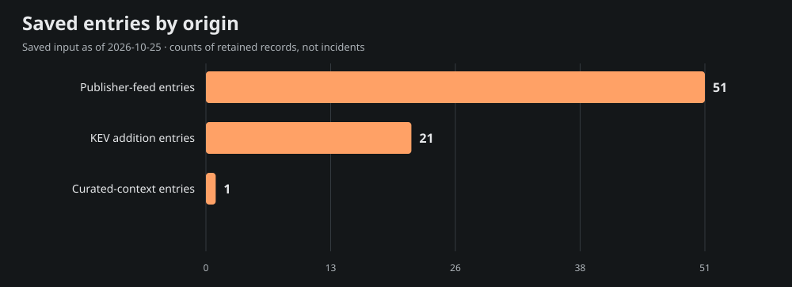
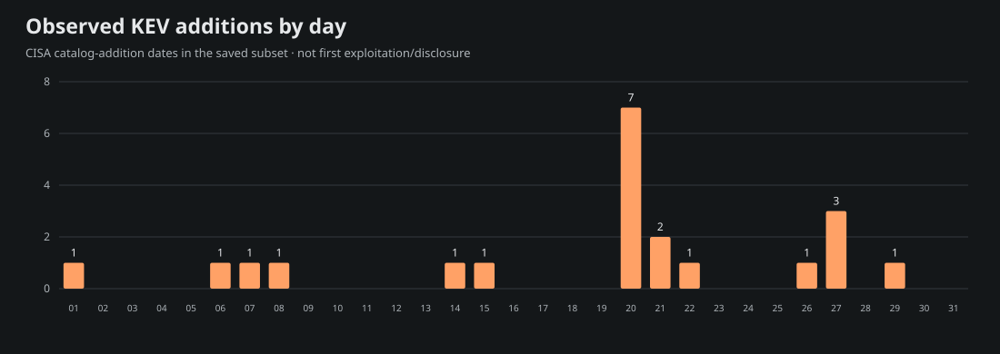

# Team Star Wolf Intelligence Hub
## May 2026 · retrospective

**Edition:** SW-MONTHLY-2026-05-RETRO · **Coverage:** selective, incomplete saved-source subset

**Period:** 2026-05-01T00:00:00-05:00 inclusive to 2026-06-01T00:00:00-05:00 exclusive (America/Chicago).

**Compiled:** 2026-10-25T21:55:23.373Z · **Input generated:** 2026-10-25T21:13:41+00:00 · **Captured:** 2026-10-25T21:29:50.108068Z

This is a retrospective compilation. A closed calendar period does not imply complete evidence. Saved entries, curated context and CNA projections are attributed below; no primary article or CNA record was fetched or independently verified for this edition.

## 1. Executive summary

The admitted saved subset contains **73 entries**: 51 publisher-feed entries, 21 CISA KEV catalog-addition entries and 1 curated-context entry. These mention **28 distinct CVE IDs**; they are not counts of incidents, newly disclosed vulnerabilities, exploited systems or affected devices.

The 6 selected developments below emphasize saved curated context, advisory metadata and dated KEV additions. Selection is bounded and source-based rather than a severity/risk ranking. The report samples 15 of 28 mentioned CVEs for current saved product, score and mitigation context; full entry/cohort/chart data are in [data.json](<https://github.com/TeamStarWolf/intelligence-hub/blob/main/reports/monthly/2026-05/data.json>).

Saved curated context highlights [Anthropic reports early Project Glasswing findings](<https://www.anthropic.com/news/glasswing-initial-update>). These remain the saved curation’s source-attributed account, including any later-update caveats; they are not claims that the whole account was known during the historical period.

|Metric|Observed value|Meaning|
|---|---:|---|
|Saved entries|73|Canonical-URL rows in the selected date recipe|
|Unique mentioned CVEs|28|Union of IDs, not newly published CVEs|
|KEV additions|21|Catalog-addition rows, not first exploitation|
|Aware timestamps|51|Chicago-aware instant membership|
|Date-only rows|22|Literal calendar precision; timezone unknown|
|Cutoff-date rows with unknown time|0|Included calendar-overlap rows, not exact-time evidence|

## 2. Selected source-attributed developments

Up to 10 entries are selected; 6 qualify under this saved-source selection recipe. A headline or CVE mention is a source lead, not a directly re-read incident narrative.

### 1. Anthropic reports early Project Glasswing findings

- **Saved source:** [Anthropic](<https://www.anthropic.com/news/glasswing-initial-update>) · curated source context · research
- **Recorded date:** 2026-05-22 · publication · calendar-day precision
- **CVE mentions:** None projected; no ID inferred from this title.
- **Saved exploitation label:** unknown; a mention alone is not exploitation evidence.
- **Saved curation context, observed October 25:** Anthropic describes AI-assisted vulnerability discovery and the remaining verification, disclosure and remediation workload. Aggregate findings include estimates and assessed subsets; they are not evidence that every reported issue is validated or exploited. Plan triage and patch capacity alongside discovery.

### 2. CVE-2026-0257 · Palo Alto Networks PAN-OS Authentication Bypass Vulnerability

- **Saved source:** [CISA Known Exploited Vulnerabilities](<https://www.cisa.gov/known-exploited-vulnerabilities-catalog?field_cve=CVE-2026-0257>) · saved Hub entry · kev
- **Recorded date:** 2026-05-29 · CISA catalog addition · calendar-day precision
- **CVE mentions:** CVE-2026-0257
- **Saved exploitation label:** known; a mention alone is not exploitation evidence.
- **Context limit:** Saved headline/metadata only; no article-body facts, actor attribution or remediation are inferred.

### 3. CVE-2026-45321 · TanStack Unspecified Vulnerability

- **Saved source:** [CISA Known Exploited Vulnerabilities](<https://www.cisa.gov/known-exploited-vulnerabilities-catalog?field_cve=CVE-2026-45321>) · saved Hub entry · kev
- **Recorded date:** 2026-05-27 · CISA catalog addition · calendar-day precision
- **CVE mentions:** CVE-2026-45321
- **Saved exploitation label:** known; a mention alone is not exploitation evidence.
- **Context limit:** Saved headline/metadata only; no article-body facts, actor attribution or remediation are inferred.

### 4. CVE-2026-48027 · Nx Console Embedded Malicious Code Vulnerability

- **Saved source:** [CISA Known Exploited Vulnerabilities](<https://www.cisa.gov/known-exploited-vulnerabilities-catalog?field_cve=CVE-2026-48027>) · saved Hub entry · kev
- **Recorded date:** 2026-05-27 · CISA catalog addition · calendar-day precision
- **CVE mentions:** CVE-2026-48027
- **Saved exploitation label:** known; a mention alone is not exploitation evidence.
- **Context limit:** Saved headline/metadata only; no article-body facts, actor attribution or remediation are inferred.

### 5. Ongoing exploitation of Cisco Catalyst SD-WAN vulnerabilities

- **Saved source:** [Cisco Talos Threat Advisory (category subset)](<https://blog.talosintelligence.com/sd-wan-ongoing-exploitation/>) · saved Hub entry · research
- **Recorded date:** 2026-05-14T16:02:36+00:00 · publication · timestamp with offset
- **CVE mentions:** CVE-2026-20122, CVE-2026-20127, CVE-2026-20128, CVE-2026-20133, CVE-2026-20182
- **Saved exploitation label:** unknown; a mention alone is not exploitation evidence.
- **Context limit:** Saved headline/metadata only; no article-body facts, actor attribution or remediation are inferred.

### 6. Flash Alert: EtherRat and TukTuk C2 End in The Gentleman Ransomware

- **Saved source:** [The DFIR Report](<https://thedfirreport.com/2026/05/11/flash-alert-etherrat-and-tuktuk-c2-end-in-the-gentleman-ransomware/>) · saved Hub entry · research
- **Recorded date:** 2026-05-11T14:05:04+00:00 · publication · timestamp with offset
- **CVE mentions:** CVE-2025-55182
- **Saved exploitation label:** unknown; a mention alone is not exploitation evidence.
- **Context limit:** Saved headline/metadata only; no article-body facts, actor attribution or remediation are inferred.

## 3. CISA KEV additions and CVE context

The saved input contains **21** KEV catalog-addition rows in this period. Catalog addition is separate from initial disclosure, first exploitation and the CVE identifier’s year. These are current-catalog observations captured October 25, not a frozen catalog from the historical month.

Showing 21 of 21 rows below; all admitted rows are retained in data.json.

|Added|CVE|Saved vendor/product tags|Current saved federal due date|
|---|---|---|---|
|2026-05-29|[CVE-2026-0257](<https://www.cisa.gov/known-exploited-vulnerabilities-catalog?field_cve=CVE-2026-0257>)|Palo Alto Networks · PAN-OS|2026-06-01|
|2026-05-27|[CVE-2026-45321](<https://www.cisa.gov/known-exploited-vulnerabilities-catalog?field_cve=CVE-2026-45321>)|TanStack · TanStack|2026-06-10|
|2026-05-27|[CVE-2026-48027](<https://www.cisa.gov/known-exploited-vulnerabilities-catalog?field_cve=CVE-2026-48027>)|Nx · Nx Console|2026-06-10|
|2026-05-27|[CVE-2026-8398](<https://www.cisa.gov/known-exploited-vulnerabilities-catalog?field_cve=CVE-2026-8398>)|Daemon · Daemon Tools Lite|2026-05-30|
|2026-05-26|[CVE-2026-48172](<https://www.cisa.gov/known-exploited-vulnerabilities-catalog?field_cve=CVE-2026-48172>)|LiteSpeed · cPanel Plugin|2026-05-29|
|2026-05-22|[CVE-2026-9082](<https://www.cisa.gov/known-exploited-vulnerabilities-catalog?field_cve=CVE-2026-9082>)|Drupal · Core|2026-05-27|
|2026-05-21|[CVE-2025-34291](<https://www.cisa.gov/known-exploited-vulnerabilities-catalog?field_cve=CVE-2025-34291>)|Langflow · Langflow|2026-06-04|
|2026-05-21|[CVE-2026-34926](<https://www.cisa.gov/known-exploited-vulnerabilities-catalog?field_cve=CVE-2026-34926>)|Trend Micro · Apex One|2026-06-04|
|2026-05-20|[CVE-2008-4250](<https://www.cisa.gov/known-exploited-vulnerabilities-catalog?field_cve=CVE-2008-4250>)|Microsoft · Windows|2026-06-03|
|2026-05-20|[CVE-2009-1537](<https://www.cisa.gov/known-exploited-vulnerabilities-catalog?field_cve=CVE-2009-1537>)|Microsoft · DirectX|2026-06-03|
|2026-05-20|[CVE-2009-3459](<https://www.cisa.gov/known-exploited-vulnerabilities-catalog?field_cve=CVE-2009-3459>)|Adobe · Acrobat and Reader|2026-06-03|
|2026-05-20|[CVE-2010-0249](<https://www.cisa.gov/known-exploited-vulnerabilities-catalog?field_cve=CVE-2010-0249>)|Microsoft · Internet Explorer|2026-06-03|
|2026-05-20|[CVE-2010-0806](<https://www.cisa.gov/known-exploited-vulnerabilities-catalog?field_cve=CVE-2010-0806>)|Microsoft · Internet Explorer|2026-06-03|
|2026-05-20|[CVE-2026-41091](<https://www.cisa.gov/known-exploited-vulnerabilities-catalog?field_cve=CVE-2026-41091>)|Microsoft · Defender|2026-06-03|
|2026-05-20|[CVE-2026-45498](<https://www.cisa.gov/known-exploited-vulnerabilities-catalog?field_cve=CVE-2026-45498>)|Microsoft · Defender|2026-06-03|
|2026-05-15|[CVE-2026-42897](<https://www.cisa.gov/known-exploited-vulnerabilities-catalog?field_cve=CVE-2026-42897>)|Microsoft · Microsoft|2026-05-29|
|2026-05-14|[CVE-2026-20182](<https://www.cisa.gov/known-exploited-vulnerabilities-catalog?field_cve=CVE-2026-20182>)|Cisco · Catalyst SD-WAN|2026-05-17|
|2026-05-08|[CVE-2026-42208](<https://www.cisa.gov/known-exploited-vulnerabilities-catalog?field_cve=CVE-2026-42208>)|BerriAI · LiteLLM|2026-05-11|
|2026-05-07|[CVE-2026-6973](<https://www.cisa.gov/known-exploited-vulnerabilities-catalog?field_cve=CVE-2026-6973>)|Ivanti · Endpoint Manager Mobile (EPMM)|2026-05-10|
|2026-05-06|[CVE-2026-0300](<https://www.cisa.gov/known-exploited-vulnerabilities-catalog?field_cve=CVE-2026-0300>)|Palo Alto Networks · PAN-OS|2026-05-09|
|2026-05-01|[CVE-2026-31431](<https://www.cisa.gov/known-exploited-vulnerabilities-catalog?field_cve=CVE-2026-31431>)|Linux · Kernel|2026-05-15|

Federal due dates are source catalog data, not deadlines assigned to this site’s visitors. Ransomware and exploitation assertions, where supplied, remain source-scoped in data.json.

### Current saved CNA sample

These 15 sampled projections are current context from the saved input. Their record-state, retrieval/update/attempt clocks and CNA score version remain explicit. Loaded projections can include rejected records; failed enrichment may retain older successful content. No source record was re-read for this report.

|CVE|Projection / record state|Saved CVSS|Saved guidance status|
|---|---|---|---|
|[CVE-2026-0257](<https://www.cve.org/CVERecord?id=CVE-2026-0257>)|ok / PUBLISHED|7.8 (v4.0; saved CNA metric)|publisher-guidance|
|[CVE-2026-45321](<https://www.cve.org/CVERecord?id=CVE-2026-45321>)|ok / PUBLISHED|9.6 (v3.1; saved CNA metric)|cisa-action|
|[CVE-2026-48027](<https://www.cve.org/CVERecord?id=CVE-2026-48027>)|ok / PUBLISHED|9.3 (v4.0; saved CNA metric)|cisa-action|
|[CVE-2026-20122](<https://www.cve.org/CVERecord?id=CVE-2026-20122>)|ok / PUBLISHED|5.4 (v3.1; saved CNA metric)|cisa-action|
|[CVE-2026-20127](<https://www.cve.org/CVERecord?id=CVE-2026-20127>)|ok / PUBLISHED|10 (v3.1; saved CNA metric)|cisa-action|
|[CVE-2026-20128](<https://www.cve.org/CVERecord?id=CVE-2026-20128>)|ok / PUBLISHED|7.5 (v3.1; saved CNA metric)|cisa-action|
|[CVE-2026-20133](<https://www.cve.org/CVERecord?id=CVE-2026-20133>)|ok / PUBLISHED|6.5 (v3.1; saved CNA metric)|cisa-action|
|[CVE-2026-20182](<https://www.cve.org/CVERecord?id=CVE-2026-20182>)|ok / PUBLISHED|10 (v3.1; saved CNA metric)|cisa-action|
|[CVE-2025-55182](<https://www.cve.org/CVERecord?id=CVE-2025-55182>)|ok / PUBLISHED|10 (v3.1; saved CNA metric)|cisa-action|
|[CVE-2008-4250](<https://www.cve.org/CVERecord?id=CVE-2008-4250>)|ok / PUBLISHED|Not supplied in saved projection|cisa-action|
|[CVE-2009-1537](<https://www.cve.org/CVERecord?id=CVE-2009-1537>)|ok / PUBLISHED|Not supplied in saved projection|cisa-action|
|[CVE-2009-3459](<https://www.cve.org/CVERecord?id=CVE-2009-3459>)|ok / PUBLISHED|Not supplied in saved projection|cisa-action|
|[CVE-2010-0249](<https://www.cve.org/CVERecord?id=CVE-2010-0249>)|ok / PUBLISHED|Not supplied in saved projection|cisa-action|
|[CVE-2010-0806](<https://www.cve.org/CVERecord?id=CVE-2010-0806>)|ok / PUBLISHED|Not supplied in saved projection|cisa-action|
|[CVE-2025-34291](<https://www.cve.org/CVERecord?id=CVE-2025-34291>)|ok / PUBLISHED|9.4 (v4.0; saved CNA metric)|cisa-action|

## 4. Campaigns and actors

**not_projected.** Schema 4 supplied no structured actor/campaign entity or relationship projection. Names in saved headlines, research or curated prose are not promoted into attribution, aliases or ATT&CK/CAPEC relationships. This does not establish that no campaign occurred.

## 5. Supply chain and AI security

Only exact saved tags select the following topic leads; this is not inferred impact or attack taxonomy.

- [Anthropic reports early Project Glasswing findings](<https://www.anthropic.com/news/glasswing-initial-update>) — saved tags: ai-security; curated source context.
  Saved curation context: Anthropic describes AI-assisted vulnerability discovery and the remaining verification, disclosure and remediation workload. Aggregate findings include estimates and assessed subsets; they are not evidence that every reported issue is validated or exploited. Plan triage and patch capacity alongside discovery.

## 6. Mitigation and product context

This is current saved projection context, not patch verification or knowledge backdated into the report month. Exact installed versions/configuration were not assessed. Full bounded product/version statements, source links and saved analysis steps are in data.json. CWE, CAPEC and actor fields are **not_projected**, rather than empty-proof of no weakness or attack pattern.

### CVE-2026-0257

- **Current saved state:** ok / PUBLISHED; 7.8 (v4.0; saved CNA metric).
- **Clocks:** retrieved 2026-10-24T22:24:27+00:00; record updated 2026-10-15T01:11:26+00:00; attempted 2026-10-24T22:24:27+00:00.
- **Saved product labels:** Palo Alto Networks / Cloud NGFW; Palo Alto Networks / PAN-OS; Palo Alto Networks / Prisma Access 
- **Saved CISA action excerpt:** Apply mitigations per vendor instructions, follow applicable BOD 22-01 guidance for cloud services, or discontinue use of the product if mitigations are unavailable.
- **Saved publisher solution excerpt (shortened):** Version Minor Version Suggested Solution Cloud NGFW All No action needed. PAN-OS 12.1 12.1.5 through 12.1.6 Upgrade to 12.1.7 or later. 12.1.2 through 12.1.4-h\* Upgrade to 12.1.4-h6 or 12.1.7 or later. PAN-OS 11.2 11.2.11 or later Upgrade to 11.2.12 or later. 11.2.8 through 11.2.10-h\* Upgrade to 11.2.10-h7 or 11.2.12 or later. 11.2.5 through 11.2.7-h\* Upgra…
- **Saved publisher workaround excerpt (shortened):** Customers can mitigate the risk of this issue by taking any of the following actions: \* Use a dedicated certificate for Authentication Override cookies: Generate a new certificate exclusively for authentication override cookies and store it securely. Do not reuse the portal or gateway certificate, …
- **Source pointer:** [Saved record reference](<https://www.cve.org/CVERecord?id=CVE-2026-0257>). No direct source review or environment applicability is established.

### CVE-2026-45321

- **Current saved state:** ok / PUBLISHED; 9.6 (v3.1; saved CNA metric).
- **Clocks:** retrieved 2026-10-24T22:24:16+00:00; record updated 2026-08-04T03:56:09+00:00; attempted 2026-10-24T22:24:16+00:00.
- **Saved product labels:** @tanstack / arktype-adapter; @tanstack / eslint-plugin-router; @tanstack / eslint-plugin-start (first 3 shown; full bounded projection in data.json)
- **Saved CISA action excerpt:** Apply mitigations per vendor instructions, follow applicable BOD 22-01 guidance for cloud services, or discontinue use of the product if mitigations are unavailable.
- **Source pointer:** [Saved record reference](<https://www.cve.org/CVERecord?id=CVE-2026-45321>). No direct source review or environment applicability is established.

### CVE-2026-48027

- **Current saved state:** ok / PUBLISHED; 9.3 (v4.0; saved CNA metric).
- **Clocks:** retrieved 2026-10-24T22:24:16+00:00; record updated 2026-08-04T03:56:10+00:00; attempted 2026-10-24T22:24:16+00:00.
- **Saved product labels:** nrwl / nx-console 
- **Saved CISA action excerpt:** Apply mitigations per vendor instructions, follow applicable BOD 22-01 guidance for cloud services, or discontinue use of the product if mitigations are unavailable.
- **Source pointer:** [Saved record reference](<https://www.cve.org/CVERecord?id=CVE-2026-48027>). No direct source review or environment applicability is established.

### CVE-2026-20122

- **Current saved state:** ok / PUBLISHED; 5.4 (v3.1; saved CNA metric).
- **Clocks:** retrieved 2026-10-24T22:24:21+00:00; record updated 2026-04-21T03:55:33+00:00; attempted 2026-10-24T22:24:21+00:00.
- **Saved product labels:** Cisco / Cisco Catalyst SD-WAN Manager 
- **Saved CISA action excerpt (shortened):** Please adhere to CISA’s guidelines to assess exposure and mitigate risks associated with Cisco SD-WAN devices as outlines in CISA’s Emergency Directive 26-03 (URL listed below in Notes) and CISA’s “Hunt &amp; Hardening Guidance for Cisco SD-WAN Devices (URL listed below in Notes). Adhere to the applicable BOD 22-01 guidance for cloud services or discontinue use…
- **Source pointer:** [Saved record reference](<https://www.cve.org/CVERecord?id=CVE-2026-20122>). No direct source review or environment applicability is established.

### CVE-2026-20127

- **Current saved state:** ok / PUBLISHED; 10 (v3.1; saved CNA metric).
- **Clocks:** retrieved 2026-10-24T22:24:21+00:00; record updated 2026-06-16T17:57:59+00:00; attempted 2026-10-24T22:24:21+00:00.
- **Saved product labels:** Cisco / Cisco Catalyst SD-WAN Manager 
- **Saved CISA action excerpt (shortened):** Please adhere to CISA’s guidelines to assess exposure and mitigate risks associated with Cisco SD-WAN devices as outlines in CISA’s Emergency Directive 26-03 (URL listed below in Notes) and CISA’s “Hunt &amp; Hardening Guidance for Cisco SD-WAN Devices (URL listed below in Notes). Adhere to the applicable BOD 22-01 guidance for cloud services or discontinue use…
- **Source pointer:** [Saved record reference](<https://www.cve.org/CVERecord?id=CVE-2026-20127>). No direct source review or environment applicability is established.

### CVE-2026-20128

- **Current saved state:** ok / PUBLISHED; 7.5 (v3.1; saved CNA metric).
- **Clocks:** retrieved 2026-10-24T22:24:21+00:00; record updated 2026-04-21T03:55:31+00:00; attempted 2026-10-24T22:24:21+00:00.
- **Saved product labels:** Cisco / Cisco Catalyst SD-WAN Manager 
- **Saved CISA action excerpt (shortened):** Please adhere to CISA’s guidelines to assess exposure and mitigate risks associated with Cisco SD-WAN devices as outlines in CISA’s Emergency Directive 26-03 (URL listed below in Notes) and CISA’s “Hunt &amp; Hardening Guidance for Cisco SD-WAN Devices (URL listed below in Notes). Adhere to the applicable BOD 22-01 guidance for cloud services or discontinue use…
- **Source pointer:** [Saved record reference](<https://www.cve.org/CVERecord?id=CVE-2026-20128>). No direct source review or environment applicability is established.

### CVE-2026-20133

- **Current saved state:** ok / PUBLISHED; 6.5 (v3.1; saved CNA metric).
- **Clocks:** retrieved 2026-10-24T22:24:21+00:00; record updated 2026-04-22T15:31:56+00:00; attempted 2026-10-24T22:24:21+00:00.
- **Saved product labels:** Cisco / Cisco Catalyst SD-WAN Manager 
- **Saved CISA action excerpt (shortened):** Please adhere to CISA’s guidelines to assess exposure and mitigate risks associated with Cisco SD-WAN devices as outlines in CISA’s Emergency Directive 26-03 (URL listed below in Notes) and CISA’s “Hunt &amp; Hardening Guidance for Cisco SD-WAN Devices (URL listed below in Notes). Adhere to the applicable BOD 22-01 guidance for cloud services or discontinue use…
- **Source pointer:** [Saved record reference](<https://www.cve.org/CVERecord?id=CVE-2026-20133>). No direct source review or environment applicability is established.

### CVE-2026-20182

- **Current saved state:** ok / PUBLISHED; 10 (v3.1; saved CNA metric).
- **Clocks:** retrieved 2026-10-24T22:24:21+00:00; record updated 2026-06-16T17:57:59+00:00; attempted 2026-10-24T22:24:21+00:00.
- **Saved product labels:** Cisco / Cisco Catalyst SD-WAN Controller; Cisco / Cisco Catalyst SD-WAN Manager 
- **Saved CISA action excerpt (shortened):** Please adhere to CISA’s guidelines to assess exposure and mitigate risks associated with Cisco SD-WAN devices as outlined in CISA’s Emergency Directive 26-03 (URL listed below in Notes) and CISA’s Hunt &amp; Hardening Guidance for Cisco SD-WAN Devices (URL listed below in Notes). Adhere to the applicable BOD 22-01 guidance for cloud services or discontinue use …
- **Source pointer:** [Saved record reference](<https://www.cve.org/CVERecord?id=CVE-2026-20182>). No direct source review or environment applicability is established.

### CVE-2025-55182

- **Current saved state:** ok / PUBLISHED; 10 (v3.1; saved CNA metric).
- **Clocks:** retrieved 2026-10-24T22:24:29+00:00; record updated 2026-10-07T17:58:00+00:00; attempted 2026-10-24T22:24:29+00:00.
- **Saved product labels:** Meta / react-server-dom-webpack; Meta / react-server-dom-turbopack; Meta / react-server-dom-parcel 
- **Saved CISA action excerpt:** Apply mitigations per vendor instructions, follow applicable BOD 22-01 guidance for cloud services, or discontinue use of the product if mitigations are unavailable.
- **Source pointer:** [Saved record reference](<https://www.cve.org/CVERecord?id=CVE-2025-55182>). No direct source review or environment applicability is established.

### CVE-2008-4250

- **Current saved state:** ok / PUBLISHED; Not supplied in saved projection.
- **Clocks:** retrieved 2026-10-24T23:19:15+00:00; record updated 2026-05-21T03:55:20+00:00; attempted 2026-10-24T23:19:15+00:00.
- **Saved product labels:** n/a / n/a 
- **Saved CISA action excerpt:** Apply mitigations per vendor instructions, follow applicable BOD 22-01 guidance for cloud services, or discontinue use of the product if mitigations are unavailable.
- **Source pointer:** [Saved record reference](<https://www.cve.org/CVERecord?id=CVE-2008-4250>). No direct source review or environment applicability is established.

### CVE-2009-1537

- **Current saved state:** ok / PUBLISHED; Not supplied in saved projection.
- **Clocks:** retrieved 2026-10-24T23:19:15+00:00; record updated 2026-05-21T03:55:22+00:00; attempted 2026-10-24T23:19:15+00:00.
- **Saved product labels:** n/a / n/a 
- **Saved CISA action excerpt:** Apply mitigations per vendor instructions, follow applicable BOD 22-01 guidance for cloud services, or discontinue use of the product if mitigations are unavailable.
- **Source pointer:** [Saved record reference](<https://www.cve.org/CVERecord?id=CVE-2009-1537>). No direct source review or environment applicability is established.

### CVE-2009-3459

- **Current saved state:** ok / PUBLISHED; Not supplied in saved projection.
- **Clocks:** retrieved 2026-10-24T23:19:15+00:00; record updated 2026-05-21T03:55:27+00:00; attempted 2026-10-24T23:19:15+00:00.
- **Saved product labels:** n/a / n/a 
- **Saved CISA action excerpt:** Apply mitigations per vendor instructions, follow applicable BOD 22-01 guidance for cloud services, or discontinue use of the product if mitigations are unavailable.
- **Source pointer:** [Saved record reference](<https://www.cve.org/CVERecord?id=CVE-2009-3459>). No direct source review or environment applicability is established.

### CVE-2010-0249

- **Current saved state:** ok / PUBLISHED; Not supplied in saved projection.
- **Clocks:** retrieved 2026-10-24T23:19:15+00:00; record updated 2026-05-21T03:55:30+00:00; attempted 2026-10-24T23:19:15+00:00.
- **Saved product labels:** n/a / n/a 
- **Saved CISA action excerpt:** Apply mitigations per vendor instructions, follow applicable BOD 22-01 guidance for cloud services, or discontinue use of the product if mitigations are unavailable.
- **Source pointer:** [Saved record reference](<https://www.cve.org/CVERecord?id=CVE-2010-0249>). No direct source review or environment applicability is established.

### CVE-2010-0806

- **Current saved state:** ok / PUBLISHED; Not supplied in saved projection.
- **Clocks:** retrieved 2026-10-24T23:19:15+00:00; record updated 2026-05-21T03:55:29+00:00; attempted 2026-10-24T23:19:15+00:00.
- **Saved product labels:** n/a / n/a 
- **Saved CISA action excerpt:** Apply mitigations per vendor instructions, follow applicable BOD 22-01 guidance for cloud services, or discontinue use of the product if mitigations are unavailable.
- **Source pointer:** [Saved record reference](<https://www.cve.org/CVERecord?id=CVE-2010-0806>). No direct source review or environment applicability is established.

### CVE-2025-34291

- **Current saved state:** ok / PUBLISHED; 9.4 (v4.0; saved CNA metric).
- **Clocks:** retrieved 2026-10-24T22:24:31+00:00; record updated 2026-10-08T15:21:21+00:00; attempted 2026-10-24T22:24:31+00:00.
- **Saved product labels:** Langflow / Langflow 
- **Saved CISA action excerpt:** Apply mitigations per vendor instructions, follow applicable BOD 22-01 guidance for cloud services, or discontinue use of the product if mitigations are unavailable.
- **Source pointer:** [Saved record reference](<https://www.cve.org/CVERecord?id=CVE-2025-34291>). No direct source review or environment applicability is established.

## 7. Changes to prior reporting

**Revision watch: not_run · no_baseline.** No primary citation was rechecked and no material-change claim is made. The 48–96-hour citation review policy remains planned; raw hashes or timestamps alone would not prove a material security change.

## 8. Watchlist for the next review

- The saved input provides loaded projections for all 28 mentioned CVEs. A source-review priority is whether publisher conditions changed after the displayed clocks; no such check is recorded here.
- Review primary conditions for the 15 sampled CVEs; their saved retrieval/update clocks describe current context, not what was known in 2026-05.
- Actor/CWE/CAPEC mapping and prior-source revision checks remain unprojected/not run; no attribution or material-change claim is made.

Next nominal report/review cycle: **2026-10-25T22:00:00-05:00** (2026-10-26T03:00:00.000Z). **Planned; activation not verified for this edition.** Individual citation eligibility/caps/cooldowns may defer a source; this is not an on-time delivery or all-articles-checked promise.

## 9. Coverage and limitations

The whole input saved 62 source ledgers:54 ok,7 partial and1 failed. These describe last saved attempts around input generation, **not source health during 2026-05**. Source-specific period rows and origin dimensions are in data.json. The whole input window was 2016-10-25 through 2026-10-25, with bounded retained feed history.

- Saved publisher headlines and curated summaries are source-attributed leads, not direct article-body fact verification.
- Counts describe a bounded retained public subset, not all incidents, newly disclosed vulnerabilities, attacks or exposed systems.
- KEV addition dates identify catalog additions, not first disclosure/exploitation; current catalog membership can differ from a historical catalog.
- Input observed October 25; individual CNA update/retrieval and source-status clocks are retained separately and are not backdated into the report period.
- The 60 globally missing primary dates remain unassigned; failed/partial feed intake and bounded retention create coverage gaps.
- Date-only records retain calendar precision and unknown timezone; October cutoff-day records have unknown time relative to the exact MTD cutoff.
- No private account/social metrics, environment inventory, raw primary sources, actor aliases, inferred CWE/CAPEC links or oldW43 claims are included.
- Next nominal report/review cycle is planned until separate activation/readback; no unattended timing or per-source fetch guarantee.

**Date recipe:** aware timestamps use America/Chicago instant membership in the stated half-open period; date-only rows retain their literal calendar date/timezone unknown. Missing dates are globally unassigned. October MTD admits cutoff-date-only rows as calendar overlap with exact time unknown. Source event/publication/KEV dates are not interchangeable.

**Chart recipes:** every plotted row, unit, as-of clock and evidence ID is in data.json. Charts use actual admitted counts; no November/December future bars or social/account metrics are generated.

## 10. Primary-first source pointers

Input: [Saved Intelligence Hub snapshot](<https://teamstarwolf.github.io/intelligence-hub/data/feed.json>) · schema 4 · SHA-256 `eb44f9aaa505efe604fb2f17c88397dec08fc77d00d554dc096ab720573f4199`. Captured 2026-10-25T21:29:50.108068Z, generated 2026-10-25T21:13:41+00:00. Structural qualification is not a raw-primary-article/CNA truth claim.

- [Saved Intelligence Hub input](<https://teamstarwolf.github.io/intelligence-hub/data/feed.json>) — saved\_hub\_entry / input
- [CISA KEV catalog reference](<https://www.cisa.gov/known-exploited-vulnerabilities-catalog>) — saved\_hub\_entry / catalog
- [CVE-2026-0257 saved record reference](<https://www.cve.org/CVERecord?id=CVE-2026-0257>) — CNA\_projection / record
- [CVE-2026-0257 saved publisher guidance reference](<https://security.paloaltonetworks.com/CVE-2026-0257>) — CNA\_projection / guidance
- [CVE-2026-45321 saved record reference](<https://www.cve.org/CVERecord?id=CVE-2026-45321>) — CNA\_projection / record
- [CVE-2026-48027 saved record reference](<https://www.cve.org/CVERecord?id=CVE-2026-48027>) — CNA\_projection / record
- [CVE-2026-20122 saved record reference](<https://www.cve.org/CVERecord?id=CVE-2026-20122>) — CNA\_projection / record
- [CVE-2026-20127 saved record reference](<https://www.cve.org/CVERecord?id=CVE-2026-20127>) — CNA\_projection / record
- [CVE-2026-20128 saved record reference](<https://www.cve.org/CVERecord?id=CVE-2026-20128>) — CNA\_projection / record
- [CVE-2026-20133 saved record reference](<https://www.cve.org/CVERecord?id=CVE-2026-20133>) — CNA\_projection / record
- [CVE-2026-20182 saved record reference](<https://www.cve.org/CVERecord?id=CVE-2026-20182>) — CNA\_projection / record
- [CVE-2025-55182 saved record reference](<https://www.cve.org/CVERecord?id=CVE-2025-55182>) — CNA\_projection / record
- [CVE-2008-4250 saved record reference](<https://www.cve.org/CVERecord?id=CVE-2008-4250>) — CNA\_projection / record
- [CVE-2008-4250 saved publisher guidance reference](<https://docs.microsoft.com/en-us/security-updates/securitybulletins/2008/ms08-067>) — CNA\_projection / guidance
- [CVE-2009-1537 saved record reference](<https://www.cve.org/CVERecord?id=CVE-2009-1537>) — CNA\_projection / record
- [CVE-2009-1537 saved publisher guidance reference](<https://docs.microsoft.com/en-us/security-updates/securitybulletins/2009/ms09-028>) — CNA\_projection / guidance
- [CVE-2009-3459 saved record reference](<https://www.cve.org/CVERecord?id=CVE-2009-3459>) — CNA\_projection / record
- [CVE-2010-0249 saved record reference](<https://www.cve.org/CVERecord?id=CVE-2010-0249>) — CNA\_projection / record
- [CVE-2010-0249 saved publisher guidance reference](<https://docs.microsoft.com/en-us/security-updates/securitybulletins/2010/ms10-002>) — CNA\_projection / guidance
- [CVE-2010-0806 saved record reference](<https://www.cve.org/CVERecord?id=CVE-2010-0806>) — CNA\_projection / record
- [CVE-2010-0806 saved publisher guidance reference](<https://docs.microsoft.com/en-us/security-updates/securitybulletins/2010/ms10-018>) — CNA\_projection / guidance
- [CVE-2025-34291 saved record reference](<https://www.cve.org/CVERecord?id=CVE-2025-34291>) — CNA\_projection / record
- [Anthropic reports early Project Glasswing findings](<https://www.anthropic.com/news/glasswing-initial-update>) — library\_curationsource / research
- [CVE-2026-0257 · Palo Alto Networks PAN-OS Authentication Bypass Vulnerability](<https://www.cisa.gov/known-exploited-vulnerabilities-catalog?field_cve=CVE-2026-0257>) — saved\_hub\_entry / kev
- [CVE-2026-45321 · TanStack Unspecified Vulnerability](<https://www.cisa.gov/known-exploited-vulnerabilities-catalog?field_cve=CVE-2026-45321>) — saved\_hub\_entry / kev
- [CVE-2026-48027 · Nx Console Embedded Malicious Code Vulnerability](<https://www.cisa.gov/known-exploited-vulnerabilities-catalog?field_cve=CVE-2026-48027>) — saved\_hub\_entry / kev
- [Ongoing exploitation of Cisco Catalyst SD-WAN vulnerabilities](<https://blog.talosintelligence.com/sd-wan-ongoing-exploitation/>) — saved\_hub\_entry / research
- [Flash Alert: EtherRat and TukTuk C2 End in The Gentleman Ransomware](<https://thedfirreport.com/2026/05/11/flash-alert-etherrat-and-tuktuk-c2-end-in-the-gentleman-ransomware/>) — saved\_hub\_entry / research

---
Data companion: [data.json](data.json). Generation and revision-check statuses describe this edition. Planned next-cycle times are not a guarantee of delivery.
