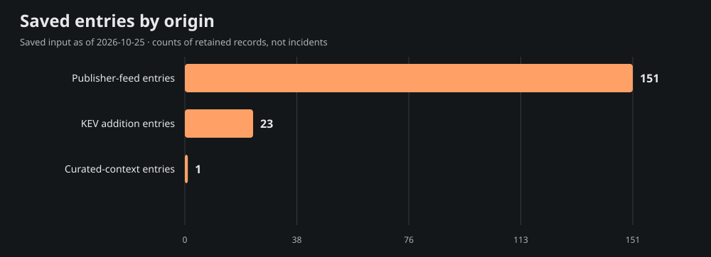
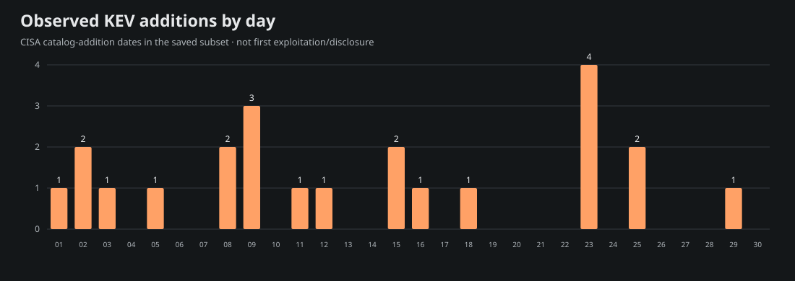
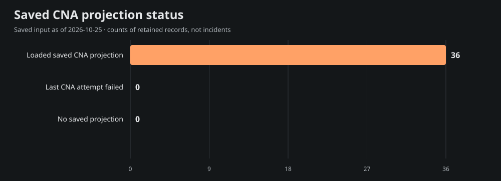

# Team Star Wolf Intelligence Hub
## June 2026 · retrospective

**Edition:** SW-MONTHLY-2026-06-RETRO · **Coverage:** selective, incomplete saved-source subset

**Period:** 2026-06-01T00:00:00-05:00 inclusive to 2026-07-01T00:00:00-05:00 exclusive (America/Chicago).

**Compiled:** 2026-10-25T21:55:23.373Z · **Input generated:** 2026-10-25T21:13:41+00:00 · **Captured:** 2026-10-25T21:29:50.108068Z

This is a retrospective compilation. A closed calendar period does not imply complete evidence. Saved entries, curated context and CNA projections are attributed below; no primary article or CNA record was fetched or independently verified for this edition.

## 1. Executive summary

The admitted saved subset contains **175 entries**: 151 publisher-feed entries, 23 CISA KEV catalog-addition entries and 1 curated-context entry. These mention **36 distinct CVE IDs**; they are not counts of incidents, newly disclosed vulnerabilities, exploited systems or affected devices.

The 9 selected developments below emphasize saved curated context, advisory metadata and dated KEV additions. Selection is bounded and source-based rather than a severity/risk ranking. The report samples 15 of 36 mentioned CVEs for current saved product, score and mitigation context; full entry/cohort/chart data are in [data.json](<https://github.com/TeamStarWolf/intelligence-hub/blob/main/reports/monthly/2026-06/data.json>).

Saved curated context highlights [Oracle issues PeopleSoft PeopleTools security alert](<https://www.oracle.com/security-alerts/alert-cve-2026-35273.html>). These remain the saved curation’s source-attributed account, including any later-update caveats; they are not claims that the whole account was known during the historical period.

|Metric|Observed value|Meaning|
|---|---:|---|
|Saved entries|175|Canonical-URL rows in the selected date recipe|
|Unique mentioned CVEs|36|Union of IDs, not newly published CVEs|
|KEV additions|23|Catalog-addition rows, not first exploitation|
|Aware timestamps|151|Chicago-aware instant membership|
|Date-only rows|24|Literal calendar precision; timezone unknown|
|Cutoff-date rows with unknown time|0|Included calendar-overlap rows, not exact-time evidence|

## 2. Selected source-attributed developments

Up to 10 entries are selected; 9 qualify under this saved-source selection recipe. A headline or CVE mention is a source lead, not a directly re-read incident narrative.

### 1. Oracle issues PeopleSoft PeopleTools security alert

- **Saved source:** [Oracle](<https://www.oracle.com/security-alerts/alert-cve-2026-35273.html>) · curated source context · advisory
- **Recorded date:** 2026-06-10 · publication · calendar-day precision
- **CVE mentions:** CVE-2026-35273
- **Saved exploitation label:** unknown; a mention alone is not exploitation evidence.
- **Saved curation context, observed October 25:** Oracle addresses CVE-2026-35273 in PeopleSoft PeopleTools, describing unauthenticated remote code execution. Check the affected supported versions and mitigation document. The vendor's exploitability description alone is not a finding of compromise in an organization's deployment.

### 2. SVD-2026-0701: Third-Party Package Updates in Python for Scientific Computing - July 2026

- **Saved source:** [Splunk Security Advisories](<https://advisory.splunk.com/advisories/SVD-2026-0701>) · saved Hub entry · advisory
- **Recorded date:** 2026-07-01T00:00:00+00:00 · publication · timestamp with offset
- **CVE mentions:** None projected; no ID inferred from this title.
- **Saved exploitation label:** unknown; a mention alone is not exploitation evidence.
- **Context limit:** Saved headline/metadata only; no article-body facts, actor attribution or remediation are inferred.

### 3. SVD-2026-0614: OS Command Injection in the btool Configuration Helper in Splunk AI Toolkit

- **Saved source:** [Splunk Security Advisories](<https://advisory.splunk.com/advisories/SVD-2026-0614>) · saved Hub entry · advisory
- **Recorded date:** 2026-06-17T00:00:00+00:00 · publication · timestamp with offset
- **CVE mentions:** None projected; no ID inferred from this title.
- **Saved exploitation label:** unknown; a mention alone is not exploitation evidence.
- **Context limit:** Saved headline/metadata only; no article-body facts, actor attribution or remediation are inferred.

### 4. SVD-2026-0613: Insecure Default Domain Allowlist in Splunk AI Toolkit

- **Saved source:** [Splunk Security Advisories](<https://advisory.splunk.com/advisories/SVD-2026-0613>) · saved Hub entry · advisory
- **Recorded date:** 2026-06-17T00:00:00+00:00 · publication · timestamp with offset
- **CVE mentions:** None projected; no ID inferred from this title.
- **Saved exploitation label:** unknown; a mention alone is not exploitation evidence.
- **Context limit:** Saved headline/metadata only; no article-body facts, actor attribution or remediation are inferred.

### 5. CVE-2026-48558 · SimpleHelp Authentication Bypass Vulnerability

- **Saved source:** [CISA Known Exploited Vulnerabilities](<https://www.cisa.gov/known-exploited-vulnerabilities-catalog?field_cve=CVE-2026-48558>) · saved Hub entry · kev
- **Recorded date:** 2026-06-29 · CISA catalog addition · calendar-day precision
- **CVE mentions:** CVE-2026-48558
- **Saved exploitation label:** known; a mention alone is not exploitation evidence.
- **Context limit:** Saved headline/metadata only; no article-body facts, actor attribution or remediation are inferred.

### 6. CVE-2026-12569 · PTC Windchill and FlexPLM Improper Input Validation Vulnerability

- **Saved source:** [CISA Known Exploited Vulnerabilities](<https://www.cisa.gov/known-exploited-vulnerabilities-catalog?field_cve=CVE-2026-12569>) · saved Hub entry · kev
- **Recorded date:** 2026-06-25 · CISA catalog addition · calendar-day precision
- **CVE mentions:** CVE-2026-12569
- **Saved exploitation label:** known; a mention alone is not exploitation evidence.
- **Context limit:** Saved headline/metadata only; no article-body facts, actor attribution or remediation are inferred.

### 7. CVE-2026-20230 · Cisco Unified Communications Manager Server-Side Request Forgery (SSRF) Vulnerability

- **Saved source:** [CISA Known Exploited Vulnerabilities](<https://www.cisa.gov/known-exploited-vulnerabilities-catalog?field_cve=CVE-2026-20230>) · saved Hub entry · kev
- **Recorded date:** 2026-06-25 · CISA catalog addition · calendar-day precision
- **CVE mentions:** CVE-2026-20230
- **Saved exploitation label:** known; a mention alone is not exploitation evidence.
- **Context limit:** Saved headline/metadata only; no article-body facts, actor attribution or remediation are inferred.

### 8. CitrixBleed To Infinity And Beyond (Citrix NetScaler Pre-Auth Memory Overread CVE-2026-8451)

- **Saved source:** [watchTowr Labs](<https://labs.watchtowr.com/citrixbleed-to-infinity-and-beyond-citrix-netscaler-pre-auth-memory-overread-cve-2026-8451/>) · saved Hub entry · research
- **Recorded date:** 2026-06-30T19:35:58+00:00 · publication · timestamp with offset
- **CVE mentions:** CVE-2025-12101, CVE-2025-5777, CVE-2026-3055, CVE-2026-8451
- **Saved exploitation label:** unknown; a mention alone is not exploitation evidence.
- **Context limit:** Saved headline/metadata only; no article-body facts, actor attribution or remediation are inferred.

### 9. Enterprise Tech In, Shell Out (Progress Kemp LoadMaster Uninitialized Heap to Pre-Auth RCE CVE-2026-8037)

- **Saved source:** [watchTowr Labs](<https://labs.watchtowr.com/enterprise-tech-in-shell-out-progress-kemp-loadmaster-uninitialized-heap-to-pre-auth-rce-cve-2026-8037/>) · saved Hub entry · research
- **Recorded date:** 2026-06-29T19:24:54+00:00 · publication · timestamp with offset
- **CVE mentions:** CVE-2026-33691, CVE-2026-8037
- **Saved exploitation label:** unknown; a mention alone is not exploitation evidence.
- **Context limit:** Saved headline/metadata only; no article-body facts, actor attribution or remediation are inferred.

## 3. CISA KEV additions and CVE context

The saved input contains **23** KEV catalog-addition rows in this period. Catalog addition is separate from initial disclosure, first exploitation and the CVE identifier’s year. These are current-catalog observations captured October 25, not a frozen catalog from the historical month.

Showing 23 of 23 rows below; all admitted rows are retained in data.json.

|Added|CVE|Saved vendor/product tags|Current saved federal due date|
|---|---|---|---|
|2026-06-29|[CVE-2026-48558](<https://www.cisa.gov/known-exploited-vulnerabilities-catalog?field_cve=CVE-2026-48558>)|SimpleHelp · SimpleHelp|2026-07-02|
|2026-06-25|[CVE-2026-12569](<https://www.cisa.gov/known-exploited-vulnerabilities-catalog?field_cve=CVE-2026-12569>)|PTC · Windchill and FlexPLM|2026-06-28|
|2026-06-25|[CVE-2026-20230](<https://www.cisa.gov/known-exploited-vulnerabilities-catalog?field_cve=CVE-2026-20230>)|Cisco · Unified Communications Manager|2026-06-28|
|2026-06-23|[CVE-2025-67038](<https://www.cisa.gov/known-exploited-vulnerabilities-catalog?field_cve=CVE-2025-67038>)|Lantronix · EDS5000|2026-06-26|
|2026-06-23|[CVE-2026-34908](<https://www.cisa.gov/known-exploited-vulnerabilities-catalog?field_cve=CVE-2026-34908>)|Ubiquiti · UniFi OS|2026-06-26|
|2026-06-23|[CVE-2026-34909](<https://www.cisa.gov/known-exploited-vulnerabilities-catalog?field_cve=CVE-2026-34909>)|Ubiquiti · UniFi OS|2026-06-26|
|2026-06-23|[CVE-2026-34910](<https://www.cisa.gov/known-exploited-vulnerabilities-catalog?field_cve=CVE-2026-34910>)|Ubiquiti · UniFi OS|2026-06-26|
|2026-06-18|[CVE-2026-20253](<https://www.cisa.gov/known-exploited-vulnerabilities-catalog?field_cve=CVE-2026-20253>)|Splunk · Enterprise|2026-06-21|
|2026-06-16|[CVE-2026-48907](<https://www.cisa.gov/known-exploited-vulnerabilities-catalog?field_cve=CVE-2026-48907>)|Widget Factory · Joomla Content Editor|2026-06-19|
|2026-06-15|[CVE-2026-20262](<https://www.cisa.gov/known-exploited-vulnerabilities-catalog?field_cve=CVE-2026-20262>)|Cisco · Catalyst SD-WAN Manager|2026-06-29|
|2026-06-15|[CVE-2026-54420](<https://www.cisa.gov/known-exploited-vulnerabilities-catalog?field_cve=CVE-2026-54420>)|LiteSpeed · cPanel Plugin|2026-06-18|
|2026-06-12|[CVE-2026-35273](<https://www.cisa.gov/known-exploited-vulnerabilities-catalog?field_cve=CVE-2026-35273>)|Oracle · PeopleSoft Enterprise PeopleTools|2026-06-15|
|2026-06-11|[CVE-2026-10520](<https://www.cisa.gov/known-exploited-vulnerabilities-catalog?field_cve=CVE-2026-10520>)|Ivanti · Sentry|2026-06-14|
|2026-06-09|[CVE-2026-11645](<https://www.cisa.gov/known-exploited-vulnerabilities-catalog?field_cve=CVE-2026-11645>)|Google · Chromium V8|2026-06-23|
|2026-06-09|[CVE-2026-20245](<https://www.cisa.gov/known-exploited-vulnerabilities-catalog?field_cve=CVE-2026-20245>)|Cisco · Catalyst SD-WAN Manager|2026-06-23|
|2026-06-09|[CVE-2026-7473](<https://www.cisa.gov/known-exploited-vulnerabilities-catalog?field_cve=CVE-2026-7473>)|Arista · Extensible Operating System|2026-06-23|
|2026-06-08|[CVE-2026-42271](<https://www.cisa.gov/known-exploited-vulnerabilities-catalog?field_cve=CVE-2026-42271>)|BerriAI · LiteLLM|2026-06-22|
|2026-06-08|[CVE-2026-50751](<https://www.cisa.gov/known-exploited-vulnerabilities-catalog?field_cve=CVE-2026-50751>)|Check Point · Security Gateway|2026-06-11|
|2026-06-05|[CVE-2026-28318](<https://www.cisa.gov/known-exploited-vulnerabilities-catalog?field_cve=CVE-2026-28318>)|SolarWinds · Serv-U|2026-06-19|
|2026-06-03|[CVE-2026-45247](<https://www.cisa.gov/known-exploited-vulnerabilities-catalog?field_cve=CVE-2026-45247>)|Mirasvit · Mirasvit Full Page Cache Warmer|2026-06-06|
|2026-06-02|[CVE-2022-0492](<https://www.cisa.gov/known-exploited-vulnerabilities-catalog?field_cve=CVE-2022-0492>)|Linux · Kernel|2026-06-05|
|2026-06-02|[CVE-2025-48595](<https://www.cisa.gov/known-exploited-vulnerabilities-catalog?field_cve=CVE-2025-48595>)|Android · Framework|2026-06-05|
|2026-06-01|[CVE-2024-21182](<https://www.cisa.gov/known-exploited-vulnerabilities-catalog?field_cve=CVE-2024-21182>)|Oracle · WebLogic Server|2026-06-04|

Federal due dates are source catalog data, not deadlines assigned to this site’s visitors. Ransomware and exploitation assertions, where supplied, remain source-scoped in data.json.

### Current saved CNA sample

These 15 sampled projections are current context from the saved input. Their record-state, retrieval/update/attempt clocks and CNA score version remain explicit. Loaded projections can include rejected records; failed enrichment may retain older successful content. No source record was re-read for this report.

|CVE|Projection / record state|Saved CVSS|Saved guidance status|
|---|---|---|---|
|[CVE-2026-35273](<https://www.cve.org/CVERecord?id=CVE-2026-35273>)|ok / PUBLISHED|9.8 (v3.1; saved CNA metric)|cisa-action|
|[CVE-2026-48558](<https://www.cve.org/CVERecord?id=CVE-2026-48558>)|ok / PUBLISHED|9.5 (v4.0; saved CNA metric)|cisa-action|
|[CVE-2026-12569](<https://www.cve.org/CVERecord?id=CVE-2026-12569>)|ok / PUBLISHED|9.3 (v4.0; saved CNA metric)|cisa-action|
|[CVE-2026-20230](<https://www.cve.org/CVERecord?id=CVE-2026-20230>)|ok / PUBLISHED|8.6 (v3.1; saved CNA metric)|cisa-action|
|[CVE-2025-12101](<https://www.cve.org/CVERecord?id=CVE-2025-12101>)|ok / PUBLISHED|5.9 (v4.0; saved CNA metric)|needs-review|
|[CVE-2025-5777](<https://www.cve.org/CVERecord?id=CVE-2025-5777>)|ok / PUBLISHED|9.3 (v4.0; saved CNA metric)|cisa-action|
|[CVE-2026-3055](<https://www.cve.org/CVERecord?id=CVE-2026-3055>)|ok / PUBLISHED|9.3 (v4.0; saved CNA metric)|cisa-action|
|[CVE-2026-8451](<https://www.cve.org/CVERecord?id=CVE-2026-8451>)|ok / PUBLISHED|8.8 (v4.0; saved CNA metric)|needs-review|
|[CVE-2026-33691](<https://www.cve.org/CVERecord?id=CVE-2026-33691>)|ok / PUBLISHED|6.8 (v3.1; saved CNA metric)|needs-review|
|[CVE-2026-8037](<https://www.cve.org/CVERecord?id=CVE-2026-8037>)|ok / PUBLISHED|9.6 (v3.1; saved CNA metric)|cisa-action|
|[CVE-2022-0492](<https://www.cve.org/CVERecord?id=CVE-2022-0492>)|ok / PUBLISHED|Not supplied in saved projection|cisa-action|
|[CVE-2023-20118](<https://www.cve.org/CVERecord?id=CVE-2023-20118>)|ok / PUBLISHED|6.5 (v3.1; saved CNA metric)|cisa-action|
|[CVE-2024-21182](<https://www.cve.org/CVERecord?id=CVE-2024-21182>)|ok / PUBLISHED|7.5 (v3.1; saved CNA metric)|cisa-action|
|[CVE-2025-32432](<https://www.cve.org/CVERecord?id=CVE-2025-32432>)|ok / PUBLISHED|10 (v3.1; saved CNA metric)|cisa-action|
|[CVE-2025-48595](<https://www.cve.org/CVERecord?id=CVE-2025-48595>)|ok / PUBLISHED|Not supplied in saved projection|cisa-action|

## 4. Campaigns and actors

**not_projected.** Schema 4 supplied no structured actor/campaign entity or relationship projection. Names in saved headlines, research or curated prose are not promoted into attribution, aliases or ATT&CK/CAPEC relationships. This does not establish that no campaign occurred.

## 5. Supply chain and AI security

Only exact saved tags select the following topic leads; this is not inferred impact or attack taxonomy.
No admitted entry selected by the exact supply-chain/ai-security/prompt-injection tag filter. That is a limitation of this saved subset, not evidence of absence.

## 6. Mitigation and product context

This is current saved projection context, not patch verification or knowledge backdated into the report month. Exact installed versions/configuration were not assessed. Full bounded product/version statements, source links and saved analysis steps are in data.json. CWE, CAPEC and actor fields are **not_projected**, rather than empty-proof of no weakness or attack pattern.

### CVE-2026-35273

- **Current saved state:** ok / PUBLISHED; 9.8 (v3.1; saved CNA metric).
- **Clocks:** retrieved 2026-10-24T22:24:17+00:00; record updated 2026-08-04T03:56:12+00:00; attempted 2026-10-24T22:24:17+00:00.
- **Saved product labels:** Oracle Corporation / PeopleSoft Enterprise PeopleTools 
- **Saved CISA action excerpt (shortened):** Apply mitigations in accordance with vendor instructions, ensuring compliance with CISA’s BOD 26-04 Prioritizing Security Updates Based on Risk (see URL in Notes) guidance and CISA’s “Forensics Triage Requirements” (see URL in Notes). Follow applicable BOD 26-04 guidance for cloud services or discontinue use of the product if mitigations are unavailable. St…
- **Source pointer:** [Saved record reference](<https://www.cve.org/CVERecord?id=CVE-2026-35273>). No direct source review or environment applicability is established.

### CVE-2026-48558

- **Current saved state:** ok / PUBLISHED; 9.5 (v4.0; saved CNA metric).
- **Clocks:** retrieved 2026-10-24T22:24:15+00:00; record updated 2026-10-07T19:26:16+00:00; attempted 2026-10-24T22:24:15+00:00.
- **Saved product labels:** SimpleHelp / SimpleHelp 
- **Saved CISA action excerpt (shortened):** Apply mitigations in accordance with vendor instructions, ensuring compliance with CISA’s BOD 26-04 Prioritizing Security Updates Based on Risk (see URL in Notes) guidance and CISA’s “Forensics Triage Requirements” (see URL in Notes). Follow applicable BOD 26-04 guidance for cloud services or discontinue use of the product if mitigations are unavailable. St…
- **Source pointer:** [Saved record reference](<https://www.cve.org/CVERecord?id=CVE-2026-48558>). No direct source review or environment applicability is established.

### CVE-2026-12569

- **Current saved state:** ok / PUBLISHED; 9.3 (v4.0; saved CNA metric).
- **Clocks:** retrieved 2026-10-24T22:24:23+00:00; record updated 2026-08-01T03:55:29+00:00; attempted 2026-10-24T22:24:23+00:00.
- **Saved product labels:** PTC / Windchill PDMLink; PTC / FlexPLM 
- **Saved CISA action excerpt (shortened):** Apply mitigations in accordance with vendor instructions, ensuring compliance with CISA’s BOD 26-04 Prioritizing Security Updates Based on Risk (see URL in Notes) guidance and CISA’s “Forensics Triage Requirements” (see URL in Notes). Follow applicable BOD 26-04 guidance for cloud services or discontinue use of the product if mitigations are unavailable. St…
- **Source pointer:** [Saved record reference](<https://www.cve.org/CVERecord?id=CVE-2026-12569>). No direct source review or environment applicability is established.

### CVE-2026-20230

- **Current saved state:** ok / PUBLISHED; 8.6 (v3.1; saved CNA metric).
- **Clocks:** retrieved 2026-10-24T22:24:21+00:00; record updated 2026-10-07T18:09:00+00:00; attempted 2026-10-24T22:24:20+00:00.
- **Saved product labels:** Cisco / Cisco Unified Communications Manager 
- **Saved CISA action excerpt (shortened):** Apply mitigations in accordance with vendor instructions, ensuring compliance with CISA’s BOD 26-04 Prioritizing Security Updates Based on Risk (see URL in Notes) guidance and CISA’s “Forensics Triage Requirements” (see URL in Notes). Follow applicable BOD 26-04 guidance for cloud services or discontinue use of the product if mitigations are unavailable. St…
- **Source pointer:** [Saved record reference](<https://www.cve.org/CVERecord?id=CVE-2026-20230>). No direct source review or environment applicability is established.

### CVE-2025-12101

- **Current saved state:** ok / PUBLISHED; 5.9 (v4.0; saved CNA metric).
- **Clocks:** retrieved 2026-10-24T22:24:34+00:00; record updated 2025-11-12T20:03:26+00:00; attempted 2026-10-24T22:24:34+00:00.
- **Saved product labels:** NetScaler / ADC; NetScaler / Gateway 
- **Guidance gap:** no action/solution/workaround supplied in this saved projection; this is unknown, not proof no fix exists.
- **Source pointer:** [Saved record reference](<https://www.cve.org/CVERecord?id=CVE-2025-12101>). No direct source review or environment applicability is established.

### CVE-2025-5777

- **Current saved state:** ok / PUBLISHED; 9.3 (v4.0; saved CNA metric).
- **Clocks:** retrieved 2026-10-24T22:24:29+00:00; record updated 2026-10-07T17:58:25+00:00; attempted 2026-10-24T22:24:29+00:00.
- **Saved product labels:** NetScaler / ADC; NetScaler / Gateway 
- **Saved CISA action excerpt:** Apply mitigations per vendor instructions, follow applicable BOD 22-01 guidance for cloud services, or discontinue use of the product if mitigations are unavailable.
- **Source pointer:** [Saved record reference](<https://www.cve.org/CVERecord?id=CVE-2025-5777>). No direct source review or environment applicability is established.

### CVE-2026-3055

- **Current saved state:** ok / PUBLISHED; 9.3 (v4.0; saved CNA metric).
- **Clocks:** retrieved 2026-10-24T22:24:17+00:00; record updated 2026-03-31T03:55:32+00:00; attempted 2026-10-24T22:24:17+00:00.
- **Saved product labels:** NetScaler / ADC; NetScaler / Gateway 
- **Saved CISA action excerpt:** Apply mitigations per vendor instructions, follow applicable BOD 22-01 guidance for cloud services, or discontinue use of the product if mitigations are unavailable.
- **Source pointer:** [Saved record reference](<https://www.cve.org/CVERecord?id=CVE-2026-3055>). No direct source review or environment applicability is established.

### CVE-2026-8451

- **Current saved state:** ok / PUBLISHED; 8.8 (v4.0; saved CNA metric).
- **Clocks:** retrieved 2026-10-24T22:24:10+00:00; record updated 2026-06-30T13:43:41+00:00; attempted 2026-10-24T22:24:09+00:00.
- **Saved product labels:** NetScaler / ADC; NetScaler / Gateway 
- **Guidance gap:** no action/solution/workaround supplied in this saved projection; this is unknown, not proof no fix exists.
- **Source pointer:** [Saved record reference](<https://www.cve.org/CVERecord?id=CVE-2026-8451>). No direct source review or environment applicability is established.

### CVE-2026-33691

- **Current saved state:** ok / PUBLISHED; 6.8 (v3.1; saved CNA metric).
- **Clocks:** retrieved 2026-10-24T22:24:17+00:00; record updated 2026-04-18T19:16:54+00:00; attempted 2026-10-24T22:24:17+00:00.
- **Saved product labels:** coreruleset / coreruleset 
- **Guidance gap:** no action/solution/workaround supplied in this saved projection; this is unknown, not proof no fix exists.
- **Source pointer:** [Saved record reference](<https://www.cve.org/CVERecord?id=CVE-2026-33691>). No direct source review or environment applicability is established.

### CVE-2026-8037

- **Current saved state:** ok / PUBLISHED; 9.6 (v3.1; saved CNA metric).
- **Clocks:** retrieved 2026-10-24T22:24:10+00:00; record updated 2026-10-15T13:20:45+00:00; attempted 2026-10-24T22:24:10+00:00.
- **Saved product labels:** Progress Software / LoadMaster; Progress Software / ECS Connections Manager; Progress Software / Object Scale Connection Manager (first 3 shown; full bounded projection in data.json)
- **Saved CISA action excerpt (shortened):** Apply mitigations in accordance with vendor instructions, ensuring compliance with CISA’s BOD 26-04 Prioritizing Security Updates Based on Risk (see URL in Notes) guidance and CISA’s “Forensics Triage Requirements” (see URL in Notes). Follow applicable BOD 26-04 guidance for cloud services or discontinue use of the product if mitigations are unavailable. St…
- **Source pointer:** [Saved record reference](<https://www.cve.org/CVERecord?id=CVE-2026-8037>). No direct source review or environment applicability is established.

### CVE-2022-0492

- **Current saved state:** ok / PUBLISHED; Not supplied in saved projection.
- **Clocks:** retrieved 2026-10-24T22:24:52+00:00; record updated 2026-06-03T03:55:20+00:00; attempted 2026-10-24T22:24:52+00:00.
- **Saved product labels:** n/a / kernel 
- **Saved CISA action excerpt:** Apply mitigations per vendor instructions, follow applicable BOD 22-01 guidance for cloud services, or discontinue use of the product if mitigations are unavailable.
- **Source pointer:** [Saved record reference](<https://www.cve.org/CVERecord?id=CVE-2022-0492>). No direct source review or environment applicability is established.

### CVE-2023-20118

- **Current saved state:** ok / PUBLISHED; 6.5 (v3.1; saved CNA metric).
- **Clocks:** retrieved 2026-10-24T22:24:47+00:00; record updated 2025-10-21T23:15:20+00:00; attempted 2026-10-24T22:24:47+00:00.
- **Saved product labels:** Cisco / Cisco Small Business RV Series Router Firmware 
- **Saved CISA action excerpt:** Apply mitigations per vendor instructions, follow applicable BOD 22-01 guidance for cloud services, or discontinue use of the product if mitigations are unavailable.
- **Source pointer:** [Saved record reference](<https://www.cve.org/CVERecord?id=CVE-2023-20118>). No direct source review or environment applicability is established.

### CVE-2024-21182

- **Current saved state:** ok / PUBLISHED; 7.5 (v3.1; saved CNA metric).
- **Clocks:** retrieved 2026-10-24T22:24:40+00:00; record updated 2026-06-02T03:55:36+00:00; attempted 2026-10-24T22:24:40+00:00.
- **Saved product labels:** Oracle Corporation / WebLogic Server 
- **Saved CISA action excerpt:** Apply mitigations per vendor instructions, follow applicable BOD 22-01 guidance for cloud services, or discontinue use of the product if mitigations are unavailable.
- **Source pointer:** [Saved record reference](<https://www.cve.org/CVERecord?id=CVE-2024-21182>). No direct source review or environment applicability is established.

### CVE-2025-32432

- **Current saved state:** ok / PUBLISHED; 10 (v3.1; saved CNA metric).
- **Clocks:** retrieved 2026-10-24T22:24:31+00:00; record updated 2026-03-21T04:00:57+00:00; attempted 2026-10-24T22:24:31+00:00.
- **Saved product labels:** craftcms / cms 
- **Saved CISA action excerpt:** Apply mitigations per vendor instructions, follow applicable BOD 22-01 guidance for cloud services, or discontinue use of the product if mitigations are unavailable.
- **Source pointer:** [Saved record reference](<https://www.cve.org/CVERecord?id=CVE-2025-32432>). No direct source review or environment applicability is established.

### CVE-2025-48595

- **Current saved state:** ok / PUBLISHED; Not supplied in saved projection.
- **Clocks:** retrieved 2026-10-24T22:24:30+00:00; record updated 2026-06-03T03:55:19+00:00; attempted 2026-10-24T22:24:29+00:00.
- **Saved product labels:** Google / Android 
- **Saved CISA action excerpt:** Apply mitigations per vendor instructions, follow applicable BOD 22-01 guidance for cloud services, or discontinue use of the product if mitigations are unavailable.
- **Source pointer:** [Saved record reference](<https://www.cve.org/CVERecord?id=CVE-2025-48595>). No direct source review or environment applicability is established.

## 7. Changes to prior reporting

**Revision watch: not_run · no_baseline.** No primary citation was rechecked and no material-change claim is made. The 48–96-hour citation review policy remains planned; raw hashes or timestamps alone would not prove a material security change.

## 8. Watchlist for the next review

- The saved input provides loaded projections for all 36 mentioned CVEs. A source-review priority is whether publisher conditions changed after the displayed clocks; no such check is recorded here.
- Review primary conditions for the 15 sampled CVEs; their saved retrieval/update clocks describe current context, not what was known in 2026-06.
- Actor/CWE/CAPEC mapping and prior-source revision checks remain unprojected/not run; no attribution or material-change claim is made.

Next nominal report/review cycle: **2026-10-25T22:00:00-05:00** (2026-10-26T03:00:00.000Z). **Planned; activation not verified for this edition.** Individual citation eligibility/caps/cooldowns may defer a source; this is not an on-time delivery or all-articles-checked promise.

## 9. Coverage and limitations

The whole input saved 62 source ledgers:54 ok,7 partial and1 failed. These describe last saved attempts around input generation, **not source health during 2026-06**. Source-specific period rows and origin dimensions are in data.json. The whole input window was 2016-10-25 through 2026-10-25, with bounded retained feed history.

- Saved publisher headlines and curated summaries are source-attributed leads, not direct article-body fact verification.
- Counts describe a bounded retained public subset, not all incidents, newly disclosed vulnerabilities, attacks or exposed systems.
- KEV addition dates identify catalog additions, not first disclosure/exploitation; current catalog membership can differ from a historical catalog.
- Input observed October 25; individual CNA update/retrieval and source-status clocks are retained separately and are not backdated into the report period.
- The 60 globally missing primary dates remain unassigned; failed/partial feed intake and bounded retention create coverage gaps.
- Date-only records retain calendar precision and unknown timezone; October cutoff-day records have unknown time relative to the exact MTD cutoff.
- No private account/social metrics, environment inventory, raw primary sources, actor aliases, inferred CWE/CAPEC links or oldW43 claims are included.
- Next nominal report/review cycle is planned until separate activation/readback; no unattended timing or per-source fetch guarantee.

**Date recipe:** aware timestamps use America/Chicago instant membership in the stated half-open period; date-only rows retain their literal calendar date/timezone unknown. Missing dates are globally unassigned. October MTD admits cutoff-date-only rows as calendar overlap with exact time unknown. Source event/publication/KEV dates are not interchangeable.

**Chart recipes:** every plotted row, unit, as-of clock and evidence ID is in data.json. Charts use actual admitted counts; no November/December future bars or social/account metrics are generated.

## 10. Primary-first source pointers

Input: [Saved Intelligence Hub snapshot](<https://teamstarwolf.github.io/intelligence-hub/data/feed.json>) · schema 4 · SHA-256 `eb44f9aaa505efe604fb2f17c88397dec08fc77d00d554dc096ab720573f4199`. Captured 2026-10-25T21:29:50.108068Z, generated 2026-10-25T21:13:41+00:00. Structural qualification is not a raw-primary-article/CNA truth claim.

- [Saved Intelligence Hub input](<https://teamstarwolf.github.io/intelligence-hub/data/feed.json>) — saved\_hub\_entry / input
- [CISA KEV catalog reference](<https://www.cisa.gov/known-exploited-vulnerabilities-catalog>) — saved\_hub\_entry / catalog
- [CVE-2026-35273 saved record reference](<https://www.cve.org/CVERecord?id=CVE-2026-35273>) — CNA\_projection / record
- [CVE-2026-35273 saved publisher guidance reference](<https://www.oracle.com/security-alerts/alert-cve-2026-35273.html>) — CNA\_projection / guidance
- [CVE-2026-48558 saved record reference](<https://www.cve.org/CVERecord?id=CVE-2026-48558>) — CNA\_projection / record
- [CVE-2026-48558 saved publisher guidance reference](<https://simple-help.com/security/simplehelp-security-update-2026-05>) — CNA\_projection / guidance
- [CVE-2026-12569 saved record reference](<https://www.cve.org/CVERecord?id=CVE-2026-12569>) — CNA\_projection / record
- [CVE-2026-12569 saved publisher guidance reference](<https://www.ptc.com/en/support/article/CS473270>) — CNA\_projection / guidance
- [CVE-2026-20230 saved record reference](<https://www.cve.org/CVERecord?id=CVE-2026-20230>) — CNA\_projection / record
- [CVE-2025-12101 saved record reference](<https://www.cve.org/CVERecord?id=CVE-2025-12101>) — CNA\_projection / record
- [CVE-2025-5777 saved record reference](<https://www.cve.org/CVERecord?id=CVE-2025-5777>) — CNA\_projection / record
- [CVE-2026-3055 saved record reference](<https://www.cve.org/CVERecord?id=CVE-2026-3055>) — CNA\_projection / record
- [CVE-2026-8451 saved record reference](<https://www.cve.org/CVERecord?id=CVE-2026-8451>) — CNA\_projection / record
- [CVE-2026-33691 saved record reference](<https://www.cve.org/CVERecord?id=CVE-2026-33691>) — CNA\_projection / record
- [CVE-2026-8037 saved record reference](<https://www.cve.org/CVERecord?id=CVE-2026-8037>) — CNA\_projection / record
- [CVE-2026-8037 saved publisher guidance reference](<https://community.progress.com/s/article/LoadMaster-Critical-Security-Bulletin-June-2026-CVE-2026-8037-CVE-2026-33691>) — CNA\_projection / guidance
- [CVE-2022-0492 saved record reference](<https://www.cve.org/CVERecord?id=CVE-2022-0492>) — CNA\_projection / record
- [CVE-2022-0492 saved publisher guidance reference](<https://www.debian.org/security/2022/dsa-5095>) — CNA\_projection / guidance
- [CVE-2023-20118 saved record reference](<https://www.cve.org/CVERecord?id=CVE-2023-20118>) — CNA\_projection / record
- [CVE-2024-21182 saved record reference](<https://www.cve.org/CVERecord?id=CVE-2024-21182>) — CNA\_projection / record
- [CVE-2024-21182 saved publisher guidance reference](<https://www.oracle.com/security-alerts/cpujul2024.html>) — CNA\_projection / guidance
- [CVE-2025-32432 saved record reference](<https://www.cve.org/CVERecord?id=CVE-2025-32432>) — CNA\_projection / record
- [CVE-2025-48595 saved record reference](<https://www.cve.org/CVERecord?id=CVE-2025-48595>) — CNA\_projection / record
- [SVD-2026-0701: Third-Party Package Updates in Python for Scientific Computing - July 2026](<https://advisory.splunk.com/advisories/SVD-2026-0701>) — saved\_hub\_entry / advisory
- [SVD-2026-0614: OS Command Injection in the btool Configuration Helper in Splunk AI Toolkit](<https://advisory.splunk.com/advisories/SVD-2026-0614>) — saved\_hub\_entry / advisory
- [SVD-2026-0613: Insecure Default Domain Allowlist in Splunk AI Toolkit](<https://advisory.splunk.com/advisories/SVD-2026-0613>) — saved\_hub\_entry / advisory
- [CVE-2026-48558 · SimpleHelp Authentication Bypass Vulnerability](<https://www.cisa.gov/known-exploited-vulnerabilities-catalog?field_cve=CVE-2026-48558>) — saved\_hub\_entry / kev
- [CVE-2026-12569 · PTC Windchill and FlexPLM Improper Input Validation Vulnerability](<https://www.cisa.gov/known-exploited-vulnerabilities-catalog?field_cve=CVE-2026-12569>) — saved\_hub\_entry / kev
- [CVE-2026-20230 · Cisco Unified Communications Manager Server-Side Request Forgery (SSRF) Vulnerability](<https://www.cisa.gov/known-exploited-vulnerabilities-catalog?field_cve=CVE-2026-20230>) — saved\_hub\_entry / kev
- [CitrixBleed To Infinity And Beyond (Citrix NetScaler Pre-Auth Memory Overread CVE-2026-8451)](<https://labs.watchtowr.com/citrixbleed-to-infinity-and-beyond-citrix-netscaler-pre-auth-memory-overread-cve-2026-8451/>) — saved\_hub\_entry / research
- [Enterprise Tech In, Shell Out (Progress Kemp LoadMaster Uninitialized Heap to Pre-Auth RCE CVE-2026-8037)](<https://labs.watchtowr.com/enterprise-tech-in-shell-out-progress-kemp-loadmaster-uninitialized-heap-to-pre-auth-rce-cve-2026-8037/>) — saved\_hub\_entry / research

---
Data companion: [data.json](data.json). Generation and revision-check statuses describe this edition. Planned next-cycle times are not a guarantee of delivery.
