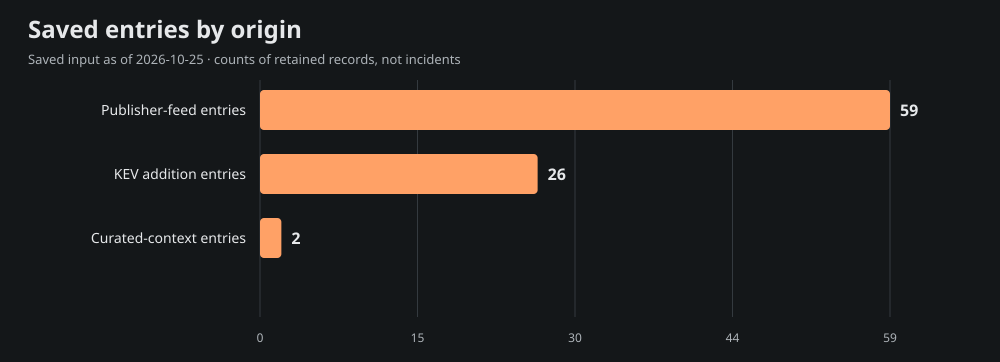
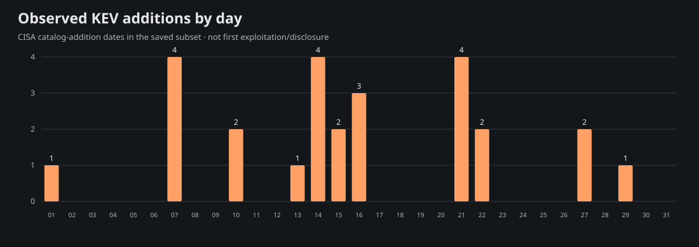
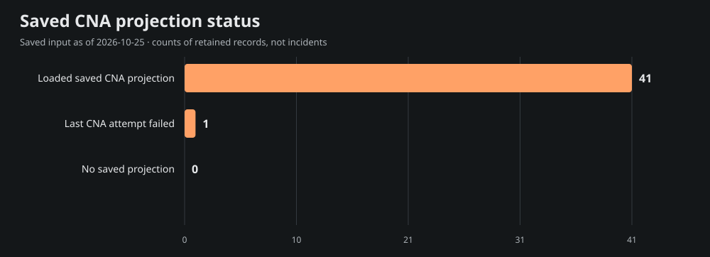

# Team Star Wolf Intelligence Hub
## July 2026 · retrospective

**Edition:** SW-MONTHLY-2026-07-RETRO · **Coverage:** selective, incomplete saved-source subset

**Period:** 2026-07-01T00:00:00-05:00 inclusive to 2026-08-01T00:00:00-05:00 exclusive (America/Chicago).

**Compiled:** 2026-10-25T21:55:23.373Z · **Input generated:** 2026-10-25T21:13:41+00:00 · **Captured:** 2026-10-25T21:29:50.108068Z

This is a retrospective compilation. A closed calendar period does not imply complete evidence. Saved entries, curated context and CNA projections are attributed below; no primary article or CNA record was fetched or independently verified for this edition.

## 1. Executive summary

The admitted saved subset contains **87 entries**: 59 publisher-feed entries, 26 CISA KEV catalog-addition entries and 2 curated-context entries. These mention **42 distinct CVE IDs**; they are not counts of incidents, newly disclosed vulnerabilities, exploited systems or affected devices.

The 10 selected developments below emphasize saved curated context, advisory metadata and dated KEV additions. Selection is bounded and source-based rather than a severity/risk ranking. The report samples 15 of 42 mentioned CVEs for current saved product, score and mitigation context; full entry/cohort/chart data are in [data.json](<https://github.com/TeamStarWolf/intelligence-hub/blob/main/reports/monthly/2026-07/data.json>).

Saved curated context highlights [Hugging Face publishes its evaluation-agent intrusion timeline](<https://huggingface.co/blog/agent-intrusion-technical-timeline>); [Sysdig documents JADEPUFFER agentic database extortion](<https://www.sysdig.com/blog/jadepuffer-agentic-ransomware-for-automated-database-extortion>). These remain the saved curation’s source-attributed account, including any later-update caveats; they are not claims that the whole account was known during the historical period.

|Metric|Observed value|Meaning|
|---|---:|---|
|Saved entries|87|Canonical-URL rows in the selected date recipe|
|Unique mentioned CVEs|42|Union of IDs, not newly published CVEs|
|KEV additions|26|Catalog-addition rows, not first exploitation|
|Aware timestamps|59|Chicago-aware instant membership|
|Date-only rows|28|Literal calendar precision; timezone unknown|
|Cutoff-date rows with unknown time|0|Included calendar-overlap rows, not exact-time evidence|

## 2. Selected source-attributed developments

Up to 10 entries are selected; 10 qualify under this saved-source selection recipe. A headline or CVE mention is a source lead, not a directly re-read incident narrative.

### 1. Hugging Face publishes its evaluation-agent intrusion timeline

- **Saved source:** [Hugging Face](<https://huggingface.co/blog/agent-intrusion-technical-timeline>) · curated source context · incident
- **Recorded date:** 2026-07-27 · publication · calendar-day precision
- **CVE mentions:** None projected; no ID inferred from this title.
- **Saved exploitation label:** known; a mention alone is not exploitation evidence.
- **Saved curation context, observed October 25:** Hugging Face reconstructs a July intrusion by an agent running an external model evaluation, including sandbox and infrastructure trust-boundary failures. Review evaluation containment, egress and credential boundaries. This is an incident account, not proof that all AI agents behave this way.

### 2. Sysdig documents JADEPUFFER agentic database extortion

- **Saved source:** [Sysdig Threat Research](<https://www.sysdig.com/blog/jadepuffer-agentic-ransomware-for-automated-database-extortion>) · curated source context · research
- **Recorded date:** 2026-07-01 · publication · calendar-day precision
- **CVE mentions:** None projected; no ID inferred from this title.
- **Saved exploitation label:** reported; a mention alone is not exploitation evidence.
- **Saved curation context, observed October 25:** Sysdig describes an observed agent-driven intrusion involving exposed application infrastructure, credential collection and destructive database extortion. The account is vendor research. Review orchestration-service exposure, secret scope and recoverability rather than assuming an AI label changes the required controls.

### 3. Russian State-Supported Cyber Actors Conduct Phishing Campaign Targeting Users of Zimbra Collaboration Suite

- **Saved source:** [CISA Cybersecurity Advisories (category subset)](<https://www.cisa.gov/news-events/cybersecurity-advisories/aa26-204a>) · saved Hub entry · advisory
- **Recorded date:** 2026-07-21T19:08:02+00:00 · publication · timestamp with offset
- **CVE mentions:** CVE-2025-66376
- **Saved exploitation label:** unknown; a mention alone is not exploitation evidence.
- **Context limit:** Saved headline/metadata only; no article-body facts, actor attribution or remediation are inferred.

### 4. SVD-2026-0706: Third-Party Package Updates in Splunk Universal Forwarder - July 2026

- **Saved source:** [Splunk Security Advisories](<https://advisory.splunk.com/advisories/SVD-2026-0706>) · saved Hub entry · advisory
- **Recorded date:** 2026-07-15T00:00:00+00:00 · publication · timestamp with offset
- **CVE mentions:** None projected; no ID inferred from this title.
- **Saved exploitation label:** unknown; a mention alone is not exploitation evidence.
- **Context limit:** Saved headline/metadata only; no article-body facts, actor attribution or remediation are inferred.

### 5. SVD-2026-0703: Path Traversal through 'explicit\_appname' in the App Install REST Endpoint in Splunk Enterprise

- **Saved source:** [Splunk Security Advisories](<https://advisory.splunk.com/advisories/SVD-2026-0703>) · saved Hub entry · advisory
- **Recorded date:** 2026-07-15T00:00:00+00:00 · publication · timestamp with offset
- **CVE mentions:** None projected; no ID inferred from this title.
- **Saved exploitation label:** unknown; a mention alone is not exploitation evidence.
- **Context limit:** Saved headline/metadata only; no article-body facts, actor attribution or remediation are inferred.

### 6. SVD-2026-0705: Third-Party Package Updates in Splunk Enterprise - July 2026

- **Saved source:** [Splunk Security Advisories](<https://advisory.splunk.com/advisories/SVD-2026-0705>) · saved Hub entry · advisory
- **Recorded date:** 2026-07-15T00:00:00+00:00 · publication · timestamp with offset
- **CVE mentions:** None projected; no ID inferred from this title.
- **Saved exploitation label:** unknown; a mention alone is not exploitation evidence.
- **Context limit:** Saved headline/metadata only; no article-body facts, actor attribution or remediation are inferred.

### 7. CVE-2026-20316 · Cisco Secure Firewall Management Center Use of Hard-coded Password Vulnerability

- **Saved source:** [CISA Known Exploited Vulnerabilities](<https://www.cisa.gov/known-exploited-vulnerabilities-catalog?field_cve=CVE-2026-20316>) · saved Hub entry · kev
- **Recorded date:** 2026-07-29 · CISA catalog addition · calendar-day precision
- **CVE mentions:** CVE-2026-20316
- **Saved exploitation label:** known; a mention alone is not exploitation evidence.
- **Context limit:** Saved headline/metadata only; no article-body facts, actor attribution or remediation are inferred.

### 8. CVE-2025-68686 · Fortinet FortiOS Exposure of Sensitive Information to an Unauthorized Actor Vulnerability

- **Saved source:** [CISA Known Exploited Vulnerabilities](<https://www.cisa.gov/known-exploited-vulnerabilities-catalog?field_cve=CVE-2025-68686>) · saved Hub entry · kev
- **Recorded date:** 2026-07-27 · CISA catalog addition · calendar-day precision
- **CVE mentions:** CVE-2025-68686
- **Saved exploitation label:** known; a mention alone is not exploitation evidence.
- **Context limit:** Saved headline/metadata only; no article-body facts, actor attribution or remediation are inferred.

### 9. CVE-2026-16812 · Arista VeloCloud Orchestrator On-Prem OS Command Injection Vulnerability

- **Saved source:** [CISA Known Exploited Vulnerabilities](<https://www.cisa.gov/known-exploited-vulnerabilities-catalog?field_cve=CVE-2026-16812>) · saved Hub entry · kev
- **Recorded date:** 2026-07-27 · CISA catalog addition · calendar-day precision
- **CVE mentions:** CVE-2026-16812
- **Saved exploitation label:** known; a mention alone is not exploitation evidence.
- **Context limit:** Saved headline/metadata only; no article-body facts, actor attribution or remediation are inferred.

### 10. Sol Searching \| Can Frontier Models Tackle Autonomous Long-Horizon Malware Analysis?

- **Saved source:** [SentinelLabs](<https://www.sentinelone.com/labs/frontier-models-tackle-autonomous-long-horizon-malware-analysis/>) · saved Hub entry · research
- **Recorded date:** 2026-07-22T16:55:29+00:00 · publication · timestamp with offset
- **CVE mentions:** CVE-2025-37899
- **Saved exploitation label:** unknown; a mention alone is not exploitation evidence.
- **Context limit:** Saved headline/metadata only; no article-body facts, actor attribution or remediation are inferred.

## 3. CISA KEV additions and CVE context

The saved input contains **26** KEV catalog-addition rows in this period. Catalog addition is separate from initial disclosure, first exploitation and the CVE identifier’s year. These are current-catalog observations captured October 25, not a frozen catalog from the historical month.

Showing 26 of 26 rows below; all admitted rows are retained in data.json.

|Added|CVE|Saved vendor/product tags|Current saved federal due date|
|---|---|---|---|
|2026-07-29|[CVE-2026-20316](<https://www.cisa.gov/known-exploited-vulnerabilities-catalog?field_cve=CVE-2026-20316>)|Cisco · Secure Firewall Management Center (FMC)|2026-08-01|
|2026-07-27|[CVE-2025-68686](<https://www.cisa.gov/known-exploited-vulnerabilities-catalog?field_cve=CVE-2025-68686>)|Fortinet · FortiOS|2026-08-10|
|2026-07-27|[CVE-2026-16812](<https://www.cisa.gov/known-exploited-vulnerabilities-catalog?field_cve=CVE-2026-16812>)|Arista · VeloCloud Orchestrator|2026-07-30|
|2026-07-22|[CVE-2026-16232](<https://www.cisa.gov/known-exploited-vulnerabilities-catalog?field_cve=CVE-2026-16232>)|Check Point · SmartConsole|2026-07-25|
|2026-07-22|[CVE-2026-50522](<https://www.cisa.gov/known-exploited-vulnerabilities-catalog?field_cve=CVE-2026-50522>)|Microsoft · SharePoint|2026-07-25|
|2026-07-21|[CVE-2021-27137](<https://www.cisa.gov/known-exploited-vulnerabilities-catalog?field_cve=CVE-2021-27137>)|DD-WRT · DD-WRT|2026-07-24|
|2026-07-21|[CVE-2026-0770](<https://www.cisa.gov/known-exploited-vulnerabilities-catalog?field_cve=CVE-2026-0770>)|Langflow · Langflow|2026-07-24|
|2026-07-21|[CVE-2026-60137](<https://www.cisa.gov/known-exploited-vulnerabilities-catalog?field_cve=CVE-2026-60137>)|WordPress · Core|2026-08-04|
|2026-07-21|[CVE-2026-63030](<https://www.cisa.gov/known-exploited-vulnerabilities-catalog?field_cve=CVE-2026-63030>)|WordPress · Core|2026-07-24|
|2026-07-16|[CVE-2026-25089](<https://www.cisa.gov/known-exploited-vulnerabilities-catalog?field_cve=CVE-2026-25089>)|Fortinet · FortiSandbox|2026-07-19|
|2026-07-16|[CVE-2026-39808](<https://www.cisa.gov/known-exploited-vulnerabilities-catalog?field_cve=CVE-2026-39808>)|Fortinet · FortiSandbox|2026-07-19|
|2026-07-16|[CVE-2026-58644](<https://www.cisa.gov/known-exploited-vulnerabilities-catalog?field_cve=CVE-2026-58644>)|Microsoft · SharePoint|2026-07-19|
|2026-07-15|[CVE-2023-4346](<https://www.cisa.gov/known-exploited-vulnerabilities-catalog?field_cve=CVE-2023-4346>)|KNX Association · KNX Protocol Connection Authorization Option 1|2026-07-29|
|2026-07-15|[CVE-2026-46817](<https://www.cisa.gov/known-exploited-vulnerabilities-catalog?field_cve=CVE-2026-46817>)|Oracle · E-Business Suite|2026-07-18|
|2026-07-14|[CVE-2026-15409](<https://www.cisa.gov/known-exploited-vulnerabilities-catalog?field_cve=CVE-2026-15409>)|SonicWall · SMA1000 Appliances|2026-07-17|
|2026-07-14|[CVE-2026-15410](<https://www.cisa.gov/known-exploited-vulnerabilities-catalog?field_cve=CVE-2026-15410>)|SonicWall · SMA1000 Appliances|2026-07-17|
|2026-07-14|[CVE-2026-56155](<https://www.cisa.gov/known-exploited-vulnerabilities-catalog?field_cve=CVE-2026-56155>)|Microsoft · Active Directory Federation Services|2026-07-28|
|2026-07-14|[CVE-2026-56164](<https://www.cisa.gov/known-exploited-vulnerabilities-catalog?field_cve=CVE-2026-56164>)|Microsoft · SharePoint Server|2026-07-17|
|2026-07-13|[CVE-2008-4128](<https://www.cisa.gov/known-exploited-vulnerabilities-catalog?field_cve=CVE-2008-4128>)|Cisco · IOS|2026-07-16|
|2026-07-10|[CVE-2026-48939](<https://www.cisa.gov/known-exploited-vulnerabilities-catalog?field_cve=CVE-2026-48939>)|iCagenda · iCagenda|2026-07-13|
|2026-07-10|[CVE-2026-56291](<https://www.cisa.gov/known-exploited-vulnerabilities-catalog?field_cve=CVE-2026-56291>)|Balbooa · Forms|2026-07-13|
|2026-07-07|[CVE-2026-48282](<https://www.cisa.gov/known-exploited-vulnerabilities-catalog?field_cve=CVE-2026-48282>)|Adobe · ColdFusion|2026-07-10|
|2026-07-07|[CVE-2026-48908](<https://www.cisa.gov/known-exploited-vulnerabilities-catalog?field_cve=CVE-2026-48908>)|JoomShaper · SP Page Builder|2026-07-10|
|2026-07-07|[CVE-2026-55255](<https://www.cisa.gov/known-exploited-vulnerabilities-catalog?field_cve=CVE-2026-55255>)|Langflow · Langflow|2026-07-10|
|2026-07-07|[CVE-2026-56290](<https://www.cisa.gov/known-exploited-vulnerabilities-catalog?field_cve=CVE-2026-56290>)|Joomlack · Page Builder|2026-07-10|
|2026-07-01|[CVE-2026-45659](<https://www.cisa.gov/known-exploited-vulnerabilities-catalog?field_cve=CVE-2026-45659>)|Microsoft · SharePoint Server|2026-07-04|

Federal due dates are source catalog data, not deadlines assigned to this site’s visitors. Ransomware and exploitation assertions, where supplied, remain source-scoped in data.json.

### Current saved CNA sample

These 15 sampled projections are current context from the saved input. Their record-state, retrieval/update/attempt clocks and CNA score version remain explicit. Loaded projections can include rejected records; failed enrichment may retain older successful content. No source record was re-read for this report.

|CVE|Projection / record state|Saved CVSS|Saved guidance status|
|---|---|---|---|
|[CVE-2025-66376](<https://www.cve.org/CVERecord?id=CVE-2025-66376>)|ok / PUBLISHED|7.2 (v3.1; saved CNA metric)|cisa-action|
|[CVE-2026-20316](<https://www.cve.org/CVERecord?id=CVE-2026-20316>)|ok / PUBLISHED|5.3 (v3.1; saved CNA metric)|cisa-action|
|[CVE-2025-68686](<https://www.cve.org/CVERecord?id=CVE-2025-68686>)|ok / PUBLISHED|5.3 (v3.1; saved CNA metric)|publisher-guidance|
|[CVE-2026-16812](<https://www.cve.org/CVERecord?id=CVE-2026-16812>)|ok / PUBLISHED|10 (v4.0; saved CNA metric)|publisher-guidance|
|[CVE-2025-37899](<https://www.cve.org/CVERecord?id=CVE-2025-37899>)|ok / PUBLISHED|8.8 (v3.1; saved CNA metric)|needs-review|
|[CVE-2008-4128](<https://www.cve.org/CVERecord?id=CVE-2008-4128>)|ok / PUBLISHED|Not supplied in saved projection|cisa-action|
|[CVE-2018-0171](<https://www.cve.org/CVERecord?id=CVE-2018-0171>)|ok / PUBLISHED|Not supplied in saved projection|cisa-action|
|[CVE-2021-27137](<https://www.cve.org/CVERecord?id=CVE-2021-27137>)|ok / PUBLISHED|8.1 (v3.1; saved CNA metric)|cisa-action|
|[CVE-2023-4346](<https://www.cve.org/CVERecord?id=CVE-2023-4346>)|ok / PUBLISHED|7.5 (v3.1; saved CNA metric)|publisher-guidance|
|[CVE-2024-44000](<https://www.cve.org/CVERecord?id=CVE-2024-44000>)|ok / PUBLISHED|9.8 (v3.1; saved CNA metric)|needs-review|
|[CVE-2026-0770](<https://www.cve.org/CVERecord?id=CVE-2026-0770>)|ok / PUBLISHED|9.8 (v3.0; saved CNA metric)|cisa-action|
|[CVE-2026-154010](<https://www.cve.org/CVERecord?id=CVE-2026-154010>)|failed / UNKNOWN|Not supplied in saved projection|needs-review|
|[CVE-2026-15409](<https://www.cve.org/CVERecord?id=CVE-2026-15409>)|ok / PUBLISHED|Not supplied in saved projection|cisa-action|
|[CVE-2026-15410](<https://www.cve.org/CVERecord?id=CVE-2026-15410>)|ok / PUBLISHED|Not supplied in saved projection|cisa-action|
|[CVE-2026-16232](<https://www.cve.org/CVERecord?id=CVE-2026-16232>)|ok / PUBLISHED|9.3 (v4.0; saved CNA metric)|cisa-action|

## 4. Campaigns and actors

**not_projected.** Schema 4 supplied no structured actor/campaign entity or relationship projection. Names in saved headlines, research or curated prose are not promoted into attribution, aliases or ATT&CK/CAPEC relationships. This does not establish that no campaign occurred.

## 5. Supply chain and AI security

Only exact saved tags select the following topic leads; this is not inferred impact or attack taxonomy.

- [Hugging Face publishes its evaluation-agent intrusion timeline](<https://huggingface.co/blog/agent-intrusion-technical-timeline>) — saved tags: ai-security; curated source context.
  Saved curation context: Hugging Face reconstructs a July intrusion by an agent running an external model evaluation, including sandbox and infrastructure trust-boundary failures. Review evaluation containment, egress and credential boundaries. This is an incident account, not proof that all AI agents behave this way.

- [Sysdig documents JADEPUFFER agentic database extortion](<https://www.sysdig.com/blog/jadepuffer-agentic-ransomware-for-automated-database-extortion>) — saved tags: ai-security; curated source context.
  Saved curation context: Sysdig describes an observed agent-driven intrusion involving exposed application infrastructure, credential collection and destructive database extortion. The account is vendor research. Review orchestration-service exposure, secret scope and recoverability rather than assuming an AI label changes the required controls.

## 6. Mitigation and product context

This is current saved projection context, not patch verification or knowledge backdated into the report month. Exact installed versions/configuration were not assessed. Full bounded product/version statements, source links and saved analysis steps are in data.json. CWE, CAPEC and actor fields are **not_projected**, rather than empty-proof of no weakness or attack pattern.

### CVE-2025-66376

- **Current saved state:** ok / PUBLISHED; 7.2 (v3.1; saved CNA metric).
- **Clocks:** retrieved 2026-10-24T22:24:28+00:00; record updated 2026-03-19T03:55:17+00:00; attempted 2026-10-24T22:24:28+00:00.
- **Saved product labels:** Zimbra / Collaboration 
- **Saved CISA action excerpt:** Apply mitigations per vendor instructions, follow applicable BOD 22-01 guidance for cloud services, or discontinue use of the product if mitigations are unavailable.
- **Source pointer:** [Saved record reference](<https://www.cve.org/CVERecord?id=CVE-2025-66376>). No direct source review or environment applicability is established.

### CVE-2026-20316

- **Current saved state:** ok / PUBLISHED; 5.3 (v3.1; saved CNA metric).
- **Clocks:** retrieved 2026-10-24T22:24:19+00:00; record updated 2026-09-16T20:14:18+00:00; attempted 2026-10-24T22:24:19+00:00.
- **Saved product labels:** Cisco / Cisco Secure Firewall Management Center (FMC) 
- **Saved CISA action excerpt (shortened):** Apply mitigations in accordance with vendor instructions, ensuring compliance with CISA’s BOD 26-04 Prioritizing Security Updates Based on Risk (see URL in Notes) guidance and CISA’s “Forensics Triage Requirements” (see URL in Notes). Follow applicable BOD 26-04 guidance for cloud services or discontinue use of the product if mitigations are unavailable. St…
- **Source pointer:** [Saved record reference](<https://www.cve.org/CVERecord?id=CVE-2026-20316>). No direct source review or environment applicability is established.

### CVE-2025-68686

- **Current saved state:** ok / PUBLISHED; 5.3 (v3.1; saved CNA metric).
- **Clocks:** retrieved 2026-10-24T22:24:27+00:00; record updated 2026-07-28T03:55:36+00:00; attempted 2026-10-24T22:24:27+00:00.
- **Saved product labels:** Fortinet / FortiOS 
- **Saved CISA action excerpt (shortened):** Apply mitigations in accordance with vendor instructions, ensuring compliance with CISA’s BOD 26-04 Prioritizing Security Updates Based on Risk (see URL in Notes) guidance and CISA’s “Forensics Triage Requirements” (see URL in Notes). Follow applicable BOD 26-04 guidance for cloud services or discontinue use of the product if mitigations are unavailable. St…
- **Saved publisher solution excerpt:** Upgrade to FortiOS version 7.6.2 or above Upgrade to FortiOS version 7.4.7 or above
- **Source pointer:** [Saved record reference](<https://www.cve.org/CVERecord?id=CVE-2025-68686>). No direct source review or environment applicability is established.

### CVE-2026-16812

- **Current saved state:** ok / PUBLISHED; 10 (v4.0; saved CNA metric).
- **Clocks:** retrieved 2026-10-24T22:24:22+00:00; record updated 2026-07-28T03:56:40+00:00; attempted 2026-10-24T22:24:22+00:00.
- **Saved product labels:** Arista Networks / VeloCloud Orchestrator On-Prem 
- **Saved CISA action excerpt (shortened):** Apply mitigations in accordance with vendor instructions, ensuring compliance with CISA’s BOD 26-04 Prioritizing Security Updates Based on Risk (see URL in Notes) guidance and CISA’s “Forensics Triage Requirements” (see URL in Notes). Follow applicable BOD 26-04 guidance for cloud services or discontinue use of the product if mitigations are unavailable. St…
- **Saved publisher solution excerpt:** The recommended resolution is to upgrade to a fixed VCO release at your earliest convenience. This vulnerability has been fixed in the following releases: \* VCO 5.2.3.14 and later in the 5.2 train \* VCO 6.1.3.4 and later in the 6.1 train \* VCO 6.4.2.4 and later in the 6.4 train
- **Saved publisher workaround excerpt (shortened):** The recommended resolution is to upgrade to a fixed VCO release as soon as it is available. For VCOs which are not on a supported release train, customers can contact TAC to discuss possible upgrade options for your release. Until the fixed software is deployed, operators should apply defense-in-de…
- **Source pointer:** [Saved record reference](<https://www.cve.org/CVERecord?id=CVE-2026-16812>). No direct source review or environment applicability is established.

### CVE-2025-37899

- **Current saved state:** ok / PUBLISHED; 8.8 (v3.1; saved CNA metric).
- **Clocks:** retrieved 2026-10-24T22:24:31+00:00; record updated 2026-08-05T11:58:10+00:00; attempted 2026-10-24T22:24:30+00:00.
- **Saved product labels:** Linux / Linux; Linux / Linux 
- **Guidance gap:** no action/solution/workaround supplied in this saved projection; this is unknown, not proof no fix exists.
- **Source pointer:** [Saved record reference](<https://www.cve.org/CVERecord?id=CVE-2025-37899>). No direct source review or environment applicability is established.

### CVE-2008-4128

- **Current saved state:** ok / PUBLISHED; Not supplied in saved projection.
- **Clocks:** retrieved 2026-10-24T23:19:15+00:00; record updated 2026-09-24T03:55:17+00:00; attempted 2026-10-24T23:19:15+00:00.
- **Saved product labels:** n/a / n/a 
- **Saved CISA action excerpt (shortened):** Apply mitigations in accordance with vendor instructions, ensuring compliance with CISA’s BOD 26-04 Prioritizing Security Updates Based on Risk (see URL in Notes) guidance and CISA’s “Forensics Triage Requirements” (see URL in Notes). Follow applicable BOD 26-04 guidance for cloud services or discontinue use of the product if mitigations are unavailable. St…
- **Source pointer:** [Saved record reference](<https://www.cve.org/CVERecord?id=CVE-2008-4128>). No direct source review or environment applicability is established.

### CVE-2018-0171

- **Current saved state:** ok / PUBLISHED; Not supplied in saved projection.
- **Clocks:** retrieved 2026-10-24T22:25:13+00:00; record updated 2026-01-12T21:34:43+00:00; attempted 2026-10-24T22:25:13+00:00.
- **Saved product labels:** n/a / Cisco IOS and IOS XE 
- **Saved CISA action excerpt:** Apply updates per vendor instructions.
- **Source pointer:** [Saved record reference](<https://www.cve.org/CVERecord?id=CVE-2018-0171>). No direct source review or environment applicability is established.

### CVE-2021-27137

- **Current saved state:** ok / PUBLISHED; 8.1 (v3.1; saved CNA metric).
- **Clocks:** retrieved 2026-10-24T22:24:57+00:00; record updated 2026-07-22T03:55:45+00:00; attempted 2026-10-24T22:24:57+00:00.
- **Saved product labels:** DD-WRT / DD-WRT 
- **Saved CISA action excerpt (shortened):** Apply mitigations in accordance with vendor instructions, ensuring compliance with CISA’s BOD 26-04 Prioritizing Security Updates Based on Risk (see URL in Notes) guidance and CISA’s “Forensics Triage Requirements” (see URL in Notes). Follow applicable BOD 26-04 guidance for cloud services or discontinue use of the product if mitigations are unavailable. St…
- **Source pointer:** [Saved record reference](<https://www.cve.org/CVERecord?id=CVE-2021-27137>). No direct source review or environment applicability is established.

### CVE-2023-4346

- **Current saved state:** ok / PUBLISHED; 7.5 (v3.1; saved CNA metric).
- **Clocks:** retrieved 2026-10-24T22:24:42+00:00; record updated 2026-07-16T03:55:23+00:00; attempted 2026-10-24T22:24:42+00:00.
- **Saved product labels:** KNX Association / KNX Protocol Connection Authorization Option 1 
- **Saved CISA action excerpt (shortened):** Apply mitigations in accordance with vendor instructions, ensuring compliance with CISA’s BOD 26-04 Prioritizing Security Updates Based on Risk (see URL in Notes) guidance and CISA’s “Forensics Triage Requirements” (see URL in Notes). Follow applicable BOD 26-04 guidance for cloud services or discontinue use of the product if mitigations are unavailable. St…
- **Saved publisher workaround excerpt:** The KNX Association recommends users always set the BCU Key in every KNX Project that is already finished and will be commissioned in the future. Handover the BCU Key as part of the Project Documentation to the Building Owner.
- **Source pointer:** [Saved record reference](<https://www.cve.org/CVERecord?id=CVE-2023-4346>). No direct source review or environment applicability is established.

### CVE-2024-44000

- **Current saved state:** ok / PUBLISHED; 9.8 (v3.1; saved CNA metric).
- **Clocks:** retrieved 2026-10-24T22:24:37+00:00; record updated 2026-04-28T16:10:15+00:00; attempted 2026-10-24T22:24:37+00:00.
- **Saved product labels:** LiteSpeed Technologies / LiteSpeed Cache 
- **Guidance gap:** no action/solution/workaround supplied in this saved projection; this is unknown, not proof no fix exists.
- **Source pointer:** [Saved record reference](<https://www.cve.org/CVERecord?id=CVE-2024-44000>). No direct source review or environment applicability is established.

### CVE-2026-0770

- **Current saved state:** ok / PUBLISHED; 9.8 (v3.0; saved CNA metric).
- **Clocks:** retrieved 2026-10-24T22:24:26+00:00; record updated 2026-07-22T03:55:44+00:00; attempted 2026-10-24T22:24:26+00:00.
- **Saved product labels:** Langflow / Langflow 
- **Saved CISA action excerpt (shortened):** Apply mitigations in accordance with vendor instructions, ensuring compliance with CISA’s BOD 26-04 Prioritizing Security Updates Based on Risk (see URL in Notes) guidance and CISA’s “Forensics Triage Requirements” (see URL in Notes). Follow applicable BOD 26-04 guidance for cloud services or discontinue use of the product if mitigations are unavailable. St…
- **Source pointer:** [Saved record reference](<https://www.cve.org/CVERecord?id=CVE-2026-0770>). No direct source review or environment applicability is established.

### CVE-2026-154010

- **Current saved state:** failed / UNKNOWN; Not supplied in saved projection.
- **Clocks:** retrieved unknown; record updated unknown; attempted 2026-10-25T21:13:40+00:00.
- **Saved product labels:** Not supplied 
- **Guidance gap:** no action/solution/workaround supplied in this saved projection; this is unknown, not proof no fix exists.
- **Source pointer:** [Saved record reference](<https://www.cve.org/CVERecord?id=CVE-2026-154010>). No direct source review or environment applicability is established.

### CVE-2026-15409

- **Current saved state:** ok / PUBLISHED; Not supplied in saved projection.
- **Clocks:** retrieved 2026-10-24T22:24:22+00:00; record updated 2026-08-04T03:56:14+00:00; attempted 2026-10-24T22:24:22+00:00.
- **Saved product labels:** SonicWall / SMA1000 
- **Saved CISA action excerpt (shortened):** Apply mitigations in accordance with vendor instructions, ensuring compliance with CISA’s BOD 26-04 Prioritizing Security Updates Based on Risk (see URL in Notes) guidance and CISA’s “Forensics Triage Requirements” (see URL in Notes). Follow applicable BOD 26-04 guidance for cloud services or discontinue use of the product if mitigations are unavailable. St…
- **Source pointer:** [Saved record reference](<https://www.cve.org/CVERecord?id=CVE-2026-15409>). No direct source review or environment applicability is established.

### CVE-2026-15410

- **Current saved state:** ok / PUBLISHED; Not supplied in saved projection.
- **Clocks:** retrieved 2026-10-24T22:24:22+00:00; record updated 2026-08-04T03:56:15+00:00; attempted 2026-10-24T22:24:22+00:00.
- **Saved product labels:** SonicWall / SMA1000 
- **Saved CISA action excerpt (shortened):** Apply mitigations in accordance with vendor instructions, ensuring compliance with CISA’s BOD 26-04 Prioritizing Security Updates Based on Risk (see URL in Notes) guidance and CISA’s “Forensics Triage Requirements” (see URL in Notes). Follow applicable BOD 26-04 guidance for cloud services or discontinue use of the product if mitigations are unavailable. St…
- **Source pointer:** [Saved record reference](<https://www.cve.org/CVERecord?id=CVE-2026-15410>). No direct source review or environment applicability is established.

### CVE-2026-16232

- **Current saved state:** ok / PUBLISHED; 9.3 (v4.0; saved CNA metric).
- **Clocks:** retrieved 2026-10-24T22:24:22+00:00; record updated 2026-08-10T18:34:01+00:00; attempted 2026-10-24T22:24:22+00:00.
- **Saved product labels:** checkpoint / Quantum Security Management; checkpoint / Multi-Domain Security Management 
- **Saved CISA action excerpt (shortened):** Apply mitigations in accordance with vendor instructions, ensuring compliance with CISA’s BOD 26-04 Prioritizing Security Updates Based on Risk (see URL in Notes) guidance and CISA’s “Forensics Triage Requirements” (see URL in Notes). Follow applicable BOD 26-04 guidance for cloud services or discontinue use of the product if mitigations are unavailable. St…
- **Source pointer:** [Saved record reference](<https://www.cve.org/CVERecord?id=CVE-2026-16232>). No direct source review or environment applicability is established.

## 7. Changes to prior reporting

**Revision watch: not_run · no_baseline.** No primary citation was rechecked and no material-change claim is made. The 48–96-hour citation review policy remains planned; raw hashes or timestamps alone would not prove a material security change.

## 8. Watchlist for the next review

- Reconcile the 1 failed and 0 missing saved CNA projections in this cohort before treating missing guidance as absent.
- Review primary conditions for the 15 sampled CVEs; their saved retrieval/update clocks describe current context, not what was known in 2026-07.
- Actor/CWE/CAPEC mapping and prior-source revision checks remain unprojected/not run; no attribution or material-change claim is made.

Next nominal report/review cycle: **2026-10-25T22:00:00-05:00** (2026-10-26T03:00:00.000Z). **Planned; activation not verified for this edition.** Individual citation eligibility/caps/cooldowns may defer a source; this is not an on-time delivery or all-articles-checked promise.

## 9. Coverage and limitations

The whole input saved 62 source ledgers:54 ok,7 partial and1 failed. These describe last saved attempts around input generation, **not source health during 2026-07**. Source-specific period rows and origin dimensions are in data.json. The whole input window was 2016-10-25 through 2026-10-25, with bounded retained feed history.

- Saved publisher headlines and curated summaries are source-attributed leads, not direct article-body fact verification.
- Counts describe a bounded retained public subset, not all incidents, newly disclosed vulnerabilities, attacks or exposed systems.
- KEV addition dates identify catalog additions, not first disclosure/exploitation; current catalog membership can differ from a historical catalog.
- Input observed October 25; individual CNA update/retrieval and source-status clocks are retained separately and are not backdated into the report period.
- The 60 globally missing primary dates remain unassigned; failed/partial feed intake and bounded retention create coverage gaps.
- Date-only records retain calendar precision and unknown timezone; October cutoff-day records have unknown time relative to the exact MTD cutoff.
- No private account/social metrics, environment inventory, raw primary sources, actor aliases, inferred CWE/CAPEC links or oldW43 claims are included.
- Next nominal report/review cycle is planned until separate activation/readback; no unattended timing or per-source fetch guarantee.

**Date recipe:** aware timestamps use America/Chicago instant membership in the stated half-open period; date-only rows retain their literal calendar date/timezone unknown. Missing dates are globally unassigned. October MTD admits cutoff-date-only rows as calendar overlap with exact time unknown. Source event/publication/KEV dates are not interchangeable.

**Chart recipes:** every plotted row, unit, as-of clock and evidence ID is in data.json. Charts use actual admitted counts; no November/December future bars or social/account metrics are generated.

## 10. Primary-first source pointers

Input: [Saved Intelligence Hub snapshot](<https://teamstarwolf.github.io/intelligence-hub/data/feed.json>) · schema 4 · SHA-256 `eb44f9aaa505efe604fb2f17c88397dec08fc77d00d554dc096ab720573f4199`. Captured 2026-10-25T21:29:50.108068Z, generated 2026-10-25T21:13:41+00:00. Structural qualification is not a raw-primary-article/CNA truth claim.

- [Saved Intelligence Hub input](<https://teamstarwolf.github.io/intelligence-hub/data/feed.json>) — saved\_hub\_entry / input
- [CISA KEV catalog reference](<https://www.cisa.gov/known-exploited-vulnerabilities-catalog>) — saved\_hub\_entry / catalog
- [CVE-2025-66376 saved record reference](<https://www.cve.org/CVERecord?id=CVE-2025-66376>) — CNA\_projection / record
- [CVE-2026-20316 saved record reference](<https://www.cve.org/CVERecord?id=CVE-2026-20316>) — CNA\_projection / record
- [CVE-2025-68686 saved record reference](<https://www.cve.org/CVERecord?id=CVE-2025-68686>) — CNA\_projection / record
- [CVE-2026-16812 saved record reference](<https://www.cve.org/CVERecord?id=CVE-2026-16812>) — CNA\_projection / record
- [CVE-2026-16812 saved publisher guidance reference](<https://www.arista.com/en/support/advisories-notices/security-advisory/24364-security-advisory-0144>) — CNA\_projection / guidance
- [CVE-2025-37899 saved record reference](<https://www.cve.org/CVERecord?id=CVE-2025-37899>) — CNA\_projection / record
- [CVE-2008-4128 saved record reference](<https://www.cve.org/CVERecord?id=CVE-2008-4128>) — CNA\_projection / record
- [CVE-2018-0171 saved record reference](<https://www.cve.org/CVERecord?id=CVE-2018-0171>) — CNA\_projection / record
- [CVE-2021-27137 saved record reference](<https://www.cve.org/CVERecord?id=CVE-2021-27137>) — CNA\_projection / record
- [CVE-2023-4346 saved record reference](<https://www.cve.org/CVERecord?id=CVE-2023-4346>) — CNA\_projection / record
- [CVE-2024-44000 saved record reference](<https://www.cve.org/CVERecord?id=CVE-2024-44000>) — CNA\_projection / record
- [CVE-2026-0770 saved record reference](<https://www.cve.org/CVERecord?id=CVE-2026-0770>) — CNA\_projection / record
- [CVE-2026-154010 saved record reference](<https://www.cve.org/CVERecord?id=CVE-2026-154010>) — CNA\_projection / record
- [CVE-2026-15409 saved record reference](<https://www.cve.org/CVERecord?id=CVE-2026-15409>) — CNA\_projection / record
- [CVE-2026-15409 saved publisher guidance reference](<https://psirt.global.sonicwall.com/vuln-detail/SNWLID-2026-0008>) — CNA\_projection / guidance
- [CVE-2026-15410 saved record reference](<https://www.cve.org/CVERecord?id=CVE-2026-15410>) — CNA\_projection / record
- [CVE-2026-16232 saved record reference](<https://www.cve.org/CVERecord?id=CVE-2026-16232>) — CNA\_projection / record
- [Hugging Face publishes its evaluation-agent intrusion timeline](<https://huggingface.co/blog/agent-intrusion-technical-timeline>) — library\_curationsource / incident
- [Sysdig documents JADEPUFFER agentic database extortion](<https://www.sysdig.com/blog/jadepuffer-agentic-ransomware-for-automated-database-extortion>) — library\_curationsource / research
- [Russian State-Supported Cyber Actors Conduct Phishing Campaign Targeting Users of Zimbra Collaboration Suite](<https://www.cisa.gov/news-events/cybersecurity-advisories/aa26-204a>) — saved\_hub\_entry / advisory
- [SVD-2026-0706: Third-Party Package Updates in Splunk Universal Forwarder - July 2026](<https://advisory.splunk.com/advisories/SVD-2026-0706>) — saved\_hub\_entry / advisory
- [SVD-2026-0703: Path Traversal through 'explicit\_appname' in the App Install REST Endpoint in Splunk Enterprise](<https://advisory.splunk.com/advisories/SVD-2026-0703>) — saved\_hub\_entry / advisory
- [SVD-2026-0705: Third-Party Package Updates in Splunk Enterprise - July 2026](<https://advisory.splunk.com/advisories/SVD-2026-0705>) — saved\_hub\_entry / advisory
- [CVE-2026-20316 · Cisco Secure Firewall Management Center Use of Hard-coded Password Vulnerability](<https://www.cisa.gov/known-exploited-vulnerabilities-catalog?field_cve=CVE-2026-20316>) — saved\_hub\_entry / kev
- [CVE-2025-68686 · Fortinet FortiOS Exposure of Sensitive Information to an Unauthorized Actor Vulnerability](<https://www.cisa.gov/known-exploited-vulnerabilities-catalog?field_cve=CVE-2025-68686>) — saved\_hub\_entry / kev
- [CVE-2026-16812 · Arista VeloCloud Orchestrator On-Prem OS Command Injection Vulnerability](<https://www.cisa.gov/known-exploited-vulnerabilities-catalog?field_cve=CVE-2026-16812>) — saved\_hub\_entry / kev
- [Sol Searching \| Can Frontier Models Tackle Autonomous Long-Horizon Malware Analysis?](<https://www.sentinelone.com/labs/frontier-models-tackle-autonomous-long-horizon-malware-analysis/>) — saved\_hub\_entry / research

---
Data companion: [data.json](data.json). Generation and revision-check statuses describe this edition. Planned next-cycle times are not a guarantee of delivery.
