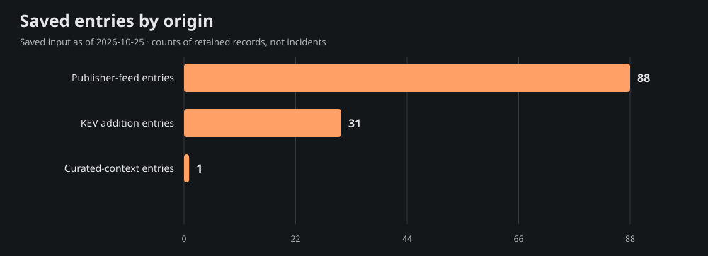
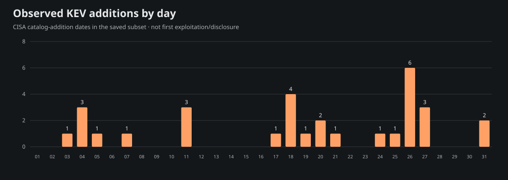
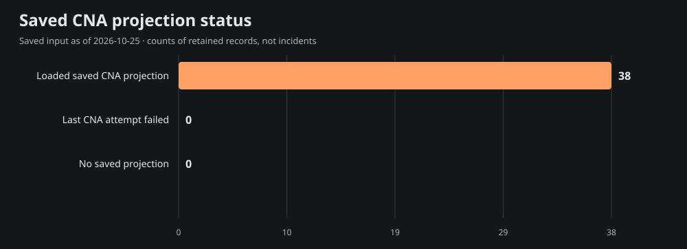

# Team Star Wolf Intelligence Hub
## August 2026 · retrospective

**Edition:** SW-MONTHLY-2026-08-RETRO · **Coverage:** selective, incomplete saved-source subset

**Period:** 2026-08-01T00:00:00-05:00 inclusive to 2026-09-01T00:00:00-05:00 exclusive (America/Chicago).

**Compiled:** 2026-10-25T21:55:23.373Z · **Input generated:** 2026-10-25T21:13:41+00:00 · **Captured:** 2026-10-25T21:29:50.108068Z

This is a retrospective compilation. A closed calendar period does not imply complete evidence. Saved entries, curated context and CNA projections are attributed below; no primary article or CNA record was fetched or independently verified for this edition.

## 1. Executive summary

The admitted saved subset contains **120 entries**: 88 publisher-feed entries, 31 CISA KEV catalog-addition entries and 1 curated-context entry. These mention **38 distinct CVE IDs**; they are not counts of incidents, newly disclosed vulnerabilities, exploited systems or affected devices.

The 10 selected developments below emphasize saved curated context, advisory metadata and dated KEV additions. Selection is bounded and source-based rather than a severity/risk ranking. The report samples 15 of 38 mentioned CVEs for current saved product, score and mitigation context; full entry/cohort/chart data are in [data.json](<https://github.com/TeamStarWolf/intelligence-hub/blob/main/reports/monthly/2026-08/data.json>).

Saved curated context highlights [Singapore CSA warns of Keyv-related npm compromise](<https://www.csa.gov.sg/alerts-and-advisories/advisories/ad-2026-009/>). These remain the saved curation’s source-attributed account, including any later-update caveats; they are not claims that the whole account was known during the historical period.

|Metric|Observed value|Meaning|
|---|---:|---|
|Saved entries|120|Canonical-URL rows in the selected date recipe|
|Unique mentioned CVEs|38|Union of IDs, not newly published CVEs|
|KEV additions|31|Catalog-addition rows, not first exploitation|
|Aware timestamps|88|Chicago-aware instant membership|
|Date-only rows|32|Literal calendar precision; timezone unknown|
|Cutoff-date rows with unknown time|0|Included calendar-overlap rows, not exact-time evidence|

## 2. Selected source-attributed developments

Up to 10 entries are selected; 10 qualify under this saved-source selection recipe. A headline or CVE mention is a source lead, not a directly re-read incident narrative.

### 1. Singapore CSA warns of Keyv-related npm compromise

- **Saved source:** [Cyber Security Agency of Singapore](<https://www.csa.gov.sg/alerts-and-advisories/advisories/ad-2026-009/>) · curated source context · advisory
- **Recorded date:** 2026-08-06 · publication · calendar-day precision
- **CVE mentions:** None projected; no ID inferred from this title.
- **Saved exploitation label:** known; a mention alone is not exploitation evidence.
- **Saved curation context, observed October 25:** CSA describes malicious Keyv and related npm releases in a self-propagating campaign that steals developer credentials. Compare exact versions and published indicators with retained build records, then follow the advisory's scoped credential and environment response guidance.

### 2. Disruptive cyber activity highlights risk from internet-exposed systems and edge devices

- **Saved source:** [UK National Cyber Security Centre](<https://www.ncsc.gov.uk/news/disruptive-cyber-activity-highlights-risk-from-internet-exposed-systems-and-edge-devices>) · saved Hub entry · advisory
- **Recorded date:** 2026-08-27T12:00:00+00:00 · publication · timestamp with offset
- **CVE mentions:** None projected; no ID inferred from this title.
- **Saved exploitation label:** unknown; a mention alone is not exploitation evidence.
- **Context limit:** Saved headline/metadata only; no article-body facts, actor attribution or remediation are inferred.

### 3. A Tale of Two SOCs: Insights From Two Red Team Assessments

- **Saved source:** [CISA Cybersecurity Advisories (category subset)](<https://www.cisa.gov/news-events/cybersecurity-advisories/aa26-237a>) · saved Hub entry · advisory
- **Recorded date:** 2026-08-20T16:32:14+00:00 · publication · timestamp with offset
- **CVE mentions:** None projected; no ID inferred from this title.
- **Saved exploitation label:** unknown; a mention alone is not exploitation evidence.
- **Context limit:** Saved headline/metadata only; no article-body facts, actor attribution or remediation are inferred.

### 4. Managing the cyber risk of agentic AI

- **Saved source:** [UK National Cyber Security Centre](<https://www.ncsc.gov.uk/blogs/managing-the-cyber-risk-of-agentic-ai>) · saved Hub entry · advisory
- **Recorded date:** 2026-08-20T12:00:00+00:00 · publication · timestamp with offset
- **CVE mentions:** None projected; no ID inferred from this title.
- **Saved exploitation label:** unknown; a mention alone is not exploitation evidence.
- **Context limit:** Saved headline/metadata only; no article-body facts, actor attribution or remediation are inferred.

### 5. SVD-2026-0807: Security Vulnerabilities in Splunk Enterprise Security - August 2026

- **Saved source:** [Splunk Security Advisories](<https://advisory.splunk.com/advisories/SVD-2026-0807>) · saved Hub entry · advisory
- **Recorded date:** 2026-08-19T00:00:00+00:00 · publication · timestamp with offset
- **CVE mentions:** None projected; no ID inferred from this title.
- **Saved exploitation label:** unknown; a mention alone is not exploitation evidence.
- **Context limit:** Saved headline/metadata only; no article-body facts, actor attribution or remediation are inferred.

### 6. CVE-2026-81578 · PaperCut NG/MF Missing Authentication for Critical Function Vulnerability

- **Saved source:** [CISA Known Exploited Vulnerabilities](<https://www.cisa.gov/known-exploited-vulnerabilities-catalog?field_cve=CVE-2026-81578>) · saved Hub entry · kev
- **Recorded date:** 2026-08-31 · CISA catalog addition · calendar-day precision
- **CVE mentions:** CVE-2026-81578
- **Saved exploitation label:** known; a mention alone is not exploitation evidence.
- **Context limit:** Saved headline/metadata only; no article-body facts, actor attribution or remediation are inferred.

### 7. CVE-2026-82078 · PaperCut NG/MF Unsafe Reflection Vulnerability

- **Saved source:** [CISA Known Exploited Vulnerabilities](<https://www.cisa.gov/known-exploited-vulnerabilities-catalog?field_cve=CVE-2026-82078>) · saved Hub entry · kev
- **Recorded date:** 2026-08-31 · CISA catalog addition · calendar-day precision
- **CVE mentions:** CVE-2026-82078
- **Saved exploitation label:** known; a mention alone is not exploitation evidence.
- **Context limit:** Saved headline/metadata only; no article-body facts, actor attribution or remediation are inferred.

### 8. CVE-2023-49105 · ownCloud Improper Authentication Vulnerability

- **Saved source:** [CISA Known Exploited Vulnerabilities](<https://www.cisa.gov/known-exploited-vulnerabilities-catalog?field_cve=CVE-2023-49105>) · saved Hub entry · kev
- **Recorded date:** 2026-08-27 · CISA catalog addition · calendar-day precision
- **CVE mentions:** CVE-2023-49105
- **Saved exploitation label:** known; a mention alone is not exploitation evidence.
- **Context limit:** Saved headline/metadata only; no article-body facts, actor attribution or remediation are inferred.

### 9. Staying Ahead of Adversarial AI Through Agentic Source Code Review

- **Saved source:** [Google Threat Intelligence](<https://cloud.google.com/blog/topics/threat-intelligence/staying-ahead-of-adversarial-ai-through-agentic-source-code-review/>) · saved Hub entry · research
- **Recorded date:** 2026-08-18T14:00:00+00:00 · publication · timestamp with offset
- **CVE mentions:** CVE-2026-13242, CVE-2026-55803
- **Saved exploitation label:** unknown; a mention alone is not exploitation evidence.
- **Context limit:** Saved headline/metadata only; no article-body facts, actor attribution or remediation are inferred.

### 10. You’re Back In The Room (Citrix NetScaler Pre-Auth RCE CVE-2026-8452(?))

- **Saved source:** [watchTowr Labs](<https://labs.watchtowr.com/youre-back-in-the-room-citrix-netscaler-pre-auth-rce-cve-2026-8452/>) · saved Hub entry · research
- **Recorded date:** 2026-08-14T07:08:20+00:00 · publication · timestamp with offset
- **CVE mentions:** CVE-2023-3519, CVE-2026-8452
- **Saved exploitation label:** unknown; a mention alone is not exploitation evidence.
- **Context limit:** Saved headline/metadata only; no article-body facts, actor attribution or remediation are inferred.

## 3. CISA KEV additions and CVE context

The saved input contains **31** KEV catalog-addition rows in this period. Catalog addition is separate from initial disclosure, first exploitation and the CVE identifier’s year. These are current-catalog observations captured October 25, not a frozen catalog from the historical month.

Showing 31 of 31 rows below; all admitted rows are retained in data.json.

|Added|CVE|Saved vendor/product tags|Current saved federal due date|
|---|---|---|---|
|2026-08-31|[CVE-2026-81578](<https://www.cisa.gov/known-exploited-vulnerabilities-catalog?field_cve=CVE-2026-81578>)|PaperCut · NG/MF|2026-09-14|
|2026-08-31|[CVE-2026-82078](<https://www.cisa.gov/known-exploited-vulnerabilities-catalog?field_cve=CVE-2026-82078>)|PaperCut · NG/MF|2026-09-14|
|2026-08-27|[CVE-2023-49105](<https://www.cisa.gov/known-exploited-vulnerabilities-catalog?field_cve=CVE-2023-49105>)|ownCloud · ownCloud|2026-08-30|
|2026-08-27|[CVE-2026-53362](<https://www.cisa.gov/known-exploited-vulnerabilities-catalog?field_cve=CVE-2026-53362>)|Linux · Kernel|2026-08-30|
|2026-08-27|[CVE-2026-66384](<https://www.cisa.gov/known-exploited-vulnerabilities-catalog?field_cve=CVE-2026-66384>)|JFrog · Artifactory|2026-09-10|
|2026-08-26|[CVE-2015-3246](<https://www.cisa.gov/known-exploited-vulnerabilities-catalog?field_cve=CVE-2015-3246>)|Red Hat · Libuser|2026-09-09|
|2026-08-26|[CVE-2015-5287](<https://www.cisa.gov/known-exploited-vulnerabilities-catalog?field_cve=CVE-2015-5287>)|Red Hat · Automatic Bug Reporting Tool|2026-09-09|
|2026-08-26|[CVE-2019-1068](<https://www.cisa.gov/known-exploited-vulnerabilities-catalog?field_cve=CVE-2019-1068>)|Microsoft · SQL Server|2026-08-29|
|2026-08-26|[CVE-2021-23758](<https://www.cisa.gov/known-exploited-vulnerabilities-catalog?field_cve=CVE-2021-23758>)|Ajax.NET Professional · Ajax.NET Professional|2026-09-09|
|2026-08-26|[CVE-2022-0995](<https://www.cisa.gov/known-exploited-vulnerabilities-catalog?field_cve=CVE-2022-0995>)|Linux · Kernel|2026-08-29|
|2026-08-26|[CVE-2026-8452](<https://www.cisa.gov/known-exploited-vulnerabilities-catalog?field_cve=CVE-2026-8452>)|Citrix · NetScaler ADC and NetScaler Gateway|2026-08-29|
|2026-08-25|[CVE-2026-60004](<https://www.cisa.gov/known-exploited-vulnerabilities-catalog?field_cve=CVE-2026-60004>)|Gitea · Gitea|2026-08-28|
|2026-08-24|[CVE-2026-21962](<https://www.cisa.gov/known-exploited-vulnerabilities-catalog?field_cve=CVE-2026-21962>)|Oracle · HTTP Server and Oracle Weblogic Server Proxy Plug-in|2026-08-27|
|2026-08-21|[CVE-2026-73570](<https://www.cisa.gov/known-exploited-vulnerabilities-catalog?field_cve=CVE-2026-73570>)|Synacor · Zimbra Collaboration Suite (ZCS)|2026-08-24|
|2026-08-20|[CVE-2026-72529](<https://www.cisa.gov/known-exploited-vulnerabilities-catalog?field_cve=CVE-2026-72529>)|TrueConf · Server|2026-08-23|
|2026-08-20|[CVE-2026-72530](<https://www.cisa.gov/known-exploited-vulnerabilities-catalog?field_cve=CVE-2026-72530>)|TrueConf · Server|2026-09-03|
|2026-08-19|[CVE-2026-64849](<https://www.cisa.gov/known-exploited-vulnerabilities-catalog?field_cve=CVE-2026-64849>)|MLflow · MLflow|2026-09-02|
|2026-08-18|[CVE-2026-33824](<https://www.cisa.gov/known-exploited-vulnerabilities-catalog?field_cve=CVE-2026-33824>)|Microsoft · Internet Key Exchange (IKE) Service Extensions|2026-08-21|
|2026-08-18|[CVE-2026-55040](<https://www.cisa.gov/known-exploited-vulnerabilities-catalog?field_cve=CVE-2026-55040>)|Microsoft · SharePoint|2026-08-21|
|2026-08-18|[CVE-2026-59310](<https://www.cisa.gov/known-exploited-vulnerabilities-catalog?field_cve=CVE-2026-59310>)|Broadcom · VMware vCenter|2026-08-21|
|2026-08-18|[CVE-2026-65400](<https://www.cisa.gov/known-exploited-vulnerabilities-catalog?field_cve=CVE-2026-65400>)|Apple · macOS|2026-08-21|
|2026-08-17|[CVE-2025-62593](<https://www.cisa.gov/known-exploited-vulnerabilities-catalog?field_cve=CVE-2025-62593>)|Ray-Project · Ray|2026-08-20|
|2026-08-11|[CVE-2026-20349](<https://www.cisa.gov/known-exploited-vulnerabilities-catalog?field_cve=CVE-2026-20349>)|Cisco · Secure Firewall Adaptive Security Appliance (ASA) and Secure Firewall Threat Defense (FTD)|2026-08-14|
|2026-08-11|[CVE-2026-68820](<https://www.cisa.gov/known-exploited-vulnerabilities-catalog?field_cve=CVE-2026-68820>)|Microsoft · Windows Ancillary Function Driver for WinSock|2026-08-25|
|2026-08-11|[CVE-2026-72898](<https://www.cisa.gov/known-exploited-vulnerabilities-catalog?field_cve=CVE-2026-72898>)|Metabase · Metabase|2026-08-14|
|2026-08-07|[CVE-2026-8037](<https://www.cisa.gov/known-exploited-vulnerabilities-catalog?field_cve=CVE-2026-8037>)|Progress · LoadMaster|2026-08-10|
|2026-08-05|[CVE-2026-63077](<https://www.cisa.gov/known-exploited-vulnerabilities-catalog?field_cve=CVE-2026-63077>)|JetBrains · TeamCity|2026-08-08|
|2026-08-04|[CVE-2026-18556](<https://www.cisa.gov/known-exploited-vulnerabilities-catalog?field_cve=CVE-2026-18556>)|N-able · N-central|2026-08-07|
|2026-08-04|[CVE-2026-34486](<https://www.cisa.gov/known-exploited-vulnerabilities-catalog?field_cve=CVE-2026-34486>)|Apache · Tomcat|2026-08-07|
|2026-08-04|[CVE-2026-9198](<https://www.cisa.gov/known-exploited-vulnerabilities-catalog?field_cve=CVE-2026-9198>)|IBM · Langflow|2026-08-07|
|2026-08-03|[CVE-2026-18577](<https://www.cisa.gov/known-exploited-vulnerabilities-catalog?field_cve=CVE-2026-18577>)|N-able · N-central|2026-08-06|

Federal due dates are source catalog data, not deadlines assigned to this site’s visitors. Ransomware and exploitation assertions, where supplied, remain source-scoped in data.json.

### Current saved CNA sample

These 15 sampled projections are current context from the saved input. Their record-state, retrieval/update/attempt clocks and CNA score version remain explicit. Loaded projections can include rejected records; failed enrichment may retain older successful content. No source record was re-read for this report.

|CVE|Projection / record state|Saved CVSS|Saved guidance status|
|---|---|---|---|
|[CVE-2026-81578](<https://www.cve.org/CVERecord?id=CVE-2026-81578>)|ok / PUBLISHED|8.8 (v4.0; saved CNA metric)|cisa-action|
|[CVE-2026-82078](<https://www.cve.org/CVERecord?id=CVE-2026-82078>)|ok / PUBLISHED|9.4 (v4.0; saved CNA metric)|cisa-action|
|[CVE-2023-49105](<https://www.cve.org/CVERecord?id=CVE-2023-49105>)|ok / PUBLISHED|9.8 (v3.1; saved CNA metric)|cisa-action|
|[CVE-2026-13242](<https://www.cve.org/CVERecord?id=CVE-2026-13242>)|ok / PUBLISHED|Not supplied in saved projection|needs-review|
|[CVE-2026-55803](<https://www.cve.org/CVERecord?id=CVE-2026-55803>)|ok / PUBLISHED|Not supplied in saved projection|needs-review|
|[CVE-2023-3519](<https://www.cve.org/CVERecord?id=CVE-2023-3519>)|ok / PUBLISHED|9.8 (v3.1; saved CNA metric)|cisa-action|
|[CVE-2026-8452](<https://www.cve.org/CVERecord?id=CVE-2026-8452>)|ok / PUBLISHED|8.8 (v4.0; saved CNA metric)|cisa-action|
|[CVE-2015-3246](<https://www.cve.org/CVERecord?id=CVE-2015-3246>)|ok / PUBLISHED|Not supplied in saved projection|cisa-action|
|[CVE-2015-5287](<https://www.cve.org/CVERecord?id=CVE-2015-5287>)|ok / PUBLISHED|Not supplied in saved projection|cisa-action|
|[CVE-2019-1068](<https://www.cve.org/CVERecord?id=CVE-2019-1068>)|ok / PUBLISHED|Not supplied in saved projection|cisa-action|
|[CVE-2021-23758](<https://www.cve.org/CVERecord?id=CVE-2021-23758>)|ok / PUBLISHED|8.1 (v3.1; saved CNA metric)|cisa-action|
|[CVE-2022-0995](<https://www.cve.org/CVERecord?id=CVE-2022-0995>)|ok / PUBLISHED|Not supplied in saved projection|cisa-action|
|[CVE-2024-55591](<https://www.cve.org/CVERecord?id=CVE-2024-55591>)|ok / PUBLISHED|9.6 (v3.1; saved CNA metric)|publisher-guidance|
|[CVE-2025-24472](<https://www.cve.org/CVERecord?id=CVE-2025-24472>)|ok / PUBLISHED|8.1 (v3.1; saved CNA metric)|publisher-guidance|
|[CVE-2025-62593](<https://www.cve.org/CVERecord?id=CVE-2025-62593>)|ok / PUBLISHED|9.4 (v4.0; saved CNA metric)|cisa-action|

## 4. Campaigns and actors

**not_projected.** Schema 4 supplied no structured actor/campaign entity or relationship projection. Names in saved headlines, research or curated prose are not promoted into attribution, aliases or ATT&CK/CAPEC relationships. This does not establish that no campaign occurred.

## 5. Supply chain and AI security

Only exact saved tags select the following topic leads; this is not inferred impact or attack taxonomy.

- [Singapore CSA warns of Keyv-related npm compromise](<https://www.csa.gov.sg/alerts-and-advisories/advisories/ad-2026-009/>) — saved tags: supply-chain; curated source context.
  Saved curation context: CSA describes malicious Keyv and related npm releases in a self-propagating campaign that steals developer credentials. Compare exact versions and published indicators with retained build records, then follow the advisory's scoped credential and environment response guidance.

## 6. Mitigation and product context

This is current saved projection context, not patch verification or knowledge backdated into the report month. Exact installed versions/configuration were not assessed. Full bounded product/version statements, source links and saved analysis steps are in data.json. CWE, CAPEC and actor fields are **not_projected**, rather than empty-proof of no weakness or attack pattern.

### CVE-2026-81578

- **Current saved state:** ok / PUBLISHED; 8.8 (v4.0; saved CNA metric).
- **Clocks:** retrieved 2026-10-24T22:24:10+00:00; record updated 2026-09-13T23:15:33+00:00; attempted 2026-10-24T22:24:10+00:00.
- **Saved product labels:** PaperCut / PaperCut MF/NG 
- **Saved CISA action excerpt (shortened):** Apply mitigations in accordance with vendor instructions, ensuring compliance with CISA’s BOD 26-04 Prioritizing Security Updates Based on Risk (see URL in Notes) guidance and CISA’s “Forensics Triage Requirements” (see URL in Notes). Follow applicable BOD 26-04 guidance for cloud services or discontinue use of the product if mitigations are unavailable. St…
- **Source pointer:** [Saved record reference](<https://www.cve.org/CVERecord?id=CVE-2026-81578>). No direct source review or environment applicability is established.

### CVE-2026-82078

- **Current saved state:** ok / PUBLISHED; 9.4 (v4.0; saved CNA metric).
- **Clocks:** retrieved 2026-10-24T22:24:10+00:00; record updated 2026-09-13T23:16:32+00:00; attempted 2026-10-24T22:24:10+00:00.
- **Saved product labels:** PaperCut / PaperCut MF/NG 
- **Saved CISA action excerpt (shortened):** Apply mitigations in accordance with vendor instructions, ensuring compliance with CISA’s BOD 26-04 Prioritizing Security Updates Based on Risk (see URL in Notes) guidance and CISA’s “Forensics Triage Requirements” (see URL in Notes). Follow applicable BOD 26-04 guidance for cloud services or discontinue use of the product if mitigations are unavailable. St…
- **Source pointer:** [Saved record reference](<https://www.cve.org/CVERecord?id=CVE-2026-82078>). No direct source review or environment applicability is established.

### CVE-2023-49105

- **Current saved state:** ok / PUBLISHED; 9.8 (v3.1; saved CNA metric).
- **Clocks:** retrieved 2026-10-24T22:24:41+00:00; record updated 2026-08-28T03:55:23+00:00; attempted 2026-10-24T22:24:41+00:00.
- **Saved product labels:** n/a / n/a 
- **Saved CISA action excerpt (shortened):** Apply mitigations in accordance with vendor instructions, ensuring compliance with CISA’s BOD 26-04 Prioritizing Security Updates Based on Risk (see URL in Notes) guidance and CISA’s “Forensics Triage Requirements” (see URL in Notes). Follow applicable BOD 26-04 guidance for cloud services or discontinue use of the product if mitigations are unavailable. St…
- **Source pointer:** [Saved record reference](<https://www.cve.org/CVERecord?id=CVE-2023-49105>). No direct source review or environment applicability is established.

### CVE-2026-13242

- **Current saved state:** ok / PUBLISHED; Not supplied in saved projection.
- **Clocks:** retrieved 2026-10-24T22:24:23+00:00; record updated 2026-07-13T16:05:20+00:00; attempted 2026-10-24T22:24:22+00:00.
- **Saved product labels:** Drupal / Geolocation Field 
- **Guidance gap:** no action/solution/workaround supplied in this saved projection; this is unknown, not proof no fix exists.
- **Source pointer:** [Saved record reference](<https://www.cve.org/CVERecord?id=CVE-2026-13242>). No direct source review or environment applicability is established.

### CVE-2026-55803

- **Current saved state:** ok / PUBLISHED; Not supplied in saved projection.
- **Clocks:** retrieved 2026-10-24T22:24:15+00:00; record updated 2026-07-13T18:24:17+00:00; attempted 2026-10-24T22:24:14+00:00.
- **Saved product labels:** Drupal / Drupal core 
- **Guidance gap:** no action/solution/workaround supplied in this saved projection; this is unknown, not proof no fix exists.
- **Source pointer:** [Saved record reference](<https://www.cve.org/CVERecord?id=CVE-2026-55803>). No direct source review or environment applicability is established.

### CVE-2023-3519

- **Current saved state:** ok / PUBLISHED; 9.8 (v3.1; saved CNA metric).
- **Clocks:** retrieved 2026-10-24T22:24:44+00:00; record updated 2026-08-05T03:55:52+00:00; attempted 2026-10-24T22:24:44+00:00.
- **Saved product labels:** Citrix / NetScaler ADC; Citrix / NetScaler Gateway 
- **Saved CISA action excerpt:** Apply mitigations per vendor instructions or discontinue use of the product if mitigations are unavailable.
- **Source pointer:** [Saved record reference](<https://www.cve.org/CVERecord?id=CVE-2023-3519>). No direct source review or environment applicability is established.

### CVE-2026-8452

- **Current saved state:** ok / PUBLISHED; 8.8 (v4.0; saved CNA metric).
- **Clocks:** retrieved 2026-10-24T22:24:09+00:00; record updated 2026-08-27T03:56:34+00:00; attempted 2026-10-24T22:24:09+00:00.
- **Saved product labels:** NetScaler / ADC; NetScaler / Gateway 
- **Saved CISA action excerpt (shortened):** Apply mitigations in accordance with vendor instructions, ensuring compliance with CISA’s BOD 26-04 Prioritizing Security Updates Based on Risk (see URL in Notes) guidance and CISA’s “Forensics Triage Requirements” (see URL in Notes). Follow applicable BOD 26-04 guidance for cloud services or discontinue use of the product if mitigations are unavailable. St…
- **Source pointer:** [Saved record reference](<https://www.cve.org/CVERecord?id=CVE-2026-8452>). No direct source review or environment applicability is established.

### CVE-2015-3246

- **Current saved state:** ok / PUBLISHED; Not supplied in saved projection.
- **Clocks:** retrieved 2026-10-24T22:25:20+00:00; record updated 2026-10-01T18:02:50+00:00; attempted 2026-10-24T22:25:20+00:00.
- **Saved product labels:** n/a / n/a 
- **Saved CISA action excerpt (shortened):** Apply mitigations in accordance with vendor instructions, ensuring compliance with CISA’s BOD 26-04 Prioritizing Security Updates Based on Risk (see URL in Notes) guidance and CISA’s “Forensics Triage Requirements” (see URL in Notes). Follow applicable BOD 26-04 guidance for cloud services or discontinue use of the product if mitigations are unavailable. St…
- **Source pointer:** [Saved record reference](<https://www.cve.org/CVERecord?id=CVE-2015-3246>). No direct source review or environment applicability is established.

### CVE-2015-5287

- **Current saved state:** ok / PUBLISHED; Not supplied in saved projection.
- **Clocks:** retrieved 2026-10-24T22:25:20+00:00; record updated 2026-08-27T03:56:39+00:00; attempted 2026-10-24T22:25:20+00:00.
- **Saved product labels:** n/a / n/a 
- **Saved CISA action excerpt (shortened):** Apply mitigations in accordance with vendor instructions, ensuring compliance with CISA’s BOD 26-04 Prioritizing Security Updates Based on Risk (see URL in Notes) guidance and CISA’s “Forensics Triage Requirements” (see URL in Notes). Follow applicable BOD 26-04 guidance for cloud services or discontinue use of the product if mitigations are unavailable. St…
- **Source pointer:** [Saved record reference](<https://www.cve.org/CVERecord?id=CVE-2015-5287>). No direct source review or environment applicability is established.

### CVE-2019-1068

- **Current saved state:** ok / PUBLISHED; Not supplied in saved projection.
- **Clocks:** retrieved 2026-10-24T22:25:10+00:00; record updated 2026-08-27T03:57:25+00:00; attempted 2026-10-24T22:25:09+00:00.
- **Saved product labels:** Microsoft / Microsoft SQL Server 2014 Service Pack 2 for 32-bit Systems (GDR); Microsoft / Microsoft SQL Server; Microsoft / Microsoft SQL Server 2014 Service Pack 2 for x64-based Systems (GDR) (first 3 shown; full bounded projection in data.json)
- **Saved CISA action excerpt (shortened):** Apply mitigations in accordance with vendor instructions, ensuring compliance with CISA’s BOD 26-04 Prioritizing Security Updates Based on Risk (see URL in Notes) guidance and CISA’s “Forensics Triage Requirements” (see URL in Notes). Follow applicable BOD 26-04 guidance for cloud services or discontinue use of the product if mitigations are unavailable. St…
- **Source pointer:** [Saved record reference](<https://www.cve.org/CVERecord?id=CVE-2019-1068>). No direct source review or environment applicability is established.

### CVE-2021-23758

- **Current saved state:** ok / PUBLISHED; 8.1 (v3.1; saved CNA metric).
- **Clocks:** retrieved 2026-10-24T22:24:58+00:00; record updated 2026-08-27T03:56:43+00:00; attempted 2026-10-24T22:24:58+00:00.
- **Saved product labels:** n/a / AjaxPro.2 
- **Saved CISA action excerpt (shortened):** Apply mitigations in accordance with vendor instructions, ensuring compliance with CISA’s BOD 26-04 Prioritizing Security Updates Based on Risk (see URL in Notes) guidance and CISA’s “Forensics Triage Requirements” (see URL in Notes). Follow applicable BOD 26-04 guidance for cloud services or discontinue use of the product if mitigations are unavailable. St…
- **Source pointer:** [Saved record reference](<https://www.cve.org/CVERecord?id=CVE-2021-23758>). No direct source review or environment applicability is established.

### CVE-2022-0995

- **Current saved state:** ok / PUBLISHED; Not supplied in saved projection.
- **Clocks:** retrieved 2026-10-24T22:24:52+00:00; record updated 2026-08-27T03:56:36+00:00; attempted 2026-10-24T22:24:52+00:00.
- **Saved product labels:** n/a / kernel 
- **Saved CISA action excerpt (shortened):** Apply mitigations in accordance with vendor instructions, ensuring compliance with CISA’s BOD 26-04 Prioritizing Security Updates Based on Risk (see URL in Notes) guidance and CISA’s “Forensics Triage Requirements” (see URL in Notes). Follow applicable BOD 26-04 guidance for cloud services or discontinue use of the product if mitigations are unavailable. St…
- **Source pointer:** [Saved record reference](<https://www.cve.org/CVERecord?id=CVE-2022-0995>). No direct source review or environment applicability is established.

### CVE-2024-55591

- **Current saved state:** ok / PUBLISHED; 9.6 (v3.1; saved CNA metric).
- **Clocks:** retrieved 2026-10-24T22:24:36+00:00; record updated 2026-08-05T03:55:59+00:00; attempted 2026-10-24T22:24:35+00:00.
- **Saved product labels:** Fortinet / FortiOS; Fortinet / FortiProxy 
- **Saved CISA action excerpt:** Apply mitigations per vendor instructions or discontinue use of the product if mitigations are unavailable.
- **Saved publisher solution excerpt:** Upgrade to FortiOS version 7.0.17 or above Upgrade to FortiProxy version 7.2.13 or above Upgrade to FortiProxy version 7.0.20 or above
- **Source pointer:** [Saved record reference](<https://www.cve.org/CVERecord?id=CVE-2024-55591>). No direct source review or environment applicability is established.

### CVE-2025-24472

- **Current saved state:** ok / PUBLISHED; 8.1 (v3.1; saved CNA metric).
- **Clocks:** retrieved 2026-10-24T22:24:33+00:00; record updated 2026-08-05T03:56:00+00:00; attempted 2026-10-24T22:24:33+00:00.
- **Saved product labels:** Fortinet / FortiOS; Fortinet / FortiProxy 
- **Saved CISA action excerpt:** Apply mitigations per vendor instructions, follow applicable BOD 22-01 guidance for cloud services, or discontinue use of the product if mitigations are unavailable.
- **Saved publisher solution excerpt:** Upgrade to FortiOS version 7.0.17 or above Upgrade to FortiProxy version 7.2.13 or above Upgrade to FortiProxy version 7.0.20 or above
- **Source pointer:** [Saved record reference](<https://www.cve.org/CVERecord?id=CVE-2025-24472>). No direct source review or environment applicability is established.

### CVE-2025-62593

- **Current saved state:** ok / PUBLISHED; 9.4 (v4.0; saved CNA metric).
- **Clocks:** retrieved 2026-10-24T22:24:28+00:00; record updated 2026-10-01T18:07:54+00:00; attempted 2026-10-24T22:24:28+00:00.
- **Saved product labels:** ray-project / ray 
- **Saved CISA action excerpt (shortened):** Apply mitigations in accordance with vendor instructions, ensuring compliance with CISA’s BOD 26-04 Prioritizing Security Updates Based on Risk (see URL in Notes) guidance and CISA’s “Forensics Triage Requirements” (see URL in Notes). Follow applicable BOD 26-04 guidance for cloud services or discontinue use of the product if mitigations are unavailable. St…
- **Source pointer:** [Saved record reference](<https://www.cve.org/CVERecord?id=CVE-2025-62593>). No direct source review or environment applicability is established.

## 7. Changes to prior reporting

**Revision watch: not_run · no_baseline.** No primary citation was rechecked and no material-change claim is made. The 48–96-hour citation review policy remains planned; raw hashes or timestamps alone would not prove a material security change.

## 8. Watchlist for the next review

- The saved input provides loaded projections for all 38 mentioned CVEs. A source-review priority is whether publisher conditions changed after the displayed clocks; no such check is recorded here.
- Review primary conditions for the 15 sampled CVEs; their saved retrieval/update clocks describe current context, not what was known in 2026-08.
- Actor/CWE/CAPEC mapping and prior-source revision checks remain unprojected/not run; no attribution or material-change claim is made.

Next nominal report/review cycle: **2026-10-25T22:00:00-05:00** (2026-10-26T03:00:00.000Z). **Planned; activation not verified for this edition.** Individual citation eligibility/caps/cooldowns may defer a source; this is not an on-time delivery or all-articles-checked promise.

## 9. Coverage and limitations

The whole input saved 62 source ledgers:54 ok,7 partial and1 failed. These describe last saved attempts around input generation, **not source health during 2026-08**. Source-specific period rows and origin dimensions are in data.json. The whole input window was 2016-10-25 through 2026-10-25, with bounded retained feed history.

- Saved publisher headlines and curated summaries are source-attributed leads, not direct article-body fact verification.
- Counts describe a bounded retained public subset, not all incidents, newly disclosed vulnerabilities, attacks or exposed systems.
- KEV addition dates identify catalog additions, not first disclosure/exploitation; current catalog membership can differ from a historical catalog.
- Input observed October 25; individual CNA update/retrieval and source-status clocks are retained separately and are not backdated into the report period.
- The 60 globally missing primary dates remain unassigned; failed/partial feed intake and bounded retention create coverage gaps.
- Date-only records retain calendar precision and unknown timezone; October cutoff-day records have unknown time relative to the exact MTD cutoff.
- No private account/social metrics, environment inventory, raw primary sources, actor aliases, inferred CWE/CAPEC links or oldW43 claims are included.
- Next nominal report/review cycle is planned until separate activation/readback; no unattended timing or per-source fetch guarantee.

**Date recipe:** aware timestamps use America/Chicago instant membership in the stated half-open period; date-only rows retain their literal calendar date/timezone unknown. Missing dates are globally unassigned. October MTD admits cutoff-date-only rows as calendar overlap with exact time unknown. Source event/publication/KEV dates are not interchangeable.

**Chart recipes:** every plotted row, unit, as-of clock and evidence ID is in data.json. Charts use actual admitted counts; no November/December future bars or social/account metrics are generated.

## 10. Primary-first source pointers

Input: [Saved Intelligence Hub snapshot](<https://teamstarwolf.github.io/intelligence-hub/data/feed.json>) · schema 4 · SHA-256 `eb44f9aaa505efe604fb2f17c88397dec08fc77d00d554dc096ab720573f4199`. Captured 2026-10-25T21:29:50.108068Z, generated 2026-10-25T21:13:41+00:00. Structural qualification is not a raw-primary-article/CNA truth claim.

- [Saved Intelligence Hub input](<https://teamstarwolf.github.io/intelligence-hub/data/feed.json>) — saved\_hub\_entry / input
- [CISA KEV catalog reference](<https://www.cisa.gov/known-exploited-vulnerabilities-catalog>) — saved\_hub\_entry / catalog
- [CVE-2026-81578 saved record reference](<https://www.cve.org/CVERecord?id=CVE-2026-81578>) — CNA\_projection / record
- [CVE-2026-82078 saved record reference](<https://www.cve.org/CVERecord?id=CVE-2026-82078>) — CNA\_projection / record
- [CVE-2023-49105 saved record reference](<https://www.cve.org/CVERecord?id=CVE-2023-49105>) — CNA\_projection / record
- [CVE-2026-13242 saved record reference](<https://www.cve.org/CVERecord?id=CVE-2026-13242>) — CNA\_projection / record
- [CVE-2026-55803 saved record reference](<https://www.cve.org/CVERecord?id=CVE-2026-55803>) — CNA\_projection / record
- [CVE-2023-3519 saved record reference](<https://www.cve.org/CVERecord?id=CVE-2023-3519>) — CNA\_projection / record
- [CVE-2026-8452 saved record reference](<https://www.cve.org/CVERecord?id=CVE-2026-8452>) — CNA\_projection / record
- [CVE-2015-3246 saved record reference](<https://www.cve.org/CVERecord?id=CVE-2015-3246>) — CNA\_projection / record
- [CVE-2015-5287 saved record reference](<https://www.cve.org/CVERecord?id=CVE-2015-5287>) — CNA\_projection / record
- [CVE-2019-1068 saved record reference](<https://www.cve.org/CVERecord?id=CVE-2019-1068>) — CNA\_projection / record
- [CVE-2021-23758 saved record reference](<https://www.cve.org/CVERecord?id=CVE-2021-23758>) — CNA\_projection / record
- [CVE-2022-0995 saved record reference](<https://www.cve.org/CVERecord?id=CVE-2022-0995>) — CNA\_projection / record
- [CVE-2024-55591 saved record reference](<https://www.cve.org/CVERecord?id=CVE-2024-55591>) — CNA\_projection / record
- [CVE-2025-24472 saved record reference](<https://www.cve.org/CVERecord?id=CVE-2025-24472>) — CNA\_projection / record
- [CVE-2025-62593 saved record reference](<https://www.cve.org/CVERecord?id=CVE-2025-62593>) — CNA\_projection / record
- [Singapore CSA warns of Keyv-related npm compromise](<https://www.csa.gov.sg/alerts-and-advisories/advisories/ad-2026-009/>) — library\_curationsource / advisory
- [Disruptive cyber activity highlights risk from internet-exposed systems and edge devices](<https://www.ncsc.gov.uk/news/disruptive-cyber-activity-highlights-risk-from-internet-exposed-systems-and-edge-devices>) — saved\_hub\_entry / advisory
- [A Tale of Two SOCs: Insights From Two Red Team Assessments](<https://www.cisa.gov/news-events/cybersecurity-advisories/aa26-237a>) — saved\_hub\_entry / advisory
- [Managing the cyber risk of agentic AI](<https://www.ncsc.gov.uk/blogs/managing-the-cyber-risk-of-agentic-ai>) — saved\_hub\_entry / advisory
- [SVD-2026-0807: Security Vulnerabilities in Splunk Enterprise Security - August 2026](<https://advisory.splunk.com/advisories/SVD-2026-0807>) — saved\_hub\_entry / advisory
- [CVE-2026-81578 · PaperCut NG/MF Missing Authentication for Critical Function Vulnerability](<https://www.cisa.gov/known-exploited-vulnerabilities-catalog?field_cve=CVE-2026-81578>) — saved\_hub\_entry / kev
- [CVE-2026-82078 · PaperCut NG/MF Unsafe Reflection Vulnerability](<https://www.cisa.gov/known-exploited-vulnerabilities-catalog?field_cve=CVE-2026-82078>) — saved\_hub\_entry / kev
- [CVE-2023-49105 · ownCloud Improper Authentication Vulnerability](<https://www.cisa.gov/known-exploited-vulnerabilities-catalog?field_cve=CVE-2023-49105>) — saved\_hub\_entry / kev
- [Staying Ahead of Adversarial AI Through Agentic Source Code Review](<https://cloud.google.com/blog/topics/threat-intelligence/staying-ahead-of-adversarial-ai-through-agentic-source-code-review/>) — saved\_hub\_entry / research
- [You’re Back In The Room (Citrix NetScaler Pre-Auth RCE CVE-2026-8452(?))](<https://labs.watchtowr.com/youre-back-in-the-room-citrix-netscaler-pre-auth-rce-cve-2026-8452/>) — saved\_hub\_entry / research

---
Data companion: [data.json](data.json). Generation and revision-check statuses describe this edition. Planned next-cycle times are not a guarantee of delivery.
