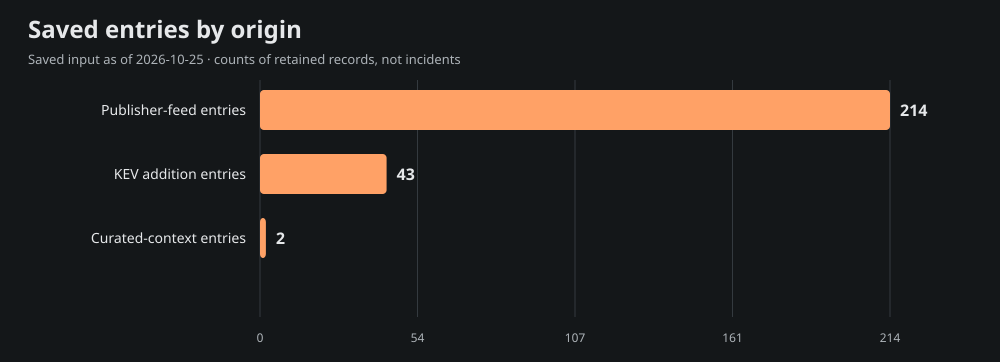
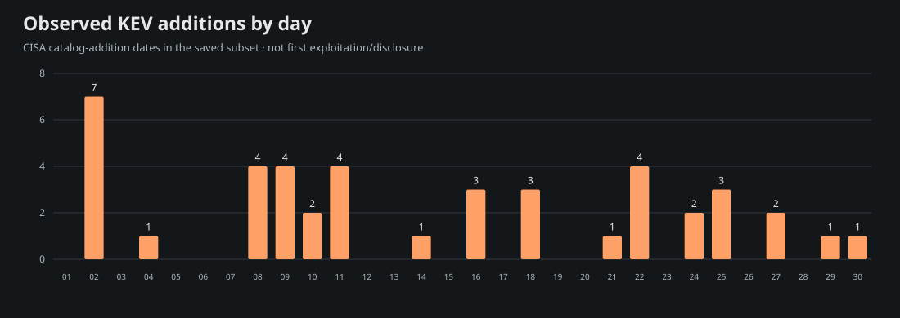
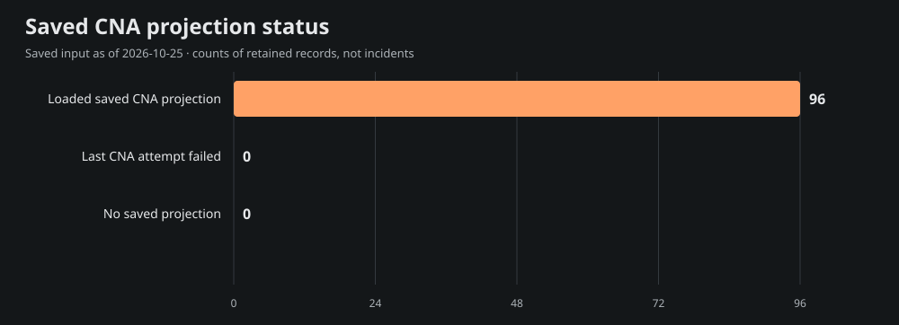

# Team Star Wolf Intelligence Hub
## September 2026 · retrospective

**Edition:** SW-MONTHLY-2026-09-RETRO · **Coverage:** selective, incomplete saved-source subset

**Period:** 2026-09-01T00:00:00-05:00 inclusive to 2026-10-01T00:00:00-05:00 exclusive (America/Chicago).

**Compiled:** 2026-10-25T21:55:23.373Z · **Input generated:** 2026-10-25T21:13:41+00:00 · **Captured:** 2026-10-25T21:29:50.108068Z

This is a retrospective compilation. A closed calendar period does not imply complete evidence. Saved entries, curated context and CNA projections are attributed below; no primary article or CNA record was fetched or independently verified for this edition.

## 1. Executive summary

The admitted saved subset contains **259 entries**: 214 publisher-feed entries, 43 CISA KEV catalog-addition entries and 2 curated-context entries. These mention **96 distinct CVE IDs**; they are not counts of incidents, newly disclosed vulnerabilities, exploited systems or affected devices.

The 10 selected developments below emphasize saved curated context, advisory metadata and dated KEV additions. Selection is bounded and source-based rather than a severity/risk ranking. The report samples 15 of 96 mentioned CVEs for current saved product, score and mitigation context; full entry/cohort/chart data are in [data.json](<https://github.com/TeamStarWolf/intelligence-hub/blob/main/reports/monthly/2026-09/data.json>).

Saved curated context highlights [Microsoft tracks passkey-themed cloud identity compromise](<https://www.microsoft.com/en-us/security/blog/2026/09/09/passkey-themed-social-engineering-leads-identity-cloud-compromise/>); [GTIG reports a shift toward agent-enabled threat operations](<https://cloud.google.com/blog/topics/threat-intelligence/from-prompting-to-autonomy-the-evolution-of-adversarial-ai>). These remain the saved curation’s source-attributed account, including any later-update caveats; they are not claims that the whole account was known during the historical period.

|Metric|Observed value|Meaning|
|---|---:|---|
|Saved entries|259|Canonical-URL rows in the selected date recipe|
|Unique mentioned CVEs|96|Union of IDs, not newly published CVEs|
|KEV additions|43|Catalog-addition rows, not first exploitation|
|Aware timestamps|214|Chicago-aware instant membership|
|Date-only rows|45|Literal calendar precision; timezone unknown|
|Cutoff-date rows with unknown time|0|Included calendar-overlap rows, not exact-time evidence|

## 2. Selected source-attributed developments

Up to 10 entries are selected; 10 qualify under this saved-source selection recipe. A headline or CVE mention is a source lead, not a directly re-read incident narrative.

### 1. Microsoft tracks passkey-themed cloud identity compromise

- **Saved source:** [Microsoft Security Research](<https://www.microsoft.com/en-us/security/blog/2026/09/09/passkey-themed-social-engineering-leads-identity-cloud-compromise/>) · curated source context · research
- **Recorded date:** 2026-09-09 · publication · calendar-day precision
- **CVE mentions:** None projected; no ID inferred from this title.
- **Saved exploitation label:** reported; a mention alone is not exploitation evidence.
- **Saved curation context, observed October 25:** Microsoft reports intrusions observed since May using help-desk and passkey pretexts, AiTM or device-code flows, and later cloud data access. The lure is not evidence that passkey cryptography was broken. Correlate sign-ins, authentication-method changes and token activity.

### 2. GTIG reports a shift toward agent-enabled threat operations

- **Saved source:** [Google Threat Intelligence Group](<https://cloud.google.com/blog/topics/threat-intelligence/from-prompting-to-autonomy-the-evolution-of-adversarial-ai>) · curated source context · research
- **Recorded date:** 2026-09-08 · publication · calendar-day precision
- **CVE mentions:** None projected; no ID inferred from this title.
- **Saved exploitation label:** reported; a mention alone is not exploitation evidence.
- **Saved curation context, observed October 25:** Google reports Q2 activity using agent-enabled credential harvesting and targeting AI development assets. Observations span several campaigns, not one September incident. Review cloud identities, AI tooling inputs and secret access, while retaining the report's attribution and telemetry limits.

### 3. CVE-2026-100308 - GluonTS arbitrary command execution during model deserialization

- **Saved source:** [AWS Security Bulletins](<https://aws.amazon.com/security/security-bulletins/rss/2026-119-aws/>) · saved Hub entry · advisory
- **Recorded date:** 2026-09-29T15:17:30+00:00 · publication · timestamp with offset
- **CVE mentions:** CVE-2026-100308
- **Saved exploitation label:** unknown; a mention alone is not exploitation evidence.
- **Context limit:** Saved headline/metadata only; no article-body facts, actor attribution or remediation are inferred.

### 4. VU\#762428: Authlib library contains a signature‑verification bypass vulnerability

- **Saved source:** [CERT/CC Vulnerability Notes](<https://kb.cert.org/vuls/id/762428>) · saved Hub entry · advisory
- **Recorded date:** 2026-09-28T19:36:11+00:00 · publication · timestamp with offset
- **CVE mentions:** CVE-2026-96760
- **Saved exploitation label:** unknown; a mention alone is not exploitation evidence.
- **Context limit:** Saved headline/metadata only; no article-body facts, actor attribution or remediation are inferred.

### 5. Exploitation of vulnerabilities affecting Citrix NetScaler ADC and Citrix NetScaler Gateway

- **Saved source:** [UK National Cyber Security Centre](<https://www.ncsc.gov.uk/news/exploitation-of-vulnerabilities-affecting-citrix-netscaler-adc-and-citrix-netscaler-gateway>) · saved Hub entry · advisory
- **Recorded date:** 2026-09-28T12:00:00+00:00 · publication · timestamp with offset
- **CVE mentions:** None projected; no ID inferred from this title.
- **Saved exploitation label:** unknown; a mention alone is not exploitation evidence.
- **Context limit:** Saved headline/metadata only; no article-body facts, actor attribution or remediation are inferred.

### 6. VU\#699627: Readwise Reader for Android, version 8.7.2, contains multiple XSS vulnerabilities

- **Saved source:** [CERT/CC Vulnerability Notes](<https://kb.cert.org/vuls/id/699627>) · saved Hub entry · advisory
- **Recorded date:** 2026-09-25T16:25:10+00:00 · publication · timestamp with offset
- **CVE mentions:** CVE-2026-18311, CVE-2026-18312, CVE-2026-18320
- **Saved exploitation label:** unknown; a mention alone is not exploitation evidence.
- **Context limit:** Saved headline/metadata only; no article-body facts, actor attribution or remediation are inferred.

### 7. CVE-2026-76504 · Cisco Catalyst SD-WAN Manager Hex Encoding Vulnerability

- **Saved source:** [CISA Known Exploited Vulnerabilities](<https://www.cisa.gov/known-exploited-vulnerabilities-catalog?field_cve=CVE-2026-76504>) · saved Hub entry · kev
- **Recorded date:** 2026-09-30 · CISA catalog addition · calendar-day precision
- **CVE mentions:** CVE-2026-76504
- **Saved exploitation label:** known; a mention alone is not exploitation evidence.
- **Context limit:** Saved headline/metadata only; no article-body facts, actor attribution or remediation are inferred.

### 8. CVE-2026-86950 · Apple Multiple Products Out-of-Bounds Write Vulnerability

- **Saved source:** [CISA Known Exploited Vulnerabilities](<https://www.cisa.gov/known-exploited-vulnerabilities-catalog?field_cve=CVE-2026-86950>) · saved Hub entry · kev
- **Recorded date:** 2026-09-29 · CISA catalog addition · calendar-day precision
- **CVE mentions:** CVE-2026-86950
- **Saved exploitation label:** known; a mention alone is not exploitation evidence.
- **Context limit:** Saved headline/metadata only; no article-body facts, actor attribution or remediation are inferred.

### 9. CVE-2026-88771 · Citrix NetScaler Improper Input Validation Vulnerability

- **Saved source:** [CISA Known Exploited Vulnerabilities](<https://www.cisa.gov/known-exploited-vulnerabilities-catalog?field_cve=CVE-2026-88771>) · saved Hub entry · kev
- **Recorded date:** 2026-09-27 · CISA catalog addition · calendar-day precision
- **CVE mentions:** CVE-2026-88771
- **Saved exploitation label:** known; a mention alone is not exploitation evidence.
- **Context limit:** Saved headline/metadata only; no article-body facts, actor attribution or remediation are inferred.

### 10. Threat Brief: NetScaler Zero Days CVE-2026-88771 and CVE-2026-88772 Exploited in the Wild (Updated September 30)

- **Saved source:** [Palo Alto Unit 42](<https://unit42.paloaltonetworks.com/netscaler-zero-days-exploited/>) · saved Hub entry · research
- **Recorded date:** 2026-09-30T20:00:04+00:00 · publication · timestamp with offset
- **CVE mentions:** CVE-2026-88771, CVE-2026-88772
- **Saved exploitation label:** unknown; a mention alone is not exploitation evidence.
- **Context limit:** Saved headline/metadata only; no article-body facts, actor attribution or remediation are inferred.

## 3. CISA KEV additions and CVE context

The saved input contains **43** KEV catalog-addition rows in this period. Catalog addition is separate from initial disclosure, first exploitation and the CVE identifier’s year. These are current-catalog observations captured October 25, not a frozen catalog from the historical month.

Showing 43 of 43 rows below; all admitted rows are retained in data.json.

|Added|CVE|Saved vendor/product tags|Current saved federal due date|
|---|---|---|---|
|2026-09-30|[CVE-2026-76504](<https://www.cisa.gov/known-exploited-vulnerabilities-catalog?field_cve=CVE-2026-76504>)|Cisco · Catalyst SD-WAN Manager|2026-10-03|
|2026-09-29|[CVE-2026-86950](<https://www.cisa.gov/known-exploited-vulnerabilities-catalog?field_cve=CVE-2026-86950>)|Apple · Multiple Products|2026-10-13|
|2026-09-27|[CVE-2026-88771](<https://www.cisa.gov/known-exploited-vulnerabilities-catalog?field_cve=CVE-2026-88771>)|Citrix · NetScaler|2026-09-30|
|2026-09-27|[CVE-2026-88772](<https://www.cisa.gov/known-exploited-vulnerabilities-catalog?field_cve=CVE-2026-88772>)|Citrix · NetScaler|2026-09-30|
|2026-09-25|[CVE-2026-65660](<https://www.cisa.gov/known-exploited-vulnerabilities-catalog?field_cve=CVE-2026-65660>)|Microsoft · SharePoint|2026-09-28|
|2026-09-25|[CVE-2026-67279](<https://www.cisa.gov/known-exploited-vulnerabilities-catalog?field_cve=CVE-2026-67279>)|MikroTik · RouterOS|2026-09-28|
|2026-09-25|[CVE-2026-87902](<https://www.cisa.gov/known-exploited-vulnerabilities-catalog?field_cve=CVE-2026-87902>)|WordPress · Core|2026-09-28|
|2026-09-24|[CVE-2026-5430](<https://www.cisa.gov/known-exploited-vulnerabilities-catalog?field_cve=CVE-2026-5430>)|WSO2 · Multiple Products|2026-09-27|
|2026-09-24|[CVE-2026-71362](<https://www.cisa.gov/known-exploited-vulnerabilities-catalog?field_cve=CVE-2026-71362>)|Adobe · Commerce and Magento|2026-09-27|
|2026-09-22|[CVE-2026-85102](<https://www.cisa.gov/known-exploited-vulnerabilities-catalog?field_cve=CVE-2026-85102>)|Check Point · Multiple Products|2026-09-25|
|2026-09-22|[CVE-2026-93616](<https://www.cisa.gov/known-exploited-vulnerabilities-catalog?field_cve=CVE-2026-93616>)|Check Point · Multiple Products|2026-09-25|
|2026-09-22|[CVE-2026-93952](<https://www.cisa.gov/known-exploited-vulnerabilities-catalog?field_cve=CVE-2026-93952>)|Arista · VeloCloud Orchestrator|2026-09-25|
|2026-09-22|[CVE-2026-94127](<https://www.cisa.gov/known-exploited-vulnerabilities-catalog?field_cve=CVE-2026-94127>)|F5 · BIG-IP APM|2026-09-25|
|2026-09-21|[CVE-2026-7273](<https://www.cisa.gov/known-exploited-vulnerabilities-catalog?field_cve=CVE-2026-7273>)|Zyxel · GS1900 Series Switches|2026-09-24|
|2026-09-18|[CVE-2025-39682](<https://www.cisa.gov/known-exploited-vulnerabilities-catalog?field_cve=CVE-2025-39682>)|Linux · Kernel|2026-09-21|
|2026-09-18|[CVE-2025-39964](<https://www.cisa.gov/known-exploited-vulnerabilities-catalog?field_cve=CVE-2025-39964>)|Linux · Kernel|2026-09-21|
|2026-09-18|[CVE-2026-53266](<https://www.cisa.gov/known-exploited-vulnerabilities-catalog?field_cve=CVE-2026-53266>)|Linux · Kernel|2026-09-21|
|2026-09-16|[CVE-2026-58704](<https://www.cisa.gov/known-exploited-vulnerabilities-catalog?field_cve=CVE-2026-58704>)|Google · Pixel|2026-09-19|
|2026-09-16|[CVE-2026-76460](<https://www.cisa.gov/known-exploited-vulnerabilities-catalog?field_cve=CVE-2026-76460>)|Cisco · Identity Services Engine|2026-09-19|
|2026-09-16|[CVE-2026-87886](<https://www.cisa.gov/known-exploited-vulnerabilities-catalog?field_cve=CVE-2026-87886>)|Acronis · Backup|2026-09-19|
|2026-09-14|[CVE-2026-76461](<https://www.cisa.gov/known-exploited-vulnerabilities-catalog?field_cve=CVE-2026-76461>)|Cisco · Secure Email Gateway|2026-09-17|
|2026-09-11|[CVE-2026-42016](<https://www.cisa.gov/known-exploited-vulnerabilities-catalog?field_cve=CVE-2026-42016>)|JFrog · Artifactory|2026-09-25|
|2026-09-11|[CVE-2026-42018](<https://www.cisa.gov/known-exploited-vulnerabilities-catalog?field_cve=CVE-2026-42018>)|JFrog · Artifactory|2026-09-25|
|2026-09-11|[CVE-2026-84869](<https://www.cisa.gov/known-exploited-vulnerabilities-catalog?field_cve=CVE-2026-84869>)|ConnectWise · ScreenConnect|2026-09-14|
|2026-09-11|[CVE-2026-85706](<https://www.cisa.gov/known-exploited-vulnerabilities-catalog?field_cve=CVE-2026-85706>)|GitLab · Community Edition and Enterprise Edition|2026-09-14|
|2026-09-10|[CVE-2026-67277](<https://www.cisa.gov/known-exploited-vulnerabilities-catalog?field_cve=CVE-2026-67277>)|MikroTik · RouterOS|2026-09-13|
|2026-09-10|[CVE-2026-86060](<https://www.cisa.gov/known-exploited-vulnerabilities-catalog?field_cve=CVE-2026-86060>)|MikroTik · RouterOS|2026-09-13|
|2026-09-09|[CVE-2025-25249](<https://www.cisa.gov/known-exploited-vulnerabilities-catalog?field_cve=CVE-2025-25249>)|Fortinet · Multiple Products|2026-09-12|
|2026-09-09|[CVE-2026-19490](<https://www.cisa.gov/known-exploited-vulnerabilities-catalog?field_cve=CVE-2026-19490>)|Citrix · NetScaler|2026-09-12|
|2026-09-09|[CVE-2026-20079](<https://www.cisa.gov/known-exploited-vulnerabilities-catalog?field_cve=CVE-2026-20079>)|Cisco · Secure Firewall Management Center (FMC) and Security Cloud Control (SCC) Firewall Management|2026-09-12|
|2026-09-09|[CVE-2026-87491](<https://www.cisa.gov/known-exploited-vulnerabilities-catalog?field_cve=CVE-2026-87491>)|Google · Chromium V8|2026-09-23|
|2026-09-08|[CVE-2026-75650](<https://www.cisa.gov/known-exploited-vulnerabilities-catalog?field_cve=CVE-2026-75650>)|Adobe · Commerce and Magento|2026-09-11|
|2026-09-08|[CVE-2026-81963](<https://www.cisa.gov/known-exploited-vulnerabilities-catalog?field_cve=CVE-2026-81963>)|Microsoft · Windows|2026-09-22|
|2026-09-08|[CVE-2026-85880](<https://www.cisa.gov/known-exploited-vulnerabilities-catalog?field_cve=CVE-2026-85880>)|Microsoft · Windows|2026-09-22|
|2026-09-08|[CVE-2026-86218](<https://www.cisa.gov/known-exploited-vulnerabilities-catalog?field_cve=CVE-2026-86218>)|N-able · N-central|2026-09-11|
|2026-09-04|[CVE-2026-85046](<https://www.cisa.gov/known-exploited-vulnerabilities-catalog?field_cve=CVE-2026-85046>)|Google · Chromium V8|2026-09-18|
|2026-09-02|[CVE-2026-48710](<https://www.cisa.gov/known-exploited-vulnerabilities-catalog?field_cve=CVE-2026-48710>)|Kludex · Starlette|2026-09-16|
|2026-09-02|[CVE-2026-49869](<https://www.cisa.gov/known-exploited-vulnerabilities-catalog?field_cve=CVE-2026-49869>)|Kestra · Kestra OSS|2026-09-05|
|2026-09-02|[CVE-2026-59822](<https://www.cisa.gov/known-exploited-vulnerabilities-catalog?field_cve=CVE-2026-59822>)|BerriAI · LiteLLM|2026-09-16|
|2026-09-02|[CVE-2026-82329](<https://www.cisa.gov/known-exploited-vulnerabilities-catalog?field_cve=CVE-2026-82329>)|JFrog · Artifactory|2026-09-05|
|2026-09-02|[CVE-2026-83548](<https://www.cisa.gov/known-exploited-vulnerabilities-catalog?field_cve=CVE-2026-83548>)|SonicWall · SMA1000 Appliances|2026-09-05|
|2026-09-02|[CVE-2026-83549](<https://www.cisa.gov/known-exploited-vulnerabilities-catalog?field_cve=CVE-2026-83549>)|SonicWall · SMA1000 Appliances|2026-09-05|
|2026-09-02|[CVE-2026-9586](<https://www.cisa.gov/known-exploited-vulnerabilities-catalog?field_cve=CVE-2026-9586>)|Sangoma · Switchvox|2026-09-05|

Federal due dates are source catalog data, not deadlines assigned to this site’s visitors. Ransomware and exploitation assertions, where supplied, remain source-scoped in data.json.

### Current saved CNA sample

These 15 sampled projections are current context from the saved input. Their record-state, retrieval/update/attempt clocks and CNA score version remain explicit. Loaded projections can include rejected records; failed enrichment may retain older successful content. No source record was re-read for this report.

|CVE|Projection / record state|Saved CVSS|Saved guidance status|
|---|---|---|---|
|[CVE-2026-100308](<https://www.cve.org/CVERecord?id=CVE-2026-100308>)|ok / PUBLISHED|8.4 (v4.0; saved CNA metric)|needs-review|
|[CVE-2026-96760](<https://www.cve.org/CVERecord?id=CVE-2026-96760>)|ok / PUBLISHED|Not supplied in saved projection|needs-review|
|[CVE-2026-18311](<https://www.cve.org/CVERecord?id=CVE-2026-18311>)|ok / PUBLISHED|Not supplied in saved projection|needs-review|
|[CVE-2026-18312](<https://www.cve.org/CVERecord?id=CVE-2026-18312>)|ok / PUBLISHED|Not supplied in saved projection|needs-review|
|[CVE-2026-18320](<https://www.cve.org/CVERecord?id=CVE-2026-18320>)|ok / PUBLISHED|Not supplied in saved projection|needs-review|
|[CVE-2026-76504](<https://www.cve.org/CVERecord?id=CVE-2026-76504>)|ok / PUBLISHED|9.8 (v3.1; saved CNA metric)|cisa-action|
|[CVE-2026-86950](<https://www.cve.org/CVERecord?id=CVE-2026-86950>)|ok / PUBLISHED|Not supplied in saved projection|cisa-action|
|[CVE-2026-88771](<https://www.cve.org/CVERecord?id=CVE-2026-88771>)|ok / PUBLISHED|9.5 (v4.0; saved CNA metric)|cisa-action|
|[CVE-2026-88772](<https://www.cve.org/CVERecord?id=CVE-2026-88772>)|ok / PUBLISHED|9.5 (v4.0; saved CNA metric)|cisa-action|
|[CVE-2019-0708](<https://www.cve.org/CVERecord?id=CVE-2019-0708>)|ok / PUBLISHED|Not supplied in saved projection|cisa-action|
|[CVE-2020-0688](<https://www.cve.org/CVERecord?id=CVE-2020-0688>)|ok / PUBLISHED|Not supplied in saved projection|cisa-action|
|[CVE-2023-45208](<https://www.cve.org/CVERecord?id=CVE-2023-45208>)|ok / PUBLISHED|Not supplied in saved projection|needs-review|
|[CVE-2025-25249](<https://www.cve.org/CVERecord?id=CVE-2025-25249>)|ok / PUBLISHED|7.4 (v3.1; saved CNA metric)|publisher-guidance|
|[CVE-2025-3248](<https://www.cve.org/CVERecord?id=CVE-2025-3248>)|ok / PUBLISHED|9.8 (v3.1; saved CNA metric)|cisa-action|
|[CVE-2025-39682](<https://www.cve.org/CVERecord?id=CVE-2025-39682>)|ok / PUBLISHED|9.8 (v3.1; saved CNA metric)|cisa-action|

## 4. Campaigns and actors

**not_projected.** Schema 4 supplied no structured actor/campaign entity or relationship projection. Names in saved headlines, research or curated prose are not promoted into attribution, aliases or ATT&CK/CAPEC relationships. This does not establish that no campaign occurred.

## 5. Supply chain and AI security

Only exact saved tags select the following topic leads; this is not inferred impact or attack taxonomy.

- [GTIG reports a shift toward agent-enabled threat operations](<https://cloud.google.com/blog/topics/threat-intelligence/from-prompting-to-autonomy-the-evolution-of-adversarial-ai>) — saved tags: ai-security, supply-chain; curated source context.
  Saved curation context: Google reports Q2 activity using agent-enabled credential harvesting and targeting AI development assets. Observations span several campaigns, not one September incident. Review cloud identities, AI tooling inputs and secret access, while retaining the report's attribution and telemetry limits.

## 6. Mitigation and product context

This is current saved projection context, not patch verification or knowledge backdated into the report month. Exact installed versions/configuration were not assessed. Full bounded product/version statements, source links and saved analysis steps are in data.json. CWE, CAPEC and actor fields are **not_projected**, rather than empty-proof of no weakness or attack pattern.

### CVE-2026-100308

- **Current saved state:** ok / PUBLISHED; 8.4 (v4.0; saved CNA metric).
- **Clocks:** retrieved 2026-10-24T22:24:26+00:00; record updated 2026-09-30T15:28:19+00:00; attempted 2026-10-24T22:24:26+00:00.
- **Saved product labels:** AWS / gluonts 
- **Guidance gap:** no action/solution/workaround supplied in this saved projection; this is unknown, not proof no fix exists.
- **Source pointer:** [Saved record reference](<https://www.cve.org/CVERecord?id=CVE-2026-100308>). No direct source review or environment applicability is established.

### CVE-2026-96760

- **Current saved state:** ok / PUBLISHED; Not supplied in saved projection.
- **Clocks:** retrieved 2026-10-24T22:24:07+00:00; record updated 2026-10-01T13:58:32+00:00; attempted 2026-10-24T22:24:07+00:00.
- **Saved product labels:** Authlib / Authlib 
- **Guidance gap:** no action/solution/workaround supplied in this saved projection; this is unknown, not proof no fix exists.
- **Source pointer:** [Saved record reference](<https://www.cve.org/CVERecord?id=CVE-2026-96760>). No direct source review or environment applicability is established.

### CVE-2026-18311

- **Current saved state:** ok / PUBLISHED; Not supplied in saved projection.
- **Clocks:** retrieved 2026-10-24T22:24:22+00:00; record updated 2026-09-25T16:58:34+00:00; attempted 2026-10-24T22:24:22+00:00.
- **Saved product labels:** Readwise / Reader 
- **Guidance gap:** no action/solution/workaround supplied in this saved projection; this is unknown, not proof no fix exists.
- **Source pointer:** [Saved record reference](<https://www.cve.org/CVERecord?id=CVE-2026-18311>). No direct source review or environment applicability is established.

### CVE-2026-18312

- **Current saved state:** ok / PUBLISHED; Not supplied in saved projection.
- **Clocks:** retrieved 2026-10-24T22:24:22+00:00; record updated 2026-09-25T16:56:33+00:00; attempted 2026-10-24T22:24:22+00:00.
- **Saved product labels:** Readwise / Reader 
- **Guidance gap:** no action/solution/workaround supplied in this saved projection; this is unknown, not proof no fix exists.
- **Source pointer:** [Saved record reference](<https://www.cve.org/CVERecord?id=CVE-2026-18312>). No direct source review or environment applicability is established.

### CVE-2026-18320

- **Current saved state:** ok / PUBLISHED; Not supplied in saved projection.
- **Clocks:** retrieved 2026-10-24T22:24:22+00:00; record updated 2026-09-25T16:57:42+00:00; attempted 2026-10-24T22:24:22+00:00.
- **Saved product labels:** Readwise / Reader 
- **Guidance gap:** no action/solution/workaround supplied in this saved projection; this is unknown, not proof no fix exists.
- **Source pointer:** [Saved record reference](<https://www.cve.org/CVERecord?id=CVE-2026-18320>). No direct source review or environment applicability is established.

### CVE-2026-76504

- **Current saved state:** ok / PUBLISHED; 9.8 (v3.1; saved CNA metric).
- **Clocks:** retrieved 2026-10-24T22:24:10+00:00; record updated 2026-10-02T23:23:29+00:00; attempted 2026-10-24T22:24:10+00:00.
- **Saved product labels:** Cisco / Cisco Catalyst SD-WAN Manager 
- **Saved CISA action excerpt (shortened):** Apply mitigations in accordance with vendor instructions, ensuring compliance with CISA’s BOD 26-04 Prioritizing Security Updates Based on Risk (see URL in Notes) guidance and CISA’s “Forensics Triage Requirements” (see URL in Notes). Follow applicable BOD 26-04 guidance for cloud services or discontinue use of the product if mitigations are unavailable. St…
- **Source pointer:** [Saved record reference](<https://www.cve.org/CVERecord?id=CVE-2026-76504>). No direct source review or environment applicability is established.

### CVE-2026-86950

- **Current saved state:** ok / PUBLISHED; Not supplied in saved projection.
- **Clocks:** retrieved 2026-10-24T22:24:09+00:00; record updated 2026-10-01T17:15:57+00:00; attempted 2026-10-24T22:24:09+00:00.
- **Saved product labels:** Apple / iOS and iPadOS; Apple / macOS 
- **Saved CISA action excerpt (shortened):** Apply mitigations in accordance with vendor instructions, ensuring compliance with CISA’s BOD 26-04 Prioritizing Security Updates Based on Risk (see URL in Notes) guidance and CISA’s “Forensics Triage Requirements” (see URL in Notes). Follow applicable BOD 26-04 guidance for cloud services or discontinue use of the product if mitigations are unavailable. St…
- **Source pointer:** [Saved record reference](<https://www.cve.org/CVERecord?id=CVE-2026-86950>). No direct source review or environment applicability is established.

### CVE-2026-88771

- **Current saved state:** ok / PUBLISHED; 9.5 (v4.0; saved CNA metric).
- **Clocks:** retrieved 2026-10-24T22:24:09+00:00; record updated 2026-09-29T03:55:15+00:00; attempted 2026-10-24T22:24:08+00:00.
- **Saved product labels:** Citrix NetScaler / ADC; Citrix NetScaler / Gateway 
- **Saved CISA action excerpt (shortened):** Apply mitigations in accordance with vendor instructions, ensuring compliance with CISA’s BOD 26-04 Prioritizing Security Updates Based on Risk (see URL in Notes) guidance and CISA’s “Forensics Triage Requirements” (see URL in Notes). Follow applicable BOD 26-04 guidance for cloud services or discontinue use of the product if mitigations are unavailable. St…
- **Source pointer:** [Saved record reference](<https://www.cve.org/CVERecord?id=CVE-2026-88771>). No direct source review or environment applicability is established.

### CVE-2026-88772

- **Current saved state:** ok / PUBLISHED; 9.5 (v4.0; saved CNA metric).
- **Clocks:** retrieved 2026-10-24T22:24:09+00:00; record updated 2026-09-28T03:55:42+00:00; attempted 2026-10-24T22:24:08+00:00.
- **Saved product labels:** Citrix NetScaler / ADC; Citrix NetScaler / Gateway 
- **Saved CISA action excerpt (shortened):** Apply mitigations in accordance with vendor instructions, ensuring compliance with CISA’s BOD 26-04 Prioritizing Security Updates Based on Risk (see URL in Notes) guidance and CISA’s “Forensics Triage Requirements” (see URL in Notes). Follow applicable BOD 26-04 guidance for cloud services or discontinue use of the product if mitigations are unavailable. St…
- **Source pointer:** [Saved record reference](<https://www.cve.org/CVERecord?id=CVE-2026-88772>). No direct source review or environment applicability is established.

### CVE-2019-0708

- **Current saved state:** ok / PUBLISHED; Not supplied in saved projection.
- **Clocks:** retrieved 2026-10-24T22:25:10+00:00; record updated 2025-10-21T23:45:37+00:00; attempted 2026-10-24T22:25:10+00:00.
- **Saved product labels:** Microsoft / Windows; Microsoft / Windows Server 
- **Saved CISA action excerpt:** Apply updates per vendor instructions.
- **Source pointer:** [Saved record reference](<https://www.cve.org/CVERecord?id=CVE-2019-0708>). No direct source review or environment applicability is established.

### CVE-2020-0688

- **Current saved state:** ok / PUBLISHED; Not supplied in saved projection.
- **Clocks:** retrieved 2026-10-24T22:25:06+00:00; record updated 2025-10-21T23:35:51+00:00; attempted 2026-10-24T22:25:05+00:00.
- **Saved product labels:** Microsoft / Microsoft Exchange Server 2013; Microsoft / Microsoft Exchange Server 2019 Cumulative Update 3; Microsoft / Microsoft Exchange Server 2016 Cumulative Update 14 (first 3 shown; full bounded projection in data.json)
- **Saved CISA action excerpt:** Apply updates per vendor instructions.
- **Source pointer:** [Saved record reference](<https://www.cve.org/CVERecord?id=CVE-2020-0688>). No direct source review or environment applicability is established.

### CVE-2023-45208

- **Current saved state:** ok / PUBLISHED; Not supplied in saved projection.
- **Clocks:** retrieved 2026-10-24T22:24:42+00:00; record updated 2024-09-19T13:58:07+00:00; attempted 2026-10-24T22:24:42+00:00.
- **Saved product labels:** n/a / n/a 
- **Guidance gap:** no action/solution/workaround supplied in this saved projection; this is unknown, not proof no fix exists.
- **Source pointer:** [Saved record reference](<https://www.cve.org/CVERecord?id=CVE-2023-45208>). No direct source review or environment applicability is established.

### CVE-2025-25249

- **Current saved state:** ok / PUBLISHED; 7.4 (v3.1; saved CNA metric).
- **Clocks:** retrieved 2026-10-24T22:24:32+00:00; record updated 2026-10-15T01:05:48+00:00; attempted 2026-10-24T22:24:32+00:00.
- **Saved product labels:** Fortinet / FortiSwitchManager; Fortinet / FortiOS 
- **Saved CISA action excerpt (shortened):** Apply mitigations in accordance with vendor instructions, ensuring compliance with CISA’s BOD 26-04 Prioritizing Security Updates Based on Risk (see URL in Notes) guidance and CISA’s “Forensics Triage Requirements” (see URL in Notes). Follow applicable BOD 26-04 guidance for cloud services or discontinue use of the product if mitigations are unavailable. St…
- **Saved publisher solution excerpt (shortened):** Upgrade to FortiSwitchManager version 7.2.7 or above Upgrade to FortiSwitchManager version 7.0.6 or above Fortinet remediated this issue in FortiSASE version 25.2.c and hence customers do not need to perform any action. Fortinet remediated this issue in FortiSASE version 25.1.b and hence customers do not need to perform any action. Upgrade to upcoming Forti…
- **Source pointer:** [Saved record reference](<https://www.cve.org/CVERecord?id=CVE-2025-25249>). No direct source review or environment applicability is established.

### CVE-2025-3248

- **Current saved state:** ok / PUBLISHED; 9.8 (v3.1; saved CNA metric).
- **Clocks:** retrieved 2026-10-24T22:24:31+00:00; record updated 2026-10-08T15:21:16+00:00; attempted 2026-10-24T22:24:31+00:00.
- **Saved product labels:** langflow-ai / langflow 
- **Saved CISA action excerpt:** Apply mitigations per vendor instructions, follow applicable BOD 22-01 guidance for cloud services, or discontinue use of the product if mitigations are unavailable.
- **Source pointer:** [Saved record reference](<https://www.cve.org/CVERecord?id=CVE-2025-3248>). No direct source review or environment applicability is established.

### CVE-2025-39682

- **Current saved state:** ok / PUBLISHED; 9.8 (v3.1; saved CNA metric).
- **Clocks:** retrieved 2026-10-24T22:24:30+00:00; record updated 2026-10-07T17:56:14+00:00; attempted 2026-10-24T22:24:30+00:00.
- **Saved product labels:** Linux / Linux; Linux / Linux 
- **Saved CISA action excerpt (shortened):** Apply mitigations in accordance with vendor instructions, ensuring compliance with CISA’s BOD 26-04 Prioritizing Security Updates Based on Risk (see URL in Notes) guidance and CISA’s “Forensics Triage Requirements” (see URL in Notes). Follow applicable BOD 26-04 guidance for cloud services or discontinue use of the product if mitigations are unavailable. St…
- **Source pointer:** [Saved record reference](<https://www.cve.org/CVERecord?id=CVE-2025-39682>). No direct source review or environment applicability is established.

## 7. Changes to prior reporting

**Revision watch: not_run · no_baseline.** No primary citation was rechecked and no material-change claim is made. The 48–96-hour citation review policy remains planned; raw hashes or timestamps alone would not prove a material security change.

## 8. Watchlist for the next review

- The saved input provides loaded projections for all 96 mentioned CVEs. A source-review priority is whether publisher conditions changed after the displayed clocks; no such check is recorded here.
- Review primary conditions for the 15 sampled CVEs; their saved retrieval/update clocks describe current context, not what was known in 2026-09.
- Actor/CWE/CAPEC mapping and prior-source revision checks remain unprojected/not run; no attribution or material-change claim is made.

Next nominal report/review cycle: **2026-10-25T22:00:00-05:00** (2026-10-26T03:00:00.000Z). **Planned; activation not verified for this edition.** Individual citation eligibility/caps/cooldowns may defer a source; this is not an on-time delivery or all-articles-checked promise.

## 9. Coverage and limitations

The whole input saved 62 source ledgers:54 ok,7 partial and1 failed. These describe last saved attempts around input generation, **not source health during 2026-09**. Source-specific period rows and origin dimensions are in data.json. The whole input window was 2016-10-25 through 2026-10-25, with bounded retained feed history.

- Saved publisher headlines and curated summaries are source-attributed leads, not direct article-body fact verification.
- Counts describe a bounded retained public subset, not all incidents, newly disclosed vulnerabilities, attacks or exposed systems.
- KEV addition dates identify catalog additions, not first disclosure/exploitation; current catalog membership can differ from a historical catalog.
- Input observed October 25; individual CNA update/retrieval and source-status clocks are retained separately and are not backdated into the report period.
- The 60 globally missing primary dates remain unassigned; failed/partial feed intake and bounded retention create coverage gaps.
- Date-only records retain calendar precision and unknown timezone; October cutoff-day records have unknown time relative to the exact MTD cutoff.
- No private account/social metrics, environment inventory, raw primary sources, actor aliases, inferred CWE/CAPEC links or oldW43 claims are included.
- Next nominal report/review cycle is planned until separate activation/readback; no unattended timing or per-source fetch guarantee.

**Date recipe:** aware timestamps use America/Chicago instant membership in the stated half-open period; date-only rows retain their literal calendar date/timezone unknown. Missing dates are globally unassigned. October MTD admits cutoff-date-only rows as calendar overlap with exact time unknown. Source event/publication/KEV dates are not interchangeable.

**Chart recipes:** every plotted row, unit, as-of clock and evidence ID is in data.json. Charts use actual admitted counts; no November/December future bars or social/account metrics are generated.

## 10. Primary-first source pointers

Input: [Saved Intelligence Hub snapshot](<https://teamstarwolf.github.io/intelligence-hub/data/feed.json>) · schema 4 · SHA-256 `eb44f9aaa505efe604fb2f17c88397dec08fc77d00d554dc096ab720573f4199`. Captured 2026-10-25T21:29:50.108068Z, generated 2026-10-25T21:13:41+00:00. Structural qualification is not a raw-primary-article/CNA truth claim.

- [Saved Intelligence Hub input](<https://teamstarwolf.github.io/intelligence-hub/data/feed.json>) — saved\_hub\_entry / input
- [CISA KEV catalog reference](<https://www.cisa.gov/known-exploited-vulnerabilities-catalog>) — saved\_hub\_entry / catalog
- [CVE-2026-100308 saved record reference](<https://www.cve.org/CVERecord?id=CVE-2026-100308>) — CNA\_projection / record
- [CVE-2026-100308 saved publisher guidance reference](<https://github.com/awslabs/gluonts/releases/tag/v0.17.0>) — CNA\_projection / guidance
- [CVE-2026-96760 saved record reference](<https://www.cve.org/CVERecord?id=CVE-2026-96760>) — CNA\_projection / record
- [CVE-2026-18311 saved record reference](<https://www.cve.org/CVERecord?id=CVE-2026-18311>) — CNA\_projection / record
- [CVE-2026-18312 saved record reference](<https://www.cve.org/CVERecord?id=CVE-2026-18312>) — CNA\_projection / record
- [CVE-2026-18320 saved record reference](<https://www.cve.org/CVERecord?id=CVE-2026-18320>) — CNA\_projection / record
- [CVE-2026-76504 saved record reference](<https://www.cve.org/CVERecord?id=CVE-2026-76504>) — CNA\_projection / record
- [CVE-2026-86950 saved record reference](<https://www.cve.org/CVERecord?id=CVE-2026-86950>) — CNA\_projection / record
- [CVE-2026-88771 saved record reference](<https://www.cve.org/CVERecord?id=CVE-2026-88771>) — CNA\_projection / record
- [CVE-2026-88772 saved record reference](<https://www.cve.org/CVERecord?id=CVE-2026-88772>) — CNA\_projection / record
- [CVE-2019-0708 saved record reference](<https://www.cve.org/CVERecord?id=CVE-2019-0708>) — CNA\_projection / record
- [CVE-2020-0688 saved record reference](<https://www.cve.org/CVERecord?id=CVE-2020-0688>) — CNA\_projection / record
- [CVE-2023-45208 saved record reference](<https://www.cve.org/CVERecord?id=CVE-2023-45208>) — CNA\_projection / record
- [CVE-2025-25249 saved record reference](<https://www.cve.org/CVERecord?id=CVE-2025-25249>) — CNA\_projection / record
- [CVE-2025-3248 saved record reference](<https://www.cve.org/CVERecord?id=CVE-2025-3248>) — CNA\_projection / record
- [CVE-2025-3248 saved publisher guidance reference](<https://github.com/langflow-ai/langflow/releases/tag/1.3.0>) — CNA\_projection / guidance
- [CVE-2025-39682 saved record reference](<https://www.cve.org/CVERecord?id=CVE-2025-39682>) — CNA\_projection / record
- [Microsoft tracks passkey-themed cloud identity compromise](<https://www.microsoft.com/en-us/security/blog/2026/09/09/passkey-themed-social-engineering-leads-identity-cloud-compromise/>) — library\_curationsource / research
- [GTIG reports a shift toward agent-enabled threat operations](<https://cloud.google.com/blog/topics/threat-intelligence/from-prompting-to-autonomy-the-evolution-of-adversarial-ai>) — library\_curationsource / research
- [CVE-2026-100308 - GluonTS arbitrary command execution during model deserialization](<https://aws.amazon.com/security/security-bulletins/rss/2026-119-aws/>) — saved\_hub\_entry / advisory
- [VU\#762428: Authlib library contains a signature‑verification bypass vulnerability](<https://kb.cert.org/vuls/id/762428>) — saved\_hub\_entry / advisory
- [Exploitation of vulnerabilities affecting Citrix NetScaler ADC and Citrix NetScaler Gateway](<https://www.ncsc.gov.uk/news/exploitation-of-vulnerabilities-affecting-citrix-netscaler-adc-and-citrix-netscaler-gateway>) — saved\_hub\_entry / advisory
- [VU\#699627: Readwise Reader for Android, version 8.7.2, contains multiple XSS vulnerabilities](<https://kb.cert.org/vuls/id/699627>) — saved\_hub\_entry / advisory
- [CVE-2026-76504 · Cisco Catalyst SD-WAN Manager Hex Encoding Vulnerability](<https://www.cisa.gov/known-exploited-vulnerabilities-catalog?field_cve=CVE-2026-76504>) — saved\_hub\_entry / kev
- [CVE-2026-86950 · Apple Multiple Products Out-of-Bounds Write Vulnerability](<https://www.cisa.gov/known-exploited-vulnerabilities-catalog?field_cve=CVE-2026-86950>) — saved\_hub\_entry / kev
- [CVE-2026-88771 · Citrix NetScaler Improper Input Validation Vulnerability](<https://www.cisa.gov/known-exploited-vulnerabilities-catalog?field_cve=CVE-2026-88771>) — saved\_hub\_entry / kev
- [Threat Brief: NetScaler Zero Days CVE-2026-88771 and CVE-2026-88772 Exploited in the Wild (Updated September 30)](<https://unit42.paloaltonetworks.com/netscaler-zero-days-exploited/>) — saved\_hub\_entry / research

---
Data companion: [data.json](data.json). Generation and revision-check statuses describe this edition. Planned next-cycle times are not a guarantee of delivery.
