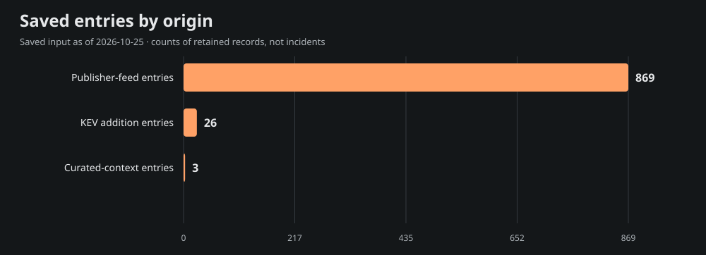
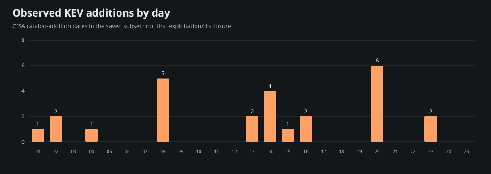
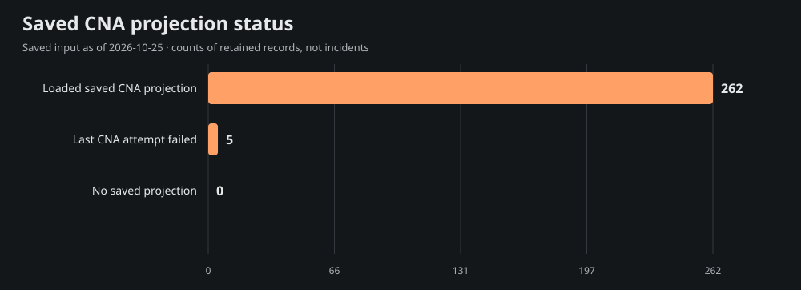

# Team Star Wolf Intelligence Hub
## October 2026 · month to date

**Edition:** SW-MONTHLY-2026-10-MTD-20261025T211341Z · **Coverage:** selective, incomplete saved-source subset

**Period:** 2026-10-01T00:00:00-05:00 inclusive to 2026-10-25T16:13:41-05:00 exclusive (America/Chicago).

**Compiled:** 2026-10-25T21:55:23.373Z · **Input generated:** 2026-10-25T21:13:41+00:00 · **Captured:** 2026-10-25T21:29:50.108068Z

This is a retrospective compilation of an unfinished month. A closed calendar period does not imply complete evidence. Saved entries, curated context and CNA projections are attributed below; no primary article or CNA record was fetched or independently verified for this edition.

## 1. Executive summary

The admitted saved subset contains **898 entries**: 869 publisher-feed entries, 26 CISA KEV catalog-addition entries and 3 curated-context entries. These mention **267 distinct CVE IDs**; they are not counts of incidents, newly disclosed vulnerabilities, exploited systems or affected devices.

The 10 selected developments below emphasize saved curated context, advisory metadata and dated KEV additions. Selection is bounded and source-based rather than a severity/risk ranking. The report samples 15 of 267 mentioned CVEs for current saved product, score and mitigation context; full entry/cohort/chart data are in [data.json](<https://github.com/TeamStarWolf/intelligence-hub/blob/main/reports/monthly/2026-10/data.json>).

Saved curated context highlights [LiteLLM publishes corrected October compromise investigation](<https://docs.litellm.ai/blog/security-incident-oct-21-2026-attack-chain>); [Mandiant investigates short-lived AOMEI update tampering](<https://cloud.google.com/blog/topics/threat-intelligence/investigating-ephemeral-supply-chain-tampering/>); [Microsoft examines browser patch-gap exploitation](<https://microsoftedge.github.io/edgevr/posts/AI-And-Rise-Patch-Gap-Abuse/>). These remain the saved curation’s source-attributed account, including any later-update caveats; they are not claims that the whole account was known during the historical period.

|Metric|Observed value|Meaning|
|---|---:|---|
|Saved entries|898|Canonical-URL rows in the selected date recipe|
|Unique mentioned CVEs|267|Union of IDs, not newly published CVEs|
|KEV additions|26|Catalog-addition rows, not first exploitation|
|Aware timestamps|839|Chicago-aware instant membership|
|Date-only rows|59|Literal calendar precision; timezone unknown|
|Cutoff-date rows with unknown time|0|Included calendar-overlap rows, not exact-time evidence|

## 2. Selected source-attributed developments

Up to 10 entries are selected; 10 qualify under this saved-source selection recipe. A headline or CVE mention is a source lead, not a directly re-read incident narrative.

### 1. LiteLLM publishes corrected October compromise investigation

- **Saved source:** [LiteLLM](<https://docs.litellm.ai/blog/security-incident-oct-21-2026-attack-chain>) · curated source context · incident
- **Recorded date:** 2026-10-23 · publication · calendar-day precision
- **CVE mentions:** None projected; no ID inferred from this title.
- **Saved exploitation label:** known; a mention alone is not exploitation evidence.
- **Saved curation context, observed October 25:** LiteLLM's canonical investigation explains the October 21 malicious 1.107.0 release through exposed and unrevoked agent-platform credentials and organization-level access. It supersedes parts of the initial account. Distinguish this incident from March and verify exact affected artifacts and response guidance.

### 2. Mandiant investigates short-lived AOMEI update tampering

- **Saved source:** [Google Threat Intelligence Group and Mandiant](<https://cloud.google.com/blog/topics/threat-intelligence/investigating-ephemeral-supply-chain-tampering/>) · curated source context · research
- **Recorded date:** 2026-10-15 · publication · calendar-day precision
- **CVE mentions:** None projected; no ID inferred from this title.
- **Saved exploitation label:** reported; a mention alone is not exploitation evidence.
- **Saved curation context, observed October 25:** Mandiant describes repeated brief changes to AOMEI update infrastructure between April and July 2026, distributing a downloader and backdoor before reverting legitimate configuration. Point-in-time checks may miss such windows; retain update and endpoint telemetry for historical review.

### 3. Microsoft examines browser patch-gap exploitation

- **Saved source:** [Microsoft Browser Vulnerability Research](<https://microsoftedge.github.io/edgevr/posts/AI-And-Rise-Patch-Gap-Abuse/>) · curated source context · research
- **Recorded date:** 2026-10-07 · publication · calendar-day precision
- **CVE mentions:** None projected; no ID inferred from this title.
- **Saved exploitation label:** reported; a mention alone is not exploitation evidence.
- **Saved curation context, observed October 25:** Microsoft describes campaigns exploiting gaps between public Chromium fixes, vendor releases and installed browser updates. Its account suggests AI may accelerate exploit development; this is an assessment, not certainty for every campaign. Update deployment and browser restart both matter.

### 4. CVE-2026-109618 Impact of Critical Vulnerabilities in PHP (CVE-2026-109618, CVE-2026-109619) on Palo Alto Networks Products (Severity: HIGH)

- **Saved source:** [Palo Alto Networks Security Advisories](<https://security.paloaltonetworks.com/CVE-2026-109618>) · saved Hub entry · advisory
- **Recorded date:** 2026-10-25T05:25:00+00:00 · publication · timestamp with offset
- **CVE mentions:** CVE-2026-109618, CVE-2026-109619
- **Saved exploitation label:** unknown; a mention alone is not exploitation evidence.
- **Context limit:** Saved headline/metadata only; no article-body facts, actor attribution or remediation are inferred.

### 5. CVE-2026-89049 - Server-side request forgery in the Session Manager port forwarding functionality in AWS Systems Manager Agent

- **Saved source:** [AWS Security Bulletins](<https://aws.amazon.com/security/security-bulletins/rss/2026-107-aws/>) · saved Hub entry · advisory
- **Recorded date:** 2026-10-25T03:13:38+00:00 · publication · timestamp with offset
- **CVE mentions:** CVE-2026-89049
- **Saved exploitation label:** unknown; a mention alone is not exploitation evidence.
- **Context limit:** Saved headline/metadata only; no article-body facts, actor attribution or remediation are inferred.

### 6. CVE-2026-89065 and CVE-2026-89066: Issue with projen - Path traversal and OS command injection

- **Saved source:** [AWS Security Bulletins](<https://aws.amazon.com/security/security-bulletins/rss/2026-108-aws/>) · saved Hub entry · advisory
- **Recorded date:** 2026-10-25T03:13:38+00:00 · publication · timestamp with offset
- **CVE mentions:** CVE-2026-89065, CVE-2026-89066
- **Saved exploitation label:** unknown; a mention alone is not exploitation evidence.
- **Context limit:** Saved headline/metadata only; no article-body facts, actor attribution or remediation are inferred.

### 7. CVE-2026-89090 - Denial of service in the event stream header decoder in AWS SDK for Go v2

- **Saved source:** [AWS Security Bulletins](<https://aws.amazon.com/security/security-bulletins/rss/2026-110-aws/>) · saved Hub entry · advisory
- **Recorded date:** 2026-10-25T03:13:38+00:00 · publication · timestamp with offset
- **CVE mentions:** CVE-2026-89090
- **Saved exploitation label:** unknown; a mention alone is not exploitation evidence.
- **Context limit:** Saved headline/metadata only; no article-body facts, actor attribution or remediation are inferred.

### 8. CVE-2026-110447 · Collabora Online – Built-in CODE Server OS Command Injection Vulnerability

- **Saved source:** [CISA Known Exploited Vulnerabilities](<https://www.cisa.gov/known-exploited-vulnerabilities-catalog?field_cve=CVE-2026-110447>) · saved Hub entry · kev
- **Recorded date:** 2026-10-23 · CISA catalog addition · calendar-day precision
- **CVE mentions:** CVE-2026-110447
- **Saved exploitation label:** known; a mention alone is not exploitation evidence.
- **Context limit:** Saved headline/metadata only; no article-body facts, actor attribution or remediation are inferred.

### 9. CVE-2026-114625 · Arista VeloCloud Orchestrator SQL Injection Vulnerability

- **Saved source:** [CISA Known Exploited Vulnerabilities](<https://www.cisa.gov/known-exploited-vulnerabilities-catalog?field_cve=CVE-2026-114625>) · saved Hub entry · kev
- **Recorded date:** 2026-10-23 · CISA catalog addition · calendar-day precision
- **CVE mentions:** CVE-2026-114625
- **Saved exploitation label:** known; a mention alone is not exploitation evidence.
- **Context limit:** Saved headline/metadata only; no article-body facts, actor attribution or remediation are inferred.

### 10. CVE-2026-106931 · EG Secure Solutions SiteGuard Server Edition OS Command Injection Vulnerability

- **Saved source:** [CISA Known Exploited Vulnerabilities](<https://www.cisa.gov/known-exploited-vulnerabilities-catalog?field_cve=CVE-2026-106931>) · saved Hub entry · kev
- **Recorded date:** 2026-10-20 · CISA catalog addition · calendar-day precision
- **CVE mentions:** CVE-2026-106931
- **Saved exploitation label:** known; a mention alone is not exploitation evidence.
- **Context limit:** Saved headline/metadata only; no article-body facts, actor attribution or remediation are inferred.

## 3. CISA KEV additions and CVE context

The saved input contains **26** KEV catalog-addition rows in this period. Catalog addition is separate from initial disclosure, first exploitation and the CVE identifier’s year. These are current-catalog observations captured October 25, not a frozen catalog from the historical month.

Showing 26 of 26 rows below; all admitted rows are retained in data.json.

|Added|CVE|Saved vendor/product tags|Current saved federal due date|
|---|---|---|---|
|2026-10-23|[CVE-2026-110447](<https://www.cisa.gov/known-exploited-vulnerabilities-catalog?field_cve=CVE-2026-110447>)|Collabora · Collabora Online – Built-in CODE Server|2026-10-26|
|2026-10-23|[CVE-2026-114625](<https://www.cisa.gov/known-exploited-vulnerabilities-catalog?field_cve=CVE-2026-114625>)|Arista · VeloCloud Orchestrator|2026-10-26|
|2026-10-20|[CVE-2026-106931](<https://www.cisa.gov/known-exploited-vulnerabilities-catalog?field_cve=CVE-2026-106931>)|EG Secure Solutions · SiteGuard Server Edition|2026-10-23|
|2026-10-20|[CVE-2026-110936](<https://www.cisa.gov/known-exploited-vulnerabilities-catalog?field_cve=CVE-2026-110936>)|Siemens · Software Center|2026-11-03|
|2026-10-20|[CVE-2026-96652](<https://www.cisa.gov/known-exploited-vulnerabilities-catalog?field_cve=CVE-2026-96652>)|Plex · Media Server|2026-11-03|
|2026-10-20|[CVE-2026-96654](<https://www.cisa.gov/known-exploited-vulnerabilities-catalog?field_cve=CVE-2026-96654>)|Plex · Media Server|2026-10-23|
|2026-10-20|[CVE-2026-96655](<https://www.cisa.gov/known-exploited-vulnerabilities-catalog?field_cve=CVE-2026-96655>)|Plex · Media Server|2026-11-03|
|2026-10-20|[CVE-2026-96656](<https://www.cisa.gov/known-exploited-vulnerabilities-catalog?field_cve=CVE-2026-96656>)|Plex · Media Server|2026-10-23|
|2026-10-16|[CVE-2025-61624](<https://www.cisa.gov/known-exploited-vulnerabilities-catalog?field_cve=CVE-2025-61624>)|Fortinet · Multiple Products|2026-10-19|
|2026-10-16|[CVE-2026-102764](<https://www.cisa.gov/known-exploited-vulnerabilities-catalog?field_cve=CVE-2026-102764>)|BeyondTrust · Remote Support|2026-10-19|
|2026-10-15|[CVE-2026-21589](<https://www.cisa.gov/known-exploited-vulnerabilities-catalog?field_cve=CVE-2026-21589>)|Atlassian · Multiple Products|2026-10-18|
|2026-10-14|[CVE-2026-0322](<https://www.cisa.gov/known-exploited-vulnerabilities-catalog?field_cve=CVE-2026-0322>)|Palo Alto Networks · PAN-OS|2026-10-17|
|2026-10-14|[CVE-2026-105133](<https://www.cisa.gov/known-exploited-vulnerabilities-catalog?field_cve=CVE-2026-105133>)|Ahsay · AhsayCBS|2026-10-17|
|2026-10-14|[CVE-2026-105134](<https://www.cisa.gov/known-exploited-vulnerabilities-catalog?field_cve=CVE-2026-105134>)|Ahsay · AhsayCBS|2026-10-17|
|2026-10-14|[CVE-2026-76519](<https://www.cisa.gov/known-exploited-vulnerabilities-catalog?field_cve=CVE-2026-76519>)|Cisco · Secure Email Gateway|2026-10-17|
|2026-10-13|[CVE-2026-104935](<https://www.cisa.gov/known-exploited-vulnerabilities-catalog?field_cve=CVE-2026-104935>)|Ivanti · Connect Secure|2026-10-16|
|2026-10-13|[CVE-2026-96951](<https://www.cisa.gov/known-exploited-vulnerabilities-catalog?field_cve=CVE-2026-96951>)|Microsoft · Windows|2026-10-16|
|2026-10-08|[CVE-2015-3306](<https://www.cisa.gov/known-exploited-vulnerabilities-catalog?field_cve=CVE-2015-3306>)|ProFTPD · ProFTPD|2026-10-11|
|2026-10-08|[CVE-2015-5477](<https://www.cisa.gov/known-exploited-vulnerabilities-catalog?field_cve=CVE-2015-5477>)|ISC · BIND|2026-10-11|
|2026-10-08|[CVE-2016-3081](<https://www.cisa.gov/known-exploited-vulnerabilities-catalog?field_cve=CVE-2016-3081>)|Apache · Struts|2026-10-11|
|2026-10-08|[CVE-2021-3199](<https://www.cisa.gov/known-exploited-vulnerabilities-catalog?field_cve=CVE-2021-3199>)|ONLYOFFICE · Docs|2026-10-11|
|2026-10-08|[CVE-2023-22894](<https://www.cisa.gov/known-exploited-vulnerabilities-catalog?field_cve=CVE-2023-22894>)|Strapi · Strapi|2026-10-11|
|2026-10-04|[CVE-2026-88779](<https://www.cisa.gov/known-exploited-vulnerabilities-catalog?field_cve=CVE-2026-88779>)|Citrix · NetScaler|2026-10-07|
|2026-10-02|[CVE-2026-102489](<https://www.cisa.gov/known-exploited-vulnerabilities-catalog?field_cve=CVE-2026-102489>)|Zammad GmbH · Zammad|2026-10-05|
|2026-10-02|[CVE-2026-102490](<https://www.cisa.gov/known-exploited-vulnerabilities-catalog?field_cve=CVE-2026-102490>)|Zammad GmbH · Zammad|2026-10-05|
|2026-10-01|[CVE-2026-104286](<https://www.cisa.gov/known-exploited-vulnerabilities-catalog?field_cve=CVE-2026-104286>)|Fortinet · FortiMail|2026-10-04|

Federal due dates are source catalog data, not deadlines assigned to this site’s visitors. Ransomware and exploitation assertions, where supplied, remain source-scoped in data.json.

### Current saved CNA sample

These 15 sampled projections are current context from the saved input. Their record-state, retrieval/update/attempt clocks and CNA score version remain explicit. Loaded projections can include rejected records; failed enrichment may retain older successful content. No source record was re-read for this report.

|CVE|Projection / record state|Saved CVSS|Saved guidance status|
|---|---|---|---|
|[CVE-2026-109618](<https://www.cve.org/CVERecord?id=CVE-2026-109618>)|ok / PUBLISHED|9.2 (v4.0; saved CNA metric)|publisher-guidance|
|[CVE-2026-109619](<https://www.cve.org/CVERecord?id=CVE-2026-109619>)|ok / PUBLISHED|9.2 (v4.0; saved CNA metric)|publisher-guidance|
|[CVE-2026-89049](<https://www.cve.org/CVERecord?id=CVE-2026-89049>)|ok / PUBLISHED|8.5 (v4.0; saved CNA metric)|needs-review|
|[CVE-2026-89065](<https://www.cve.org/CVERecord?id=CVE-2026-89065>)|ok / PUBLISHED|6.8 (v4.0; saved CNA metric)|needs-review|
|[CVE-2026-89066](<https://www.cve.org/CVERecord?id=CVE-2026-89066>)|ok / PUBLISHED|8.4 (v4.0; saved CNA metric)|needs-review|
|[CVE-2026-89090](<https://www.cve.org/CVERecord?id=CVE-2026-89090>)|ok / PUBLISHED|8.2 (v4.0; saved CNA metric)|needs-review|
|[CVE-2026-110447](<https://www.cve.org/CVERecord?id=CVE-2026-110447>)|ok / PUBLISHED|9.2 (v4.0; saved CNA metric)|cisa-action|
|[CVE-2026-114625](<https://www.cve.org/CVERecord?id=CVE-2026-114625>)|ok / PUBLISHED|9.4 (v4.0; saved CNA metric)|publisher-guidance|
|[CVE-2026-106931](<https://www.cve.org/CVERecord?id=CVE-2026-106931>)|ok / PUBLISHED|8.5 (v4.0; saved CNA metric)|cisa-action|
|[CVE-2012-1823](<https://www.cve.org/CVERecord?id=CVE-2012-1823>)|ok / PUBLISHED|Not supplied in saved projection|cisa-action|
|[CVE-2014-125110](<https://www.cve.org/CVERecord?id=CVE-2014-125110>)|ok / PUBLISHED|3.5 (v3.1; saved CNA metric)|needs-review|
|[CVE-2014-6278](<https://www.cve.org/CVERecord?id=CVE-2014-6278>)|ok / PUBLISHED|Not supplied in saved projection|cisa-action|
|[CVE-2015-1000013](<https://www.cve.org/CVERecord?id=CVE-2015-1000013>)|ok / PUBLISHED|Not supplied in saved projection|needs-review|
|[CVE-2015-2291](<https://www.cve.org/CVERecord?id=CVE-2015-2291>)|ok / PUBLISHED|Not supplied in saved projection|cisa-action|
|[CVE-2015-3306](<https://www.cve.org/CVERecord?id=CVE-2015-3306>)|ok / PUBLISHED|Not supplied in saved projection|cisa-action|

## 4. Campaigns and actors

**not_projected.** Schema 4 supplied no structured actor/campaign entity or relationship projection. Names in saved headlines, research or curated prose are not promoted into attribution, aliases or ATT&CK/CAPEC relationships. This does not establish that no campaign occurred.

## 5. Supply chain and AI security

Only exact saved tags select the following topic leads; this is not inferred impact or attack taxonomy.

- [LiteLLM publishes corrected October compromise investigation](<https://docs.litellm.ai/blog/security-incident-oct-21-2026-attack-chain>) — saved tags: supply-chain, ai-security; curated source context.
  Saved curation context: LiteLLM's canonical investigation explains the October 21 malicious 1.107.0 release through exposed and unrevoked agent-platform credentials and organization-level access. It supersedes parts of the initial account. Distinguish this incident from March and verify exact affected artifacts and response guidance.

- [Mandiant investigates short-lived AOMEI update tampering](<https://cloud.google.com/blog/topics/threat-intelligence/investigating-ephemeral-supply-chain-tampering/>) — saved tags: supply-chain; curated source context.
  Saved curation context: Mandiant describes repeated brief changes to AOMEI update infrastructure between April and July 2026, distributing a downloader and backdoor before reverting legitimate configuration. Point-in-time checks may miss such windows; retain update and endpoint telemetry for historical review.

## 6. Mitigation and product context

This is current saved projection context, not patch verification or knowledge backdated into the report month. Exact installed versions/configuration were not assessed. Full bounded product/version statements, source links and saved analysis steps are in data.json. CWE, CAPEC and actor fields are **not_projected**, rather than empty-proof of no weakness or attack pattern.

### CVE-2026-109618

- **Current saved state:** ok / PUBLISHED; 9.2 (v4.0; saved CNA metric).
- **Clocks:** retrieved 2026-10-24T22:24:24+00:00; record updated 2026-10-23T14:07:55+00:00; attempted 2026-10-24T22:24:24+00:00.
- **Saved product labels:** PHP Group / PHP 
- **Saved publisher workaround excerpt:** Check the GitHub Security Advisory for mitigation strategies.
- **Source pointer:** [Saved record reference](<https://www.cve.org/CVERecord?id=CVE-2026-109618>). No direct source review or environment applicability is established.

### CVE-2026-109619

- **Current saved state:** ok / PUBLISHED; 9.2 (v4.0; saved CNA metric).
- **Clocks:** retrieved 2026-10-24T22:24:24+00:00; record updated 2026-10-23T14:07:57+00:00; attempted 2026-10-24T22:24:23+00:00.
- **Saved product labels:** PHP Group / PHP 
- **Saved publisher workaround excerpt:** Check the GitHub Security Advisory for mitigation strategies.
- **Source pointer:** [Saved record reference](<https://www.cve.org/CVERecord?id=CVE-2026-109619>). No direct source review or environment applicability is established.

### CVE-2026-89049

- **Current saved state:** ok / PUBLISHED; 8.5 (v4.0; saved CNA metric).
- **Clocks:** retrieved 2026-10-24T22:24:08+00:00; record updated 2026-09-10T18:57:53+00:00; attempted 2026-10-24T22:24:08+00:00.
- **Saved product labels:** AWS / Amazon SSM Agent 
- **Guidance gap:** no action/solution/workaround supplied in this saved projection; this is unknown, not proof no fix exists.
- **Source pointer:** [Saved record reference](<https://www.cve.org/CVERecord?id=CVE-2026-89049>). No direct source review or environment applicability is established.

### CVE-2026-89065

- **Current saved state:** ok / PUBLISHED; 6.8 (v4.0; saved CNA metric).
- **Clocks:** retrieved 2026-10-24T22:24:08+00:00; record updated 2026-09-11T16:22:01+00:00; attempted 2026-10-24T22:24:08+00:00.
- **Saved product labels:** AWS / projen 
- **Guidance gap:** no action/solution/workaround supplied in this saved projection; this is unknown, not proof no fix exists.
- **Source pointer:** [Saved record reference](<https://www.cve.org/CVERecord?id=CVE-2026-89065>). No direct source review or environment applicability is established.

### CVE-2026-89066

- **Current saved state:** ok / PUBLISHED; 8.4 (v4.0; saved CNA metric).
- **Clocks:** retrieved 2026-10-24T22:24:08+00:00; record updated 2026-09-11T16:21:02+00:00; attempted 2026-10-24T22:24:08+00:00.
- **Saved product labels:** AWS / projen 
- **Guidance gap:** no action/solution/workaround supplied in this saved projection; this is unknown, not proof no fix exists.
- **Source pointer:** [Saved record reference](<https://www.cve.org/CVERecord?id=CVE-2026-89066>). No direct source review or environment applicability is established.

### CVE-2026-89090

- **Current saved state:** ok / PUBLISHED; 8.2 (v4.0; saved CNA metric).
- **Clocks:** retrieved 2026-10-24T22:24:08+00:00; record updated 2026-09-24T19:29:25+00:00; attempted 2026-10-24T22:24:08+00:00.
- **Saved product labels:** AWS / AWS SDK for Go v2 
- **Guidance gap:** no action/solution/workaround supplied in this saved projection; this is unknown, not proof no fix exists.
- **Source pointer:** [Saved record reference](<https://www.cve.org/CVERecord?id=CVE-2026-89090>). No direct source review or environment applicability is established.

### CVE-2026-110447

- **Current saved state:** ok / PUBLISHED; 9.2 (v4.0; saved CNA metric).
- **Clocks:** retrieved 2026-10-24T22:24:23+00:00; record updated 2026-10-24T03:55:50+00:00; attempted 2026-10-24T22:24:23+00:00.
- **Saved product labels:** Collabora / Collabora Online - Built-in CODE Server 
- **Saved CISA action excerpt (shortened):** Apply mitigations in accordance with vendor instructions, ensuring compliance with CISA’s BOD 26-04 Prioritizing Security Updates Based on Risk (see URL in Notes) guidance and CISA’s “Forensics Triage Requirements” (see URL in Notes). Follow applicable BOD 26-04 guidance for cloud services or discontinue use of the product if mitigations are unavailable. St…
- **Source pointer:** [Saved record reference](<https://www.cve.org/CVERecord?id=CVE-2026-110447>). No direct source review or environment applicability is established.

### CVE-2026-114625

- **Current saved state:** ok / PUBLISHED; 9.4 (v4.0; saved CNA metric).
- **Clocks:** retrieved 2026-10-24T22:24:23+00:00; record updated 2026-10-24T03:55:14+00:00; attempted 2026-10-24T22:24:23+00:00.
- **Saved product labels:** Arista Networks / VeloCloud Orchestrator 
- **Saved CISA action excerpt (shortened):** Apply mitigations in accordance with vendor instructions, ensuring compliance with CISA’s BOD 26-04 Prioritizing Security Updates Based on Risk (see URL in Notes) guidance and CISA’s “Forensics Triage Requirements” (see URL in Notes). Follow applicable BOD 26-04 guidance for cloud services or discontinue use of the product if mitigations are unavailable. St…
- **Saved publisher solution excerpt:** The recommended resolution is to upgrade to a fixed VCO release at your earliest convenience. These vulnerabilities have been fixed in the following releases: - VCO 5.2.3.18 and later in the 5.2 train - VCO 6.1.3.10 and later in the 6.1 train - VCO 6.4.2.12 and later in the 6.4 train
- **Saved publisher workaround excerpt (shortened):** Until the fixed software is deployed, operators should apply defense-in-depth controls appropriate for their environment: - Restrict access to the VCO web interface to trusted administrative networks. - Monitor the VCO for accesses from known malicious source IPs. - Monitor for unexpected outbound …
- **Source pointer:** [Saved record reference](<https://www.cve.org/CVERecord?id=CVE-2026-114625>). No direct source review or environment applicability is established.

### CVE-2026-106931

- **Current saved state:** ok / PUBLISHED; 8.5 (v4.0; saved CNA metric).
- **Clocks:** retrieved 2026-10-24T22:24:24+00:00; record updated 2026-10-21T03:56:27+00:00; attempted 2026-10-24T22:24:24+00:00.
- **Saved product labels:** EG Secure Solutions Inc. / SiteGuard Server Edition for Apache httpd; EG Secure Solutions Inc. / SiteGuard Server Edition for Nginx; EG Secure Solutions Inc. / SiteGuard Server Edition for IIS (first 3 shown; full bounded projection in data.json)
- **Saved CISA action excerpt (shortened):** Apply mitigations in accordance with vendor instructions, ensuring compliance with CISA’s BOD 26-04 Prioritizing Security Updates Based on Risk (see URL in Notes) guidance and CISA’s “Forensics Triage Requirements” (see URL in Notes). Follow applicable BOD 26-04 guidance for cloud services or discontinue use of the product if mitigations are unavailable. St…
- **Source pointer:** [Saved record reference](<https://www.cve.org/CVERecord?id=CVE-2026-106931>). No direct source review or environment applicability is established.

### CVE-2012-1823

- **Current saved state:** ok / PUBLISHED; Not supplied in saved projection.
- **Clocks:** retrieved 2026-10-24T23:19:14+00:00; record updated 2025-11-04T17:11:54+00:00; attempted 2026-10-24T23:19:14+00:00.
- **Saved product labels:** n/a / n/a 
- **Saved CISA action excerpt:** Apply updates per vendor instructions.
- **Source pointer:** [Saved record reference](<https://www.cve.org/CVERecord?id=CVE-2012-1823>). No direct source review or environment applicability is established.

### CVE-2014-125110

- **Current saved state:** ok / PUBLISHED; 3.5 (v3.1; saved CNA metric).
- **Clocks:** retrieved 2026-10-25T00:06:08+00:00; record updated 2024-08-06T14:10:56+00:00; attempted 2026-10-25T00:06:08+00:00.
- **Saved product labels:** n/a / wp-file-upload Plugin 
- **Guidance gap:** no action/solution/workaround supplied in this saved projection; this is unknown, not proof no fix exists.
- **Source pointer:** [Saved record reference](<https://www.cve.org/CVERecord?id=CVE-2014-125110>). No direct source review or environment applicability is established.

### CVE-2014-6278

- **Current saved state:** ok / PUBLISHED; Not supplied in saved projection.
- **Clocks:** retrieved 2026-10-24T23:19:12+00:00; record updated 2025-12-30T20:24:56+00:00; attempted 2026-10-24T23:19:12+00:00.
- **Saved product labels:** n/a / n/a 
- **Saved CISA action excerpt:** Apply mitigations per vendor instructions, follow applicable BOD 22-01 guidance for cloud services, or discontinue use of the product if mitigations are unavailable.
- **Source pointer:** [Saved record reference](<https://www.cve.org/CVERecord?id=CVE-2014-6278>). No direct source review or environment applicability is established.

### CVE-2015-1000013

- **Current saved state:** ok / PUBLISHED; Not supplied in saved projection.
- **Clocks:** retrieved 2026-10-25T00:06:08+00:00; record updated 2024-08-06T08:58:26+00:00; attempted 2026-10-25T00:06:08+00:00.
- **Saved product labels:** n/a / n/a 
- **Guidance gap:** no action/solution/workaround supplied in this saved projection; this is unknown, not proof no fix exists.
- **Source pointer:** [Saved record reference](<https://www.cve.org/CVERecord?id=CVE-2015-1000013>). No direct source review or environment applicability is established.

### CVE-2015-2291

- **Current saved state:** ok / PUBLISHED; Not supplied in saved projection.
- **Clocks:** retrieved 2026-10-24T22:25:21+00:00; record updated 2026-10-01T18:21:33+00:00; attempted 2026-10-24T22:25:21+00:00.
- **Saved product labels:** n/a / n/a 
- **Saved CISA action excerpt:** Apply updates per vendor instructions.
- **Source pointer:** [Saved record reference](<https://www.cve.org/CVERecord?id=CVE-2015-2291>). No direct source review or environment applicability is established.

### CVE-2015-3306

- **Current saved state:** ok / PUBLISHED; Not supplied in saved projection.
- **Clocks:** retrieved 2026-10-24T22:25:20+00:00; record updated 2026-10-09T16:02:13+00:00; attempted 2026-10-24T22:25:20+00:00.
- **Saved product labels:** n/a / n/a 
- **Saved CISA action excerpt (shortened):** Apply mitigations in accordance with vendor instructions, ensuring compliance with CISA’s BOD 26-04 Prioritizing Security Updates Based on Risk (see URL in Notes) guidance and CISA’s “Forensics Triage Requirements” (see URL in Notes). Follow applicable BOD 26-04 guidance for cloud services or discontinue use of the product if mitigations are unavailable. St…
- **Source pointer:** [Saved record reference](<https://www.cve.org/CVERecord?id=CVE-2015-3306>). No direct source review or environment applicability is established.

## 7. Changes to prior reporting

**Revision watch: not_run · no_baseline.** No primary citation was rechecked and no material-change claim is made. The 48–96-hour citation review policy remains planned; raw hashes or timestamps alone would not prove a material security change.

## 8. Watchlist for the next review

- Reconcile the 5 failed and 0 missing saved CNA projections in this cohort before treating missing guidance as absent.
- Review primary conditions for the 15 sampled CVEs; their saved retrieval/update clocks describe current context, not what was known in 2026-10.
- Actor/CWE/CAPEC mapping and prior-source revision checks remain unprojected/not run; no attribution or material-change claim is made.

Next nominal report/review cycle: **2026-10-25T22:00:00-05:00** (2026-10-26T03:00:00.000Z). **Planned; activation not verified for this edition.** Individual citation eligibility/caps/cooldowns may defer a source; this is not an on-time delivery or all-articles-checked promise.

## 9. Coverage and limitations

The whole input saved 62 source ledgers:54 ok,7 partial and1 failed. These describe last saved attempts around input generation, **not source health during 2026-10**. Source-specific period rows and origin dimensions are in data.json. The whole input window was 2016-10-25 through 2026-10-25, with bounded retained feed history.

- Saved publisher headlines and curated summaries are source-attributed leads, not direct article-body fact verification.
- Counts describe a bounded retained public subset, not all incidents, newly disclosed vulnerabilities, attacks or exposed systems.
- KEV addition dates identify catalog additions, not first disclosure/exploitation; current catalog membership can differ from a historical catalog.
- Input observed October 25; individual CNA update/retrieval and source-status clocks are retained separately and are not backdated into the report period.
- The 60 globally missing primary dates remain unassigned; failed/partial feed intake and bounded retention create coverage gaps.
- Date-only records retain calendar precision and unknown timezone; October cutoff-day records have unknown time relative to the exact MTD cutoff.
- No private account/social metrics, environment inventory, raw primary sources, actor aliases, inferred CWE/CAPEC links or oldW43 claims are included.
- Next nominal report/review cycle is planned until separate activation/readback; no unattended timing or per-source fetch guarantee.

**Date recipe:** aware timestamps use America/Chicago instant membership in the stated half-open period; date-only rows retain their literal calendar date/timezone unknown. Missing dates are globally unassigned. October MTD admits cutoff-date-only rows as calendar overlap with exact time unknown. Source event/publication/KEV dates are not interchangeable.

**Chart recipes:** every plotted row, unit, as-of clock and evidence ID is in data.json. Charts use actual admitted counts; no November/December future bars or social/account metrics are generated.

## 10. Primary-first source pointers

Input: [Saved Intelligence Hub snapshot](<https://teamstarwolf.github.io/intelligence-hub/data/feed.json>) · schema 4 · SHA-256 `eb44f9aaa505efe604fb2f17c88397dec08fc77d00d554dc096ab720573f4199`. Captured 2026-10-25T21:29:50.108068Z, generated 2026-10-25T21:13:41+00:00. Structural qualification is not a raw-primary-article/CNA truth claim.

- [Saved Intelligence Hub input](<https://teamstarwolf.github.io/intelligence-hub/data/feed.json>) — saved\_hub\_entry / input
- [CISA KEV catalog reference](<https://www.cisa.gov/known-exploited-vulnerabilities-catalog>) — saved\_hub\_entry / catalog
- [CVE-2026-109618 saved record reference](<https://www.cve.org/CVERecord?id=CVE-2026-109618>) — CNA\_projection / record
- [CVE-2026-109618 saved publisher guidance reference](<https://github.com/php/php-src/security/advisories/GHSA-w8hw-w9fx-j79w>) — CNA\_projection / guidance
- [CVE-2026-109619 saved record reference](<https://www.cve.org/CVERecord?id=CVE-2026-109619>) — CNA\_projection / record
- [CVE-2026-109619 saved publisher guidance reference](<https://github.com/php/php-src/security/advisories/GHSA-6wmf-4rv5-p3rp>) — CNA\_projection / guidance
- [CVE-2026-89049 saved record reference](<https://www.cve.org/CVERecord?id=CVE-2026-89049>) — CNA\_projection / record
- [CVE-2026-89049 saved publisher guidance reference](<https://github.com/aws/amazon-ssm-agent/releases/tag/3.3.4851.0>) — CNA\_projection / guidance
- [CVE-2026-89065 saved record reference](<https://www.cve.org/CVERecord?id=CVE-2026-89065>) — CNA\_projection / record
- [CVE-2026-89065 saved publisher guidance reference](<https://github.com/projen/projen/releases/tag/v0.101.37>) — CNA\_projection / guidance
- [CVE-2026-89066 saved record reference](<https://www.cve.org/CVERecord?id=CVE-2026-89066>) — CNA\_projection / record
- [CVE-2026-89066 saved publisher guidance reference](<https://github.com/projen/projen/releases/tag/v0.103.0>) — CNA\_projection / guidance
- [CVE-2026-89090 saved record reference](<https://www.cve.org/CVERecord?id=CVE-2026-89090>) — CNA\_projection / record
- [CVE-2026-89090 saved publisher guidance reference](<https://github.com/aws/aws-sdk-go-v2/releases/tag/release-2026-03-23>) — CNA\_projection / guidance
- [CVE-2026-110447 saved record reference](<https://www.cve.org/CVERecord?id=CVE-2026-110447>) — CNA\_projection / record
- [CVE-2026-110447 saved publisher guidance reference](<https://help.nextcloud.com/t/to-collabora-built-in-user-update-asap/250516>) — CNA\_projection / guidance
- [CVE-2026-114625 saved record reference](<https://www.cve.org/CVERecord?id=CVE-2026-114625>) — CNA\_projection / record
- [CVE-2026-114625 saved publisher guidance reference](<https://www.arista.com/en/support/advisories-notices/security-advisory/24838-security-advisory-0199>) — CNA\_projection / guidance
- [CVE-2026-106931 saved record reference](<https://www.cve.org/CVERecord?id=CVE-2026-106931>) — CNA\_projection / record
- [CVE-2012-1823 saved record reference](<https://www.cve.org/CVERecord?id=CVE-2012-1823>) — CNA\_projection / record
- [CVE-2012-1823 saved publisher guidance reference](<https://lists.fedoraproject.org/archives/list/package-announce%40lists.fedoraproject.org/message/PKGTQUOA2NTZ3RXN22CSAUJPIRUYRB4B/>) — CNA\_projection / guidance
- [CVE-2014-125110 saved record reference](<https://www.cve.org/CVERecord?id=CVE-2014-125110>) — CNA\_projection / record
- [CVE-2014-125110 saved publisher guidance reference](<https://github.com/wp-plugins/wp-file-upload/commit/c846327df030a0a97da036a2f07c769ab9284ddb>) — CNA\_projection / guidance
- [CVE-2014-6278 saved record reference](<https://www.cve.org/CVERecord?id=CVE-2014-6278>) — CNA\_projection / record
- [CVE-2015-1000013 saved record reference](<https://www.cve.org/CVERecord?id=CVE-2015-1000013>) — CNA\_projection / record
- [CVE-2015-2291 saved record reference](<https://www.cve.org/CVERecord?id=CVE-2015-2291>) — CNA\_projection / record
- [CVE-2015-3306 saved record reference](<https://www.cve.org/CVERecord?id=CVE-2015-3306>) — CNA\_projection / record
- [LiteLLM publishes corrected October compromise investigation](<https://docs.litellm.ai/blog/security-incident-oct-21-2026-attack-chain>) — library\_curationsource / incident
- [Mandiant investigates short-lived AOMEI update tampering](<https://cloud.google.com/blog/topics/threat-intelligence/investigating-ephemeral-supply-chain-tampering/>) — library\_curationsource / research
- [Microsoft examines browser patch-gap exploitation](<https://microsoftedge.github.io/edgevr/posts/AI-And-Rise-Patch-Gap-Abuse/>) — library\_curationsource / research
- [CVE-2026-109618 Impact of Critical Vulnerabilities in PHP (CVE-2026-109618, CVE-2026-109619) on Palo Alto Networks Products (Severity: HIGH)](<https://security.paloaltonetworks.com/CVE-2026-109618>) — saved\_hub\_entry / advisory
- [CVE-2026-89049 - Server-side request forgery in the Session Manager port forwarding functionality in AWS Systems Manager Agent](<https://aws.amazon.com/security/security-bulletins/rss/2026-107-aws/>) — saved\_hub\_entry / advisory
- [CVE-2026-89065 and CVE-2026-89066: Issue with projen - Path traversal and OS command injection](<https://aws.amazon.com/security/security-bulletins/rss/2026-108-aws/>) — saved\_hub\_entry / advisory
- [CVE-2026-89090 - Denial of service in the event stream header decoder in AWS SDK for Go v2](<https://aws.amazon.com/security/security-bulletins/rss/2026-110-aws/>) — saved\_hub\_entry / advisory
- [CVE-2026-110447 · Collabora Online – Built-in CODE Server OS Command Injection Vulnerability](<https://www.cisa.gov/known-exploited-vulnerabilities-catalog?field_cve=CVE-2026-110447>) — saved\_hub\_entry / kev
- [CVE-2026-114625 · Arista VeloCloud Orchestrator SQL Injection Vulnerability](<https://www.cisa.gov/known-exploited-vulnerabilities-catalog?field_cve=CVE-2026-114625>) — saved\_hub\_entry / kev
- [CVE-2026-106931 · EG Secure Solutions SiteGuard Server Edition OS Command Injection Vulnerability](<https://www.cisa.gov/known-exploited-vulnerabilities-catalog?field_cve=CVE-2026-106931>) — saved\_hub\_entry / kev

---
Data companion: [data.json](data.json). Generation and revision-check statuses describe this edition. Planned next-cycle times are not a guarantee of delivery.
