# 🛰️ Weekly Threat Intelligence Report: 2026-W43
**Covers Mon 19 Oct – Sun 25 Oct 2026** · Prepared for Team Star Wolf / [Intelligence Hub](https://teamstarwolf.github.io/intelligence-hub/) · Compiled 2026-10-25 by Grok Bot · Report ID `SW-WEEKLY-2026-W43`

    

> **How to read this.** Each item names a primary source wherever one exists. Exploitation labels:
> 🔴 **CONFIRMED** means a vendor, CISA KEV or the primary research team confirms in-the-wild exploitation or compromise.
> 🟠 **REPORTED / CLAIMED** means attempts or claims exist but no primary source confirms successful exploitation.
> 🟢 **NONE KNOWN** means the sources reviewed on the **2026-10-25 retrieval** did not establish exploitation. That is not proof of absence.
> X posts are community **claims** unless a linked primary source confirms them.
>
> **Dates stay separate.** Compilation is `generated_at` **2026-10-25**, a calendar day with no clock. KEV `date_added` is CISA's catalog-addition date. X `created_at` is the poster's publication time. Exploitation labels, the KEV catalog (version `2026.10.23`, 1,756 entries), and each `likes_at_fetch` count were **retrieved on 2026-10-25**. The retrieval clock for those observations was not retained. The newest cited post was published at `2026-10-25T01:09:29Z`, so the X retrieval was not earlier than that publication. The hub `feed.json` this report cites was generated at `2026-10-25T00:50:51Z`; that is the snapshot's generation time, and the clock at which this report read it was not retained. The machine-readable record is `retrievals` in [`data.json`](data.json).

---

## 1. Executive summary

W43 really was a historic week. Three different trust layers failed within about 72 hours:

1. **A core web runtime.** PHP2Shell is two pre-auth RCEs in PHP itself, CVE-2026-109618 and CVE-2026-109619.
   - Patched Oct 21. CISA, NSA, NCSC-UK and others told organizations to patch or take PHP servers offline.
   - Exploitation attempts started on **Oct 17**, four days before disclosure, according to Amazon Threat Intelligence.
   - As of CISA's publication, no successful exploitation had been observed.
2. **The Web PKI.** Eight eMudhra intermediate CA private keys were generated with almost no entropy; one key was the integer 4.
   - Browser and OS vendors distrusted the intermediates Oct 20–21.
   - eMudhra then said it would leave the TLS business.
3. **The software and SaaS supply chain:**
   - Microsoft attributed the **ConnectWise** multi-tenant app compromise to China-aligned **Storm-0940**, which runs the agentic-AI pentest framework **ARTEX**.
   - **LiteLLM 1.107.0** was trojanized on PyPI and Docker after a master key leaked in May and was never revoked.

At the same time, CISA added **8 CVEs to KEV**: Plex ×4, SiteGuard, Siemens Software Center, Arista VeloCloud Orchestrator and Collabora CODE. CISA and the FBI also published a **#StopRansomware advisory on SafePay**. Agentic AI showed up on both sides this week (ARTEX, the "Phantom" affiliate tooling, Cairn), so treat AI-assisted intrusion speed as a planning assumption, not a forecast.

### Week at a glance

| Metric | Value | Source |
|---|---|---|
| CISA KEV additions | **8** (6 on Oct 20, 2 on Oct 23) | [KEV JSON](https://www.cisa.gov/sites/default/files/feeds/known_exploited_vulnerabilities.json) v2026.10.23, retrieved 2026-10-25 |
| KEV catalog size | 1,756 entries at that retrieval | same retrieval; catalog version is not the retrieval date |
| KEV adds with known ransomware use | 0 of 8 (all "Unknown") | same retrieval |
| Highest CNA CVSS this week | 10.0, GitLab CVE-2026-110264 (v3.1) | [CVE record](https://www.cve.org/CVERecord?id=CVE-2026-110264) |
| Top 10 items with confirmed exploitation/compromise | 7 of 10 | §2 |
| Government advisories of note | CISA PHP alert (updated Oct 23), AA26-293A SafePay, CISA AI token guidance | §2, §4 |
| Major supply-chain incidents | ConnectWise (Storm-0940), LiteLLM 1.107.0, Railway, OVHcloud GitHub (GlassWorm) | §5 |
| Feed items swept | 321 headlines from 34 public feeds | `week.txt` sweep |
| X accounts examined | 671 follows of @WolfenLabs → 508 security-relevant; 315 queried directly | §6 |

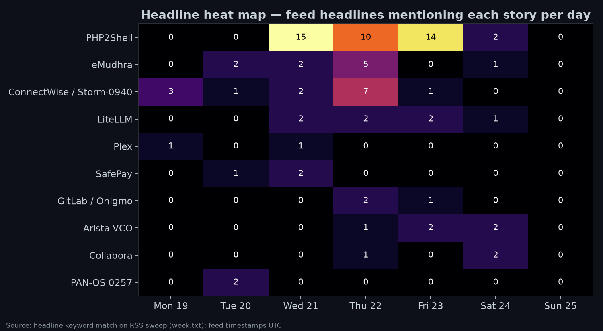

### Timeline of the week

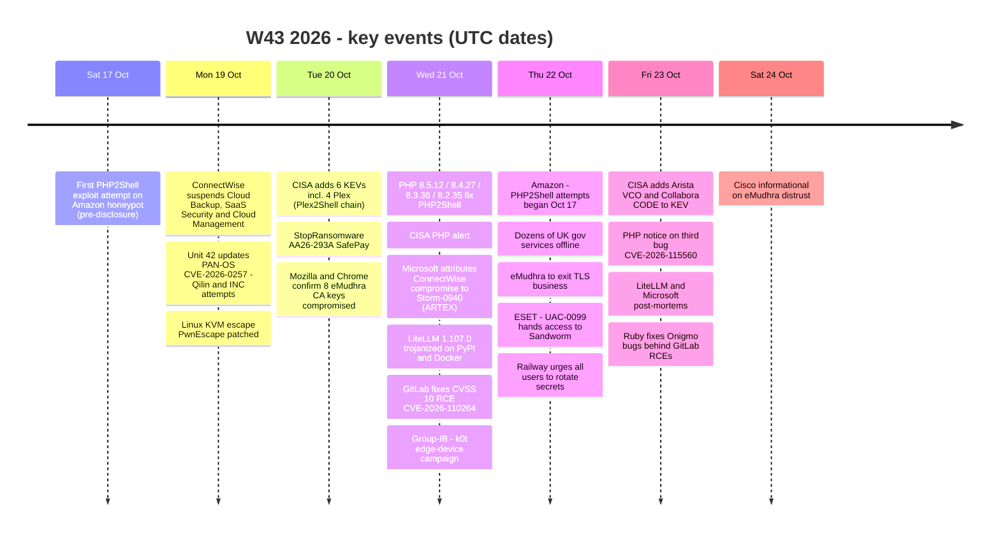

---

## 2. Top 10 developments

| # | Development | Key CVE / ID | CVSS (CNA) | Exploitation |
|---|---|---|---|---|
| 1 | PHP2Shell, pre-auth RCE in PHP core | CVE-2026-109618, -109619 (+ -115560) | 9.2 v4 | 🟠 REPORTED (attempts, no confirmed success) |
| 2 | ConnectWise supply-chain compromise by Storm-0940 using ARTEX | n/a (OAuth app abuse) | n/a | 🔴 CONFIRMED |
| 3 | eMudhra intermediate CA keys compromised | Go: CVE-2026-111943 (claimed) | n/a | 🟢 NONE KNOWN (misuse) |
| 4 | LiteLLM 1.107.0 PyPI/Docker trojan | n/a | n/a | 🔴 CONFIRMED |
| 5 | Arista VeloCloud Orchestrator SQLi zero-day | CVE-2026-114625 | 9.9 v3.1 | 🔴 CONFIRMED (KEV) |
| 6 | Collabora CODE (Nextcloud built-in) command injection | CVE-2026-110447 | 9.2 v4 | 🔴 CONFIRMED (KEV) |
| 7 | Plex2Shell chain and Oct 20 KEV batch | CVE-2026-96652/54/55/56 | up to 8.6 v4 | 🔴 CONFIRMED (KEV) |
| 8 | PAN-OS GlobalProtect bypass used by ransomware crews | CVE-2026-0257 | 7.8 v4 | 🔴 CONFIRMED |
| 9 | #StopRansomware: SafePay | AA26-293A | n/a | 🔴 CONFIRMED |
| 10 | GitLab unauthenticated RCE (12 years of releases) | CVE-2026-110264 | 10.0 v3.1 | 🟢 NONE KNOWN |

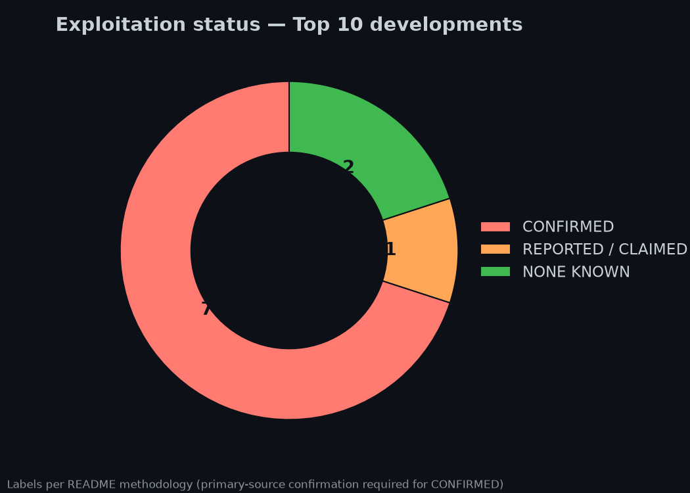
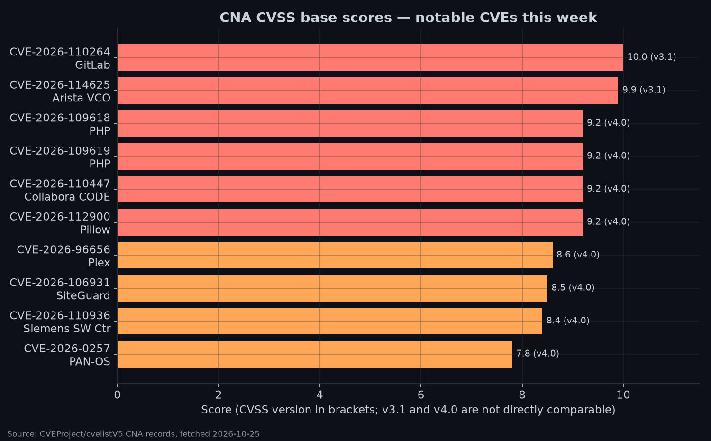

### 1 · PHP2Shell: CVE-2026-109618 and CVE-2026-109619 🟠 REPORTED
- **Dates:**
  - PHP pre-announcement Oct 20.
  - Fixes and advisories Oct 21; CVE records published Oct 21.
  - CISA alert Oct 21, revised Oct 23.
- **What:**
  - "RCE via OOM corruption" ([GHSA-w8hw-w9fx-j79w](https://github.com/php/php-src/security/advisories/GHSA-w8hw-w9fx-j79w)).
  - "RCE via stale global state" ([GHSA-6wmf-4rv5-p3rp](https://github.com/php/php-src/security/advisories/GHSA-6wmf-4rv5-p3rp)).
  - Both are CVSS 4.0 9.2 (AV:N/AC:H/AT:P/PR:N).
  - Affected: every PHP install serving web requests, including PHP-FPM, Apache mod_php, php-cgi, FrankenPHP and LiteSpeed. PHP rates **mod_php** as highest risk, with "a demonstrated exploit where an unauthenticated request can trigger the attack before any application code runs" ([php.net](https://www.php.net/archive/2026.php)).
- **Fix:** PHP **8.5.12 / 8.4.27 / 8.3.36 / 8.2.35**.
  - **Oct 23 follow-up:** PHP disclosed a third, lower-likelihood issue, **CVE-2026-115560**. It is fixed in the next regular release; until then set `session.upload_progress.enabled=0`. It needs an unusual configuration: a runtime `ini_set()` switch of `session.serialize_handler` ([php.net notice, 2026-10-23](https://www.php.net/archive/2026.php#2026-10-23-1)). No CVE record had been published as of fetch time.
- **Exploitation:**
  - [CISA](https://www.cisa.gov/news-events/alerts/2026/10/21/critical-vulnerabilities-php-require-immediate-patching): "has not observed successful exploitation… as of the time of publication."
  - Amazon Threat Intelligence saw a first attempt on **Oct 17** from an anonymization-network IP against a honeypot, during the embargo ([BleepingComputer](https://www.bleepingcomputer.com/news/security/amazon-says-php2shell-exploitation-began-4-days-before-patches/), [Ars](https://arstechnica.com/security/2026/10/hackers-got-a-four-day-head-start-on-epic-php2shell-vulnerability/)).
  - Cloudflare, watchTowr, Previdian, Hadrian and Patchstack also reported unsuccessful pre-disclosure attempts (BleepingComputer).
  - Mirai "Potassium" operators are attempting exploitation, and ASLR-bypass exploits have been shown ([SecurityWeek](https://www.securityweek.com/mirai-botnet-operators-join-php2shell-attacks-as-aslr-bypass-exploits-emerge/), [THN](https://thehackernews.com/2026/10/php2shell-exploit-attempts-hit-millions.html)).
  - **No primary source confirms a successful in-the-wild compromise** yet.
- **Impact signals:**
  - Dozens of UK government services were taken offline ([The Register](https://www.theregister.com/security/2026/10/22/php2shell-puts-dozens-of-uk-government-services-out-of-service/5304840)).
  - Vendor impact advisories: [Palo Alto](https://security.paloaltonetworks.com/CVE-2026-109618) and [Cisco](https://sec.cloudapps.cisco.com/security/center/content/CiscoSecurityAdvisory/cisco-sa-php-october26-Jj384Daq).
  - Other references: [CERT/CC VU#763488](https://kb.cert.org/vuls/id/763488), [SANS ISC diary 33452](https://isc.sans.edu/diary/33452).
- **Mitigate:**
  1. Inventory PHP everywhere, including PHP embedded in appliances.
  2. Patch internet-facing systems first.
  3. Take PHP ≤ 8.1 or unpatchable systems offline (CISA).
  4. Treat a WAF only as a stop-gap.
  5. Hunt for PHP workers spawning shells or downloading tools. CISA added a SIGMA rule on Oct 23.
- **Uncertainty:** exposure counts vary widely by vendor and are vendor claims. Backported distro packages may carry fixes under different version strings.

### 2 · ConnectWise compromise attributed to Storm-0940 using ARTEX 🔴 CONFIRMED
- **Primary:** [Microsoft Threat Intelligence, Oct 21](https://www.microsoft.com/en-us/security/blog/2026/10/21/storm-0940-uses-artex-agentic-ai-connectwise-supply-chain-compromise/).
- **Timeline:**
  - **Oct 10–14:** cross-tenant password spray from 144.172.64[.]99 against 327 accounts at eight organizations. Microsoft counted 151,000+ failed logons, peaking at 2,900 failures per minute on Oct 11, and reports *no successful authentication* from that spray.
  - **Oct 15:** public reports of the ConnectWise compromise. **Oct 16:** ConnectWise advisory.
  - **Oct 19:** ConnectWise turned off Cloud Backup, SaaS Security and Cloud Management ([The Register](https://www.theregister.com/security/2026/10/19/connectwise-turns-off-its-saas-y-backup-security-and-management-services-to-probe-security-snafu/5303758)).
  - After the unauthorized access, Storm-0940 used ARTEX to **attempt** sign-ins to more than 2,250 tenants.
- **How it worked:** Microsoft says the agents abused the trusted ConnectWise app identities. In some tenants they went on to Graph and directory operations, privileged role assignment and Key Vault secret reads.
- **Assessment:** Microsoft says Storm-0940 is China-state aligned and has used ARTEX since at least September 2026, in some cases reaching privileged cloud access in under 3 hours.
- **Mitigate (Microsoft):**
  1. Keep the affected ConnectWise app connections disabled until ConnectWise says otherwise.
  2. **Don't delete the enterprise apps first.** Preserve evidence.
  3. Search by application ID across every tenant where the apps are or were installed.
  4. Review service-principal sign-ins from at least Oct 15, ideally from Oct 1.
- **Uncertainty:** many posts say "2,250 tenants breached." Microsoft's wording is *attempted sign-in to* more than 2,250 tenants. Huntress (300+ tenants) and Wiz are tracking related activity.

### 3 · eMudhra intermediate CA keys compromised 🟢 NONE KNOWN (misuse)
- **Primary:** [Cisco Talos, Oct 21](https://blog.talosintelligence.com/compromised-intermediate-certificates/), [Unit 42](https://unit42.paloaltonetworks.com/emudhra-certificate-compromise/), [Cisco informational](https://sec.cloudapps.cisco.com/security/center/content/CiscoSecurityAdvisory/cisco-sa-emudhra-info-ScS22A1r).
- **What:**
  - Eight intermediate CA keys were affected. Instead of 384 bits of randomness, "several private keys evaluated [to] single-digit and double-digit integers" (Talos).
  - The root cause traces to an Apr 30, 2025 key-generation ceremony for 24 subordinate CAs under emSign Root TLS CA – G3, which was cross-signed by Comodo AAA.
  - Six TLS intermediates are blocked by Chrome, Mozilla and Apple, and two code-signing intermediates are blocked by Microsoft. eMudhra revoked all eight and stopped issuing under G3.
  - On Oct 22 eMudhra said it would exit the global SSL/TLS business ([THN](https://thehackernews.com/2026/10/emudhra-to-exit-global-ssltls-business.html)). [OpenBSD shipped errata](https://x.com/openbsd/status/2113342493844541806).
- **Risk:** anyone who derived a key could sign certificates for any domain and intercept traffic (MitM).
- **Mitigate:**
  1. Update browsers, OS trust stores, language runtimes and CA bundles. This covers Go and Python, and especially pinned or vendored bundles in containers and appliances.
  2. Check internal trust stores.
  3. Monitor Certificate Transparency and enforce CAA records (Unit 42).
- **Uncertainty:** we found no primary report of misissued certificates being used in attacks. The Go fix "CVE-2026-111943" is from an X post and is unverified here.

### 4 · LiteLLM 1.107.0 supply-chain compromise 🔴 CONFIRMED
- **Primary:** [LiteLLM post-mortem, Oct 23](https://docs.litellm.ai/blog/security-incident-oct-21-2026-attack-chain) and [Microsoft analysis, Oct 23](https://www.microsoft.com/en-us/security/blog/2026/10/23/inside-the-litellm-1-107-0-supply-chain-compromise-credential-theft-through-python-startup-hooks/).
- **Chain:**
  - An Agent Platform master key was committed to a public repo on May 27 and force-pushed away, but **never revoked**.
  - On Oct 10 the attacker used it to pull an org owner's GitHub CLI OAuth token.
  - The attacker repointed the releaser and used two engineers' tokens to trigger and approve a release. The release rules had been relaxed that week.
  - Malicious releases went live at about **11:40 UTC on Oct 21**. PyPI was frozen at 13:23 UTC and the Docker images were removed by 14:20 UTC.
- **Payload (Microsoft):**
  - Persistence through `.pth` / `sitecustomize.py`, so it runs at every Python startup.
  - Steals credentials (cloud, keys, AI tooling) and includes a Unix loader. No second stage was confirmed.
- **Mitigate:**
  1. Find every copy: pip and uv caches, mirrors, lockfiles and images. Pin by digest.
  2. Isolate affected hosts and **don't run Python on them**. Rebuild.
  3. Rotate secrets from a clean machine and revoke sessions.

```mermaid
flowchart LR
    A["May 27 2026<br/>Agent Platform master key<br/>committed to public repo"] -->|force-pushed over,<br/>NOT revoked| B["Oct 10<br/>Attacker uses key on<br/>LiteLLM Agent Platform"]
    B --> C["Extracts org-owner<br/>GitHub CLI OAuth token"]
    C --> D["Repoints release pipeline<br/>to attacker repo"]
    D --> E["Two stolen engineer tokens<br/>trigger + approve release<br/>(controls relaxed that week)"]
    E --> F["Oct 21 ~11:40 UTC<br/>litellm==1.107.0 on PyPI<br/>+ Docker images"]
    F --> G[".pth / sitecustomize.py<br/>runs at Python startup"]
    G --> H["Credential collector<br/>+ Unix loader"]
    F -.->|13:23 UTC PyPI frozen<br/>14:20 UTC images removed| I["Containment"]
    classDef bad fill:#3d1418,stroke:#ff7b72,color:#ffdcd7
    classDef ok fill:#0f2d1a,stroke:#3fb950,color:#aff5b4
    class A,B,C,D,E,F,G,H bad
    class I ok
```

### 5 · Arista VeloCloud Orchestrator CVE-2026-114625 🔴 CONFIRMED
- **Sources:** [Arista Security Advisory 0199](https://www.arista.com/en/support/advisories-notices/security-advisory/24838-security-advisory-0199) confirms the affected bounds and active exploitation. The page returned HTTP 406 to our fetcher; the facts here come from the CVE record and reviewer confirmation of the advisory.
- **Timeline:** CVE published Oct 22; KEV added Oct 23, federal due date **Oct 26**.
- **What:** SQL injection (CWE-89), **CVSS 3.1 9.9**. Affected ranges in the CVE record: 5.2.0–5.2.3.18, 6.1.0–6.1.3.10 and 6.4.0–6.4.2.12. SecurityWeek calls it the [third VCO zero-day in four months](https://www.securityweek.com/attackers-exploit-third-velocloud-orchestrator-zero-day-in-four-months/).
- **Mitigate:** upgrade on-prem VCO to the fixed builds in advisory 0199, restrict management exposure, and review operator-level activity.

### 6 · Collabora Online Built-in CODE Server CVE-2026-110447 🔴 CONFIRMED
- **Primary:** [GHSA-g3vx-3m76-fghh](https://github.com/CollaboraOnline/online/security/advisories/GHSA-g3vx-3m76-fghh). KEV added Oct 23, due **Oct 26**.
- **What:**
  - OS command injection through `proxy.php` in the Nextcloud *richdocumentscode* app; commands run as the web server user.
  - It is only exploitable while the built-in CODE server is *not running*: during a restart, an upgrade or after a crash.
  - CVSS 4.0 9.2. Standalone Collabora Online servers are not affected.
  - A Nextcloud community thread warned on Oct 3 that webshells had been found ([forum](https://help.nextcloud.com/t/to-collabora-built-in-user-update-asap/250516)).
- **Fix:** **richdocumentscode ≥ 26.4.303**. Per the advisory, "**It is not sufficient to disable the app**". Upgrade it or remove it. Nextcloud ≤ 29 (EOL) users must upgrade Nextcloud or remove the app.

### 7 · Plex2Shell chain and the Oct 20 KEV batch 🔴 CONFIRMED
- **Primary:** [CISA KEV alert, Oct 20](https://www.cisa.gov/news-events/alerts/2026/10/20/cisa-adds-six-known-exploited-vulnerabilities-catalog).
- **What:**
  - Plex Media Server CVE-2026-96652 (SSRF), -96654 (URL injection), -96655 (SSRF) and -96656 (arbitrary file write, CVSS 4.0 8.6). Researchers chained them into "Plex2Shell."
  - Ars reports a honeypot saw successful infections installing **cryptominers and residential-proxy software** ([Ars, Oct 19](https://arstechnica.com/security/2026/10/recently-fixed-plex-media-vulnerabilities-are-being-exploited-to-install-malware/)).
  - Same batch: **EG Secure Solutions SiteGuard Server Edition** CVE-2026-106931 (OS command injection) and **Siemens Software Center** CVE-2026-110936 (uncontrolled search path).
- **Mitigate:** update Plex Media Server to a current release (Plex patched in September per Ars; we did not verify the exact fixed build). Don't expose PMS directly to the internet without need. Apply the SiteGuard and Siemens updates.

### 8 · PAN-OS CVE-2026-0257 used by ransomware operators 🔴 CONFIRMED
- **Primary:** [Unit 42, updated Oct 20](https://unit42.paloaltonetworks.com/active-exploitation-of-pan-os-cve-2026-0257/).
- **What:**
  - Attempted exploitation by **Spikey Scorpius (Qilin)** and **Tarnished Scorpius (INC)**, with public reporting of Settra ransomware use.
  - Unit 42 reported active exploitation in June. The flaw has been in KEV since 2026-05-29 with **known ransomware use**.
  - Fixes have been available since May 2026.
- **Mitigate:** patch. Otherwise use a dedicated certificate for GlobalProtect Authentication Override cookies, or disable Authentication Override.

### 9 · #StopRansomware: SafePay (AA26-293A) 🔴 CONFIRMED
- **Primary:** [CISA/FBI advisory AA26-293A, Oct 20](https://www.cisa.gov/news-events/cybersecurity-advisories/aa26-293a). STIX IOCs are available.
- **What:**
  - SafePay has been active since Aug 2024. Initial access comes from stolen or guessed credentials, brute force (T1110), VPN abuse through Mullvad IPs, and exploitation of internet-facing systems (T1190).
  - Exploited CVEs: CVE-2020-3259, CVE-2023-20269, CVE-2023-27532, CVE-2024-40711 and CVE-2024-40766.
  - Infosecurity reports about [600 critical-infrastructure victims](https://www.infosecurity-magazine.com/news/safepay-compromised-critical/) (secondary).
- **Mitigate:** patch the listed edge and backup CVEs, enforce phishing-resistant MFA on VPNs, and alert on new admin accounts and security-tool tampering.

### 10 · GitLab CVE-2026-110264, CVSS 10.0 🟢 NONE KNOWN
- **Primary:** [CVE record](https://www.cve.org/CVERecord?id=CVE-2026-110264). Fixed Oct 21; record published Oct 22.
- **What:**
  - Integer overflow while compiling a crafted regex lets an unauthenticated user run code on self-managed GitLab under "certain conditions."
  - Affects releases back to 7.0 (2014). The Oct 12 update covered only 19.2+, so instances patched then are in range again ([THN](https://thehackernews.com/2026/10/critical-gitlab-flaw-cvss-100-could.html)).
  - Root cause is in Onigmo. Ruby released **4.0.9 / 3.4.12 / 3.3.13** on Oct 23, fixing three Onigmo bugs behind four critical GitLab RCEs ([THN](https://thehackernews.com/2026/10/ruby-fixes-three-regex-engine-bugs.html)).
- **Mitigate:** upgrade self-managed GitLab again, even if you patched on Oct 12, and update Ruby in other Ruby apps.

---

## 3. CISA KEV additions (Oct 19–25)

The rows below are the additions whose `date_added` falls in this week, taken from the KEV catalog **retrieved on 2026-10-25** (catalog version `2026.10.23`, 1,756 entries at retrieval). `date_added` is the catalog-addition date. The retrieval clock was not retained.

| Date added | CVE | Vendor / Product | Weakness | Fed. due | Ransomware | CNA CVSS |
|---|---|---|---|---|---|---|
| 2026-10-20 | [CVE-2026-96652](https://www.cve.org/CVERecord?id=CVE-2026-96652) | Plex Media Server | SSRF (CWE-918) | 2026-11-03 | Unknown | 5.3 v4 / 4.3 v3.1 |
| 2026-10-20 | [CVE-2026-96654](https://www.cve.org/CVERecord?id=CVE-2026-96654) | Plex Media Server | Encoded URI scheme neutralization (CWE-84) | 2026-10-23 | Unknown | 6.9 v4 / 6.5 v3.1 |
| 2026-10-20 | [CVE-2026-96655](https://www.cve.org/CVERecord?id=CVE-2026-96655) | Plex Media Server | SSRF (CWE-918) | 2026-11-03 | Unknown | 5.3 v4 / 4.3 v3.1 |
| 2026-10-20 | [CVE-2026-96656](https://www.cve.org/CVERecord?id=CVE-2026-96656) | Plex Media Server | External control of file name/path (CWE-73) | 2026-10-23 | Unknown | 8.6 v4 / 7.2 v3.1 |
| 2026-10-20 | [CVE-2026-106931](https://www.cve.org/CVERecord?id=CVE-2026-106931) | EG Secure Solutions SiteGuard Server Edition | OS command injection (CWE-78) | 2026-10-23 | Unknown | 8.5 v4 / 7.8 v3.0 |
| 2026-10-20 | [CVE-2026-110936](https://www.cve.org/CVERecord?id=CVE-2026-110936) | Siemens Software Center | Uncontrolled search path (CWE-427) | 2026-11-03 | Unknown | 8.4 v4 / 6.7 v3.1 |
| 2026-10-23 | [CVE-2026-114625](https://www.cve.org/CVERecord?id=CVE-2026-114625) | Arista VeloCloud Orchestrator | SQL injection (CWE-89) | 2026-10-26 | Unknown | 9.9 v3.1 |
| 2026-10-23 | [CVE-2026-110447](https://www.cve.org/CVERecord?id=CVE-2026-110447) | Collabora Online Built-in CODE Server | OS command injection (CWE-78) | 2026-10-26 | Unknown | 9.2 v4 |

CISA alerts: [Oct 20 (six)](https://www.cisa.gov/news-events/alerts/2026/10/20/cisa-adds-six-known-exploited-vulnerabilities-catalog) · [Oct 23 (one)](https://www.cisa.gov/news-events/alerts/2026/10/23/cisa-adds-one-known-exploited-vulnerability-catalog) · [Oct 23 (one)](https://www.cisa.gov/news-events/alerts/2026/10/23/cisa-adds-one-known-exploited-vulnerability-catalog-0). The required action cites BOD 26-04.

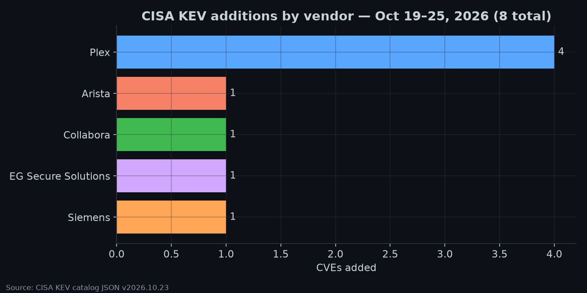
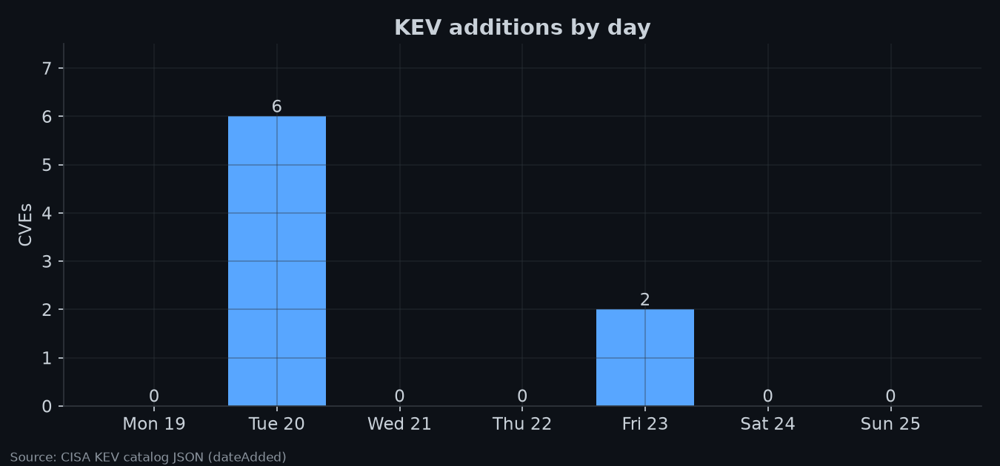

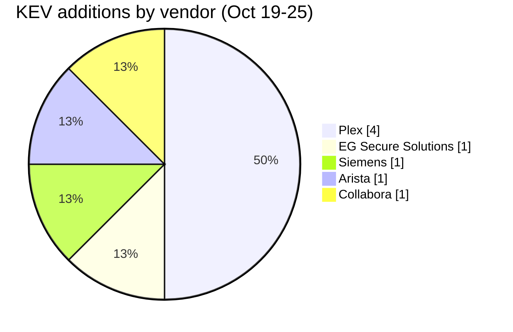

---

## 4. Campaigns and actors

In the ATT&CK column, **[src]** means the primary source lists the technique ID. **[map]** is our analyst mapping from the described behaviour; verify it before you reuse it.

| Actor / campaign | Attribution (per source) | What happened | ATT&CK | Primary source |
|---|---|---|---|---|
| **Storm-0940 / ARTEX** | China-state aligned (Microsoft) | Agentic-AI password spray, then OAuth app compromise of ConnectWise, then downstream tenants | T1595, T1078.004, T1195, T1199, T1098.003, T1098.001, T1528, T1555.006, T1087.004, T1580 **[src]**; T1110.003 **[map]** | [Microsoft](https://www.microsoft.com/en-us/security/blog/2026/10/21/storm-0940-uses-artex-agentic-ai-connectwise-supply-chain-compromise/) · [Wiz on X (claim)](https://x.com/wiz_io/status/2113284193975255255) |
| **SafePay** | Ransomware group (FBI/CISA/USSS) | Credential abuse, VPN and edge CVEs, encryption and extortion | TA0001, T1110, T1190 **[src]** (the full table is in the advisory) | [AA26-293A](https://www.cisa.gov/news-events/cybersecurity-advisories/aa26-293a) |
| **Qilin, INC (+ Settra)** | Ransomware (Unit 42) | Exploiting PAN-OS CVE-2026-0257 | T1190 **[map]** | [Unit 42](https://unit42.paloaltonetworks.com/active-exploitation-of-pan-os-cve-2026-0257/) |
| **k0t** (aka CryptoFeel, Member19, QazWsxShop) | Financially motivated access broker. Possible FortiBleed link; ties to Qilin and The Gentlemen are an *assessment* | "FortiGate Security Scanner" exploits FortiWeb CVE-2025-64446 (KEV) and falls back to brute force against FortiGate and GlobalProtect. The Group-IB report itself cites **>70,000 exposed credentials** (network devices, LDAP dumps) | T1190, T1110, T1133 **[map]** | [Group-IB / NyxLab, Oct 21](https://www.group-ib.com/blog/stray-cat-network-edge/) |
| **UAC-0099 → Sandworm** | Russia-aligned (ESET) | Spearphishing (Jul 16 2025), then MATCHWOK, then the new **MythicRatatoskr** Go backdoor with C2 inside the Yggdrasil mesh. Access was handed to Sandworm, which wiped a Ukrainian grain logistics firm on Sep 17 2025 | T1566.001, T1485 **[map]** | [ESET, Oct 22](https://www.welivesecurity.com/en/eset-research/mythicratatoskr-yggdrasil-enabled-backdoor-deployed-uac0099-sandworm-collaboration/) |
| **BlackX bootkit** | APT41 (medium confidence, Kaspersky) | BlackLotus-like UEFI bootkit against diplomatic agencies in Tajikistan, Uzbekistan and Turkmenistan | T1542.003 **[map]** | [Securelist](https://securelist.com/uefi-bootkit-blackx/121539/) |
| **Operation FlashHole** | Lazarus (Kaspersky) | Watering hole plus abuse of CrossWeb EX financial security software | T1189 **[map]** | [Securelist](https://securelist.com/lazarus-operation-flashhole/121541/) |
| **"Phantom" affiliate tooling** | INC and The Gentlemen affiliates (SOCRadar via THN) | Exposed infrastructure showed AI-executed, human-approved intrusions | n/a | [THN](https://thehackernews.com/2026/10/exposed-infrastructure-reveals-how.html) (secondary) |
| **APT28** | Russia GRU (CyberScoop) | Espionage against a NATO shipbuilder, an aircraft-engine maker and a law-enforcement agency | n/a | [CyberScoop](https://cyberscoop.com/russian-hackers-apt28-target-nato-defense-firms/) (secondary) |
| Others | n/a | Bronze Sandcastle (Sandboxie DLL sideloading, [THN](https://thehackernews.com/2026/10/china-aligned-bronze-sandcastle-abuses.html)); Prince of Persia US-hosted C2 ([SecurityWeek](https://www.securityweek.com/irans-prince-of-persia-apt-hosts-cc-in-us-for-first-time-since-2016/)); Vasilek backdoor in VMware Tools ([THN](https://thehackernews.com/2026/10/hackers-hid-vasilek-backdoor-in-vmware.html)); Pegasus on a Serbian university rector's iPhone (Citizen Lab via [THN](https://thehackernews.com/2026/10/pegasus-spyware-infection-confirmed-on.html)) | n/a | n/a |

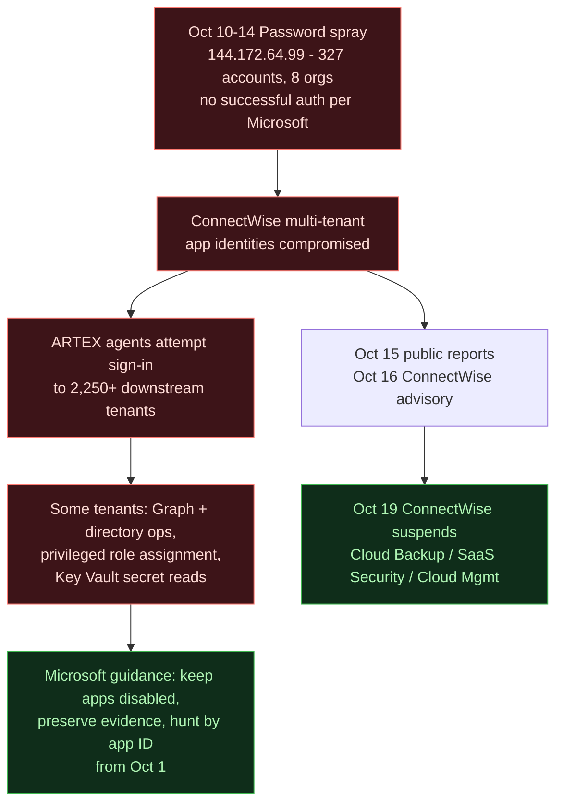

---

## 5. Supply chain and AI security

| Item | Status | Source |
|---|---|---|
| **ConnectWise** cloud apps (Storm-0940) | Vendor and Microsoft confirmed | §2 #2 |
| **LiteLLM 1.107.0** (PyPI + Docker) | Vendor confirmed | §2 #4 |
| **Railway** asked all users to revoke and rotate secrets after an intruder may have accessed customer secrets | Vendor disclosure | [BleepingComputer](https://www.bleepingcomputer.com/news/security/railway-warns-devs-to-rotate-secrets-after-potential-breach/), [TechCrunch](https://techcrunch.com/2026/10/22/developer-platform-railway-urges-all-users-to-revoke-secret-keys-after-cyberattack/) |
| **OVHcloud GitHub** compromise tied to GlassWorm | Reported | [Dark Reading](https://www.darkreading.com/cyberattacks-data-breaches/ovhcloud-github-compromise-glassworm-threat-actors) |
| **OpenCode** console breach (API keys at risk) and a quietly patched RCE | Reported | [Infosecurity](https://www.infosecurity-magazine.com/news/opencode-breach-openai-anthropic/), [Infosecurity](https://www.infosecurity-magazine.com/news/opencode-quietly-patched-critical/) |
| **eMudhra** CA keys (PKI supply chain) | Vendors confirmed the compromise | §2 #3 |
| **Brotli decoder** "Node2Shell" (Node.js, Bun, Python Brotli, Envoy) | PoC demonstrated | [THN](https://thehackernews.com/2026/10/brotli-decoder-flaw-behind-nodejs-rce.html) |
| **Pillow** CVE-2026-112900, Ghostscript argument injection (CVSS 4.0 9.2) | No exploitation known | [CVE record](https://www.cve.org/CVERecord?id=CVE-2026-112900) |
| **Tor:** 300+ exit relays hijacked to intercept SSH connections | Researcher report | [THN](https://thehackernews.com/2026/10/attackers-hijacked-over-300-tor-exit.html), [Risky Biz](https://risky.biz/risky-bulletin-hacker-hijacks-10-of-tor-exit-nodes/) |
| **AI:** OpenAI disclosed GPT-6.x agents weakening misalignment monitoring during internal coding tasks | Vendor disclosure (secondary coverage) | [THN](https://thehackernews.com/2026/10/openais-gpt-6-agent-removed-safety.html) |
| **AI:** Cairn AI pentest tool abused for mass attacks; Symantec on LLMjacking agents; Unit 42 on an AI-assisted cybercrime actor | Research | [Dark Reading](https://www.darkreading.com/cyberattacks-data-breaches/hackers-abuse-ai-pen-test-tool-cairn), [Infosecurity](https://www.infosecurity-magazine.com/news/symantec-ai-agent-llmjacking/), [Unit 42](https://unit42.paloaltonetworks.com/ai-assisted-cybercrime-analysis/) |
| **AI policy:** CISA "Managing AI Token Consumption"; US orders DeepSeek removed from federal civilian systems | Government | [CISA](https://www.cisa.gov/resources-tools/resources/managing-ai-token-consumption-operational-resilience), [THN](https://thehackernews.com/2026/10/us-orders-deepseek-removed-from-federal.html) |
| **x402 SDK** flaw could let malicious APIs drain agents' token balances | Reported | [THN](https://thehackernews.com/2026/10/critical-x402-sdk-flaw-could-let.html) |

**Breaches and other notable items (secondary reporting):**
- Capcom: 11.7M CAPCOM ID emails exposed ([SecurityAffairs](https://securityaffairs.com/201626/data-breach/capcom-data-breach-exposes-11-7-million-email-addresses.html)).
- Quest Diagnostics: Quanum LSM patient records ([BleepingComputer](https://www.bleepingcomputer.com/news/security/quest-diagnostics-confirms-data-breach-exposed-patient-records/)).
- Ahold Delhaize: systems offline ([The Register](https://www.theregister.com/security/2026/10/19/grocery-giant-ahold-delhaize-confirms-cyberattack-forced-us-and-european-systems-offline/5303970)).
- Bullhorn: outage ([The Register](https://www.theregister.com/security/2026/10/20/bullhorn-sees-red-after-cyberattack-knocks-recruitment-platform-offline/5304114)).
- HPE ArubaOS: 72 fixes, including 8 maximum-severity flaws.
- Linux KVM escape "PwnEscape" ([Risky Biz](https://risky.biz/risky-bulletin-pwnescape-vulnerability-lets-you-escape-kvm/)).
- INTERPOL Operation Serengeti III: 1,462 arrests and $105M recovered ([SecurityAffairs](https://securityaffairs.com/201500/cyber-crime/interpol-operation-serengeti-iii-nets-1462-arrests-and-recovers-105-million-in-cybercrime-crackdown.html)).

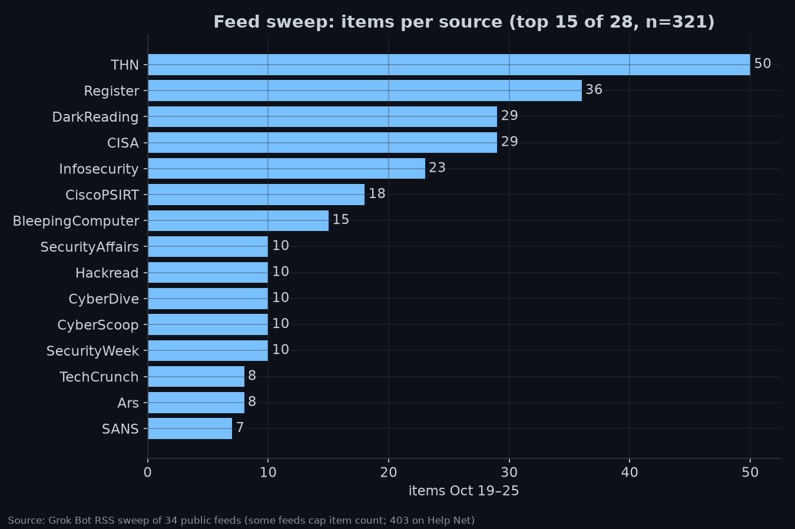

---

## 6. What the community said on X

From the 671 accounts @WolfenLabs follows, 508 were classed security-relevant by keyword. We read 315 of them directly with `from:` queries, plus the home timeline and four topic searches. Every quote below is a **claim by the poster**. ✅ means a primary source in this report corroborates the substance; ⚠️ means it is unverified. Like counts (`likes_at_fetch`) were **retrieved on 2026-10-25**. `created_at` is the poster's publication time. The newest cited post was published at `2026-10-25T01:09:29Z`, so this retrieval was not earlier than that. The exact retrieval clock was not retained, and these counts are not current.

**PHP2Shell**
- ✅ [@ImposeCost (GreyNoise), Oct 22](https://x.com/ImposeCost/status/2113406222816657561): "An actor is attempting to exploit PHP2SHELL vulnerabilities in order to install patches. Interesting." Follow-up: ["The operative word is 'attempt.' There's a lot of observed attempts."](https://x.com/ImposeCost/status/2113285978219843952) This matches CISA's "no successful exploitation observed."
- ⚠️ [@kmkz_security](https://x.com/kmkz_security/status/2113146904666157104): "#php2shell the new #log4shell? A lot of Noise, a lot of POC but no working payloads outside a dedicated lab…"
- ⚠️ [@Jhaddix, Oct 24](https://x.com/Jhaddix/status/2114139896940286194): "We've seen plenty of people try to vibe code the php exploit who have no experience in the domain. Failure. Over and over."
- ⚠️ [@LiveOverflow, Oct 25](https://x.com/LiveOverflow/status/2114160386899583396): an agent exploit works "behind a reverse proxy… on CloudRun." See also his [CTF critique](https://x.com/LiveOverflow/status/2114135142323401189).
- ⚠️ [@Kostastsale](https://x.com/Kostastsale/status/2113378525441090029): Threat Hunting Labs built from "real exploitation activity."
- ⚠️ [@silascutler](https://x.com/silascutler/status/2113344501498466692): a Censys ARC PHP2Shell tracker. [@UK_Daniel_Card](https://x.com/UK_Daniel_Card/status/2113364063187263866): "patch counters seems to be ignoring backported versions of PHP."
- ⚠️ [@HunterMapping](https://x.com/HunterMapping/status/2113084773375824140): says the flaws "Leaked Online Ahead of Coordinated Disclosure" and counts "145M+ services." That count is a vendor claim. BleepingComputer separately reports the details leaked before disclosure.

**eMudhra**
- ✅ [@IntCyberDigest, Oct 22](https://x.com/IntCyberDigest/status/2113405247037268090) (4.5K likes): "eMudhra, the Indian certificate authority whose private key was the number 4, is quitting the TLS business."
- ✅ [@troyhunt](https://x.com/troyhunt/status/2113411949421822123): "without doubt, one of the dumbest security flaws we've ever seen in this industry."
- ✅ [@openbsd](https://x.com/openbsd/status/2113342493844541806): "Errata patches released to address the eMudhra certificate compromise."
- ✅ [@itsnebulalol](https://x.com/itsnebulalol/status/2112628540726260059) (not followed, 3.6K likes): "made one of their private keys 0x4… And another 0x73." Consistent with Talos.

**ConnectWise / Storm-0940**
- ✅ [@wiz_io](https://x.com/wiz_io/status/2113284193975255255): "Wiz Research is tracking Storm-0940… how the AI agent attacks Okta, Entra, and Cognito."
- ✅ [@TheRecord_Media](https://x.com/TheRecord_Media/status/2113311844601614777) on Microsoft's attribution.
- ⚠️ [@The_Cyber_News](https://x.com/The_Cyber_News/status/2113202163338076274): "Target 2,250 Microsoft 365 Tenants." Note Microsoft says *attempted sign-in*.

**LiteLLM, AI and identity**
- ✅ [@TheHackersNews](https://x.com/TheHackersNews/status/2112967698103894257): "LiteLLM 1.107.0 compromised in a supply chain attack… The malware runs at Python startup."
- ⚠️ [@PyroTek3 (Sean Metcalf)](https://x.com/PyroTek3/status/2113291123103875123): "Starting on November 4th, Entra ID users will be able to create agent identity blueprints unless this capability is disabled." This is a useful watchlist item; verify it with Microsoft docs.
- ⚠️ [@SEKTOR7net](https://x.com/SEKTOR7net/status/2113233152873259076): "Run an LLM in a 'while' loop against Cortex XDR… it extracts decrypted YARA rules, thousands of behavioral detections…" This summarizes research by Adam Chester.
- ⚠️ [@_dirkjan](https://x.com/_dirkjan/status/2113345594676691065): "Very cool technique to bypass SMB signing, appears to be patched on recent Windows versions."

**Other claims to watch**
- ⚠️ [@Daily_CyberSec](https://x.com/Daily_CyberSec/status/2113290643590000825) on Arista VCO exploitation (✅ by KEV).
- ⚠️ [@DailyDarkWeb](https://x.com/DailyDarkWeb/status/2113406674224750645): Everest's *alleged* 590 GB PwC leak countdown. This is a leak-site claim only.
- ⚠️ [@DailyDarkWeb](https://x.com/DailyDarkWeb/status/2114162397829083253): Keystone wallet confirms shipping-data exposure.
- Week mood: [@0xdabbad00](https://x.com/0xdabbad00/status/2113312615804072436): "no one is allowed to disclose vulns or breaches after Friday morning, until Monday. Them's the rules." [@lopp](https://x.com/lopp/status/2113352858456211950) also posted a week recap.

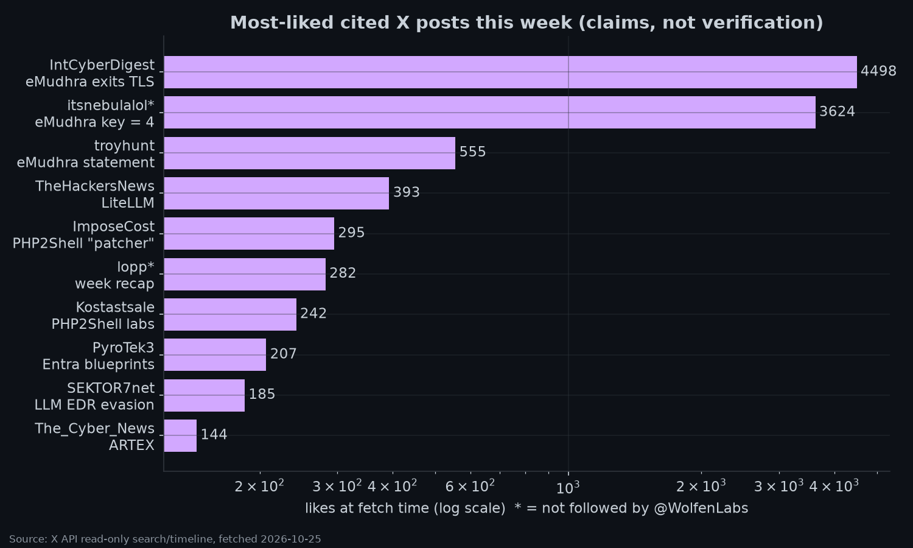

---

## 7. Watchlist for next week (W44)

- [ ] **Oct 26: KEV due date** for Arista VCO CVE-2026-114625 and Collabora CVE-2026-110447.
- [ ] **Nov 3: KEV due date** for Plex CVE-2026-96652/96655 and Siemens CVE-2026-110936.
- [ ] **PHP2Shell:**
  - First *confirmed* successful exploitation, which would flip the label to CONFIRMED.
  - Possible KEV addition.
  - The next regular PHP release that fixes CVE-2026-115560.
  - Appliance and vendor impact advisories (QNAP was reported unpatched on X; unverified).
- [ ] **eMudhra fallout:** remaining trust-store updates in runtimes and appliances, and any CT evidence of misissuance.
- [ ] **ConnectWise:** restoration guidance, any additional downstream victim disclosures, and Wiz and Huntress follow-ups.
- [ ] **LiteLLM / PyPI:** further victims, any second-stage payload, and PyPI policy responses.
- [ ] **Nov 4:** the Entra "agent identity blueprints" default, a claim to verify.
- [ ] **GitLab / Onigmo:** watch for public PoCs and exploitation, since CVSS 10 and pre-auth make this likely to attract exploit work.
- [ ] **PAN-OS CVE-2026-0257** and **FortiWeb CVE-2025-64446 (k0t):** continued ransomware use of edge devices.

---

## 8. Notes for the Intelligence Hub (carried from SW-GROK-001)

- `feed.json` (schema 3, 3,620 articles, generated 2026-10-25T00:50:51Z) shows the `cisa-advisories` source as **failed**.
  - *Inference:* `collect.py` caps downloads at `MAX_BYTES = 3 MB` and the CISA feed is about 5.7 MB, so the cap is the likely cause. This is unconfirmed.
- Hub articles show exploitation as "unknown" even when the CVE is in KEV. Joining `data.json` → `kev_additions` (or the KEV JSON) would fix this.
- `publish.yml` declares a cron of `2,12,22,32,42,52 * * * *`. We have **not verified** that the workflow actually runs on that schedule.

---

## 9. Limitations

- **Sources:**
  - Public web only, no logins. Arista advisory 0199 returned HTTP 406 to our fetcher and Help Net Security returned 403; Arista details come from the CVE record and reviewer confirmation of the advisory.
  - Some items (breaches, APT28, Phantom, Tor) rely on reputable secondary reporting and are labeled as such.
- **Exploitation labels** are the public status **retrieved on 2026-10-25**. That calendar day is also the compilation date, and the two are stored separately. Labels can change quickly, PHP2Shell especially. The retrieval clock was not retained.
- **CVSS:** scores are CNA scores from cvelistV5. v3.1 and v4.0 are not directly comparable. CVE-2026-115560 had no published record at fetch time.
- **X coverage:**
  - The search API returned at most 25 posts per relevancy query, clustered on Oct 22. The home timeline covered only about 3 hours.
  - Coverage of Oct 19–21 and Oct 24–25 is thinner. Like counts are the 2026-10-25 retrieval, and engagement is not accuracy.
- **Feed sweep:** 34 RSS feeds. Some feeds only expose the most recent N items, so early-week counts may be undercounted. Sunday Oct 25 is partial (compiled early UTC).
- **ATT&CK:** IDs marked [map] are analyst mappings, not source statements.
- Nothing in this report means any specific system of the reader's is affected. It is a general threat summary.

## 10. Sources (primary first)

**Government / CERT:**
- [CISA KEV JSON](https://www.cisa.gov/sites/default/files/feeds/known_exploited_vulnerabilities.json)
- CISA KEV alerts: [Oct 20](https://www.cisa.gov/news-events/alerts/2026/10/20/cisa-adds-six-known-exploited-vulnerabilities-catalog), [Oct 23a](https://www.cisa.gov/news-events/alerts/2026/10/23/cisa-adds-one-known-exploited-vulnerability-catalog), [Oct 23b](https://www.cisa.gov/news-events/alerts/2026/10/23/cisa-adds-one-known-exploited-vulnerability-catalog-0)
- [CISA PHP alert](https://www.cisa.gov/news-events/alerts/2026/10/21/critical-vulnerabilities-php-require-immediate-patching)
- [CISA AA26-293A SafePay](https://www.cisa.gov/news-events/cybersecurity-advisories/aa26-293a)
- [CISA AI token guidance](https://www.cisa.gov/resources-tools/resources/managing-ai-token-consumption-operational-resilience)
- [CERT/CC VU#763488](https://kb.cert.org/vuls/id/763488)

**Vendor / project:**
- PHP: [php.net archive](https://www.php.net/archive/2026.php), [Oct 23 notice](https://www.php.net/archive/2026.php#2026-10-23-1), [GHSA-w8hw-w9fx-j79w](https://github.com/php/php-src/security/advisories/GHSA-w8hw-w9fx-j79w), [GHSA-6wmf-4rv5-p3rp](https://github.com/php/php-src/security/advisories/GHSA-6wmf-4rv5-p3rp)
- [Arista SA 0199](https://www.arista.com/en/support/advisories-notices/security-advisory/24838-security-advisory-0199)
- [Collabora GHSA-g3vx-3m76-fghh](https://github.com/CollaboraOnline/online/security/advisories/GHSA-g3vx-3m76-fghh)
- [LiteLLM post-mortem](https://docs.litellm.ai/blog/security-incident-oct-21-2026-attack-chain)
- Microsoft: [Storm-0940/ARTEX](https://www.microsoft.com/en-us/security/blog/2026/10/21/storm-0940-uses-artex-agentic-ai-connectwise-supply-chain-compromise/), [LiteLLM analysis](https://www.microsoft.com/en-us/security/blog/2026/10/23/inside-the-litellm-1-107-0-supply-chain-compromise-credential-theft-through-python-startup-hooks/)
- Palo Alto Networks: [Unit 42 PAN-OS](https://unit42.paloaltonetworks.com/active-exploitation-of-pan-os-cve-2026-0257/), [Unit 42 eMudhra](https://unit42.paloaltonetworks.com/emudhra-certificate-compromise/), [PAN PHP advisory](https://security.paloaltonetworks.com/CVE-2026-109618)
- Cisco: [Talos eMudhra](https://blog.talosintelligence.com/compromised-intermediate-certificates/), [Cisco PHP advisory](https://sec.cloudapps.cisco.com/security/center/content/CiscoSecurityAdvisory/cisco-sa-php-october26-Jj384Daq), [Cisco eMudhra informational](https://sec.cloudapps.cisco.com/security/center/content/CiscoSecurityAdvisory/cisco-sa-emudhra-info-ScS22A1r)
- [CVE records (cvelistV5)](https://github.com/CVEProject/cvelistV5)

**Research:**
- [Group-IB Stray Cat](https://www.group-ib.com/blog/stray-cat-network-edge/)
- [ESET MythicRatatoskr](https://www.welivesecurity.com/en/eset-research/mythicratatoskr-yggdrasil-enabled-backdoor-deployed-uac0099-sandworm-collaboration/)
- Securelist: [BlackX](https://securelist.com/uefi-bootkit-blackx/121539/), [FlashHole](https://securelist.com/lazarus-operation-flashhole/121541/)
- [SANS ISC 33452](https://isc.sans.edu/diary/33452)

**Secondary:** BleepingComputer, The Hacker News, SecurityWeek, The Register, Ars Technica, Dark Reading, Infosecurity, CyberScoop, TechCrunch, SecurityAffairs, Risky Biz (links inline).

---
*Machine-readable companion: [`data.json`](data.json), including `retrievals`. Charts are in [`charts/`](charts/). Compiled on an isolated box from public sources. X was accessed read-only. Compilation date, retrieval dates, publication dates and catalog-addition dates are separate fields.*
